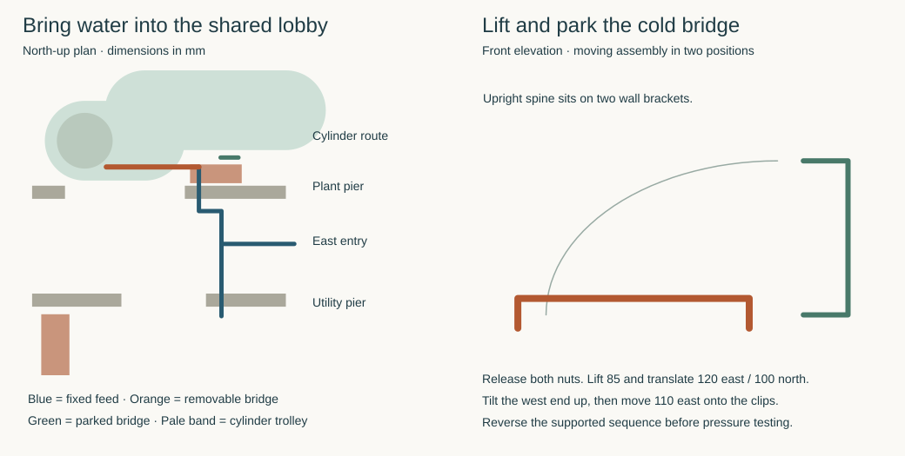

# A shared lobby inlet with a removable cylinder connection

**Develop the lobby tee and lift-off cold bridge for the east-water house.** This replaces the fixed pipe through plant-N rejected in the [damaged-tube study](services-water-joints.md#damaged-tube-at-the-east-plant-station). A wet connection in the lobby serves utility and plant on opposite sides. The radiator can stay in place. Removing one supported bridge clears the cylinder trolley. Coordinates are millimetres from the HAD ground-floor datum. The route is a MAT proposal for HAD, STR and site coordination. [House geometry](../had/studies/water-replan.json) · [reproducible clearance and movement checks](studies/plant-inlet-route.py)

## Enter between the two rooms

Move the outside service point from Y1000/Z500 to **Y3150/Z1000** on the east face. The site alignment moves 2150 north and the inlet rises another 500. The boundary study uses a separately buried 12 m comparison with crown 900 below **its own** grade. There is no surveyed house-end grade or installed trench. If the house-side grade were −1800 as in the HAD section comparison, that soil-covered crown would be at −2700 and its rise to the new port would be 3700. The old port already needed 3200 on that basis. A straight riser at the weather face X12090/Y3150 would enter the P17 cap footprint by 27.5 mm at Z−750 to −180. Its centre is (11667.5,3400) and it measures 900 × 600. A trial Ø200 protected duct centred at X12250/Y3150 clears that cap by 32.5 mm horizontally before turning 160 mm inward at high level. Confirm excavation clearance, other ties, ground and frost protection at the real site. A frost-protected house-end riser or genuinely warm entry enclosure, a duct bend that admits renewal, a soil-covered approach clear of the foundations, and supplier-accepted meter/backflow/isolation are conditions of using this entry. An exposed vertical pipe or open air trench fails that duty. If a protected rise cannot be provided, develop an independently formed low entry and a warm-side riser before adopting the house port. [P17 cap and grid](../str/studies/current-house-grid.json) · [current head](../str/studies/current-house-joined-foundation.json) · [boundary route and frost study](../had/boundary-service-lodge-options-result.md) · [HAD section and ground assumptions](../had/had-03-undercroft-section-screen.md)

Take the fixed Ø74 complete pipe reservation to the lobby tee at (11315,3150,1000). Provide independent upstream service isolation and a contained drain in an accessible, supported wet station. Continue the plant leg north to Y3500, west to X11075, then north to Y3970. The other tee leg ends just inside the utility at (11315,2380,1000). It clears the sink-head carry and fan platform. Distribution from this manifold to the backed washer outlet at (10800,1250,750) and the actual sink taps still needs an accessible run that preserves the integral head's extraction. The 250 mm rear chase is a potential destination for that branch. The chamber, appliance branch and pressure-control group are additional to the centreline model. [Utility disconnection and carry](../ias/ias-03-utility-host-revised-route.md) · [integral head](../ias/ias-03-utility-factory-head.md)

| Location | Proposed penetration and support |
|---|---|
| Outer east wall at Y3150/Z1000 | A Ø100 formed passage leaves 800 mm to the utility window and 700 mm to the plant door in plan. Detail the weather, drained cavity, thermal/air control, sleeve and protected entry. The structural masonry, insulation and weather leaf have separate support duties. |
| Utility-north at X11315/Y2550/Z1000 | Ø100 leaves 115 mm between bore edge and raw east jamb. Place split support clips on the utility and lobby sides at Y2400 and 2700, outside the sleeve. |
| Plant-intermediate at X11075/Y3700/Z1000 | Ø100 leaves 100 mm to the arch's raw east jamb. Locate clips at Y3550 and 3850 and support the upturned terminal at Y3970. Both internal walls have a 140 mm core and 27 mm finish each side. The 13 mm radial budget between Ø74 and Ø100 must fit sleeve wall, movement and seal together. |
| Lobby and plant supports | Keep the tee on an east-wall bracket, the Y3500 offset on the south face of the plant wall, and the plant terminal on independently anchored brackets from its north face. East entry to tee is 775 mm from X12090. Hold the tee, bends and terminal against operating forces. No load goes into a radiator, heat pipe or a sleeve. |

HAD must adopt the coordinated openings. STR must qualify pier ligament, arch thrust path, reinforcement, anchorage and the outer bearing zone before holes or brackets are specified. The plant radiator rises to Z750 in its native unhang. Its highest edge is 213 mm below the proposed jacket underneath. The proof reserves an 84 mm radius for each complete radiator heating-pair drop. Actual spacing and insulation must fit. The fixed lines and empty rack clear both trolley routes, the plant operator passage and the separate radiator service bodies. [Plant cart and operator reservations](studies/east-water-plant.json) · [emitter branches](studies/whole-house-service-baseline.json)

## Release and reinstate the cold connection

Equip the plant tail and the cylinder tail with **two upward-facing Endex N11 88401 cone unions**. The removable bridge takes both captive nuts. The maker specifies 22 mm capillary ends, brass, PN16, a 60 mm assembled union and 38 mm nut flats. Its UK union instructions qualify when PTFE or approved compound is required. Confirm the actual potable duty, joint preparation and constituents. Select the matched inlet group and preserve the cylinder's required expansion, relief, tundish and drain paths. The cold union must leave the safety relief path connected whenever the vessel is charged. [Endex 88401](https://aalberts-ips.co.uk/products/item/88401/) · [Endex catalogue, pp.13 and 56](https://aalberts-ips.co.uk/wp-content/uploads/2023/12/Endex-09969088_56035915_Brochure_2023.pdf) · [Vaillant non-plumbed cylinder installation, §§4–5](https://professional.vaillant.co.uk/downloads/aproducts/cylinders-1/unistor/standard-unistor-cylinder-0020221300-00-1044908.pdf)

The faces sit on parallel vertical axes at X10090 and X11075, both at Y3970. Each complete made union must lie within Z1040–1100. The bridge crown is at Z1230. Turn the compatible cylinder cold tail toward the southeast socket and support it on the service cradle. All retained projections must fit a 37 mm radius around that tail from the native outlet, and the actual dry transport envelope must fit the Ø850 trolley. The terminal extremity is 399.4 mm from the cylinder centre at most on the proposed envelope. The actual threaded cold port, adaptor, complete safety group, cradle anchors and other cylinder connections need a common arrangement. A native ¾-inch connection alone does not prove this placement.

1. Safely shut down, independently isolate and drain the intervention. Fit the bridge handling support. Counter-hold both fixed halves, back each nut fully onto the bridge and release the bridge clips. For a BGS 34238 open-ended wrench, the model encloses its 297 mm length and 71.5 mm head in a 60° working sector at each nut. Bind the second wrench and its reaction flats, 12.8 mm head thickness, access for resetting, flange/compound adhesion and actual forces on the supplied kit. [BGS wrench](https://www.bgstechnic.com/en/Products/Hand-Tools/Spanners/Open-End-Spanners/Single-Sizes/Single-Open-End-Spanner-DIN-894-38-mm.html)
2. **Lift both halves 85 mm together.** Even if the retained parts fill the top of the entire 60 mm made envelope and the moving parts start at its bottom, 25 mm separates them. The layout reserves 60 mm of nut backoff before the lift. Confirm the shoulder, effective thread, actual captive nut and solder tails allow full release within that space. Neither 60 nor 85 mm is a catalogue stroke.
3. Translate the supported bridge **120 east and 100 north in one diagonal movement**. Its minimum computed clearances are 27.8 mm to the static cylinder and 28.8 mm to the plant heating pair. Tilt the west end up through 90° about the raised east end. The required upper swept bound is Z2165.2. Move the upright assembly another 110 east into two west-open, positively retained brackets at (11495,4070), nominal Z1450 and 1900, cantilevered from the solid plant wall at Y3797. Qualify the handling aid, grips, bracket depth, fasteners and empty swing volume. Parked projection leaves **43 mm** outside each trolley sweep. The other cylinder connections must also release before transport.
4. After equipment return, support and remove the bridge from the rack, reverse the tilt and diagonal travel, then lower both aligned faces together. Inspect and remake the qualified joints without forcing pipe alignment. Restore independent supports, fill, test both joints, inspect for visible leakage and recommission. The empty brackets retain over 32 mm outside the radiator operator reservation. Never use the temporary parking state for simultaneous radiator work.

This resolves the first cold-line movement and an in-room stow position for a declared fitting envelope. Product geometry, rated supports, the site entry and the complete pressure-system installation remain admission conditions. MAT-SERVICES remains planned.
