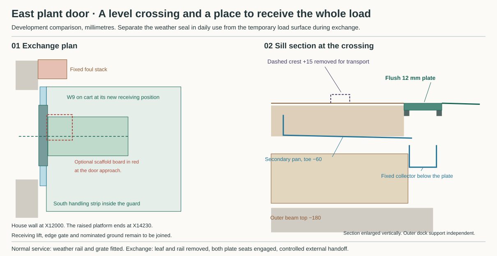

# Receive the complete plant load beyond the east threshold

**Develop a removable weather rail, a separately supported flush crossing plate and a guarded exchange dock. Reject an exchange that ends with the cart centre at X12500 or relies on the ordinary grate to carry the cart.** At the old endpoint the W9 carrier still projects 125 mm into the house. At the new one its trailing edge is 25 mm beyond the collector and its leading edge is 825 mm short of the dock end. An external lift or matched receiving platform still has to meet that end. [HAD opening and apparatus routes](../had/studies/water-replan.json) · [Plant room and crew controls](studies/plant-room-rewind.json) · [Computed comparison](studies/plant-threshold.json)

## Pass the actual door and put down the load

The east opening at X12000 is 1400 mm wide in the masonry, Y3900–5300, with spring at 2550 and head at 2850. Retain a finished rectangular opening of 1000 × 2300, Y4100–5100. Independently support and remove the single leaf before exchange. Include the hinge projections, jamb hardware, leaf parking, restraint and head in the clear-opening test. The existing 742.5 mm internal door is 107.5 mm narrower than the 850 mm cylinder handling envelope. The wider front landing cannot cure that upstream bottleneck. [Plant reference door](../had/studies/water-replan.json) · [Front entrance](front-threshold.md)

| Apparatus at the east door | South / north jamb clearance | Trailing edge at old endpoint | Centre X with trailing edge 25 mm beyond collector |
|---|---:|---:|---:|
| 850 mm cylinder handling envelope at Y4575 | 50 / 100 mm | 12075, over the channel | 12580, another 80 mm |
| Same envelope on the separate revised Y4600 route | 75 / 75 mm | 12075 | 12580, another 80 mm |
| W9 and 1250 × 609 mm carrier at Y4575 | 170.5 / 220.5 mm | 11875, inside the wall | 12780, another 280 mm |

The cylinder comparator is 595 × 1745 mm. The 555 mm above its body must accommodate the trolley, fittings, restraint and operating clearance. The coarse W9-on-cart height bound of 2011 leaves 289 mm. Keep both alternatives conditional. The cylinder comparison does not select a vessel. The W9 indoor 600 mm crew sweep still fails at the 700 mm plant station, even though the carrier fits the exterior crossing. [Cylinder selection and limits](domestic-hot-water-cylinder.md) · [W9 lifting and cart evidence](studies/w9-forkable-receiver.json) · [Crew sweep and revised wall option](studies/plant-room-rewind.json)

## Separate everyday closure from wheel bearing

Carry the daily sill on continuous supported seats with a replaceable exposed rail reaching +15. Run the accessible wet-side pan beneath it to a toe at −60 and return its dry edge to −20. Keep a separate protected, inspectable air joint on the warm side and independently return both masonry DPC ends at the jambs. A drained pan cannot break an upward capillary path through a bearing. Select the exact rail, metal pan, hard mineral/metal support, thermal interruption, fasteners, solder or weld, bedding, residues and replaceable weather/air seals together. Qualify their local thermal and movement behaviour, pressure and rain performance and repair. No residue exception follows from this choice. [Ground opening and DPC duties](ground-field-assembly.md) · [Owner material policy](../../docs/reference-house/material-policy.md)

Set a 100 mm clear collector at X12030–12130 with a walking grate. Its proposed lowest external skin at −115 clears the actual 900 mm outer-E beam top at −180 by 65 mm. The inner 20 mm ledge ends at X12030, 87.5 mm inside the beam's outer edge at 12117.5. The outer ledge starts 12.5 mm beyond that edge and needs independent dock support. Both ledges must continuously back the plate across its width. Keep the inner shelf load path clear of brittle insulation, the wet pan and the dry air joint. The relative movement of the supports, locks and plate remains a design load. [Current structural grid](../str/studies/current-house-grid.json) · [Section coordinates](studies/plant-threshold.json)

For a dry, isolated exchange remove the rail and walking grate and install a retained, unperforated 950 × 140 × 12 mm stainless plate at finished level 0. Its 20 mm end bearings give a 120 mm centre span. At Y4112.5–5062.5 the worst equipment-to-plate edge margin is 37.5 mm on either cylinder alignment, or 27.5 mm after two adverse 5 mm errors. The closest plate end is 12.5 mm from a jamb, only 2.5 mm on the same adverse stack. Retainers, hinge remnants and placing tools must stay out of that clearance. The plate itself weighs about 12.8 kg before fittings. Stage it before opening the wet edge and provide a supported lift for removable parts. [Crossing measurements](studies/plant-threshold.json)

The Fetra 25011401 has 200 × 40 mm wheels. On an ideal square 15 mm step, a rigid wheel needs a horizontal axle force of 0.620 times its vertical reaction to climb. Actual sill profiles and wheel deformation change that result, and the normal grate has no verified wheel rating. For the flush plate, put 1.5 times the *entire* 234.05 kg W9, coarse receiver and cart weight on one wheel, giving 3.443 kN. A simply supported 12 mm strip spanning 120 mm gives 172.15 MPa at 25 mm effective width or 107.59 MPa at 40 mm. Against the trial 200/1.1 MPa limit it needs at least 23.67 mm of effective width. Wheel tread width alone cannot supply that proof. Resolve contact, local bending, bearing, fatigue, grade, support/anchor capacity, rolling gaps, traction, lift controls and the heavier actual loaded apparatus before assigning a rating. [Fetra sheet and scope](studies/w9-forkable-receiver-sources.json) · [Calculation](studies/plant-threshold.py)

## Protect the edge and hand off to the site

Set the trial dock at X12130–14230, Y3400–5350. A symmetric northern edge at Y5500 would overlap the fixed foul-stack territory by 25 mm. The revised edge clears it by 125, or 50 after a 75 mm end-work projection. The separate Ø200 protected water-entry duct at X12250, Y3150 ends at Y3250, 150 mm before the south edge. Keep piles, feet, outlet and guard bases outside its excavation and renewal space. The replacement scaffold board at X12135–12535, Y4515–4915 lies in the exchange route in plan. Sequence scaffold removal/alternative protection or relocate its standard and support before claiming the dock and scaffold can share this bay. Check actual vertical levels, attachments and access. [Foul-stack territory](../had/studies/water-replan.json) · [Inlet and P17 cap](plant-inlet-route.md) · [Scaffold on the current elevation](../rwt/studies/over-roof-site-envelope.json)

Reserve a 50 mm inner edge strip for guard/heel protection. Alongside the original cylinder the south side retains 700 mm, leaving 50 beyond a 600 mm standing zone and two 25 mm clearances. That is a single lateral station. Before the door opens, provide a guarded independent receiving lift or load-rated vehicle platform, a restrained gate arrangement and a verified operator path. Restrain the carrier on the 1:80 fall. Anchor restraint to the dry supporting structure outside the wet pan. Prove each move through handover, inward return and occupied restoration without an unprotected edge or person trapped behind the load. Keep the outer 20 mm crossing ledge level. The 2080 mm of deck beyond it falls to −26, leaving 1774 mm to trial grade −1800. A separate 1:20 ramp would require 35.48 m of running length before landings. With neither a real external receiver nor a proved route to grade the east exchange stops here. [HAD exterior grade](../had/studies/water-replan.json) · [Calculated dock clearances](studies/plant-threshold.json)

## Keep two water routes open in normal use

Fall the deck away from the threshold. Fall the collector invert from −95 at mid-length to −105 at each end. Give it a south primary end box and a separate northern gravity spout with 100 mm clear width and crest at −95. Their inspection/lifting zones belong inside the permanent guard or behind a separately protected access enclosure. Discharge both visibly to independent lower receivers, clear of doors, foundations, inlet duct, the foul stack and people. Require the north relief to remain free when the primary is blocked or a deck-edge discharge ices. The normal grate, removable plate and its restraints must neither bridge the dry joint nor obstruct those end outlets. [Front wet-test basis](front-threshold.md) · [Blockage comparison](studies/plant-threshold.json)

Charging the 4.095 m² deck to the collector at 216 mm/h gives 0.2457 L/s. Add the full 3.99 m² bounding door face, as at the front entrance, and the blocked-primary challenge becomes 0.4851 L/s. An ideal 100 mm wide critical-flow control then needs 20.08 mm specific head. With a further 5 mm adverse allowance, a crest at −85 gives −59.92, just above the −60 pan toe. Lowering the crest to −95 gives −69.92, a 9.92 mm margin. Real edges, tailwater, debris or a narrowed spout can consume this margin. With both paths blocked the pan's −20 dry return is vulnerable before water reaches the +15 surface rail. Close the opening independently during exchange, protect the exposed dry joint and control runoff throughout. After reassembly test the pan returns, jambs and air closure, block each outlet separately, record first wetting and restore both free paths. Test the installed door under driven rain. A real site, positive load support, weather/air joints, verified seals and a proved exchange crew remain conditions of adoption. [Level model and falsifiers](studies/plant-threshold.json)
