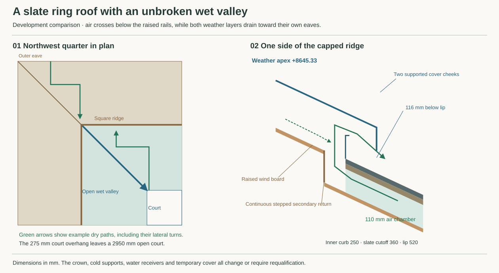

# Recompose the 25° ring roof around an open valley

**Develop Penrhyn Capital double-lap slate above a supported wind-and-water board and a ventilated cavity open in two directions. Reject substitution into the existing crown.** The proposed ordinary wall-line weather surface is **+7418.42 mm** and the capped crown is **+8645.33 mm**, 180.59 mm above the structural/MAT crown comparison at +8464.73. The new geometry keeps the four wet valleys intact. It requires changed eaves, post heads, flashings, receivers and maintenance provision. The specified lead inventory, the board's junction system and the destination of contaminated runoff prevent selection for construction. This is a source-level redesign for HAD, ROF, STR and RWT. [Existing roof section](ordinary-eave-joined.md) · [Structural redesign boundary](../str/whole-house-corner-rewind.md) · [Welded roof network](../str/studies/current-house-welded-network.json) · [Primary records](studies/ring-roof-family-sources.json) · [Reproducible geometry, quantities and failures](studies/ring-roof-family.json)

## Which complete weather assembly can follow the roof?

| Family | Consequence for this house |
|---|---|
| Natural, unbacked zinc on 24 mm open boards, 50 mm ventilation and a cold-side breather | Retain the genuine VMZINC reference. Standard PP layers and polymer-adhesive details fail the default material policy. Replacing the earlier 1 mm membrane reserve with 18 mm Hunton Sarket increases normal depth by 17 mm. Holding the old top gives **7 mm physical interference** at a corner that required 10 mm clearance. The board's approval covers sufficiently weathertight discontinuous roofing on suitable support. It provides no matched VMZINC approval for this substitution. Ordinary parallel channels also strand the hip and valley strips. [Zinc layer duties](envelope-cold-metal-roof.md) · [Hunton use and installation conditions](https://www.sintefcertification.no/Product/Download/308) |
| A complete unvented standing-seam assembly | FOAMGLAS UK System 4.6.5 provides a real alternative topology with bitumen-bonded glass, filled joints, embedded clip plates and a separated metal skin. Its instructions require a full-area torch-applied **polyester-reinforced** waterproofing sheet. Exclude the unmodified package under the default policy. Bare glass does not permit omitting its waterproofing or changing the fixing system. [System 4.6.5, both pages](https://www.foamglas.com/-/media/project/foamglas/public/shared/files/tds/tds-4605/tds-4-6-5-uk.pdf) |
| Natural slate on Chestershield 1F | A UK slate/tiling underfelt with bitumen-impregnated fibre, a jute backing and sanded faces. Its 22.5 kg nominal roll covers 15 m² before laps. Keep the base, impregnation and accessory declarations open. Under this high-resistance layer the drying path moves below the felt. NHBC's warm/hybrid HR comparison calls for a warm AVCL, 25,000 mm²/m low, 5,000 mm²/m high and a 25 mm clear path below drape. A 36 mm one-way rail with 10 mm drape clears 26 mm locally. With the stated 3 mm felt/lap reservation and thick-slate case it already interferes by 0.58 mm at the old crown, leaves disconnected corners and supplies no separate wind closure across the bare glass joints. The two-way version rises 93.32 mm before adding that closure. [Chestershield data](https://www.chesterfelt.co.uk/wp-content/uploads/2022/08/Chesterfelt-Chestershield-Underslating-Felt-TDS.pdf) · [NHBC 7.2, Table 12, design comparison](https://nhbc-standards.co.uk/downloads/2025/NHBC-Standards-2025-Chapter-7-2.pdf) |
| Natural slate on 18 mm Hunton Sarket | Develop this functional section. Keep the combined underlay/wind board directly above the insulating zone and ventilate above it. TG2190 gives a maximum 600 mm support spacing for 18 mm, edge fixing at up to 100 mm and intermediate fixing at up to 250 mm. The board needs a strong separate watertight membrane over the valley support and a windtight ridge connection. Its EPD allocates 0.88 kg bitumen and **0.15 kg unidentified constituents per m²** to the 18 mm product. That gives about 141 kg and 24 kg over the field before laps and waste. Identify the constituents, actual under-valley membrane, tapes, penetration seals, repair glue and assembly acceptance. The certificate concerns its timber construction. Our steel/bare-glass substructure and stepped cap are bespoke. [UK product](https://huntonfiber.co.uk/products/roof/hunton-sarket/) · [TG2190, figures 3–5 and fixing schedule](https://www.sintefcertification.no/Product/Download/308) · [EPD NEPD-4038-3072-EN, Table 1](https://cdn.byggtjeneste.no/nobb/f5ba03de-3db3-4b0d-841e-7cb37a88f46b) |

Use the maker's **500 × 300 mm, 5.5 mm nominal Penrhyn Capital**, about 2.23 kg per slate. At a measured 25° rafter pitch the published moderate/severe headlaps are 95/120 mm, giving 202.5/190 mm gauges and about 36.11/38.48 kg/m². Covering the entire sloping outline at the severe table rate gives 6.16 t, including areas where the slate stops. Counting the twelve cut courses on each face and the separate under-eaves course gives **5.22 t of nominal installed slate** before local detailing and waste. Check the exposure map, starred fixing/thickness qualifications, wind suction, elevation and final slate sorts. If thicker stock is required, the load consequence below governs. The previously studied shallow outward-only 8° roof cannot inherit this slate table. Retaining 25° across its longer 4250 mm wall-line run would raise the courtyard rim by 1982 mm above its exterior eave and require a different frame and daylight case. [Welsh Slate weights](https://www.welshslate.com/roofing/architects-and-specifiers/slate-sizes-and-weights/) · [Headlaps and applicability](https://www.welshslate.com/roofing/architects-and-specifiers/slate-headlap/) · [Outward-only topology](../rwt/rwt-06-outward-roof-rewind.md)

## Feed the dry gallery without piercing the wet valley

The 12400 mm outside eave and 7750 mm square ridge stay in plan. Extend only the courtyard overhang from **200 to 275 mm**. Its 50 mm slate nose and two 25 mm mounting margins previously left only 100 mm for a down-facing soffit inlet. They now leave 175 mm for a 160 mm grille. The clear sky opening falls from 3100 to 2950 mm. The existing outer overhang can take the narrower 80 mm grille. Preserve the positive edge, fire stops, bird protection, snow and inspection duties. Each proposed grille remains open to the exterior after the actual fascia, gutter and supports are fitted. [Earlier ring ventilation](ordinary-eave-joined.md) · [Welsh Slate eaves and valley details, pp 20–22](https://www.welshslate.com/clientfiles/files/roofing2022/files/assets/common/downloads/Welsh%20Slate%20Roofing%20Brochure%202022.pdf?uni=53b9868f2533fd798fa914b46233eeeb)

Raise the existing 50 mm sloping steel rails on **60 mm discrete foot extensions**, with a timber nailer alongside each rail. The continuous members now lie in the upper part of the 110 mm cavity. Air passes sideways below them. Reserve a 1250 mm band of this lower passage where each corner turns into the main field. No transverse beam may close the band. Locate each foot, brace and fire subdivision in the coordinated layout. The new cutoff is 360 mm from the ridge. Each courtyard half-eave has 1475 mm of inlet and feeds an extra 2040 mm of valley-side field. Adopt **25 mm of equivalent area for each served strip** as a distribution stress. This is stronger than applying an inlet rule to physical eave length. TG2190's own 18–30°/short-roof counterbatten comparator is 36 mm. [Source-defined routes and blockage limits](studies/ring-roof-family.json) · [Board approval](https://www.sintefcertification.no/Product/Download/308)

| Area balance after blockage and setting allowances | Available | Assigned |
|---|---:|---:|
| One half court soffit, 50% net mesh and three 50 mm feet, 10 mm loss in gross opening | 99,375 mm² | 87,875 mm² |
| Last lateral crossing in the 1250 mm band, three 50 mm feet and 50 mm effective depth | 55,000 mm² | 51,000 mm² per court corner and face |
| Shorten the same band to 1000 mm | 45,000 mm² | 51,000 mm², fails |
| One outer curb outlet, after 100 mm closure at both ends and 15 cleats | 365,000 mm² | 310,000 field plus 38,750 upper cap |
| One inner curb outlet on the same basis, 13 cleats | 320,000 mm² | 175,750 field plus 38,750 upper cap |

The X1000 outer path turns under the rails toward X2075 before reaching its hip. The court path enters near X4600 and crosses to X3400 at q2933.3, 330 mm in plan from the valley centre. It then rises to the court curb. No aperture is cut through the valley pan. The old 30 mm grille, even at the real RHEINZINK mesh's 63% opening, supplies only 18.9 mm equivalent against a revised court transfer target of 59.58 mm. RHEINZINK's lower ridge design is for pitches **greater than** 25°. Its higher ridge is a comparison, not approval of another supplier's slate or lead. These are continuous geometric routes and nominal areas. A full pressure, condensation, snow, wet-screen and fire-stopping test is still needed. [RHEINZINK guide, figs 11.1–11.2](https://www.rheinzink.co.uk/fileadmin/redaktion/RHEINZINK_UK/Downloads/Technical-Documents/design-application-standing-seam-100396-012-en-gb.pdf)

Keep the raised wind board and warm AVCL continuous around the steel crown. The lower-board clearance and 320 mm of glass above the governing steel retain the earlier 165.28 mm local rise. The main field exhaust lies **outside** the curb at 250 mm. The redesigned high hood stands 236 mm above the field, covers the slates 176.5 mm along slope and turns down 120 mm at 520 mm. It leaves 110 mm horizontal throat, 116 mm above the upstand and 116 mm under the lip. The upstand overlaps the lip by 78.6 mm vertically. Give the cap's separate upper chamber protected 20 mm side openings above its raised board and connect the two sides over the crown. After their own allowances they pass the extra 38,750 mm² on each side. Return the secondary wet surface over supported skirts to the field wind board. Verify cap cleats, wind uplift, crossflow under either wind direction, upstand corners and wind-driven water; external access to a slot is essential. [Ridge section](studies/ring-roof-family.svg)

## Keep both water layers and their destinations visible

Four inner valley triangles and the straight eave strips conserve the existing **60.0625 m² roof-plus-open-court catchment**. After the 75 mm extension the roof contributes 51.36 m² and direct sky 8.7025 m². At 216 mm/h normal roof runoff rises from 3.02715 to **3.08160 L/s**. The complete inward-failure dose stays **3.60375 L/s**. One revised valley carries 0.3456 L/s from 5.76 m² on plan. Do not add those four flows again to the court failure event. [STR catchment accounting](../str/studies/current-house-welded-network.json) · [RWT roof and court event](../rwt/rwt-06-integrated-roof-court-recomposition.md)

The valley falls 18.25° along its 3574 mm length. Welsh Slate's ordinary close-mitred valley starts at 50°. Its open lead-valley table allows a 100 mm opening for the 25° face, less than 25 m² and up to 225 mm/h, subject to the stated rafter length, vertical-runoff and site constraints. Develop **200 mm clear** on a 600 mm developed Code 4 liner, with solid valley boards, turned edges, compatible sliding clips and no slating nail through the lead. The ideal critical-flow head is only 10.1 mm at the trial width. It supplies no allowance for ice, debris, outlet backwater, wind or capillary bypass. Three 1391 mm pieces and two proposed 300 mm end laps cover the run; two maximum 1500 mm pieces cannot. Verify lap drainage at the actual diagonal fall. TG2190 requires an **independent watertight sheet beneath the board ends**, lapped with the board field and separately discharged visibly at the foot. The primary lead trough cannot also count as that hidden layer. Qualify its actual material, end support, lap, eaves clearance and replaceability, then test primary blockage and secondary discharge with both receivers assembled. [Welsh Slate detail](https://www.welshslate.com/clientfiles/files/roofing2022/files/assets/common/downloads/Welsh%20Slate%20Roofing%20Brochure%202022.pdf?uni=53b9868f2533fd798fa914b46233eeeb) · [Calder lead working guide](https://www.calderlead.co.uk/uploads/documentsearch/id4/Calder-GTGLW-210213.pdf)

**Lead is a material and destination decision.** The proposed laps, paired ridge cheeks, crown roll, outer hips, four valleys and twelve saddle/terminal blanks expose about **1.706 t** of Code 4 lead to weather. The outer ridge cheek and hips discharge over slate to the exterior copper-goods comparator, outlets, leaders and site receivers. The inner cheek and lined valleys discharge to the courtyard collection. A failed inward collection sends that runoff to the court surface and the normal/fault N or E route. The east option includes the open chute, basin and separate overflow. The north option includes the garden-side basin and reserved continuation. Neither copper collection, a separated joint nor a remote free outfall establishes that lead-bearing water is acceptable for storage, irrigation, infiltration, a garden or another destination. Survey actual water use and the lawful receiving environment and establish runoff/deposition and compatible joints before choosing lead. RWT-METALS excludes copper runoff to zinc and incompatible bituminous contact/runoff to zinc. Its conditional copper chain grants no lead-to-copper or environmental admission. Track fixings, flashings, patination treatment, solder/flux, supports and construction residues. The owner's policy excludes unsuitable lead-containing water-contact components. [RWT-METALS directional cases](../../docs/research/roof-rainwater-material-compatibility.md) · [N/E terminal handoffs](../rwt/rwt-06-finite-exit-map.md) · [East receiver](../rwt/rwt-06-east-ground-outfall.md) · [Corner and cleanout exchange](../rwt/rwt-06-corner-and-cleanout.md) · [Owner material policy](../../docs/reference-house/material-policy.md)

Do not solve that issue by relabelling the liner copper. The Copper Development Association's slate detail recommends 20 oz/ft² copper and limits the illustrated intersections to a **valley** slope of at least 4.5:12. Here the diagonal is **3.957:12**. The shown detail would need equal faces at least 27.94° or a qualified shallower copper junction. At 28°, keeping the wall-line height adds another 139 mm to field height at q2125 before resizing the rest of the assembly. A lead-free junction and its wetted downstream chain remain a genuine design choice. [Copper in Architecture, §9.5](https://www.copper.org/publications/pub_list/pdf/A4050-Architectural-Handbook.pdf)

Do not lift both existing gutter and roof by the field rise. At the ordinary north outer eave the recalculated primary/secondary edges stand at +7325.16/+7142.30. Keeping the existing gutter leaves the board drip 53.75 mm above its back, but increases the primary free drop to the bottom from 276.74 to **386.61 mm**. Raising the gutter by 109.87 mm instead puts its back **56.12 mm above the secondary drip**. Recut the apron, protected independent secondary discharge and support, and challenge capture, splash and diversion under the site wind and blocked-gutter event. The new court drip line moves another 75 mm inward and has its own receiver duty. [Earlier ordinary eave and common-receiver failure](ordinary-eave-joined.md)

## What the steel budget and the repair route permit

The 18 mm board needs support independent of the brittle insulation. Trial 50 × 50 mm timber runners at the existing ordinary 540.83 mm spacing, flush within the top 50 mm of glass and carried on cold brackets at the existing post axes. New 50 mm timber nailers sit beside the upper steel rails. All slate, batten and frame loads return to supported steel; the board is independently fixed to its timber. Keep 270 mm continuous glass below each local runner, secure the lower AVCL return and collars, seal every actual board penetration, and keep valley and cap support out of the air gallery. The optimistic original planar-plus-post estimate 0.15534 W/m²K becomes **0.15661** after the simple timber substitution. This excludes steel shoulders, edge transfer, leakage and three-dimensional wet joints. Do not spend the small thermal margin twice. The 346 mm posts become 406 mm. With the same end and section assumptions their Euler capacity falls to **72.6%**. The ordinary 6.3 kPa plan card gives 1.87 kN per support before local specials. The 25 × 50 batten at 540.83 mm gives 8.96 MPa under distributed load, but 25.96 MPa under a single central 1 kN. Provide independent maintenance staging. [Original layer and post ledger](studies/loggia-roof-section.json) · [Welded space-frame reference](../str/studies/current-house-roof-route.json)

Replace the source roof's **1.5 kPa on slope** background with the scheduled materials. Retain the actual conserved steel, the old 30 kg/m² secondary lump, 320 mm glass, lower boards and metal AVCL. Charge the added runners, nailers, battens, extensions, board, lead pieces and extra 0.9075 m² of roof. The continuous wall-head ring remains separately accounted. The 432.45 kN whole-roof comparator is held fixed. Do not claim the archived frame reactions for the extended court cantilever, altered cap, or the concentrated hip/valley support loads. [Mass balance by grade](studies/ring-roof-family.json)

| Severe-exposure course layout | Regular-field slate kg/m² at maximum gauge | Mean background margin after fitted courses and specials | Original whole-roof gravity margin |
|---|---:|---:|---:|
| Capital, 5.5 mm | 38.48 | +9.50 kg/m² | +32.38 kN |
| County, 7 mm | 50.73 | **−0.87 kg/m²** | +16.09 kN |
| Celtic, 9 mm | 65.23 | **−13.15 kg/m²** | **−3.18 kN** |

The unslated crown accounts for 24.63 m² and the open valleys another 2.55 m², leaving 132.88 m² of regular field within 160.05 m² of roof. The 160 mm hood overlap beyond the slate cutoff remains in both material schedules. A simple coverage rate on the trimmed area would give County +0.15 kg/m² of mean background margin. Instead, divide the severe outer and court runs into twelve equal courses at 180.68 and 187.57 mm gauge. Their actual headlaps become 138.64 and 124.85 mm. Add under-eaves slates 344.32 and 337.43 mm long with aligned tails, clip the upper two courses at the cutoff and integrate every overlapping course across the changing hip/valley widths. Include 5 mm side gaps and the tighter batten spacing at the full-area conservative timber allowance. County now exceeds that mean budget slightly. Actual rake cuts must admit two nails and adequate slate width, including slate-and-a-half pieces where required. The roof-wide mean cannot rate a concentrated support. [Maker's course setting and eaves, pp 16 and 20](https://www.welshslate.com/clientfiles/files/roofing2022/files/assets/common/downloads/Welsh%20Slate%20Roofing%20Brochure%202022.pdf?uni=53b9868f2533fd798fa914b46233eeeb)

The cap cheeks and roll apply about **40.50 kg/m of ridge**, and the lined valleys about **14.30 kg/m** along their actual slope. Those correspond to 0.219 and 0.077 kN of unfactored lead over a 550 mm tributary length, excluding saddles and fixing reactions. Before local battens, boards or trimmers, the material change against the regular Capital field is about +9.93 kg/m at the ridge and +6.24 kg/m along the valley once the omitted slate is removed. Where lead extends beneath retained slates, the severe Capital field and a single lead ply give about 158.9 kg/m² before added local support, above the 152.9 kg/m² uniform background reference. Send the line, strip and saddle loads to their actual cold rails, purlins and corner frames.

The specials include eight 1100 mm pieces per ridge side per cheek with 150 mm laps, outer hip pieces of 1287 mm with 200 mm laps, four three-piece valleys, the roll and blanks. One cheek is about 16.25 kg and one valley piece 17.04 kg before its support. Allowances exclude the actual clips, collars, valley boards, the second membrane, extra gutter work and unscheduled metal. For Capital the remaining roof-average allowance is about 1.52 t on this course layout, subject to the concentrated actions above. The 320 mm glass stays over the crown only with its raised deck and separate supported returns; the shared structural rewind explicitly leaves its +8464.73 cap proposal unadopted and supplies no new signed register. This higher proposal cannot inherit its capacity or permission. Re-run signed wind, snow, lift-off, point loads, roof stability and visible elevations with STR. [Calder ridge and hip lap requirements](https://www.calderlead.co.uk/uploads/documentsearch/id4/Calder-GTGLW-210213.pdf)

**First opening and restoration.** Install independently supported external access, weather cover, protected court runoff and a load-rated horizontal cradle. Preserve escape and the east plant dock. At an ordinary ridge bay, support the two adjacent laps and the selected cheek before undoing compatible exposed clips and lifting the neighbour's un-nailed ridge overlap. Draw the shorter cheek level, shelter the inner vent and maintain secondary drainage before releasing a wet board or slate below. Use the actual three-piece arrangement at the valley and an independent trough/temporary bypass before lifting its upper lap. Retain the lower wet sheet during a primary intervention. Replacing that lower sheet or the supporting board is a wider works phase involving the supported rail/field, not a one-slate repair. Restore clips, laps, vent screens, wind board and both water paths. Inspect and wet-test with the normal outlet obstructed, check movement space and clear the temporary route.

The existing construction-cover model gives a conservative +9300 mm minimum underside, only **655 mm** over the new crown. A 1100 mm length cannot be upended there. A 150 mm lift and 250 mm fixture leave 255 mm geometrically. The illustrative pitched underside gives 3157 mm above the ridge middle but just **1897 mm at all four corners**. A temporary cover 250 mm higher would leave 147 mm over a 2 m working envelope at those corners if actual chords, bracing, support and plot allow it. An 80 mm deep side platform 450 mm below the crown at 710 mm offset clears field slate by 37 mm, but the crown is 841 mm from its edge. Provide a designed bridge or guided handling system for the inward clip. A low platform and bare hand reach cannot complete the job. Actual people, anchored fall protection, lifting points, load, storm preparation and reinstatement remain to be demonstrated. [RWT temporary roof](../rwt/studies/over-roof-service.json) · [Site footprint](../rwt/studies/over-roof-site-envelope.json)

The choice carried forward is the **raised, cross-ventilated slate section as the first matched prototype**, with the existing zinc and traditional felt assemblies retained as controls. It earns no material exception. With a hard +8464.73 crown, unacceptable lead runoff, unavailable board/valley joint, unsuitable steel or inadequate working cover, withhold this roof and redesign rather than erase the conflict. The threshold, structural damp crossings and remaining window fabrication/thermal duties still belong to their own envelope gates. [Whole-envelope disposition](envelope-disposition.md)
