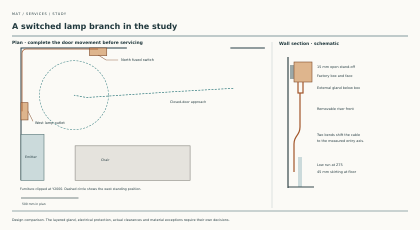

# MAT-SERVICES — mineral cable, complete terminations and accessible renewal

**30 October 2026. Bounded design comparison; MAT-SERVICES remains planned.** This advances S08 and X03 of the [single constituent register](constituent-audit.md), with consequences for S09/S10. It applies the [material policy](../../docs/reference-house/material-policy.md) to the current [IAS service-access family](../ias/ias-02s-services-access.md). It selects no circuit, protective device, product schedule or owner exception.

## Decision earned

Keep **bare copper-sheathed, magnesium-oxide-insulated cable** as a credible alternative for the continuous wiring portion. Do not call the resulting circuit polymer-free: the 2020 documented standard Pyrotenax termination contains PVC conductor insulation, and its higher-temperature glazed alternative still uses PTFE sleeving [1–3]. A mineral core, brass gland or glazed seal is insufficient evidence for the complete end assembly.

Develop the route with continuous lengths between independently accessible electrical enclosures. Do not create extra concealed joints merely to make decorative panels modular. Put each necessary termination, its insulated tails and equipment connection within a task-sized, independently supported enclosure; the removable finish is not that enclosure. This follows IAS's existing service geography and introduces a material consequence: shortening the polymer-bearing cable run does not automatically remove the functional constituents at its ends.

The comparison supports **less reliance on polymer along a run**, not a quantified reduction or an accepted exception at the ends. If a complete suitable no-synthetic termination cannot be evidenced, the choices remain further system research, a different route/system, or an explicit owner decision under the existing exception process. Omitting the seal or conductor insulation is not an alternative.

## Primary evidence and its applicability

Sources inspected 30 October 2026. Product pages are undated; the older manual is retained as edition-specific evidence, not silently treated as the supplied 2026 bill of materials.

| Key | Exact source | Bounded finding |
|---|---|---|
| 1 | [Chemelex UK, Bare Fire Survival MI Wiring Cable](https://www.chemelex.com/en-gb/pyrotenax/products/bare-fire-survival-mi-wiring-cable), current product page | Copper conductor/sheath and magnesium oxide insulation; light- and heavy-duty families exist. This establishes a real bare-cable family, without selecting a size or importing its fire claims as a domestic circuit design. |
| 2 | [Chemelex UK, Standard Termination Kit](https://www.chemelex.com/en-gb/pyrotenax/products/standard-termination-kit), current product page | RPS screw-on seals for MI cables, with a stated 105°C operating limit. The page does not disclose the complete supplied formulation or identify all accessory revisions. |
| 3 | [nVent Pyrotenax, CDE0923-MiFireSurvivalCable-EN-2005](https://device.report/m/af17bfb138c4f865ea6a1660292f7da36ded4a9d67a81a1bac68c3201be9f41e.pdf), manufacturer-authored 2020 edition, mirrored PDF, pp.1–2 and 8–10; identity/footer p.12 | Standard RPS/RPSL includes PVC sleeving and plastic closure components. The glazed-insulator option uses PTFE sleeving; the fire/radiation variant includes silicone-elastomer/glass sleeving. These are distinct assemblies, not interchangeable upgrades. The RMX compound's full chemistry remains undisclosed despite its descriptive “plastic” label. Current kit contents must be reconciled before selection. |
| 4 | [AEI bare light-duty cable sheet](https://www.aeicables.co.uk/uploads/6/2021-01/f2a1d2d8cf54cb029241bed7d9cece12.pdf), DS/SD/MICCLDBARE.V1, November 2020, p.1 | The bare-copper title and copper/MgO construction list coexist with a “Low Smoke Zero Halogen Sheathed” bullet. This is an unresolved identity inconsistency, not evidence that a particular supplied bare cable has a polymer oversheath. No dimension, rating or absence claim from this sheet is used to qualify the house candidate. |

The [original manufacturer endpoint for source 3](https://www.nvent.com/en-az/node/529231?asset_type=Installation+Manual+%2F+Instruction+Sheet) yielded indexed text but failed direct retrieval. The mirrored manufacturer's PDF was visually checked at its table and edition footer; its host is not treated as a product approval authority. No US Pyropak/System 1850 approval or hazardous-area seal is substituted for a UK general-wiring assembly. The current RPS listing and the 2020 manual form a useful traceable lead, but do not prove unchanged contents, present availability of every variant or cross-brand compatibility. The source discrepancy in [4] is a reason to request the exact supplied identity, not to fill the gap with a merchant description.

## Complete route comparison

The following is an **authored comparison of functions**, not a new installed-system register. S08 remains the single owning row for quantities and constituents.

| Part of the route | Candidate treatment | What must still be established |
|---|---|---|
| Plant/control end | Independently supported, accessible electrical enclosure in the existing dry-service geography | Exact protective and control equipment; conductor entry, full termination constituents, earthing/bonding, required enclosure and working access |
| Continuous cable | Investigate the manufacturer's bare MI family; include actual supports, fixings and any exposure protection | Environment, corrosion/contact conditions, mechanical protection, cable size, bending/support limits, thermal grouping and electrical design. “Bare” is not a direction to strip a required coating from another product |
| Room-side route | Selective existing IAS dry-service route, stopped at significant construction boundaries | Actual bends, segregated services, fixing map and removable face. Do not assume an existing route designed around another cable is qualified by material substitution |
| Room accessory end | Independent accessible backbox/enclosure and declared rise to the accessory | All tail insulation, seal, gland, accessory body and internal components. A metal faceplate establishes only its own face material |
| Boundary or equipment transition | Retain the actual fire, acoustic, moisture and movement duties; disclose each required accessory | Matched tested boundary assembly, equipment interface and renewal method. A metal sheath is not a fire-stop or a ground-water boundary |

IAS's 150-high, 45-projecting skirting trial leaves **27 mm gross behind an 18 mm face**, before supports and fixings. It is not a demonstrated space for a complete termination or a cable bend. Use that reservation only as a location to investigate the continuous route; locate necessary connections in separately detailed boxes. No deeper west-gallery skirting is adopted, and no floor, structural member or OAS mounting zone is cut by this comparison.

Do not split a cable at every nominal 1200 mm removable cover. For the deliberately simple comparison of one cable between two endpoints, one uninterrupted length has **two cable ends**. Dividing it into *k* separately terminated lengths has **2k ends**; each extra subdivision adds two. This is counting, not an installed joint schedule, failure probability or polymer-mass calculation. A complete loop, multi-cable accessory or branching network needs its own topology. Accessible continuity can reduce unnecessary end assemblies without claiming that every joint is avoidable.

## Renewal, burden and failure boundaries

Removing decorative trim must leave the supported cable and closed electrical enclosures in place. A competent electrical worker must be able to isolate the affected circuit, reach the actual enclosure, renew its termination or equipment connection and verify the reinstated circuit without dismantling permanent fabric. This is a design task for the eventual electrical designer; this study supplies no wiring procedure, protection setting or test acceptance value.

A detachable room finish does not make a mineral cable a repeatedly flexed connector. The selected route must establish how a damaged length is removed and a replacement brought around its actual bends. End access must include tools and controlled cable movement, rather than assuming a visible gland can be worked on in place. Moisture exposure and the reinstatement of a disturbed termination remain explicit failure cases.

Price the **complete circuit alternative**: cable, supports, enclosures, compatible end kits, installation skill/time, inspection/testing, access provision and future replacement. A cable price per metre would omit the parts that control this comparison. No current quote, installed length, labour rate, service life or percentage saving is established. Likewise, the manufacturer warranty and cable fire claims are not a thousand-year circuit-life result.

## Owning handoff and remaining work

S08/X03 should now distinguish an evidenced metal/mineral cable body, evidenced synthetic parts in the specified historical termination variants, and unknown current complete assemblies. S09 remains unresolved for switches, sockets, lighting, protective devices and equipment interiors; S10 retains its full boundary obligations. No constituent is exempt because it is small, concealed, safety-related or inside certified equipment. Do not alter certified equipment internals to manufacture a material pass.

The next electrical design comparison must bind one exact bare-cable size, current matching end kits, supports, enclosure and terminal accessory; obtain their constituent declarations; locate both end assemblies and a real corner/boundary in the owning IAS/BCR geography; and establish the complete safety and renewal design. Any proposed residue must enter the policy's existing exception record with alternatives and an owner decision, not be approved here.

MAT-SERVICES also still owes water/valve and heating constituents, soil/waste interfaces, ventilation ducts and equipment, insulation, controls and conditional plant. This electrical result neither resolves those systems nor duplicates [RWT's copper terminal and access work](../rwt/copper-access-first-result.md). The packet and MAT-COORDINATION dependencies remain unchanged.

## A continuous cable around the study corner

**Develop the north-west corner of the ground-floor study as a dry branch.** The chosen house has a 500 mm stretch on each wall beyond the west radiator and before the north door. At their intersection, X429.5/Y3150.5, a bare Pyrotenax 2L1.5 can round the corner inside the proposed 45 mm skirting. Stop the trim at an independently supported electrical station. A complete Deta M1228 backbox is 41 mm deep, already 14 mm deeper than the space behind the 18 mm face. [Current house geometry](../had/studies/water-replan.json) · [IAS dry skirting](../ias/ias-02s-services-access.md#s-d--worked-dry-skirting-trial) · [Deta M1228](https://www.deta.co.uk/products/wiring-accessories/switches-sockets/metalclad/metalclad-1g-surface-back-box-m1228)

The cable is two 1.5 mm² copper conductors in mineral insulation with a copper sheath. Its nominal bare diameter is 5.7 mm. Use the manufacturer's ordinary bend of six diameters and, conservatively, measure the 34.2 mm radius at the inside surface. The centreline radius is then 37.05 mm. The maker also describes a sharper bend with restrictions on subsequent straightening. This study keeps the ordinary bend for replacement. The cable size serves this routing comparison only. [Gland instruction CDE0929, pp. 1–3](https://www.nvent.com/sites/default/files/acquiadam/assets/PYROTENAX-IM-CDE0929-MIFireSurviCable-EN.pdf) · [UK installation guide CDE0937, §§6.0, 6.5](https://www.nvent.com/sites/default/files/acquiadam/assets/Pyrotenax-IM-CDE0937-MI-EN.pdf)

| Arrangement at Z75 above finished floor | Consequence |
|---|---|
| 90° turn around the inside corner, straight axes 9 mm from each wall | Tangencies lie 46.05 mm from the corner. Minimum clearance to the two trim faces is 7.26 mm at the diagonal. The sheath sits 6.15 mm off the wall on the straights. |
| Same corner, carrier raising both axes to 15 mm | The cable overlaps the back of the trim by 1.23 mm. **14.13 mm is the limiting common offset** before allowing for fabrication and wall irregularity. |
| 90° turn towards a rear entry contained in a single 27 mm strip | The centreline alone needs 37.05 mm of normal travel. Reject this rear turn. A side entry at the edge of the trim can receive a straight cable if the actual gland axis, nut, pot and tool stroke fit. |
| Independent supports on each wall 75 and 325 mm from the corner | The length between the two inner fixings around the bend is 116.10 mm. The next interval is 250 mm, below the guide's 450 mm horizontal surface-fixing limit for this diameter. Individual carrier seats, saddle heights and fixings must preserve the 9 mm axes and the removable face. |

The corner works because the backs of the two faces meet at a point. At 45°, the cable centre is the mounting offset plus 10.85 mm from each wall. Its shortest distance to that point is the diagonal distance, less the 2.85 mm cable radius. A mitre block, fixing post or corner cleat in that pocket spends its clearance. The [reproducer](studies/study-cable-corner.py) checks the whole circular bend against the two perpendicular faces and tests the failed 15 mm offset.

At that station a 300 mm-radius plan gauge centred at X800/Y2770 clears the trial trim by 25.5 mm and the closest scheduled furniture, the study radiator, by 107.4 mm. This establishes a standing position. To renew the continuous cable, the electrical station and the local corner faces must open independently, the saddles must release from the room side, and an incoming length must reach both exposed ends. The two-ended study below locates the opposite end, both operating heights and the first removal. Verify actual entry alignment and tool access against the selected boxes. No hole through the permanent wall or floor is reserved.

The manufacturer's 2L1.520 gland marking identifies the cable and its M20 thread. The M1228 has five side knockouts and one rear knockout of 20 mm. Those numbers do not establish room for the locking hardware inside the box or locate its side axis. The documented RPS standard seal employs PVC conductor sleeving and closure components. The gland, copper sheath and metal box therefore cannot clear the assembled circuit under the house material policy. Retain the current supplied seal formulation, compatible accessory and protective connection as procurement and owner-decision inputs. [Deta box schedule, DS 0090 v1.1](https://asset.eezybridge.com/de3fae66-8137-4795-8eb8-80bf777a3c65/5071) · [nVent termination manual CDE0923, pp. 1–2, 8–10](https://www.nvent.com/sites/default/files/acquiadam_assets/2021-01/PYROTENAX-IM-CDE0923-MiFireSurvivalCable-EN.pdf)

## Switch a study lamp from the door

Develop a **local lighting branch** with a switched fused supply on the study's north wall and a dedicated round-pin lamp socket on the west wall. Continuous bare copper/MgO cable turns through the north-west skirting corner and rises independently at each end. This gives an occupant control of a supplementary lamp by the door and keeps its plug reachable beyond the radiator. The comparison runs from the load terminals of the fused unit to the fixed socket. The upstream final circuit, room lighting design and movable lamp still need specifying. [Two-ended geometry and reproduction](studies/study-cable-corner.py)

| Study location | Complete accessory and position | Space bought |
|---|---|---|
| North, entry X1100 at Y3150.5 | BG MC550F-01 double-pole switched fused connection unit with its own metal box, 81.5 × 81.5 × 51 mm, centre +1050. Use its load terminals for the fixed branch. Specify the 3 A BS 1362 fuse option as a project choice for the 5 A lamp outlet. | Reserve 150 mm along the wall around the cable entry, including the offset of a bottom knockout from the centre. The station ends 175 mm before the rough door opening. Its finished face is at most 66 mm from the wall on a new 15 mm stand-off. |
| West, entry Y2600 at X429.5 | BG MC529-01 single 5 A BS 546 socket with its own metal box, 81.5 × 81.5 × 46 mm, centre +550. Use a compatible 5 A lamp plug. | The same 150 mm reservation leaves 125 mm clear north of the radiator's end and clears the west window. The face projects 61 mm from the wall. A seated Scolmore PA176 plug body adds 19.5 mm before its flex. The route check reserves 60 mm beyond the face for plug and working space. |

BG identifies the steel and **epoxy powder finish** of both accessories. The socket's supplied box has two bottom 20 mm knockouts and an earth terminal. Its data sheet lists 1.5 mm² conductors. The switch has separate supply/load terminals, two earth terminals and its own mounting box. Keep the lamp plug's polycarbonate housing, brass terminals and flexible lead in the material account. The proposed 3 A cartridge limits the intended duty through its time/current characteristic. Eaton TDC180-3A is a documented BS 1362-family comparator with a ceramic tube and nickel-plated brass caps. Match the actual holder and fault duty. [BG switched unit and instructions](https://www.bgelectrical.uk/uk/wiring-devices/metal-clad/13a-fused-sockets/MC550F-01) · [BG socket and instructions](https://www.bgelectrical.uk/uk/wiring-devices/metal-clad/round-pin-export-sockets/MC529-01) · [BG F103](https://www.bgelectrical.uk/uk/wiring-devices/contractor/fuses-bulk-pack) · [Eaton TDC180 data](https://www.eaton.com/content/dam/eaton/products/electrical-circuit-protection/fuses/data-sheets/eaton-tdc180-fuse-data-sheet.pdf) · [Scolmore PA176](https://scolmore.com/product/PA176/)

Keep the finished face centre within 30.75 mm of the authored cable axis along either wall. That bound follows from fitting a 20 mm opening wholly inside an 81.5 mm side. Even at that offset the nearer centre is over 500 mm from the room corner. Both heights are in the 450–1200 mm habitable-room range of England's Approved Document M Volume 1 §1.18. The §2.30 accessible/adaptable dwelling comparison also asks for 300 mm from an inside corner. These are layout checks; the project has no selected plot or established optional category. The 15 mm stand-offs, complete fixing, registered knockout positions and tool loads require a real setout. [Approved Document M, Volume 1](https://www.gov.uk/government/publications/access-to-and-use-of-buildings-approved-document-m)

### Pay for the bends, gland and access at both ends

Leave the low strip at each end by turning upward **in the plane of that wall**, still 9 mm off it. The same 37.05 mm centreline radius brings the first vertical tangent to +112.05. Above the skirting, two opposite tangent bends take the cable to the measured bottom entry. On the 15 mm stand-off, an intact 20 mm hole in the side of the actual box places its centre at least 25 mm off the finished wall. Using the entire published unit depths as conservative outer limits gives at most 56 mm for the north station and 51 mm for the west. Both offsets can be made within a 75 mm rise starting at +180. Give each riser its own removable 150 mm wide front and protected edges. Keep the upper tails in the electrical enclosure and fix the saddles to the backing. Between the two box entry planes the centreline measures **2.531–2.560 m**, before terminal tails, setting-out tolerance or order allowance. Check the existing 75/325 mm saddle positions and add fixings on the straight risers at no more than 300 mm spacing. The wireway remains dedicated to this lighting branch. [Cable and bend basis](#a-continuous-cable-around-the-study-corner)

Use a complete size-20 Pyrotenax RGM set at each end. The manufacturer's illustrated comparison gives an 11 mm entry thread, about 21 mm nominal external gland projection, a 22 mm across-flats gland and a Ø14.8 × 16.7 mm seal pot. The brass locknut is 24 mm across flats and 27.7 mm across corners. Its rotating envelope already exceeds the entire 27 mm enclosed skirting cavity. The selected lamp boxes buy an accessible side of the connection at the bottom of each riser. Their **external depth alone cannot establish the internal fit** between the locknut, seal/pot, accessory body, earth screw, incoming feed and insulated tails. At the north end reserve a distinct entry for the upstream supply. Check both locknuts and their sequence against the two actual knockout centres. If either station fails this test, buy a separately supported deeper wiring chamber or move the feeder entry and redraw the complete connection. [Manufacturer's RGM assembly and standard seal, CDE0923](https://www.nvent.com/en-az/node/529231?asset_type=Installation+Manual+%2F+Instruction+Sheet) · [Illustrated Pyrotenax gland and termination comparison](https://www.cablejoints.co.uk/upload/Pyrotenax_Cable_Terminations_%26_Glands.pdf)

For scale a Bahco 6M-19-22 spanner has a 225 mm length and a 46 mm-wide head at its 22 mm end. At the lowest 25 mm wall offset the wall-parallel head has only **2 mm** nominal rear clearance. Remove the riser face, orient the handle towards the room corner along the wall and reserve up to 190 mm of clear room-side depth for a 30° outward working arc. Both wall runs accommodate the length. This screen covers one tool envelope. Determine the second tool, independent counterhold, wrench indexing, hand clearance and achievable torque with the actual assembly. [Bahco 6M-19-22](https://www.bahco.com/int_en/metric-double-open-end-wrenches-with-chrome-finish-pb_6m_.html)

Close the study door using the existing furniture-tested sequence. From its closed stance at (2275,2800), move through (1750,2770) to (1000,2720) at the north station and (890,2740) at the west. With R300, the checked wall, box/plug, radiator, chair, door and frame envelopes have **at least 5.0 mm** clearance along this line. The conservative 45 mm trim line at the original closed stance governs. Nominal horizontal reaches to the faces are 378 and 423 mm. Clear the tools and return to the existing stance before reopening the door. The open leaf sweeps across the western part of the route. Copying the same 66/80.5 mm projections to opposite sides of the 1015 mm west gallery would reduce local width to 868.5 mm at a common height; retain that gallery's shallow ordinary trim. [Study operation](../had/studies/water-replan.json) · [IAS gallery and dry skirting comparison](../ias/ias-02s-services-access.md#floor-area-and-circulation-consequence)

### Replace the continuous branch

Isolate upstream, prove dead and remove the lamp plug. Remove the two accessory fronts and their protective bonds under controlled isolation. Document and disconnect the load conductors, the required box-to-accessory earth links, and the north feed if its geometry restrains the box. Open the risers and both corner faces, release the lower box locknuts and independent saddles, and retain the cable while lifting each independently supported box off the upward facing fixed end. Provide **200 mm of clear lift above each station** as an installation reservation. This exceeds the 150 mm factory earth-tail comparison plus the conservative 11+16.7 mm thread/pot lengths, but receiving lugs, side entry of an upstream feed and real tail stiffness can still defeat the sequence. Confirm the incoming supply can be released and safely restored from the same side. Full-height removal below a fixed box would run the horizontal cable into the floor after just 72.15 mm. Price two demountable box/backplates and an open-front replacement operation rather than burying fixed ends behind the skirting. With both upward ends free, open the saddles toward the room. Draw the shaped length **75 mm east and 75 mm south** before packing it for removal. A 20 mm radial allowance about each gathered disconnected end puts the entire first sweep inside X434.5–1195/Y2505–3145.5. This leaves 105 mm to the radiator and 155 mm or more to the closed-door frame. Reverse this translation for the incoming formed length before bringing the boxes down over its prepared ends. Check the actual end fittings, backing, tools and handling force with both boxes captive. Protect open hygroscopic ends and remake the supplied seals. Restore both bonds, test sheath/CPC continuity, polarity, insulation, protective disconnection and actual lamp switching, then replace trim. A dedicated protective conductor, if the final circuit needs one, changes this two-core route and must be fitted and checked. [BG socket installation instructions](https://www.bgelectrical.uk/uk/wiring-devices/metal-clad/round-pin-export-sockets/MC529-01) · [Pyrotenax UK installation and testing guide](https://www.nvent.com/sites/default/files/acquiadam/assets/Pyrotenax-IM-CDE0937-MI-EN.pdf)

The protected supply, two independently supported accessory backs and their mounting screws must have an effective protective path with each removable face refitted. The exposed sheath, painted box and fixing screws do not establish continuity by themselves. Follow the matched box-to-face earth links and verify their termination capacity and measured continuity. The dry layout needs two factory end seals, two glands/locknuts, two metal boxes and accessories, the plug and their protective links. The standard RPS evidence identifies PVC sleeves/closure components, the BG housings have epoxy and the cited plug has polycarbonate. Retain their exact supplied constituents, additional protective sleeving, lamp flex, coatings, compounds and any required pot earth-tail in the residual decision. The geometry cannot approve a polymer exception. The final circuit still needs a drawn supply, fuse compatibility, protective-device coordination, cable rating, fault-loop/RCD performance, installation inspection and a full two-end exchange specimen. No new hole in the floor, external weather boundary or adjoining protected construction is required by the **local branch route**; proposed backplate and saddle fixings still need an appropriate substrate and embedment limit at each wall.
