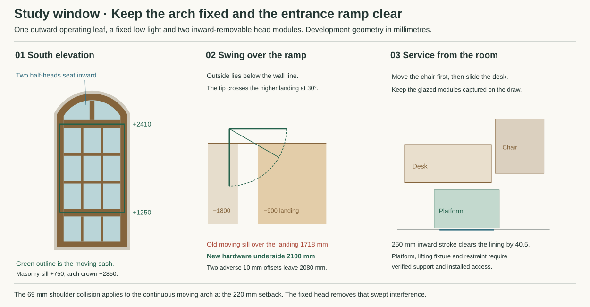

# Keep the Study arch fixed and open one rectangular sash

**Reject the full-height outward arched sash at the existing frame depth. Develop a fixed low light, one rectangular outward-opening leaf and two inward-removable fixed head lights.** The shoulder of the old moving arch hits masonry by **69.1 mm** during its required service movement. The old sill also passes just **1718 mm** above the higher front-ramp landing. The new leaf clears both. This changes the earlier Study specimen and needs adoption by HAD and OAS. It preserves the single operating leaf and segmental masonry opening. [Earlier mixed sash](envelope-glazing-alternatives.md#fit-the-glazing-to-the-actual-study-arch) · [HAD occurrence](../had/studies/water-replan.json) · [Reproducible comparison](studies/study-coupled-window.json) · [Primary editions and hashes](studies/study-coupled-window-sources.json)

## What can open in the actual wall

Bøjsø's real DUOWOOD 1+1 provides a construction and maintenance comparator. Its specification gives a 50 × 128 mm fixed frame, 52 × 28 mm outer sash and 19 mm bars. The outer light is puttied float glass. A bead retains the separate 4 mm hard-coated inner light. Both sashes open together. The maker requires 90° for cleaning between standard side-hung sashes. Two or three magnets release at the hinge side and the inner sash opens on the opposite edge. The standard complete sash can lift off at 90° after releasing an applicable friction arm and independently supporting it. The maker restricts the Danish 1+1 package to listed/conservation buildings. Its specification includes finger-jointed pine, a concealed weather strip, magnets, galvanised hinges and a 100–140 μm multi-coat fungicidal finish. Hand-applied linseed paint is an alternative finish. The factory treatment, putty, adhesives, seals and lubricants remain part of any stock order. [DUOWOOD tender rev 9, §§2–6](https://boejsoe.dk/media/wz3ddsf2/udbudsbeskrivelse-duowood-version-1.pdf) · [A-02-82 section, rev 1](https://boejsoe.dk/media/boyp3gga/a-02-82-duowoodplus-a-19-udadgaaende.pdf) · [Operation and installation, pp 5–9, 17–18](https://boejsoe.dk/media/maepa32v/vedligeholdelsesvejledning_2022-low-komprimeret.pdf) · [Maker's finish options](https://boejsoe.dk/teknisk-info/overfladebehandling/)

Use X1800 on the registered south wall. The masonry radius is 566.67 about Z2283.33, with sill +750, spring +2550 and crown +2850. Take the current 27 mm dry return and the maker's nominal 12 mm fitting joint. Trial the A-02-82 side frame's 32 mm weather-face width and 3 mm moving gap inside that 39 mm inset. This gives the **proposed** pivot X1374, Y220 and moving width 852. Keep the OAS weather datum Y0. The actual hinge axis, profile offsets and installed arch must be surveyed or specified against this model. [OAS section A](../../docs/reference-house/opening-interface-studies.md#a--jamb-at-15) · [Geometry and assumptions](studies/study-coupled-window.py)

* **Continuous arch.** A point at X1584 on the moving shoulder stands at +2726.12. At 90° it is at X1374, Y10, still inside the masonry reveal. The unlined raw arch there reaches only +2657.01. At this pivot the necessary setback limit for the front arc to clear at 90° is 104.93 mm. Shifting the complete 128 mm frame that far forward would stop it before the structural zone begins at Y262.5. A projected hinge, splayed arch or independent carrier would need a different supported weather and structural detail.
* **Fixed head, moving middle.** Put the working leaf between +1250 and +2410. Its top remains 140 mm below the raw spring. At 30° the latch-side front corner is at X2111.85, Y−206, above the −900 return landing. The old moving underside at +818.4 leaves 1718.4 mm. Allow 50 mm beneath the new bottom for hardware. The new minimum is 2100 mm, or 2080 with two adverse 10 mm level errors. Its 90° projection stops at Y−632, well before the flights at −1200. Include open hardware, guards, handling and actual walking headroom in the joined verification. The gap between the two lower landing guard zones is only 100 mm. A normal tower cannot straddle them as if they were a single level surface. [Shifted front landings](front-threshold.md)
* **Keep the warm seat.** The frame at Y220–348 overlaps the inner structural zone by 85.5 mm and retains the existing Y300 fixing line. At the least favourable angle, the 28 mm deep front leaf retains 2.54 mm of a trial 3 mm latch gap. Set the deeper part 14 mm back from the latch edge and even a 128 mm depth bound retains 7.28 mm. A 2 mm adverse fit leaves only 0.54 at the front. Check seals and ironmongery on an actual corner. Provide bearing beneath each jamb and at the straight-to-curved transition, with independent dry fixings, drained outer joints and continuous room-side air closure. Bøjsø specifies 2–4 fixings in each vertical frame, maximum spacing 900 mm, for its assembly. The new frame needs its own anchors, hardware and exposure check. [Maker's installation manual](https://boejsoe.dk/media/maepa32v/vedligeholdelsesvejledning_2022-low-komprimeret.pdf)

## Which glass belongs in the repaired opening

Develop one **rectangular** insulated inner light in the shared operating sash. Keep the low light and the split arch head independently paired. Outer weather lights can use replaceable 4 mm clear glass with selected solid timber, mechanical capture and a compatible linseed-oil/chalk bed. The 32 mm outer true bars retain a 12 mm web with 8 mm bite and 2 mm clearance on both sides. The earlier 40 mm opposed vacuum rebates leave 4 mm. Widening those bars to 52 would leave 16 mm and give twelve 265.33 × 383.25 mm units, but widening them cannot cure either swept obstruction. [Monolithic bedding candidate](https://linseedpaint.com/product/fillers/linseed-oil-putty-filler/) · [Original window materials and limits](envelope-glazing-alternatives.md)

| Complete comparison | Heat, material and replacement consequence |
|---|---|
| Paired clear outer and 4 mm Pilkington K Glass inner throughout | Pilkington permits the hard-coated inner with its coating facing the cavity and calls for an outward ventilation route. Keep this renewable control. For 1.7920 m² of framed opening and 1.0399 m² of aligned glass, trial centre/opaque U-values of 1.9/1.4 already exceed the project's 1.6 W/m²K whole-window benchmark by 0.162 W/K before edge, hardware and vent losses. At 1.9/1.1 they leave only 0.064 W/K. These are sensitivities, not rated properties of the paired sash. [Pilkington secondary application](https://www.pilkington.com/en/gbl/architectural-and-technical-glass/glass-applications/window/window-faqs) · [EPR benchmark and applicability](../epr/internal-technical-review.md#bpe-4--energy-and-renewables-route) |
| One straight FINEO 8 inner, paired monolithic glass elsewhere | Candidate 764 × 1078 mm rectangular unit. AGC declares 0.7 W/m²K at the glass centre. Crediting that only over the 0.6826 m² clear overlap in the opening tier recovers 0.819 W/K against the 1.9 comparison, leaving **0.658 W/K** for edges, ventilation, fittings and residual paths at the 1.4 opaque assumption. The moving glass alone rises from 15.89 to 24.13 kg. The unit exceeds the retrofit small-light limit. Require four-sided support, compatible setting/location blocks, renewed seals and a complete new-frame installation. The retrofit guide bars wooden blocks with coated or laminated glazing. The product DoP identifies a low-E coating in the unit. Obtain a documented compatible support before assigning wood, and keep named PP/PA, silicone or EPDM recipes outside the default selection. Do not bed the vacuum edge in ordinary linseed putty. [AGC FINEO 8 DoP A000522502](https://www.fineoglass.eu/wp-content/uploads/40/A000522502_-_FINEO_8_EN.pdf) · [AGC installation guide, §§2–3](https://www.fineoglass.eu/wp-content/uploads/56/TDS_Fineo-retrofit-glazing-instruction_0823_EN.pdf) · [AGC new-frame qualification](https://www.fineoglass.eu/faq/) |
| Off-the-shelf coupled or shaped insulating assembly | The maker's stock 1+1 supplies the movement comparison, while its new-building energy and complete material case are unsuitable as a straight substitution. Its standard 1+2 uses an inner insulating unit whose whole edge construction must be disclosed. AGC advertises free-form vacuum glazing by individual enquiry. That does not supply a shaped-unit schedule or installed weather joint for this head. Two half-head cassettes avoid that order and can be handled independently. [Bøjsø glazing options](https://boejsoe.dk/teknisk-info/glas-og-ruder/) · [AGC shape scope](https://www.fineoglass.eu/wp-content/uploads/23/LR-25-10-31-Fineo-nieuwe-brochure-EN.pdf) |

The fixed monolithic head used previously admits a severe local cold surface. At room +20 and outside −5, the 5.8 W/m²K centre comparison gives +1.15 at the room glass, using 0.13 m²K/W inside. The proposed 1.9 paired-head sensitivity gives +13.83. At −10 that falls to +12.59. The cavity face of the outer glass may then be −7.49. At 60% indoor and 80% outdoor RH, a simple well-mixed steady vapour-pressure calculation allows at most **10.2% indoor air** in that cold cavity at −10, or 14.7% at −5. Wind reversals, wet materials, edges and long-wave cooling need a real moisture model and test. Detail a tighter warm seal, outward ventilation shielded against direct rain, visible lower weeps and removable access to each compartment. Keep cavity drying independent of the room ventilation supply. [Maker's condensation guidance](https://boejsoe.dk/media/maepa32v/vedligeholdelsesvejledning_2022-low-komprimeret.pdf) · [Historic England secondary glazing](https://historicengland.org.uk/images-books/publications/eehb-secondary-glazing-windows/)

## First release, return and remaining duty

1. **Prepare the room.** Retain the HAD routine operating contact X2220, Y429.5 and body X2580, Y765 with the room door shut. Their plan reach is 492.1 mm. Establish the real lever, opening and closing forces, vertical reach, secure open state, purge area and fall guarding. Ordinary operation does not require clearing the desk. Before renewal keep the sash shut and positively restrained. Move the 1000 × 900 chair reservation north to centre Y2020, east to X2250, turn 90°, move 50 mm south and then east to park at X2325–3225, Y1470–2470. Slide the desk 700 mm north. Its west edge stays 25.5 mm from the study emitter. The trial 1200 × 700 room platform now clears the desk by 135 mm. Check actual high and low obstructions, movable furniture and cable release, furniture handlers, platform entry, independent load support and an occupied return route. [Current HAD furniture and controls](../had/studies/water-replan.json) · [Service clearances](studies/study-coupled-window.json)
2. **Draw the fixed head inward.** Support each proposed 374 × 310 × 100 mm half-head module before removing its screwed room-side retainer. Both panes remain attached to their small frame. Its front beds against a stationary exterior stop, with an independently drained overlap and replaceable dry capture. A 16 mm profile overlap and another 6 mm to the exposed pocket allow 6 mm normal clearance at concentric arc and straight sides, 2 mm after two adverse 2 mm deviations. Opposing pockets would overlap by 12 mm in a 32 mm central bar. Use a 64 mm centre instead, leaving 20 mm timber. Two 4 mm panes inside the entire half-pack outline weigh at most 1.68 kg before timber, capture and tools. At most 573.3 mm reaches the proposed room-side grips from the trial standing station. A 150 mm draw leaves the far face 59.5 mm inside the room lining. **250 mm** puts it 40.5 mm beyond the lining. Use an independently supported guide, hold the module throughout the pull and lower to a protected bench. The permanent outer weather stop remains.
3. **Take the rectangular glass to the same bench.** A native 90° coupled opening still places the far corner out at Y−632. A hand-reach assumption from the room cannot release and carry the complete glass there. In the proposed closed-leaf arrangement, capture the full warm inner ring, remove its dry-side fasteners and bring it in with its glass. This exposes a specified 810 × 1124 mm throat. An independently held 788 × 1102 outer nine-light lattice then draws through it with 11 mm on each side, 7 after two adverse 2 mm errors. Its putty and true bars come to the bench intact. The moving frame around that throat has only **21 mm side and 18 mm top/bottom** at the narrowest projected section. Verify the actual stepped timber section, hinge, clamp, guide and anchor through the signed dead load, racking and site wind before assigning capacity. Standard Bøjsø couplers do not provide the proposed inward release. Keep maintenance of external perimeter pointing and a whole-frame exchange as separate guarded work.
4. **Restore the boundary.** Install and retain the weather lattice first, then the supported inner unit, weather overlap, warm closure and anti-release hardware. Drain the outer compartments to the existing OAS sill tray without bridging the dry joint. Test both outlets, closures, wind-driven rain, measured air leakage, closed restraint and the complete 90° operation. Preserve a safe front approach while restoring the weatherproof enclosure. Obtain the actual glass safety class, edge bedding and packers, complete coatings, magnetic/hinge internals, dry seals, opening limiter, support and whole-window weather/thermal evidence. If the rectangular vacuum unit cannot meet the constituent policy in a new frame, retain the paired control for an actual whole-window test or present a specific documented material decision. MAT-ENVELOPE remains open. [Window support and commissioning duties](../../docs/reference-house/opening-assembly-selection.md) · [Full envelope disposition](envelope-disposition.md)
