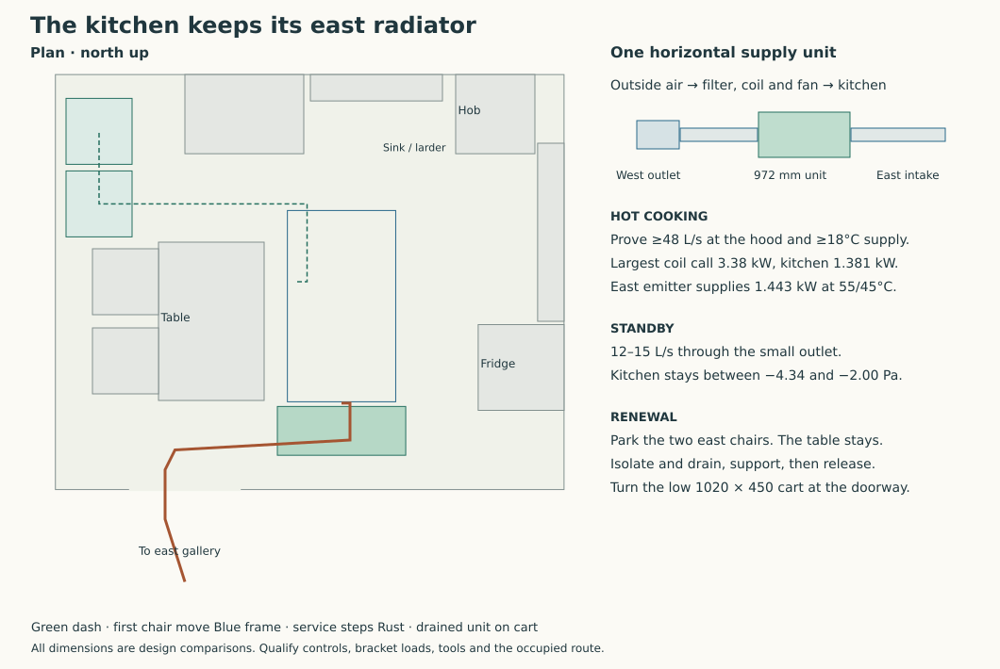

# Keep the east kitchen radiator and temper the incoming air with water

**For the six-extract house, develop one wall-mounted hydronic supply unit and keep the existing east kitchen radiator.** The Swegon Salsa hood and Twist external motor use the high setting for hot cooking. A 27 kg Blauberg EC MW 700 S31 filters, heats and supplies outdoor air from the existing east port. This removes two 3 kW duct heaters, the 3.8 m overhead carrier and the proposed 79 kg west radiator. Keep the 14 kW three-phase room source and independently charged hot-water cylinder. [Reproducer](studies/tempered-kitchen-air.py) · [Computed cases](studies/tempered-kitchen-air.json) · [Joined plant](local-extract-heat-and-store.md)

## A hot-cooking setting with an actual capture duty

At 600 mm hood-to-hob height, the Salsa family's EN 13141-3 odour-capture comparison gives 75% at 48 L/s. Qualify the particular flue-free, externally exhausted hood, its full-width coverage of the hob, filter, extended visor and complete 125 mm exhaust. England's current reference guidance gives 30 L/s for this type of intermittent hood and records the highest setting at commissioning. Use the stricter 48 L/s benchmark for this cooking design. [Salsa data and test conditions](https://www.swegon.com/globalassets/digizuite/10096-en-casasalsa_productcatalogue_en.pdf) · [Twist instructions](https://www.swegon.com/globalassets/digizuite/10108-en-casatwist_installation_en.pdf) · [Approved Document F, volume 1, Table 1.1 and commissioning appendix](https://assets.publishing.service.gov.uk/government/uploads/system/uploads/attachment_data/file/1045918/ADF1.pdf) · [English transition timetable](https://www.gov.uk/government/publications/the-future-homes-and-buildings-standards-building-circular-012026/the-future-homes-and-buildings-standards-building-circular-012026-letter)

Keep the off and two lower manual functions. Commission the highest to the supported 10 V command. The existing 64 fan combinations retain their hood resistance and weather brackets. At 2 V the adverse case has no forward exhaust. At 5 V it gives 31.41 L/s. At 8 V the adverse exhaust exceeds 48 L/s but some makeup flows fall below the source coil chart. At 10 V all 192 high-setting combinations give 71.14–87.38 L/s hood and 77.79–100.49 L/s direct supply. These model brackets retain the source's exhaust chart-domain limits. Measure hood flow and installed capture before granting hot-cooking permission. [Original fan curves and network](joined-cooker-system-result.md)

## Follow the heat through the coil and the rooms

At 20°C indoors, −10°C outdoors and 18°C supply, hot cooking needs **2.61–3.38 kW at the coil** and 1.327–1.381 kW from the kitchen radiator. Its existing Stelrad east H600×1200 gives **1.443 kW at 55/45/20**, leaving 62 W in the worst case. Below **17.49°C** supply it can no longer meet that peak. The other 15 emitters supply 11.593 kW at their scheduled room temperatures against an 8.444 kW aggregate remainder. Check occupied-room losses and balancing individually. Cold −10°C air at the maximum direct flow would demand 4.758 kW in the kitchen. Inhibit hot cooking on loss of coil heat.

Room and supply-air heat together peak at **13.202 kW**, leaving 0.798 kW against the Panasonic's 14 kW useful target. The 22-hour ordinary, two-hour hot-cooking house requires up to **233.38 kWh/day**. The coil receives part of that same heat. A 45/35°C coil loop needs 4.84 L/min at maximum call. Mixing equal parts of 55°C secondary supply and 35°C coil return requires 2.42 L/min of injection. Specify the actual pump, valve, protected circulation and any glycol/HX penalty. The 9.52 kW small-machine comparison cannot meet this daily mean. [Heat and independent DHW](local-extract-heat-and-store.md) · [Existing east emitter](kitchen-replan-heat-result.md)

The four-row EC MW 700 coil chart covers the 280–362 m³/h hot-cooking range. At −10°C and 45/35°C water the curves read about **25–27°C maximum outlet**, before modulation to 18°C. Bind capacity on the actual fluid and dirty coil, water-side pressure loss and minimum controllable heat. Test standby separately. Its 44 dBA rating at 3 m requires an actual room sound check with the terminal, cabinet and structure. [Manufacturer catalogue, technical and pressure data](https://blaubergventilatoren.net/es/download/datasheet-16162.pdf#page=139) · [Coil chart](https://blaubergventilatoren.net/es/download/datasheet-16162.pdf#page=142)

## Keep pressure under control with the hood off

The six local fans extract 78–96 L/s. The unassisted kitchen reaches −8.305/−12.581 Pa. Feed a measured **12–15 L/s** in standby. Reducing the same 14-node transfer network to upper-ring and hall balances reproduces both former endpoints. Across all 64 extract combinations and both new supply limits, the kitchen stays at **−4.342 to −1.997 Pa** under the calm closed-transfer assumptions. Six room inlets now supply 7.73–20.99 L/s individually. Check room use, quiet operation and fire-doorset transfer at the actual pressures.

Put a small fixed outlet in parallel with the main outlet **after the coil and its straight discharge**. Shut the main outlet in standby. A removable Ø50 metal plate with trial discharge coefficient 0.61 implies 60–94 Pa from 12 to 15 L/s. Measure total fresh air, including main-blade leakage, and silence and guard the small outlet. At a minimum 12°C standby supply, maximum coil heat is 0.396 kW and kitchen radiator duty is 1.284 kW. An untreated 13.11 L/s at −10°C would instead require 1.612 kW. The catalogue thermal chart starts above standby flow. Commission the stable minimum fan speed, temperature, valve range, noise and frost programme. The fan nameplate is 0.139 kW before circulation and controls. [Connected graph](studies/connected-cooker-network.json) · [Blauberg's supply and return sensors](https://blaubergventilatoren.de/uploads/download/b264en_a4_stkr_03_preview3.pdf#page=17)

At peak the Ø250 duct carries 2.05 m/s. The G4 maximum-speed curve reads above 350 Pa in the high-setting band. A half-obstructed 75%-free terminal at trial coefficient 0.61 costs 48.1 Pa. Three metres of tube and fitting K=4 cost 11.0 Pa. Allow a further 100 Pa dirty-filter increment, 50 Pa for silencing, valves, diffuser and remaining losses, and 50 Pa adverse wind. The result leaves 91.0 Pa against that conservative full-speed line. Qualify the actual clean/dirty curves and fan speed. Buy a diffuser with at least 0.067 m² effective area for the illustrative 1.5 m/s face target and test its throw away from the hob and seats.

## Prove the changeover

The S31 offers frost and return-temperature sensing, three-way valve and pump control, external damper control and Modbus RTU. Its filter-pressure indication serves a different duty from kitchen pressure. Provide independent outdoor-reference room pressure, true hood flow, total fresh air and downstream temperature. Preserve the factory fire and thermal controls. Replacing the two 13.04 A heaters with a 1.05 A fan gives illustrative cooking allocations **51 / 20.05 / 22 A** with the same three-phase plant, 32 A hob on L1, 3 A auxiliaries on L3 and the normal immersion inhibited. The optional 9 kW indoor backup adds 13.1 A per phase. Confirm actual loads and electrical protection.

1. In standby prove the weather shutter, circulation, small measured airflow and warm supply. Before a cooking call, check sensor zero and both air paths, then preheat the coil while keeping the hob disabled.
2. Prove the open main outlet. Ramp the Twist and supply together against measured hood flow and the −4 Pa kitchen target. Confirm at least 48 L/s hood and 18°C supply before authorising hot cooking. Starting full makeup against a stopped hood or starting both motors without feedback cannot ensure the transient.
3. Trip or inhibit the hob and exhaust on lost temperature, failed damper or fan, blocked terminal, pressure fault or lost feedback. Latch a visible fault, match the supply rundown and permit standby only after safe pressure and valve position return. Test the inherited −5 Pa/5 s protective response with actual sensor uncertainty, adverse wind, loss of power and fan coastdown. The generic kVent programme lists a 70 s supply-fan shutdown delay and 40 s idle timer. Those defaults cannot provide the five-second protection. Obtain the matched firmware's writable fan demand, timeout and approved independent stop interface. Power failure needs an independently frost-safe coil and pipe arrangement. [Blauberg installation and controls](https://blaubergventilatoren.de/uploads/download/b264en_a4_stkr_03_preview3.pdf) · [CAREL kVent release 3.1, D023–026](https://www.airsystems.ro/assets/kvent_rel_3_1_en.pdf) · [Sensing and trip](joined-cooker-system-result.md)

## Fit one cabinet on the solid south pier

Mount the unit horizontally between rough openings ending at X9150 and starting at X10450. Put its control above and its removable four-bolt cover toward the room. Test a **972 × 370 mm** plan at X9400/Y8684.5 and a conservative Z2150–2755 enclosure. This leaves 415 mm to the RC soffit and 112.5 mm minimum to a raw jamb for a centred 903 mm mounting span. The first flush design puts its outlet through the existing high/low service riser at X8700/Y8500. Carry the native four vibration mounts on a separate 260 mm structural standoff fixed to the pier. Its Y8859.5 outlet clears the 320 mm riser band by 49.5 mm with a complete Ø300 insulated duct. The cabinet top clears the high trunk by 60 mm. A 39 kg unit-plus-frame trial at 2g gives 0.765 kN and a total 0.341 kNm at 445 mm eccentricity. Bind the wet mass, anchors, torsion, wall and pull reactions. Keep the original Y8600/Z2400 east-wall port, using two 45° bends east of the clean straight to shift the duct 259.5 mm north. Confirm bend tangents, actual frame, controls and sound lining. Keep X10372–10672 and X8600–9400 straight and independent of the diverter, shutter and outlet, meeting the native 250/750 mm minimum. Use the outdoor sensor upstream of the unit. Size the cowl, noncombustible support, weather, acoustic, thermal, pest and fire closures; verify no exhaust re-entry. The ducts have independent supports. Tee the secondary pair at X10200/Y8500/Z2945, run north to Y8790 then west to X10050. Two trial Ø50 complete pipes retain 200 mm to the soffit. Drop to accessible mixing, pump, drain, isolation and detachable three-quarter-inch coil tails. Fit vents at high points and protect the wet branches from their outdoor-air exposure. [Blauberg mounting instructions](https://blaubergventilatoren.de/uploads/download/b264en_a4_stkr_03_preview3.pdf#page=13) · [Manufacturer manual, mirrored copy](https://device.report/manual/16688159) · [Actual house](../had/studies/water-replan.json)

Keep the table, west chairs, refrigerator, sink, larder and oven in position. For intervention move the east chairs one at a time round the north end of the table to two west parks. Restore them before resuming the ordinary window operation. One **820 × 1450 mm** Zarges service-step footprint then clears the furniture. Reach the filter, cover screws, control and unions from the guarded deck; the removable cover hangs on its captive cables. Provide a separate supported first rest. Check the purchased step's guard, bolt and cover travel, grip, wet weight, stable human reach and head clearance. [Named access equipment](joined-cooker-system-result.md#constructive-north-hatch-and-offset-platform-successor)

For full exchange shut down cooking and both air paths, isolate electricity, close/drain the water branches and support the unit before release. Use independently supported retracting Ø250 couplers, split water spools and releasable wiring. Budget at least 70 mm sleeve parking and verify actual socket engagement. With the access steps parked, bring a Genie GL-8 standard base to the room face. Its 630 × 880 mm footprint fits the cleared floor, 570 mm forks reach below the 370 mm projection and forks-down reach 2500 mm at the required 2150 mm elevation. The 181 kg rating applies at a 300 mm load centre. Prove the 27 kg case, drained fittings and restrained cradle against its actual load chart, including extended mast, operator and tools. Keep the operator outside the raised load. The manufacturer prohibits side-loading the machine against a fixed object. [Genie GL-8 specification](https://www.genielift.com/docs/default-source/product-specifications/material-lifts/en-gb/genie-lift-product-specifications-2020.pdf)

Use a drop-out steel cradle to separate tool work from lifting. Keep the factory vibration mounts on that cradle. Its four lugs engage horizontal captive pins in two fixed wall arms. With the machine still safely on the wall, the worker on the steps isolates, drains and releases all connections and transport restraints except the four holding pins. Remove the steps. Dock the stationary GL-8 from the north, place its forks under the restrained cradle and prove support without jacking against the fixed frame. A mechanically interlocked, ground-reachable release retracts the unloaded pins from outside the load projection. Budget 20 mm travel for 12 mm nominal engagement with a visible fully retracted witness on each. If any pin binds, keep the load supported and restore the positive wall restraint before recovery.

Price a 410 mm maximum fork-direction cradle depth and an actual loaded centre within the rated 300 mm. At the 39 kg, 2g trial, even assigning all 765 N to one Ø8 pin gives 7.61 MPa in double shear and 31.88 MPa bearing on one 3 mm lug. These values do not qualify arm torsion, pin bending, fasteners, vibration, locking, human access or the purchased mechanism. Confirm no fixed shelf or bracket crosses the downward path. Lower vertically at X9886/Y8869.5. Keep the lift stationary with the load raised. Only after setting the case on the low braked receiver, move it north to Y9080. This avoids asking an operator on the steps to remove a final anchor over raised forks. [Genie operating manual, safety and rated load centres](https://manuals.genielift.com/Operators/english/1314200.pdf)

The restrained **1020 × 450 mm maximum complete cart** includes wheels, case, stops and retained fittings. Move from X9886/Y9080 to X9950/Y8800, then west, turn diagonally through the 900 mm kitchen arch and enter the east gallery at X8700/Y7725. The continuous horizontal clearance bound is 18.27 mm. Pass the attended open east cross-door, turn west at X8600/Y3420, then south in the front hall. The second sweep to X6000/Y−600 leaves 44.57 mm to represented obstacles. Confirm the real cart, loaded control, door operation, exterior handling and safe return. Restore the opening, air and water seals, then verify both air modes and protective trips. [Cart routes and clearance](studies/tempered-kitchen-air.json)

**MAT-SERVICES remains open.** S03/S05/S06/S07 have a joined local-air and heat development branch. It still requires the owning Services/HAD export, matched safety changeover and occupied-room proof. S01/S02/S04 retain the actual incoming-water duty, cylinder safety/renewal and lawful relief/foul routes. S08/S09/S10 include the selected electrical fittings, controls, motor/valve seals, filter media, grommets, vibration feet, mineral-wool binder and service-specific closures. The six local fans retain their EPDM and ABS. No material exception is approved. [S01–S10 crosswalk](constituent-audit.md#s01s10-development-decision-and-residue-crosswalk)
