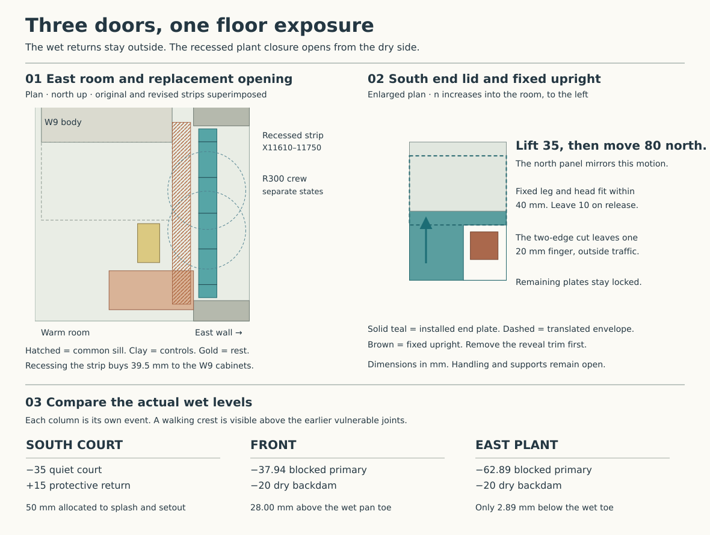

# Three doors on the suspended ground floor

**Carry the drained, non-pressure floor into coordinated design with three different opening details.** Keep the south court pan on its own seat and release it towards the court. At the front, put the renewable air joint behind the pan, under lift-out floor plates. Recess the east version into the replacement-door reveal so it can coexist with the plant controls and a level cargo crossing. Carry the monolithic stair and wet-wall cores only in the dry-site comparison. Reject this floor for a plot requiring a continuous gas or pressure-water barrier. The pans, lower steel field and three trial core caps together still leave unclosed paths. The [ground-exposure policy](../../docs/reference-house/ground-water-policy.md), [three occupied core sections](occupied-core-breaks.md) and [source-linked dimensions](studies/three-door-floor.json) govern this choice.

## Keep each wet return visible

All levels are millimetres from ground finished floor. The occupied floor has 15 finish, 65 distribution and 100 glass above RC200 from −180 to −380. The ordinary two bonded masonry courses occupy −180 to −30. Stop the plaster at floor level; the 30 mm between DPC top and plaster remains a wall-core/air joint. Carry water on the weather side of the jamb and the independent air line to the room. A bed under a doorset, an end dam on a pan and a seal round a door leaf perform three different jobs. [Concrete, mortar, wall and threshold section](floor-pour-boundary.md)

| Door and fixed support | Wet route and first adverse state | What stays dry and how it comes apart |
|---|---|---|
| South court, 1800 rough. The projecting seat and blind blocks return to its own court girder. | Retain the joined +15 protective return, conditional −35 quiet surface, both outlets and independent high cavity trays. The 50 mm difference has already been assigned to splash and setout. The high tray ends are 148.25 mm above the low aprons. Use high tongues back to the high trays and the separate low return to its apron. | Keep the mineral base, fixed front bar, jamb caps/boots and actual formed pan. With temporary rain protection, capture and remove both leaves, frame and sill, release the end caps, then draw/lift the supported pan in its authored sequence. The high tongue and door fixing must leave the pan draw intact. Expose, clean, reinstate and separately test the dry rear contact and wet releases. The court well and whole blocked-inlet event retain RWT/HAD ownership. [Court air assembly](court-air-path.md) · [High and low returns](floor-pour-boundary.md) |
| Front, 1800 rough. Fixed seat on outer-S over P21–P22. | Keep the 1:80 pan from Y435/−60 to Y−40/−65.94. Under the blocked normal pipe, the 200 wide, −55 relief gives −37.94 after the event allowance: the pan toe is **28.00 submerged**, with 17.94 to the −20 dry backdam. A blinded grate tests a separate surface path, whose water is already above floor zero. | Keep the backdam and both closed end upturns on the wet side of a fixed gasket plane at Y480. The proposed interior plate/cheek opens separately. Keep the 1200 protected route and the three shifted lower flights. Repair of a full threshold or either door leaf needs an independently supported crossing or a controlled interruption of occupancy. [Front water, support and access](front-threshold.md) |
| East plant, 1400 rough, finished 1000 cargo opening. The plate's inboard shelf sits over outer-E; its outside shelf belongs to the dry receiving dock. | On the revised pan set the toe at X12045/−60, 15 over the 100-wide collector. Place the heel 278 mm farther inboard at X11767/−56.525, then return it to −20. Keep the 1:80 fall and both jamb dams. The north backup at −95, collecting 0.4851 L/s against the blocked south outlet, reaches −62.89 after return loss: only **2.89** to the toe and 42.89 to the backdam. | Set the fixed low dry face at X11722, 45 inboard of the heel. Remove the independent outside rail/grate only for the dry exchange and fit the 950 × 140 plate. All inner floor covers must then be present. The original cylinder and W9 have to travel 80 and 280 beyond their former stop; the dock still needs a separately supported receiver 1774 above the trial grade. [Plant threshold, equipment and dock](plant-threshold.md) |

The front and plant backdams sit **35 mm below** their +15 walking crests. Long backup, wind, capillary or a damaged end can reach the building before the pedestrian sees water over a sill. For the court, test threshold and failed inlet in the same water state. Keep its actual first-susceptible material unresolved. No common +15 acceptance level can replace three water tests. For both outer returns, turn each pan end up at its wet jamb and direct its discharge outward, leave a drained and inspectable gap behind it, and carry the wall DPC round the seat without bridging it with bedding or finishes. Do not return a wet apron into the graphite joint.

## A replaceable metal-to-metal dry joint

Let *n* increase roomward from the weather face. At the front *n* is Y; at the east door *n* is 12000−X. For both outer thresholds propose a fixed 1.5 mm stainless air skirt starting on the concrete side of the 100 mm glass. Turn its base into the actual concrete body with cast-in transverse returns. Keep its welded ends accessible before casting; price an interface specimen showing bearing/compaction and leakage along the steel–concrete contact. At each side, shop-form a fixed wing round the end of the mineral DPC and carry the **dry** face to the wall-core/plaster return. Provide a mortar stop and a separately drained weather-side end. Defects in embedded wings entail opening the floor or jamb. Those wings cannot be repaired by replacing the visible soft gasket. [Ordinary material boundary and three substrate cuts](envelope-disposition.md)

At each end of the opening carry the gasket centre up from −45 to +225 in the same vertical plane as its bottom run, round the two bottom corners as a single cut U, and clamp its upper tips to the corresponding dry doorset-jamb termination. This leaves two actual upper boot joints and the complete leaf/head/meeting seals. Price removable interior cheeks, separate door-frame support, captive clamp heads and a renewable lower metal flange on the **frame**, with a matching fixed steel face behind it. Neither wet pan carries a clamp bolt. Form a closed backed stud/bolt seat before casting, qualify its weld and prevent air tracking along the carrier. Assemble and pressure-test the fixed lower and side ends before fitting the leaf. Current timber/metal frame supplier, its anchorage and its upper air termination still have to deliver the mating face; a steady contact against rough wood is inadequate.

| Dry closure | Front | East proposed shallow reveal |
|---|---:|---:|
| Fixed clamp face and outer backdam in *n* | 480 / 435 | 278 / 233 |
| Gasket upright centres in house plan | X5075 and 6925 | Y4000 and 5200 |
| 12 mm wide, 1 mm thick one-piece gasket blank | 1862 × 276 | 1212 × 276 |
| Lift-out walking cover in *n* | 452–592 | 250–390 |
| Smallest horizontal reserve to actual girder edge below | 90.5 | 367.5 |
| Removable plate lengths across opening | 4 × 450 | 100, 4 × 275, 100 |
| Gross largest 16 mm plate before fittings | 7.96 kg | 4.87 kg |
| Distributed closure force at the comparative contact stress below | 197.74 kN | 143.96 kN |

Develop **unbacked SGL SIGRAFLEX Z flexible graphite**, 1 mm, as a replace-on-opening gasket between machined dry metal faces. The manufacturer's metric sheet lists Z foil on 500, 1000 and 1500 mm wide rolls, 50 m standard length. Cut each low U lengthwise from 500 stock; the two bottom corners then have no abutting strip ends. A one-piece complete front frame would exceed the widest stated stock by 362 mm before fabrication allowance. The 1000-square BASIS sheet is a different stock format. Z is an industrial foil with stated carbon minimum 99.85%, oxidation and corrosion inhibitors. The data sheet describes polymer-free foil; the adhesive-backed ZS and PTFE-coated forms are different. Obtain actual inhibitor, carrier, finish, metal contact and fabrication disclosures. No fire, domestic air/gas, weather or building-life result transfers from this catalogue. [SGL Carbon metric foil sheet, both pages, July 2021](https://www.sglcarbon.com/pdf/SGL-Datasheet-SIGRAFLEX-APX2-APX-E-C-Z-Foil-EN.pdf) · [SGL sheet formats](https://www.sglcarbon.com/en/markets-solutions/material/sigraflex-basis-all-thicknesses/)

Use the manufacturer's tabulated room-temperature ASTM *y* factor of 1000 psi as an **illustrative uniform contact stress of 6.895 MPa**. It supplies a comparison of flange effort, not a specified building gasket seating pressure or leakage criterion. The 12 mm band demands 8.27 kN per 100 mm at that stress. At 100 mm fastener pitch a simple 40 × 8 flat pressure bar, idealised as a simply supported beam under the corresponding line load, gives 242 MPa and 0.327 mm movement. A 40 × 10 bar gives 155 MPa and 0.167 mm at E=193 GPa; the authored elastic comparison is 200/1.1 MPa. Take the reaction back through the opposed flange and blind fasteners locally. The total closure force is internal to the pair. Qualify bolt seating, corners, backing flexibility, persistent compression, fracture of the foil, thermal movement and relaxation. With 1 mm foil a 5 mm out-of-flat face cannot be corrected by tightening the gasket. Survey the opposing faces and provide adjustable dry frame shoes before clamping; under pressure-cycle or movement failure change the closure.

Both lids bear 20 mm each side of a 100 mm clear strip, 120 between bearing centres. Put interrupted mechanical anchors and structurally supported longitudinal ledgers on the actual RC support; keep them clear of the air skirt, unperforated wet sheet and brittle glass. At the east end the **outer exchange plate** spans another channel on separate supports. Its 3.443 kN conservative wheel gives 96.83 MPa on the new 16 mm dry lid for 25 mm effective distribution. A separate 5 kN check gives 250 MPa for 12 mm, 140.63 MPa for 16 mm. Charge the one load to a single strip, check actual tread, joints, hold-down and edge position, and qualify the ledgers and supports. The end fingers beside the east jamb are outside the cargo opening and do not receive this simple full-plate rating. The lower 3.05 m of continuous 1.5 mm steel skirt through 100 mm of glass has 0.686 W/K end-to-end conductance between imposed end temperatures at 15 W/(m·K). Count the legs, posts, bearing, concrete spreading and interior surface temperature in the thermal detail. [Steel heat-path precedent](ground-pier-boundary.md#actual-south-threshold-support-and-the-fixedremovable-join)

## Which east interface can actually be opened?

The common room-side lid at X11408–11548/Y3900–5300 clears the accepted HAD controls by 180.5 in Y. At the W9 whole-room trial the controls instead cover 140 × 197 of the lid's south end. With the 60 mm north wall change they cover 140 × 257. The W9 casing and its southern service zone end only 2 mm west of this lid. Neither apparatus movement nor removal of a live electrical/control bank is an acceptable first step in repairing a door seal. [HAD room and doors](../had/studies/water-replan.json) · [Distinct W9 and moved-wall studies](studies/plant-room-rewind.json)

Put the east deck instead at **X11610–11750/Y3950–5250** and retain the actual 1000 clear Y4100–5100. There is 39.5 to either W9 control position in X, 29.5 after two 5 mm adverse errors. The W9/service-zone X separation becomes 204 mm. Set the structural doorset toward the weather side, its fixed traffic-side return outside the recessed lid, and use demountable lower jamb linings in the 200 mm rough-to-finished side bands. The two end covers remain 23 mm from the rough reveal's actual finished faces Y3927/5273. A continuous full-thickness infill to the room face or a permanent hinge shoe sitting over a lid defeats the arrangement. This part of the reveal is a proposed doorset change.

The southern 100-long end lid occupies Y3950–4050, the northern Y5150–5250. Give each a full-through corner cut open on **two** edges. Remove *n*250–312 over south Y3950–4030 or north Y5170–5250. Reserve the entire upright, flange and screw head inside a 40-wide zone ending at *n*302. Release and lift the separate reveal trim before moving the panel. A solid plate hits the +225 upright; a notch opening only to the weather side needs 62 mm west to disengage and overlaps the W9 controls by 22.5. Raise each positively captured end plate 35, clearing the proposed 15 mm keeper and putting its underside 19 above the five locked covers. Move it 80 towards the middle of the opening. Its outside end now clears the 40-wide upright by 10, without moving towards the controls. The remaining 20 mm finger needs its own seat and local load test. Put the grip on the intact 78 mm web. Keep the cheek, fasteners and trim outside both actual sweeps once released.

For a first rest reserve a temporary dry 170 × 300 pad at X11140–11310/Y4220–4520. Only one plate is out. Carry the supported panel centre along X11680 to Y4370 before moving 455 west to (11225,4370), with its 140 dimension along X. The largest 275 plate leaves 15 and 12.5 at the pad edges. The pad is 30 east of the cylinder working zone, 27 south of the W9 working zone and 63 north of the moved-wall control cabinet. Check a real guided lift, grip, supported travel and safe restoration. A person may not stand under its load. The removed loose jamb trim needs a separate hook or second rest. [Plant working footprints](studies/plant-room-rewind.json)

Open one end or centre cover at a time, with daily passage/plant transfer isolated, the door secured and the other plates locked. Remove the six end/centre covers only for a full supported frame exchange. With a 10 mm dry pressure bar, the clear 100 tool opening leaves 82 to the inboard ledge; a nominal 55 mm head and 15 mm withdrawal fit with 12 in section. The lower bolts at about −45 are beyond a direct 600 arm envelope from the two illustrated low working stations. At an authored shoulder of +550 the +225 jamb targets are 573.61/537.35 away. A 300 mm vertical guided drive from a −45 bolt reaches +255, where the same upper-hand geometry can work. Compare Milwaukee's 36 mm SHOCKWAVE right-angle head with a 25 mm bit charged at its full length and 15 for disengagement: 76 in the 82 opening. The distinct OSD2 has a 51 mm head and a 40 Nm application limit; with the same full bit it misses by 9 and would require measured projection ≤16. Do not transfer its torque limit to the smaller tool. Secure the drive/reaction housing, support the extension from above and calibrate delivered torque/preload at the actual fastener. At an illustrative M8 torque coefficient 0.2, 8.27 kN corresponds to about 13.2 Nm per pitch; it is not a bolt rating or a tightening specification. Price actual bit, fixed head, tool width, elbow sweep, fasteners, tightening across both jaws and lower access. [Milwaukee UK compact head](https://uk.milwaukeetool.eu/en-gb/shockwave-right-angle-attachment/) · [OSD2 dimensional control](https://uk.milwaukeetool.eu/en-gb/osd2-offset-screwdriver-drill-angle-attachment/)

The isolated south and north R300 worker centres are (11672,4470) and (11672,4775) while only their respective end strip is open. The south station has 29 to the nearest moved-wall control, 120 to the open strip, 70 to the finished south jamb line and 28 to the outer face. The north equivalent has 75 to its open strip and 25 to the limiting jamb line. Keep all other panels installed, no simultaneous cargo or operating plant work, and qualify the actual reveal/splayed jamb volume, secured leaf, two-hand effort, working height and foot support. The 40-wide upright territories leave at least 130 mm to the Ø850 moving cylinder about Y4575 (155 about Y4600). The W9 route's unresolved crew/turn remains. [Station and contact calculation](studies/three-door-floor.json)

Support the doorset, relax the dry clamp evenly, then part its gasket faces toward the room before taking away the frame. Retain temporary weather and interior protection. Clean and inspect both faces, install a new one-piece foil and both end returns, test, re-seat and lock the plates, then restore the leaf and site protection. The east plant route is available only in the all-lids-closed state. Working crews, front egress during full opening, roof/site lift, temporary screen and loading through the completed threshold require separate witnesses.

## Exposure and whole-house disposition

The conditional air account allocates 158.09 m³/h at 50 Pa to **all** openings, while fixed wall/floor leakage has its own 63.23. The existing court contact sensitivity alone uses 100.19, leaving 57.89 before any new allowance or allocation. A uniform unbacked 0.5 mm opening along only the 3.05 m front/east lower contact lines passes 50.12 m³/h in the same ideal inviscid Cd=1 screen. At 1 mm the figure is 100.23; a 0.578 mm slot would consume the entire residual. This diagnostic excludes both pairs of jamb legs, all leaves, windows and meeting joints. It is not a measured leak bound. Test the joint with useful masking, then replace those partial readings with the unmasked whole-opening result; count each physical path once. [Current court accounting and masked-test boundaries](studies/court-air-path.results.json)

For a **drained dry-site** selection, support masonry on the bonded brick DPC and accept monolithic concrete at the three structural crossings only against the loaded two-lift, shoulder and finish wetting/drying test. Keep a real draining solum and inspectable opposed void ventilation. At 1:100, fixing the west lip to −1800 loses 37 mm of stressed crossing clearance; lowering that lip to −1920 gives 83 but needs a surveyed passive downstream receiving level below it under backwater and heave. The three door water tests, steel-to-concrete substrate/interrupted mortar returns, actual gas exposure and passive site outlet are independent conditions. The front entrance cannot be sacrificed to protect the plant dock or court. [Solum and moisture source](floor-pour-boundary.md) · [Three loaded crossing outcomes](occupied-core-breaks.md)

For a **continuously isolated pressure/gas site**, the three dry doors do not cure the P46/P47/P24 concrete intersections, wet shoulders, return interfaces or unqualified embedded seals. Even the 80-piece field has 116.94 m of seam and £12,991.80 ex VAT of sheet stock in the recorded scenario before fitting. The proposed three separate caps leave 1.858 m of perimeter beyond room-side access on the bonded masonry layout; the stair rocking and lower anchorage require their own solution. Do not stack local measures and call the pressure boundary selected. Change the level/foundation/plot or return with a full positive enclosure and a framed penetration system. Complete threshold gasket, two clamps, ledgers, finishing and repair costs need fabricator prices. Four front and six east covers total 54.86 kg gross 16 mm stainless before notches, ledgers, fasteners or lifting eyes. The two low U blanks use 3.074 m of 500 mm-wide roll laid end to end before cutting allowance. Renew the foil whenever its flange parts. The blocked pan, loaded deck, disturbed trim and restricted entrance give different first-repair costs.

Retain the raised Penrhyn/Hunton slate prototype with the consequences of its 275 court overhang, lead runoff, supported valley, canopy and conditional +8645.33 crown. Retain the fixed Study arch/low pane and shorter rectangular opening leaf pending the actual straight inner unit, complete glazing carriers and assembled performance. The roof and window cannot supply their missing constituents by association with the ground detail. Exposed soffit retention, portal/tie penetrations and the court receiver/first-repair return also retain internal work in the [owning six-interface table](loggia-envelope-boundary.md#mat-envelope-owning-exit-table). Keep the materials node planned. [Roof comparison](ring-roof-family.md) · [Study glazing](study-coupled-window.md) · [Current whole-envelope disposition](envelope-disposition.md)
