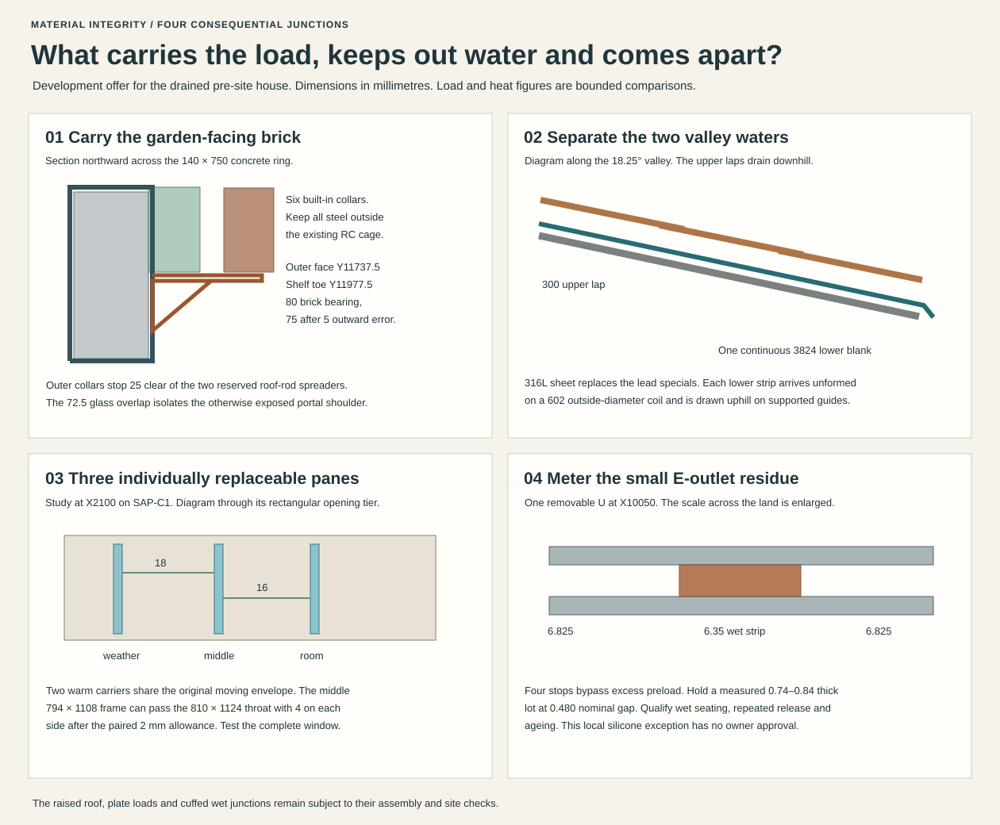

# The envelope offered for house selection

**Carry one drained-site envelope into MAT-COORDINATION.** Use the suspended RC/mineral ground floor, solid warm structural leaves, drained outer brickwork, bare cellular-glass insulation, the raised Penrhyn Capital roof with supported Sarket and separate lead-free primary and secondary valleys, and mechanically renewable timber/glass openings. Keep the upper floor level above the independently supported loggia ceiling. Offer one local replaceable silicone seal for owner decision at the east rainwater joint. Its use is unapproved. A site requiring continuous gas or pressure-water isolation excludes this floor. A hard lower crown excludes this roof. Neither case can be settled by buying a different finish.

This completes the **bounded comparison of material alternatives** in MAT-ENVELOPE. It gives the owning designers a section, first release, adverse comparator and rejection condition at each of the six interfaces. Supplier declarations, full-scale structural/weather/fire tests, plot and water evidence and a dated residue decision remain necessary before adoption. MAT-COORDINATION must replace this offer if those conditions fail. The accepted house, maturity and approvals ledger retain their respective authority. [Programme and exit boundary](material-integrity-programme.md#packets-and-earned-exits) · [Sole constituent register](constituent-audit.md) · [Owner policy](../../docs/reference-house/material-policy.md)

| Interface and register roles | Carry into the house comparison | Cost, intervention and non-transferable condition |
| --- | --- | --- |
| Ground and structural floor · G01–G05, G08, X01–02 | Carry the 52-head suspended concrete field, conventional RC200, 100 floor glass and two bonded engineering-brick courses at ordinary masonry. Keep the three monolithic supports as deliberate moisture paths on the dry site. | More courses do not stop those supports. The metal field needs 80 pieces and 116.94 m of seam, with £12,991.80 ex VAT recorded for 60 stock sheets before labour. The three positive caps leave 1.858 m inaccessible and the stair can lose contact. Reject continuous isolation on this house. The −1920 trial solum lip needs a surveyed lower passive receiving level. Prove actual wetting/drying, heave, subfloor ventilation, gas and ground resistance. [Three occupied cores](occupied-core-breaks.md) · [Floor and threshold disposition](three-door-floor.md) |
| Walls, exposed soffit and finish · G04–G08, O04–05 | Retain the 27/140/110/50/102.5 ordinary wall and 200 glass at the loggia. Stop the weather leaf below the carried slab insulation, keep a vented/drained cavity, and mechanically capture each glass course and mineral-finish panel. Use disclosed solid, frost-suitable face brick, compatible mortar and plain lime/sand on the exterior-rated rib lath. | The 6.744 m² ceiling uses 28 finish frames, 32 primary inserts and 16 independent catches, with 25 clear of the first moving panel at each worker station. Wet assembly 128.26 kg/m². The midwall 20 K loss grows from 4.45 to 24.12 W/m if the cavity reaches the RC. The removed face does not carry a neighbouring layer. Price wet-weather staging, reinforcement coordination, region-specific corrosion and the overhead panel/insert mock-up. [Wall, shelf and supported first release](loggia-soffit.md) |
| Garden/court portal and tie · G05–G09, X01–02 | Carry the actual wrapped 2960 masonry opening and independent structural tie. Support the upper north facing brick outside the insulation on a real collar/shelf. Renew the central tie from inside the open portal. | Six collars and shelf units require installation with the RC. Accept local facing reconstruction for their exceptional retirement. Keep the warm air closure and two-stage rain collar independent of the removable rod. The alternatives and forces follow below. [Portal shape and original tie](loggia-envelope-boundary.md#exposed-soffit-a-finite-assembly-rather-than-an-internal-ceiling-label) |
| Roof and protected ceiling · G09, R01–05 | Preserve SAP-C1’s 25° steel roof, +8645.33 crown, 320 glass, two-direction ventilation, 275 court overhang, warm air/vapour layer and supported secondary drainage. Use unbacked 316L for formed specials and four independent secondary valleys. Keep local classified ceilings in their actual zones. | Reject the previous crown for this slate, zinc with an unmatched board, unmodified polyester-reinforced warm roof and the illustrated copper valley at this 18.25° slope. The old 1.706 t of lead and its runoff are avoidable. No ordinary bay, ventilated slot or quoted metal permits deleting the protected ceiling, branch insulation or the required second water layer. [Slate prototype and roof/ceiling controls](ring-roof-family.md) · [Actual structural handoff](../str/provisional-house-handoff.md) |
| Three doors and other openings · O01–05 | Retain the south court's outward pan draw, front dry clamp behind the pan and recessed east cargo crossing. Use the renewable OAS E0 frame, separately supported fixed/operating lights, a drained weather face and accessible warm closure. Compare three individually replaceable monolithic panes in the Study. | The front/east plate sets already cost 54.86 kg gross stainless before ledgers. The accepted threshold datum is an assembly to wet-test. Keep both low aprons separate from the high cavity trays 148.25 above them. Two windows cannot inherit a crane/sash proof from the rejected north export. The register maps 43 windows, three doors, two open loggia portals and one service portal, including all sixteen SAP-C1 moves. OAS/IAS/STR still own actual operating and protected fittings. [Current three doors](three-door-floor.md) · [Opening assembly family](../../docs/reference-house/opening-assembly-selection.md) |
| Outdoor water and restoration · R06–10, C01–02 | Consume the six-pan south-access court and two independent ground routes. Keep folded, shop-welded Cu-DHP protective shoes and separate fixed/removable wet faces. Use the narrow controlled-gap challenger below at one two-piece E joint only. | A +15 protective crest is a geometric boundary. The −35 quiet reference has already spent 25 on splash and 25 on setout. Retain the unknown first harmful level, separate destinations and actual tails. Heat-softened R240 fold stock, filler/flux, movements, pockets and captured replacement must survive the actual wet trial. RWT-METALS owns downstream compatibility. [Selected court and renewal states](../had/court-intake-selection.md) · [Folded shoes and seal evidence](seal-and-weather-materials.md) · [Single RWT materials authority](../rwt/rwt-04-materials-joints-compatibility.md) |

## The north shelf and the tie are different structural parts

The final outer floor ring is **140 × 750**, Z3170–3920, on Y11667.5. Preserve its eight H12 on each face, H8 hoops at 100 and separate diaphragm reinforcement. Its cold face Y11737.5 lies 160 behind the first brick at Y11897.5. The lower arch ends at Y11775. Neither the 72.5 upper/lower glass overlap nor the rendered shoulder can carry the brick. Trial six 80 × 6 stainless closed saddles **outside** the cage at X4875, 5325, 5775, 6225, 6675 and 7125. The original 4700/7300 roof-rod stations reserve 220-wide spreaders. The saddles stop 25 short of those zones. Put the bottom straps on the form before the pour, maintain the full concrete section, then join the top straps across the prepared RC head before bedding the upper core. Account for the additional 6 at the adjacent bed, cover, stiff inclusions and construction tolerance. A blind anchor drilled into a nominal 140 wall has no comparable clearance proof. [Final outer and court ring sizes](../str/studies/current-house-floor-stops.json) · [Rod hardware footprint](../str/studies/current-house-floor-closure.json)

On the cold vertical leg provide two 8 × 120 gussets and a removable stainless shelf with 120-high web and 8 plate. Its toe remains Y11977.5. Direct the weather load onto that toe and back to the collar, keeping 80 bearing, or 75 after 5 outward error. End cantilevers are 375, internal spans 450 and the worst tributary width 600. Four metres of solid facing at 20 kN/m³ asks **4.92 kN service or 6.64 factored** per end bracket. The 1.40 kNm toe moment gives 36.5 MPa across the two gross gussets. Top bearing at the centre of the core and positive opposing contact pads centred at +3855/+3360 give a 3.77 kN horizontal couple and 0.69/0.59 MPa trial top/side bearing. The cold end cantilever asks 0.78 kNm under the gross factored line. Retain independent wall ties, a sliding shelf splice, drained cavity tray and end dams over the steel. Test corner anchor, ring torsion, welds, lateral pressure, fire and slot/leaf movements in both signs. The 41 kg strap stock excludes gussets and shelf. Exceptionally replacing all 3 m of supporting shelf can require protected dismantling and rebuilding of up to **2.46 t** of gross facing in this solid-height comparison. [Shelf installation and two-thirds brick bearing](https://www.ancon.co.uk/downloads/52/Ancon%20MDC%20Masonry%20Support%20Systems.pdf)

The garden tie axis Y11667.5 puts the nearest edge of the 150-square backing plate **22 beyond** the room's north finish. A room-side wrench cannot simply appear there. Cast the end plate and stationary D30 stub as permanent structural fabric with a closed, shop-tested metal rear housing incorporated during construction. Form the orthogonal masonry/air return around it. Lap the housing's fixed flange to the warm metal/plaster return before closing the corner. Keep an accessible fixed catch and drain on the weather side of the pier. A shop-fitted Ø50 drip disc on the stationary stub is outside the curved lining at its actual X4891.56 intersection, above a removable sloped two-piece rain hood with an open downward telltale. An annulus round the rod is not the warm air seal. If the housing fails, remove the local masonry return under separate arch restraint. Never transfer the old accessible-nut assumption into the garden wall.

Put the removable tie's pins at **X5200 and 6800, Z2200**. Each solid stationary eye is 24 thick and 60 deep. An open-bottom fork on the centre tie has two 10 ears, 2 side gaps and a captured Ø28 pin transverse to the passage. At the source 29.98 kN tension, the adverse 43 mm support-span pin gives 150 MPa bending, 24 MPa nominal double shear and 155 MPa combined. Eye/ear bearing gives 45/54 MPa. Preserve independent end anchorage, pin edge distances, fit, fatigue, hot-strength and anti-release checks. First close the passage, shore the arch and take its signed thrust on an independently restrained temporary tie/jack. Secure the central piece at two points, unload the pins and prove load transfer. Draw each pin along Y into its captured 100 mm work bay. Lift the open-bottom forks together 65, giving 5 clear above both eyes and **72.7** minimum to the curved soffit at the outer corner of either moving fork. Move across Y with both ends captured before lowering. Reverse under shoring, lock and retension the replacement, check movement and restore the two hood sections. The new 60-depth forks reduce local walking head to 2280/2322.5 at court/garden. Test the full shoring, bearing and tool arrangement before authorising any structural intervention. [Actual arch forces and plate](../str/studies/open-loggia-support.json) · [Measured interfaces and rejection bounds](studies/whole-envelope.json)

## A separate lower valley survives the first opening

Keep the slate field and revise the ridge cheeks, rolls, hip/valley pieces and saddle blanks from Code 4 lead to **0.5 mm uncoated Uginox Top 316L** on an independently supported profile. The producer distinguishes the weldable 316L from its tinned Patina product. Use shop-formed corners and resistance-welded raised seams where a weather-tight continuous metal seam is required. An ordinary folded seam alone does not give that result. Preserve the 200 clear valley, 60/50 crossflow layers, full cap throats and opening for the supported corner return. Keep both roof flanks sliding at the structural hinge. Provide fixed points, sliding stainless cleats, pressure-relieved overlap and separate upstands outside the wet floor. A 300 downhill lap on this slope buys 93.9 vertical, or 288 net length after a 10 allowance and 80 K expansion of one 1391 piece. Protect the wood/slate from hot work. Specify remove-and-rinse cleaning products and collect process water. No tin/lead solder, adhesive seam resin or coating is assumed. [Aperam technical guide, §§3.8, 4.2–4.7](https://www.uginox.co.uk/wp-content/uploads/2018/01/Uginox-Technical-Guide.pdf) · [Resistance seam method and its separate support layer](https://www.imoa.info/download_files/stainless-steel/euroinox/RoofingTech.pdf)

The lower valley is a separate 760-wide strip. Keep 200 of open receiving width, 180 of wing plus a 40 turn and 60 board underlap to each side in the developed stock. Give it a continuous **3824** blank, including 150 at head and 100 at toe. On each side clamp the upper sarking's downhill edge onto the supported wing with a stationary flashed wood/steel batten and a separate folded wind return. Water on the board must land inside the lower tray; keep its opposite retained edge and fastener line above the water path. Fold the lower throat to the separate Q4545 drip, 20 inward of the primary Q4525. At 80 K the full lower strip grows 4.89, giving 6.71 projected drip separation after two adverse 5 allowances. Provide at least 8 longitudinal movement at the free toe. Keep penetrations out of the wet floor. Set a removable, drained 2 mm stainless support bed on closely spaced formed seats in the local wind-board territory. Give the metal skin a free slip and drainage path on low stainless ribs, and keep the wind closure continuous under the supported seam. The producer recommends a water-repellent separating layer under a metal field; the local metal-on-metal valley seat is a bespoke assembly. Qualify movement, vibration, contact corrosion, trapped condensation and supported installation. If the supplied board requires an irreplaceable synthetic membrane or tape at this junction, reject the combination or present its exact changed residue. TG 2190 is for the stated timber system. The 18 mm board has about 141 kg bitumen and 24 kg undeclared constituents across this roof. Unknown chemistry needs a supplier declaration. [Hunton Sarket and four-sided T&G](https://huntonfiber.co.uk/products/roof/hunton-sarket/) · [Current approval listing](https://www.sintefcertification.no/product/index/184) · [Underlying board evidence](studies/ring-roof-family-sources.json)

The old 1.706 t specials correspond to 83.57 m² developed stock. The replacement wetted pieces weigh 334.30 kg. Four secondary strips add 46.50 kg and their support beds 185.99 kg. Before new clips, stiffeners, local saddle fabrication and temporary works, this removes **1.139 t**. The valley itself gets heavier. Over the four 3.574 m lines its revised metal and bed add about 4.76 kg/m relative to the former lead valleys. Applying that load to the native roof kernel, while scaling the unchanged locations of the exposed specials, reduces the 22 incremental downward support reactions by **0.262–0.826 kN** each. They sum to 5.56 kN against 16.73 before. The stripped suction case gets no favourable weight credit. STR still owns complete mixed load cases, local rails and clips, and spring/foundation reactions. Every £10/m² on the 95.20 m² skin/secondary stock changes the sheet comparison by £952 before beds, scrap, specialist welding, access and testing. Obtain a formed-coil quotation rather than treating commodity flat sheets as deliverable roof parts. [22 signed load changes](studies/whole-envelope-roof.json) · [Aperam applications and stock in continuous lengths](https://www.uginox.com/en/applications/)

For routine replacement, keep the lower wet surface in place, restrain adjacent 1391 mm primary pieces and clips, remove the single lap under weather cover and restore it. At rare secondary retirement divert water independently and take down the supported upper pieces/board wings. Do not attempt to turn a 3.824 m formed trough on the eave stand. Supply the unformed 11.62 kg blank on a 300-radius mandrel. Its outside diameter is 602 and its outer-fibre screen 161 MPa. Qualify the delivered coil temper and flatten/form it progressively on supported guides along the valley with a separately restrained feed/winch at the head. Set its cradle on the actual 1800-square eave stage at the four mirrored positions in the model. The SW centre is (5300,5300). Four 160-square feet avoid the retained 600-square first rest. Price the elevated cradle top at +7182, 75 above the secondary toe, so its underside clears the travelling catch even where the two overlap in plan. The frame stops over 60 inside the fixed gutter front. Feed the strip over a rounded, protected sloping guide toward (4525,4525); do not load the slate, weather lip or retained gutter. Separate the feed operation from corner cassette exchange. Fit the temporary cover to the measured pitched geometry: the conservative flat-cover gap is **347 short** of coil plus the existing 400 lift/tool allowance. The proposed 250 local rise gives 2147 corner height for a 2000 work envelope. Locate and test the erected cover, independent ridge access, hold-down, arrest, wind shutdown and runoff before work. Reject that repair on a plot where its temporary space cannot be furnished. [Selected decks and upper catches](../had/studies/court-intake-selection.json) · [Existing cover and access comparisons](ring-roof-family.md#what-the-steel-budget-and-the-repair-route-permit)

## Keep the glass standard and the joint exceptional

At the SAP-C1 Study centre **X2100**, keep the fixed sill light, two arched head cartridges and one 852-wide rectangular operating tier. At the retained +1250/+2410 tier, existing adverse clearance over the −900 ramp landing is 2080 including the 50 hanging hardware. The shifted hinge X1674 bounds the full-depth sweep at X2535.6. The actual protected landing starts at X5000 with a 100 guard. The translated actuator at X2520/Y429.5 is 341 in plan from the earlier (2580,765) stance. The old single moving arch still crosses the masonry. Keep the separate guard, temporary barrier, raised controls and relocated Study lamp outside the final operating and repair volumes. Require the OAS/BCR occurrence replay at X2100 before adoption. [Study frame and removal](study-coupled-window.md) · [SAP-C1 occurrence register](../str/studies/reconciled-house-interface.json)

Use the existing nine-light weather lattice with 4 mm glass and compatible putty. In the same 128 mm envelope trial two independently dry-retained, 4 mm monolithic K-glass warm panes. Front-to-back glass intervals are Y237–241, 259–263 and 279–283, giving 18/16 clear gaps. Face each hard coating toward its cavity. Provide four-sided positive capture, measured edge clearance and compatible non-metallic bearing blocks with disclosed constituents. Trial dense solid hardwood seats in the protected, drained rebate only with glass-supplier agreement for this separately glazed product. Maintain the 14 mm latch-side setback and 28 mm front shoulder. Keep the warm plane tight, pressure-relieve the successive cavities outwards, baffle rain, and open each to inspection and individual drainage. Do not let inside humid air ventilate the coldest face. The earlier two-pane cold-cavity screen at −10 allowed only 10.2% indoor air. No sealed argon unit or cavity performance is assumed. [Pilkington on secondary K Glass](https://www.pilkington.com/en/gbl/architectural-and-technical-glass/glass-applications/window/window-faqs) · [Product and toughening options](https://www.pilkington.com/en-gb/united-kingdom/architectural-and-technical-glass/product-categories/thermal-insulation/pilkington-k-glass-n)

The extra 764 × 1078 pane weighs **8.24 kg** and brings the moving glass to **24.13 kg**, the same glass allowance as the FINEO comparator. A 45 kg complete trial leaf imposes 0.19 kN hinge couple at 980 spacing before wind. A 1.5 kPa pressure over the operating tier has about 0.63 kNm opening moment. Keep mechanical restraint through opening and independent support during release. With the leaf shut, capture and remove the inner carrier to the room, then the 794 × 1108 middle carrier through the 810 × 1124 throat with 4 reserve each side after paired 2 errors. The existing outer lattice then has its own 7 reserve. Assemble in reverse, clean both cavities and test drainage and operation. At a supplier's illustrated £34.18/m² ex VAT K-glass rate the added glass is about £28 before machining, safety grade, rebates, hinges and handling. The FINEO option remains available if its exact new-frame edge system and material exception are justified. Reject it as the default where its required packer/seal is unresolved. [Supply-rate control](https://sw-glass.co.uk/tools/glass-pricing) · [FINEO new-frame boundary](https://www.fineoglass.eu/faq/)

A naked second gap does not earn a U-value. Over the 0.683 m² clear operating tier, the original paired 1.9 centre / 1.4 opaque screen overshoots the 1.6 whole-window target by 0.162 W/K. An effective extra resistance of 0.1664 m²K/W just pays that difference plus 0.15 W/K of edges and hardware. At an authored 0.25 the centre falls to 1.288 and 0.256 W/K remains for all additional losses, only 0.317 m³/h full-temperature bypass after spending 0.15. At zero useful added resistance the decision fails. Hot-box and wet-test the complete opening, including daylight, safety, opening effort and independent pane capture. Transfer the glazing family by role to the other openings, retaining their actual sills, springs, guards, privacy and fire duties. A protected doorset or retained low guard cannot be replaced by this sash calculation. [All 49 current openings and shifted axes](studies/whole-envelope.json)

At E coupling **X10050** retain the four side-only bolts, 8 kN total, 20 land, two support frames, captured release and two independently supported pieces. The 600 bottom plus two illustrative 250 legs gives 1100 active line. An unprofiled copper land averages 0.364 MPa. Matching the cited 135 MPa copper deformation comparator at 8 kN would require a uniform contact band no wider than **0.054 mm**. A continuous field knife-edge of that width, renewed on the supported carriage, is rejected. Welding the two native pieces together removes the existing independent exchange. A concealed secondary catch is not full-duty bypass capacity.

Offer the specific **non-adhesive 0.79 mm BISCO HT-800**, a single die-cut 6.35-wide U within the land with 6.825 margins. Retain integral dry-side ears outside the wet line and capture the gasket before the outer face draws away. The active material is **5.52 cm³**, approximately **1.94 g** at the typical 352 kg/m³; separately weigh the ears and any service spares. At a measured lot spanning 0.74–0.84 and a matched 0.480 ±0.030 initial setting, 100 kPa on the narrow land uses 699 N total, 381 on the bottom. The paired-frame component comparison opens 0.0185 more, giving 28.6–46.4% compression. At 200 kPa it still gives 26.1% at the thin end. Around 244 kPa consumes the allocated opening. At 300 the thin end fails the 25% screen. Four metallic stops must bypass the rest of the bolt preload. Survey the complete two loaded faces, corners and bolt sequence, qualify exact thin-stock pressure, aged reclosure and sustained blocked water, and test the joint under captured movement. Treat 100 kPa as a design stress, not a certified thin-stock property. Retain source first-harm and site head as unknown. Only MAT-COORDINATION may present this small cold-replaceable residue for a dated owner decision. If declined or the assembled gap fails, leave the two-piece wet joint unavailable and return the altered connection to RWT/HAD. Do not silently substitute a wider gasket, seal every shoe in silicone or choose unretained tapes. [Rogers exact thickness and density](https://www.rogerscorp.com/-/media/project/rogerscorp/documents/elastomeric-material-solutions/bisco/english/data-sheets/180-070-ht-800---medium-cellular-silicone.pdf) · [Flat copper and reversible native joint](upper-access-renewal.md) · [Loaded-gap predecessor](seal-and-weather-materials.md)

**Acceptance boundary.** BCR/MRA/PHY retain the assembled loaded, wet, fire, thermal, ground, access and temporary-work tests. OAS/HAD/STR/RWT retain the actual house, support, door/guard, cap and receiving designs. Incoming board additives, render/metal production residues, timber finishes, safety glass treatments and any proprietary hardware remain declared procurement holds. Reject unapproved stock and re-open the affected alternative if evidence changes. No claim of a polymer-free installed house, fixed first harm or consent to build follows.

Run `python3 -B project/mat/studies/whole-envelope.py --check`. Add `--frame-audit` to recompute the 22 incremental reactions using STR’s read-only stiffness model. The regular check reproduces the garden, roof, window and seal bounds and verifies the reaction sum. [Calculation](studies/whole-envelope.py) · [Drawing and result](studies/whole-envelope.json)
