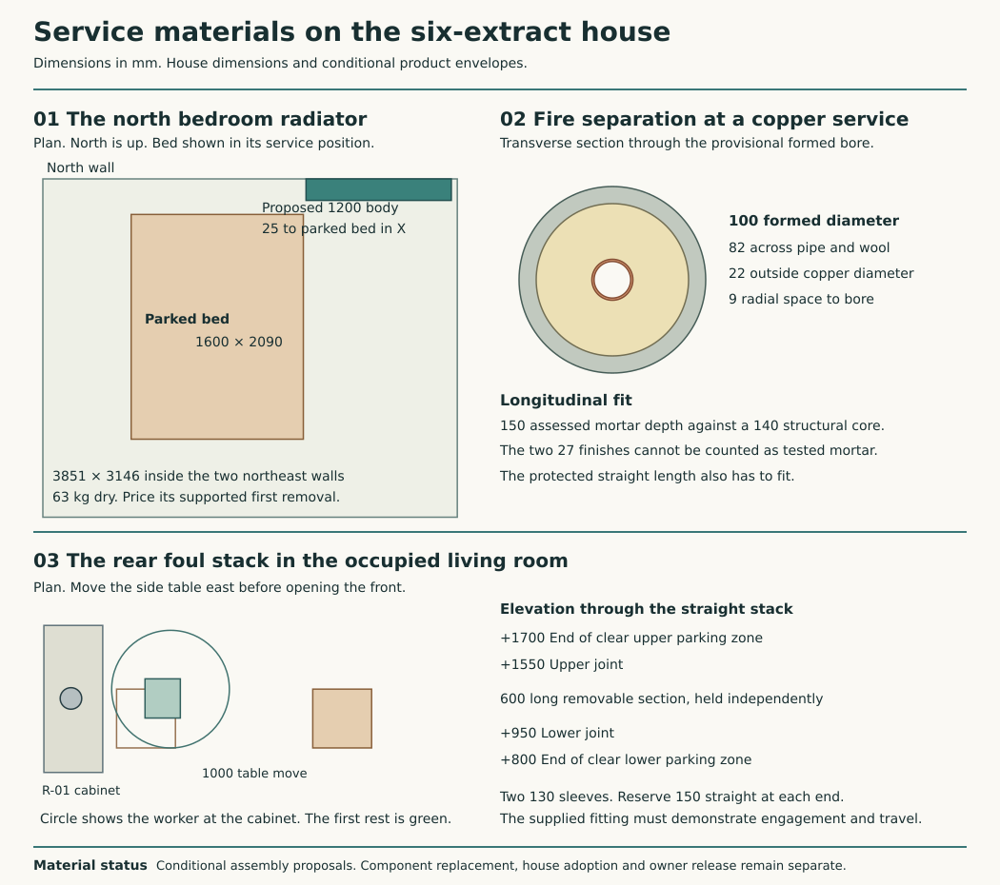

# Material choices for the house services

**Carry accessible copper water lines, a stainless foul-stack repair, six local extracts, a water-tempered cooker intake and a separately heated mineral-jacketed cylinder into house coordination.** The 16-emitter secondary heating loop stays separate from the outdoor primary. Provide a dry mineral-insulated lighting circuit, separate communications territory and individually renewable factory equipment. Retain the two independent rainwater routes and the existing RWT metal-compatibility record.

This resolves the material alternatives in S01–S10. Several complete factory assemblies contain identified polymers. Their use requires a dated decision on the actual part, exposure and replacement. **Zero exceptions are approved.** The existing house drawing still imports the earlier 8 kW and 300 L Services projection. The new HAD-SERVICES-ADOPTION work has to choose a working house configuration, change that projection at its source and reproduce the occupied house against it. [Constituent register](constituent-audit.md#s01s10-development-decision-and-residue-crosswalk) · [House adoption task](../had/house-architectural-design-programme.md#select-the-inhabited-service-system) · [Computed quantities](studies/service-material-offer.json)

## Water and waste

**S01 · Potable water.** Keep copper tube and ordinary metal-sealing fittings on the fourteen cold and nine hot endpoints. At a damaged plain straight, cut to sound material and offer two Endex 88039 end-feed slip sleeves with a closely fitted replacement. The 32/41 mm published sleeve lengths require measured stock and independent parking on both sides. Soft solder requires the matching flux, cleaning and flushing. A suitably qualified copper-to-copper phosphorus braze avoids flux but increases the protected hot-work area. Retain cool, drained, independently supported pipe and shielding for the mineral finish. The Conex 301BP can bridge a manufacturer-approved repair. Its 100 mm overall length gives no allowable damage gap. Press ends with EPDM and valve seats such as PTFE/FPM remain separate residues. [Compared parts and repair](services-water-joints.md#damaged-tube-at-the-east-plant-station)

Develop the accessible lobby feed at (11315,3150,1000) through the two formed piers. Reserve the protected upturned cone-union pair on the cylinder side. The 22 mm Endex N11 allows jointing compound or PTFE **if required**. Price those at both cones until an assembled, renewed matched pair proves a dry joint. The fixed half, counterhold, isolation and capped retained end stay supported when the bridge comes off. The west seat and stand must also come off for the large cylinder. Complete the branch from the utility-side manifold at (11315,2380,1000) to the washer and sink beside the real head-first carry. The washer’s fixed tap at (10800,1250,750) is serviceable in the lower trial posture from (10800,1725), with 562 mm shoulder-to-tap reach. The standing position needs 846 mm and fails the 650 mm control. Release backed utilities from the front before the 700 mm north withdrawal. [Washer station and release](../ias/ias-03-utility-first-release.md) The external riser, frost level and provider handoff stay site-specific. [Inlet and union motion](plant-inlet-route.md) · [Boundary cells, burial and openable raceway](../had/boundary-service-lodge-options-result.md)

**S02 · Foul and condensate.** Of the examined soil systems, carry the AISI 316L BLÜCHER 811 pipe and 842.110.110 S double-slip connection as the accessible residue proposal. Its standard EPDM is local to the sockets. LCC's documented yarn/lead-wool joint is a credible mineral/metal alternative, but its current matched packing, access-door gasket, bitumen coating and releasable repair have not all been established. The Hargreaves Halifax split-coupling method has a defined insertion repair, with epoxy along the pipe and EPDM at each clamp. Substituting bare pipe or removing seals would invalidate those systems. The manufacturer calls for fresh seals and compatible lubricant after dismantling. Provide a separate removable trap and cleaning access wherever the selected apparatus produces condensate. Keep the E-02 route from (9800,5200,2682.5) to the east wall at (12000,5625,2616.875), 2625 mm developed at 1:40. The Ø200 wall opening leaves 55.5 mm to the dry return. Its separate exterior stack and surveyed foul outfall must not receive the potable relief drain by assumption. [System parts and manufacturer's repair data](services-waste-joints.md) · [East foul route](east-water-foul-join.md)

Use the branch-free ground length of the **rear living-room stack**, X567.5/Y11177.5. Propose two straight joints at +950 and +1550, a 600 mm replaceable spool and a 200-wide × 900-high service opening from +800. Reserve 150 mm of clean straight at each retained end to park the entire 130 mm coupling. The actual movement must respect both seal lips, insertion marks, OD tolerance and the maker's instructions. Neither the 97 mm catalogue dimension nor the parking reservation gives an allowable gap. Provide a separate upper stack support, lower restraint and a captive first rest for the spool. Keep clamps free of both parking zones. Upper toilet use stops while this section is open. Drain, ventilate, protect finishes and blank both ends.

Move the 300-square side table 900 east. It passes the reading sofa by 25 mm. A 600 mm diameter body drawing the table from its east side at Y11250 retains 20.5 mm to the north wall. From (1075,11225) the worker clears the cabinet and north wall by 45.5 mm and the sofa by 25. Support the vertical spool before moving both sleeves away from its ends. Draw the released pipe east under capture to a 180-wide receiver centred at X1035. Its near face clears a remotely operating R300 body centred at X1450 by 25 mm. Keep the removed front and temporary blanks on their own stands. Measure the replacement, prepare its edges, fit new seals and inspect every joint under the agreed water test. Restore the cabinet and table only after the section and its independent supports are dry and stable. The new lower opening needs a real frame, door/panel handling, access to the two restraints and lube/clean/test clearance. Reject this spool if the native double sleeve cannot park on smooth tube or if upper loads depend on it. Retain the supported cut-and-renew clamp alternative for the owner's comparison. The proposal adds four seal positions at this pair of double sockets. Include the other sockets, traps, pan connectors and access-door seals in the bought-system schedule. [Occupied house and actual furniture](../had/studies/water-replan.json) · [Located upper and lower riser](services-b-joined-inventory.md)

## Heat, stored water and air

| Family | Carry into the house design | Material, replacement and rejection conditions |
| --- | --- | --- |
| **S03 · Heating** | Three-phase outdoor Panasonic 16-class comparison at 14 kW net delivered to the secondary, independently heated DHW, separated glycol primary, plate exchanger, continuously available buffer and steel panel radiators. Keep the serviceable east kitchen emitter and one indoor hydronic makeup coil. | The 8 kW source fails the connected cold duty. The small 9.52 kW case has insufficient daily output for the retained standby duty. The primary pump, motor insulation, glycols/additives, factory valve seats, coatings, HX joints, pipe-jacket binders and removable insulation require part-specific disclosure. Buy shutoffs and drains on both sides of the HX and coil, independent supports, full buffer and cabinet release and rated recovery after defrost. [Primary/secondary, machine and electrical schedule](local-extract-heat-and-store.md) |
| **S04 · Domestic hot water** | Develop Howden MS103 direct, 370 L catalogue size, nominal Ø760 × 1650 with mineral fibre and metal outer jacket, at X9830/Y4250. Retain a usable 300 L storage requirement and separately scheduled electric heating. | Specify net potable volume, element position, the factory pressure/temperature limits and the actual jacket recipe. The 300 L-class Eco Plus thermal comparator has 60 mm PU and a plastic-coated outer skin. The 273.5 L uniSTOR comparison misses literal storage by 26.5 L. Mineral fibre changes the jacket, leaving immersion seals, membrane, thermostats, approved safety group and inlet valve internals in the register. Remove discharge spool, bridge and supported west stand before trolley movement. The Ø760 case leaves only 20 mm radial for permanent projections after the existing cart margin. [Named storage bodies, heat and removal](local-extract-heat-and-store.md#the-factory-mineral-alternative-needs-a-different-first-movement) · [Discharge system](cylinder-safety-route.md) |
| **S05 · Room extracts** | Six independently removable local stations on the service baseline. The Titon family provides native flow control. Retain all six stations on the six-wet-space house until HAD actually adopts a different rear room. | Count six mandatory EPDM gaskets and six visible ABS fascias for six TP640Hi units, plus motors, electronics and undisclosed contents. A metal grille cannot replace the manufacturer's functional fascia. Give each fan isolation, access to its seals and safe supported withdrawal from its actual room. The W9 alternative consolidates fans but adds a four-port plant root, filters, condensate and duct distribution; it retains its separate 60 mm wall/buffer and carrier design. [House alternatives and component access](balanced-service-architecture.md) |
| **S06 · Supply and transfer** | Six habitable-room inlet territories, smooth removable metal ducts, mechanically captured collars, cleanouts and separately supported weather terminals. Retain the independent high cooker exhaust. | Compare the six 15,000 mm² equivalent-area requirements and the protected 7,600 mm² door-transfer proxies. The actual doorset, smoke control, attenuation, insulation binder, mesh, inlet/filter media and closure must work together. Reject the polyethylene/HDPE/PP ComfoTube network for the local branch. Keep the six background inlets in their habitable supply rooms. Prove occupied-room supply, pressure, sound and every protected door on the actual house. [Connected network and transfer boundaries](connected-cooker-network-result.md) |
| **S07 · Cooker and makeup air** | Salsa/Twist manual outdoor capture and the 27 kg Blauberg EC MW 700 S31 water-tempered supply. Keep the existing east penetration, independent ducts and four-pin release from the south pier. | This removes two 3 kW electric heaters, a 3.8 m overhead carrier and an additional 79 kg west radiator. A 300 mm passive route fails; the larger regularly regulated shutter exceeds its cited duty. Disclose the 30 mm cabinet mineral insulation/binder, filter, feet, sealants, controls, motor and hood grease equipment. The 1020 × 450 cart first lowers vertically on a stationary lift before leaving through the front. Commission installed capture with the complete exhaust, clean/dirty filters and 18°C hot-mode supply. [Selected high setting, room load and staged release](tempered-kitchen-air.md) |

Keep the independently accessible temperature/pressure and expansion relief valves upstream of the visible tundish and maintain open gravity discharge. The Eco Plus comparator has a 3.5 bar reducer, a 3 bar precharged 24 L vessel, 8 bar expansion relief and 90°C/10 bar T&P relief. Its raised trial tundish at (10035,4800,1400) cuts the straight D1 separation from 639.5 to 393.1 mm before bends. Bind the actual Howden port locations, valve settings, continuous fall, receiving point and safe visible termination to the bought package. The previously studied factory group asked for 28 mm inlet and 50 L/min at 1.5 bar; the 22 mm bridge has neither an accepted pressure-loss test nor a generic entitlement to serve the Howden. The two longest front circuit runs already contain 15.61 L on the assumed IDs. Check expansion acceptance for the actual distribution as well as the vessel. The four prescribed mixed-water draws remain independent of fixture count. [Storage, safety and source draw profiles](local-extract-heat-and-store.md)

## Electrical distribution, controls and closures

**S08 · Wiring and communications.** Use bare copper-sheathed MgO cable where the room offers separately supported dry containment and an accessible end at both ends. For the actual Study lamp branch retain two ends, two glands, two bonded metal boxes, BG's epoxy powder, the identified PVC termination constituents and the polycarbonate lamp plug. A cable family, an RPS/RPSL pot and a 27 mm skirting void do not produce a complete universal circuit. Keep the scope of the manufacturer's matched system, segregation and electrical protections. Move the Study attachment or provide a verified independent mounting plate where the 150 mm station crosses the structural jamb in plan. [Room circuit and first replacement](services-mineral-cable.md#switch-a-study-lamp-from-the-door)

Keep the provider's fibre and network termination point with a live double socket at a dry accessible station. Use a replaceable patch lead and collocated router as the least-cable data offer. Make a separate empty accessible metal route available for a wired Study outlet. Maintain an independent wired route for safety controls and alarms. Validate the room connection and service in the occupied house and fit the Study link if the household needs a fixed workstation or room coverage fails. Compare a single replaceable run of Excel 100-071 Cat6, Ø6.2, with eight PE-insulated copper cores, a PE separator and a thermoplastic LS0H jacket for the entire bought length, plus two terminations. For an exception request count the installed path, two actual modules, patch leads and accessible slack. No speculative whole-house star is purchased. The operator's internal fibre, power leads, connector/shroud and exterior duct remain in the constituent account even with zero private room drops. Openreach's July 2026 cupboard guide makes the RJ45 distribution optional and requires a single fibre backbox, maximum 500 mm internal tail and at least 3 m of external coil. The distinct private electrical and passive communications boundary cells retain their source access and ownership. [Openreach installation](https://www.openreach.com/content/dam/openreach/openreach-dam-files/new-dam-%28not-in-use-yet%29/documents/help-support/ONT-Installation-July-2026-Updated-online.pdf) · [Excel 100-071](https://excel-networking.com/catalogue/product/100-071) · [English new-dwelling connection guidance](https://assets.publishing.service.gov.uk/government/uploads/system/uploads/attachment_data/file/1119957/ADR1.pdf)

**S09 · Controls.** Use serviceable metal-front stations, wired local controls and visible status. Separate capture, supply temperature, interlocked damper position, room pressure and power loss. Retain factory frost protection, water high limits and manual reset. The metal face, motor shell and copper cable do not remove PCB laminate, electronics, seals or contact insulation. Keep precisely located edge sensors, wiring terminations and the complete module replaceable without disturbing protected wall fabric. Reject a silent single indicator or a monitoring app as sole proof of the two airstreams. [Controls and physical receipts](tempered-kitchen-air.md#prove-the-changeover)

**S10 · Penetrations and closures.** Keep a formed opening, independent pipe and duct supports, accessible joints and a separately restorable boundary. Assign fire, weather, acoustic, pest and condensate functions at each actual wall. The Ø100 provisional inner holes for the cold feed have 13 mm radial outside the current Ø74 reservation. Where the adopted fire strategy requires it, compare the assessed PROMASTOP-M copper detail. Its stated LS/LI mineral wool is 30–100 mm, 40–150 kg/m³, melting point at least 1000°C and local length at least 1000 mm with the registered pipe diameter and wall-thickness graph. The mortar seal needs at least 150 mm depth. A continuous wrap around 22 mm copper is already Ø82, leaving at most 9 mm radial in Ø100. The 140 mm structural core is 10 mm short of that seal depth. Plaster skins have their own duties and do not provide tested mortar. The 170 mm from the utility tip to pier axis does not demonstrate the required local insulation length or a valid return around its fittings. Keep the 22 × 1.2 Kuterlon as an available tube comparator and verify the exact wall thickness, annulus, supports, wool configuration and pipes' end condition for the selected assessment. Reject a generic mortar-and-sleeve prescription. Use a supplier-assessed thickened boundary with clips and union clear of its face, or relocate the crossing out of that compartment. A restored non-rated weather/sound joint has a separate duty. Insulation binders and mortar admixtures still need declaration. [ETA-17/0862, pp. 3 and 21](https://media.promat.com/pi34802/original/1810089534/eta-17-0862-promastop-m.pdf#page=21) · [Kuterlon range](https://yorkshirecopper.com/wp-content/uploads/U2502.pdf) · [Actual piers and bores](plant-inlet-route.md)

## Tests for the house design

The six native 13/16 L/s stations and 12–15 L/s powered standby supply remain the underlying positive cold-weather development branch. Loss of that supply while the other fans keep running is a real defect. A non-humidity TP640i in the kitchen can be compared at native **5 continuous, 16 boost, 20 high** with the other five independently at 13/16. With cooking inhibited and zero direct makeup, the 32 distinct combinations yield 70–85 L/s through the habitable rooms and kitchen pressure of −4.709 to −3.437 Pa under the same calm, closed-door assumptions. The room source must explicitly adopt the change from 78 L/s ordinary. Keep a reachable high wet-extraction control, zero boost delay/overrun for this trial, and a de-energised switch-live fault path. The highest hot case becomes 104.49 L/s supply, 3.511 kW at the coil and 13.346 kW for the house. The sensor, fan and two real ducts must actually reach their prescribed states. [Titon DO5841 issue 1](https://www.titon.com/uk/wp-content/uploads/sites/10/2020/12/DO5841-Iss-01.pdf) · [Approved Document F vol. 1, tables 1.2 and 1.3](https://assets.publishing.service.gov.uk/government/uploads/system/uploads/attachment_data/file/1045918/ADF1.pdf)

At −5 Pa the permissible residual hood exhaust with no makeup and the kitchen fan at 5 L/s is 3.308 L/s if the other five are ordinary, **0.697 L/s** if all are boosted. The inherited pressure trip acts after five seconds below −5 Pa. If HAD adopts the stronger criterion of physical recovery within five seconds of loss of supply, demonstrate that low residual, including wind draw through the outlet, in the actual installed system. A stop contact or a nominally shut blade supplies neither a coast time nor a leakage rate. Preserve safe coil response when electricity also fails. Reject any proposed hot-cooking mode that cannot make the protective transition. Keep cooking unavailable on a latched fault.

Check the whole-house 14 kW capacity against the individual room emitters. The principal's existing H600×1000 gives 1.202 kW at 55/45/20°C. After the largest 21.18 L/s cold inlet it allows only **14.66 W/K** of local fabric and infiltration loss. Its 3.851 × 3.146 m northeast corner presents three segmental windows totalling 5.346 m². Price the two walls only through their 2.85 m heads, using the ordinary field 0.32445 and the proposed complete-window target 1.6 W/m²K. They already consume **13.29 W/K**. A roof projection at 0.12 W/m²K spends more than the remaining 1.37 W/K before leakage and junctions. These are explicit design values. The permanent room loss and actual roof allocation still need establishing. [Glass and wall offer](whole-envelope-selection.md)

Develop the same H600 family at length 1200 on the north wall. Place the full 1350 × 200 at X10165/Y11370.5. It gives 1.443 kW and a 22.68 W/K local budget, clears the west-parked bed by 25 mm, the east wall by 55.5 mm and the ordinary bed by 130.5 mm. Confirm the 63 kg drained body's bearings, tail, sill, valves, supported first movement and passage to a lifting route. The other five habitable HLC ceilings are 19.31 W/K in each front bedroom, 15.11 in Bed4, 27.24 in Study and 51.29 in Living on the same trial. They provide measurable rejection conditions for occupied-room sizing. [Numerical evidence and remaining duties](studies/service-material-offer.json)

MAT-COORDINATION owns the reconciliation of the finally selected materials and any owner exceptions. For each refused or still-unknown residue retain the article/revision, exact installed quantity or explicit uncertainty, position, visibility, exposure, replacement interval or inspection trigger, factory safety duty, compared redesign, supported access and dated disposition. The local fans, two-sleeve example and two cable ends have finite counts. Whole-house pipe joints, screens, membranes, filters, supplier electronics, cable lengths, compounds and the optional LAN remain unpurchased quantities. Reject unapproved products for installation and keep the working service available by an approved alternate or an explicitly different house design. The architecture successor owns the permanent physical fit. [Owner policy](../../docs/reference-house/material-policy.md) · [Programme](material-integrity-programme.md)
