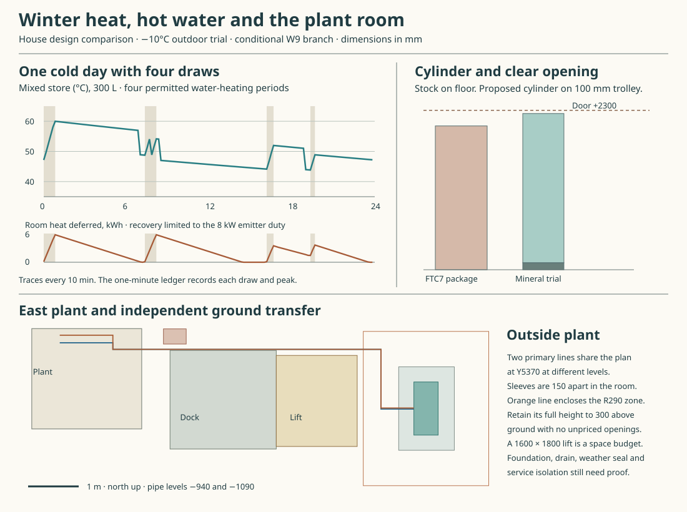

# A cold day in the house and plant room

Carry the **10 kW-class monobloc, separate heat exchangers and a slim factory cylinder** into the balanced-ventilation comparison. It can serve the four stated hot-water draws and recover the day's room heat in the model. The governing six local extracts still give **9.408 kW for rooms alone** at −10°C, above the installed 8 kW room duty. Keep both ventilation branches visible until there is a site heat loss and a physically credible W9 installation. [House services](whole-house-service-baseline.md) · [W9 cold-weather duty](balanced-service-architecture.md) · [Computed results](studies/winter-heat-and-water.json)

## Which outdoor unit can deliver the water temperatures?

Use 20°C indoors, −10°C outdoors and 220 W/K fabric and infiltration. The conditional W9 supplies 16°C air at 96 L/s ordinarily and 128 L/s for two cooking hours, with 70% effective recovery and the existing supplementary air-heat contract. That leaves 7.061 and 7.214 kW respectively at the radiators, or 169.766 kWh/day. Sixteen emitters offer 8.824 kW across fourteen duties, but the least generous room has only 2.13% spare. Limit useful room output to the scheduled 8 kW.

| Ecodan, single phase | A−10/W50 maximum kW / COP | A−10/W70 maximum kW / COP | Useful room / coil kW in this model | Daily result |
|---|---|---|---|---|
| PUZ-WZ85VAA | 8.5 / 2.08 | 6.8 / 1.64 | 7.225 / 5.78 | Room heat falls short by 14.43 kWh each day |
| PUZ-WZ100VAA | 10.4 / 2.22 | 9.1 / 1.64 | 8 / 6 | Meets both duties on the timed draw profile |
| PUZ-WZ120VAA | 11.7 / 1.94 | 10.6 / 1.66 | 8 / 6 | Same delivery at both house limits |

These are maximum-output table points. Apply a separate 15% adverse system allowance as a sensitivity. The data book already accounts for defrost where marked. No additional defrost fraction or annual COP follows. At the existing minimum primary fluid heat capacity of 3.2 kJ/L·K, 30 L/min transfers 8 kW across 5 K. Delivering the full 10.4 kW would need 39 L/min, above the 100 model's 34.4 L/min ceiling. Qualify actual glycol and flow, frost behaviour and the 100 L available to defrost in every valve state. [Manufacturer data book, A-37 and A-38](https://library.mitsubishielectric.co.uk/pdf/download_full/5483)

For room heat, primary 50/45°C to emitters 45/40°C requires exchanger conductance of 1.60 kW/K. For water, primary 70/65°C to a 65/62°C coil loop requires 1.53 kW/K at 6 kW. The coil inside a 60°C tank then needs **1.83 kW/K**, or 611 W/m²K over 3 m², at 28.67 L/min. Specify output at the end of charging, pressure drop and fouling allowance against the actual matched pumps. Halving coil conductance happens to serve this draw sequence because the tank is usually cooler. It fails the 6 kW end-of-charge requirement.

## What happens between 07:00 and 08:30?

Draw 80, 80 and 70 L at 40°C at 07:00, 07:45 and 08:30, then 70 L at 19:00. Mains enters at 10°C. A minute-by-minute mixed 300 L tank accounts for delivered heat, jacket loss and 1 kWh/day distribution loss. Reserve all 150 minutes of water priority even if the tank reaches 60°C early. Run eight days so neither a preheated tank nor an unrecovered room deficit can fund a daily pass. Actual stratification and draw-off require a rated assembly.

| Charging arrangement | Delivered at 40°C | Whole-house consequence |
|---|---|---|
| Ten equal 15-minute intervals spaced 144 minutes apart | 4.34 L short | Returning to 60°C later misses the morning draw |
| Start 06:20, 07:05 and 08:15 for 15, 20 and 10 minutes, plus seven 15-minute intervals | All 300 L | Tank minimum 43.91°C, returns to 60°C. The peak deferred room heat is 4.043 kWh |
| Same revised windows, previous 4 kW charging limit | 97.5 L short | Tank peak 48.14°C |
| Revised windows, 6 kW, higher jacket and pipe losses | 6.92 L short | Tank peak 54.79°C with conductivity 0.045 W/mK, 1 W/K bridges and 2 kWh/day distribution |

The successful cycle supplies 10.465 kWh at the taps and charges 14.186 kWh. The building must contribute at least **8.09 kWh/K of participating heat capacity** to keep a 4.043 kWh interruption within 0.5 K even under evenly shared room response. Verify occupied room temperatures individually, especially near emitters with little reserve. The primary buffer has no room-inertia credit. Demonstrate that the matched factory controller can operate the requested windows, transitions, normal hygiene cycle and protective overrides. If not, compare independent DHW heating or a revised source. Full window times and water/room conservation are in the [reproducer](studies/winter-heat-and-water.py).

## Which cylinder fits and can be replaced?

The FTC7 EHPT30X-UKHEW1L provides 301 L. Its published 172-minute reheat and 5.38 kW nominal heat input use the variable compressor **and** a 3 kW immersion boost to 60°C at 20 L/min primary. This is a useful factory benchmark. Its 748 × 755 × 2075 mm package exceeds the 700-square station by 48 and 55 mm. It weighs 82/382 kg empty/full, uses 60 mm expanded polyurethane, has a 24 L expansion vessel and loses 2.09 kWh/24 h under its test conditions. Retain it intact as a comparator. The separate 300 BES has only 273.5 L potable capacity. [FTC7 installation manual, pp. 8 and 12](https://library.mitsubishielectric.co.uk/pdf/download_full/5760) · [FTC7 product sheet](https://library.mitsubishielectric.co.uk/pdf/download_full/5757) · [300 BES evidence](domestic-hot-water-cylinder.md)

Give a manufacturer a **594 mm diameter × 2154 mm high** design envelope. A 484 mm bore and 1800 mm straight barrel contain 331.17 L before end volumes. A 3 m² coil displaces 21 L. Reserving another 8 L internally leaves 302.17 L. The 28 mm OD coil needs 34.10 m, about 26 turns over 958 mm and 18 mm radial clearance. Bore, heads and 490 mm shell OD define a geometric trial only. Supplier pressure design, rated useful water, immersion, inspection, relief and complete material declaration govern.

At 50 mm mineral insulation, conductivity 0.040 W/mK and 0.5 W/K total thermal bridges, the jacket and ends lose 3.329 kWh/24 h at 60/20°C. Include the actual segmented casing, fasteners, binder, treatment, connections and losses in the product test. Move the cylinder 15 mm west to X9845/Y4250 for 38.06 mm clearance during the inlet bridge swing, against a 35 mm requirement. The 100 mm trolley leaves 46 mm under the 2300 door. R421 needed with the retained tail leaves only 4 mm in the R425 cart envelope. Price detachable top connections, native safety group, relief slope, loaded handling and first-rest hardware together. [Industrial mineral slab conductivity, table at 50°C](https://rti.rockwool.com/syssiteassets/tools--documentation/products-industrial/product-data-sheets/uk/rti-prorox-sl-930_uk.pdf?f=20201210152241) · [Moving inlet bridge](plant-inlet-route.md) · [Relief route](cylinder-safety-route.md)

## Where do the machine, pipes and supply go?

Face the actual 1050-wide, 480-deep unit east on an 1100 × 1650 pad. The old body reservation was 450 mm short across its face. For the manufacturer's open-ground installation, allow the full 1 m perimeter from ground to +300 mm, leaving 70 mm inside the east reservation and 120 mm to the independently budgeted 1600 × 1800 lift. Establish actual walls, openings, ignition sources, frost-safe condensate receiver, discharge air, noise, service access and lifting on the selected site. The 100 unit is 120 kg and contains 0.82 kg R290. [Outdoor unit product sheet](https://library.mitsubishielectric.co.uk/pdf/download_full/5456) · [Outdoor installation manual, §3 Fig. 3-2](https://library.mitsubishielectric.co.uk/pdf/download_full/5450)

The old riser X12500/Y4300 crosses the loading dock. Take the two 90 mm insulated lines north of the lift on Y5370 at Z−940 and −1090. Their envelopes clear the lift by 75, the foul stack by 60 and each other by 60 mm. Rise through separate 120 mm sleeves at X9950/Y5500 and Y5650. These have 30 mm between seats and 40/65 mm minimum to the enumerated room/structure/handling obstacles. Allow detachable indoor and outdoor tails beyond the measured 9.55 and 9.83 m runs. At 0.5 L/s through 26 mm ID, a Darcy factor of 0.04 and combined fitting K of 12 give 20.60 kPa. Add a 35 kPa exchanger/filter/valve allowance. Match the actual pump to the resulting 55.60 kPa, native port heights, subfloor supports and reinstatable weather/fire seals. [Ground transfer](plant-threshold.md) · [Coordinate and pressure ledger](studies/winter-heat-and-water.json)

The single-phase 100 unit's 30 A maximum, 13 A immersion, 16 A W9 circuit allowance and 3 A auxiliaries reserve **62 A** before other loads. Illustrative 60/80/100 A supplies leave −2/+18/+38 A. Adding a coincident 32 A cooker leaves −34/−14/+6 A. A three-phase YAA comparator at 12 A/phase gives 28/25/15 A with W9, immersion and auxiliaries assigned to separate phases. These are concurrent budgets. Establish actual demand, supply, protection, manufacturer interlocks and isolation before selecting circuits or a connection. Keep factory pumps, seals, safety valves, electrical insulation, controls, jacket constituents and glycol on the S01–S10 material register. [Data book, electrical specification](https://library.mitsubishielectric.co.uk/pdf/download_full/5483) · [UK Power Networks, domestic supply upgrades](https://www.ukpowernetworks.co.uk/i-already-have-electricity-domestic/adding-more-power/what-do-you-need-to-upgrade) · [Constituent audit](constituent-audit.md)
