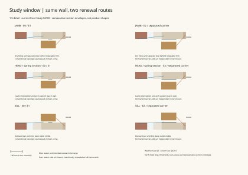
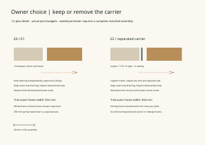

# Front Study window | conventional frame or retained carrier

**Carry both renewal routes into the first owner review.** The conventional mechanically fixed frame is the comparison control. Sparse fixing pads preserve its aperture in this model. A local retained carrier can preserve the outer wet transition during some frame work, but neither tested profile accepts the existing frame through its smaller opening. The wider release joint only becomes a candidate with a changed frame and proven seats, seals and handling.

[Set the drawings in the owner review](../had/owner-design-pack-preparation.md) · [Current bay and occupied approach](../bcr/bay-interface-study.md) · [Study sash and glass comparison](../mat/study-coupled-window.md) · [Source fingerprints and dimensions](studies/study-subframe.json)

The controlling occurrence is **GROUND / outer-south / south-window-0**, centred at **X2100**, with 1000 mm raw width, sill Z750, spring Z2550 and crown Z2850. Keep the 27 mm dry lining, Y429.5 room face, and Y222.5–402.5 portal core in both comparisons. The trial frame spans Y220–348 with dry fixing line Y300. Existing arch support stays independent of the frame and the cassette. The sections show allocation envelopes and boundary routes. They are insufficient for fabrication or for setting a seal compression.

## Millimetres spent at each edge

| Comparison | Allocation beyond the 27 mm finished return | Candidate outer width | Consequence |
| --- | --- | ---: | --- |
| E0, direct mechanical fixing | 12 mm fitting trial | **922 mm** | Conventional renewal breaks the interface at the frame. Restore it deliberately from accessible edges. |
| E1, isolated fixing grounds | The same 12 mm joint, with sparse pads at Y282.5–317.5 inside the core depth and dry access to fasteners | **922 mm** | The Y300 line leaves 17.5 mm nominal to each pad end. Actual packers, fixings, seat and stop determine whether a sparse ground earns its space. |
| E2, tight local carrier | 3 mm plate + 4 mm wall fit + 5 mm dry release + 4 mm setting reservation | **914 mm** | Preserving the old frame and finish would consume 4 mm per side beyond the trial retained opening. The dry release allowance alone falls to 1 mm after two 2 mm settings. |
| E2, separate local closure | 4 mm plate + 5 mm wall fit + 8 mm dry release + 4 mm setting reservation | **904 mm** | Leaves 4 mm in the dry release check, but loses 9 mm per side against the retained frame. A reduced 834 mm operating width is a sensitivity with unchanged profiles, not a recalculated sash. |

The 12 mm fitting trial is borrowed from the original Study section. The new 2 + 2 mm stack is a separate cassette installation sensitivity. The same errors are also applied to the independent open-joint usability screen to challenge which group they consume. There is no probability or installed tolerance claim. Apply the inset along the same curved head, with fitted crown Z2811 for E0, Z2807 for tight E2 and Z2802 for the separated joint. Trimming the old lining to recover the lost width would change its aperture cross-section. Increasing the roomward lining depth would spend the independently constrained Study door and window room-side release space.

## Support, wet path and reinstatement

At the **head**, intercept cavity water above the structural arch and turn it outward past the proposed retained part. At the **jamb**, retain a drained outside termination and a separately sealed room-side line. At the **sill**, drain the frame and the protected area behind it to an inspectable outward pan. Challenge a blocked outward path and failed perimeter seal before counting a dry threshold. Neither joint may route water into the mineral finish, the carrier pocket or retained fixing line. Use independently supported temporary weather closure for full-frame exchange. Keep water and frame loads off the warm trim and the removable finish. Coat, isolate and drain the trial carrier with declared constituent choices. Neither the metal strip nor the hatch outline qualifies hidden seals, bedding, galvanic compatibility or thermal performance.

On the warm side draw the dry trim first, support the component and expose its accessible fixings. The earlier **250 mm** inward draw concerns each separable fixed **half-head pack**, with only **2 mm** remaining pocket reserve after settings. It is not a whole-window removal claim. Maintain positive capture and the BCR apparatus/occupied apron outside the selected inlet's carrier. Record complete outward scaffold, guards, whole-frame support and carriage if inward removal is unproved. For E0/E1 inspect mounting grounds and re-establish the affected warm and wet seals. For E2 retain the permanent exterior stop only if it is independently supported and remains watertight while the dry-side nested frame is out. Refit the nested frame, install the accessible inner seal, inspect both permanent joints, then prove the drain, air line, retained head capture and operation. Eventual replacement of the carrier is another support and weather-closure operation.

**Decision for the pack.** E0/E1 preserve the existing modeled envelope and remain the leading comparisons. Reject a continuous retained carrier as a drop-in for this frame. Keep a resized, separately sealed carrier as an explicit local option if the owner values the extra retained wet boundary enough to pay for its changed aperture, service sequence and second permanent perimeter. Before that branch advances, obtain a joined carrier/frame section, dry-removal sweep, sill and blocked-drain detail, and actual support and movement evidence from TRIAD and the source owners. This study neither selects that branch nor reopens the house-wide cassette exclusion.

Run `node project/oas/studies/study-subframe.mjs --check` to reproduce the two sheets and receipt. Print at original A3 and A4 size and verify the labeled scale bars. No existing opening selection, project material exception, support approval, completed physical test or owner decision is changed.
