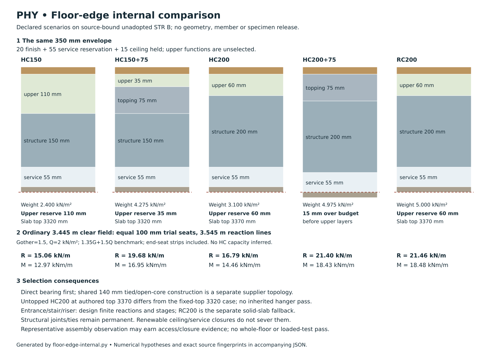

# Floor-edge internal investigation

**31 October 2026 — PHY-03-ENGINEERING. Internal research, preliminary calculations and provisional option reduction.**

**Reference design — not released for construction. Assumptions and outstanding verification accompany the proposal; internal checks do not constitute external assurance or certification.**

## Decision

**Develop direct-bearing hollowcore as the ordinary floor-edge route, with a supplier-designed permanent joint/tie system. Keep a 200 mm in-situ reinforced-concrete floor as the conventional alternative where the complete interrupted floor is simpler to resolve in a solid slab.** Neither is adopted here. Do not make a new removable shoe, dry sliding seat or fabricated shallow shelf the default merely to preserve the nominal ceiling line.

This investigation narrows the choice in six ways:

1. A **150 mm untopped hollowcore** field remains the first ordinary-edge enquiry. The current manufacturer guide supports investigating the longer unadopted fields as well as the short ordinary field; it does not establish their actual panel schedule. Removing a structural topping is conditional on a complete designed joint, restraint and diaphragm route. It is not permission to omit those functions.
2. **150 mm hollowcore plus a nominal 75 mm topping** remains a credible alternative, but carries 1.875 kN/m² extra permanent action and leaves only 35 mm for upper functions in the represented floor depth. It receives no composite-action, diaphragm, fire, acoustic or waterproofing credit from its thickness alone.
3. **Untopped HC200 is a distinct, live alternative**, particularly before inventing a bespoke 150 mm riser hanger. An authored 20 finish + 60 upper functions + 200 hollowcore + 55 services + 15 ceiling section preserves the overall 350 mm, with slab top **3370** and soffit **3170**. This changes the structural upper datum and assumes a complete untopped joint/diaphragm route; it is not the accepted fixed-3320-top riser case and grants no hanger or upper-layer pass.
4. **200 mm hollowcore plus 75 mm topping cannot preserve the unchanged 350 mm assembly**, even before upper functional layers: it exceeds that budget by 15 mm. Its nominal product compatibility is not an excuse to consume the service zone silently.
5. **RC200 is a real conventional comparator.** It is 2.600 kN/m² heavier than bare HC150, **1.900** heavier than bare HC200, but only **0.725** heavier than HC150+75 under the stated weights. Its continuous solid zones can be designed around openings without an unqualified hollowcore cut, although it still requires reinforcement, restraint, anchorage, temporary works and boundary design. One ordinary-span bar trial is credible as a preliminary benchmark; that same bar trial fails the long-gallery flexural comparison. This is a conditional section result, not rejection of the RC family.
6. The **east-spine tied 140 mm shared bearing remains the current supplier-specific enquiry** from STR. It is a different support topology from two independent 100 mm seats. The entrance, stair and service interruption cases need their own finite load paths; an ordinary-edge calculation cannot close them.

There is no reason at this stage to commission a bespoke proof-load experiment to validate an invented ordinary bearing connection. There is a useful, conditional **assembly and renewal observation** once a complete supplier/engineered detail is selected. Its representative occurrence and limits are defined below. Loaded testing remains a separate released activity under ER-STR-01 / EPR-RH11.

## Authority, source geometry and reproducibility

This completed internal investigation implements the [PHY internal development contract](physical-validation-programme.md) and [current-house applicability](current-house-prototype-applicability.md); its challenge and validation record is below. It does not change the house geometry, material register, BCR finding classifications, physical-test gates or project maturity. The historical timber/hanger P03 study remains comparison history, not a compulsory current baseline.

The starting main is `a86ad87950d007f862b6004769bbea56e8bfd946`. The accepted architectural authority remains **RH-LAYOUT-REVISION-02 / FAMILY-02**. The joined **STR B** plan is explicitly **unadopted**. Its rotations, spine and frame positions are hypotheses used to expose consequences, not architectural instructions. The [structural brief](../../docs/reference-house/structural-brief.md), [owner charter](../owner-house-charter.md), [material policy](../../docs/reference-house/material-policy.md) and [STR programme](../str/structural-architecture-programme.md) retain their authority.

The [standard-library Python reproducer](studies/floor-edge-internal.py), [complete numerical output](studies/floor-edge-internal.json) and [A3 comparison](studies/floor-edge-internal.svg) are part of this study. Run:

```sh
python project/phy/studies/floor-edge-internal.py --check
```

Without `--check`, the script regenerates only its JSON and SVG. It verifies SHA-256 fingerprints of the six actual geometry sources before calculating; changed inputs fail rather than silently inheriting this result. The output records units, all hypotheses, sensitivity cases and equilibrium checks. It is a transparent scenario calculator, not a building-analysis or product-design program. Primary source files are identified below; their web access date does not become a technical revision.



| Occurrence | Source-bound geometry used | What is still a hypothesis |
|---|---|---|
| Ordinary outer/court edge | [Span envelope](../str/str-spans-result.md): 3445 mm between structural faces; 3415 between finishes; 3585 between represented leaf centres | Two separate 100 mm seats from [STR support comparison](../str/house-support-study.md) give 3545 mm reaction-centre spacing and 3645 mm end-to-end length. Actual bearing stress/reaction lines and ordered unit length are unselected |
| Longer B fields | Clear spans 4327.5 mm at the rotated southwest room and 5462.5 mm at the rotated east gallery | Adding the same two trial seats gives 4427.5 / 5562.5 mm reaction-centre scenarios, not accepted effective spans |
| Shared east spine | [STR bearing study](../str/house-spine-bearing-study.md): 140 mm core at x 9230–9370; clear gallery 1077.5 and wet strip 2227.5; representative bay y 6570–7770 | Actual unit/core phase, narrow-end bearing, grout, tie anchorage, top-wall transfer and temporary works |
| Entrance bridge | [STR support study](../str/house-support-study.md): bridge y 2735–3832.5; side patches x 4685–4885 and 7115–7315; short side-member axes y 2650 / 3917.5 | Actual members, patch resistance, arch/spandrel behaviour, guard/point loads and end-seat extent |
| Stair interruption | Header patch y 4232.5–4432.5 stays outside the clear stair; inner trimmer patch x 2817.5–3017.5; north support axis y 8852.5 | Actual tributaries, landing/flight/guard loads, sections, connections, bearing and construction sequence |
| Service/wet edge | [STR riser trim](../str/house-riser-trim-study.md): 700 × 800 structural enquiry, 550 × 700 gross riser and 600 × 750 cabinet are distinct | Actual supported unit cuts, receiving panels, cabinet/plant reactions, penetrations and independent closure |

The section is FFL 3450 above finished ceiling 3100: **350 mm** total. The B allowance is 20 finish + 35 upper functions + 75 topping + 150 hollowcore + 55 services + 15 ceiling. A separate 15 mm positive camber/tolerance hypothesis leaves 20 mm upper functions and requires up to 90 mm topping at supports to retain 75 mm at the highest crown. That is a reservation, not predicted camber, levelling permission or a qualified finish build-up.

## Primary technical basis

Sources were reopened on 31 October 2026. The supplied details and dates are kept separate from general material mechanics. No catalogue span, CE/UKCA status or component description constitutes a whole installed-house approval.

| Source | Evidence used and exact scope |
|---|---|
| **S1 — Forterra/Bison, [Hollowcore brochure, 05/2019](https://www.forterra.co.uk/wp-content/uploads/2020/12/Bison-Hollowcore-Brochure-2019.pdf), printed pp8–15** | Current-hosted product guide. Printed p15 gives HC150 2.40 and HC200 3.10 kN/m²; the unambiguous Q = 2 column gives maximum **clear** guide spans 7.40 / 8.85 m with **2.1 kN/m² finishes**. The table includes service/ultimate conditions, deflection and natural frequency but explicitly remains a guide. It is not the selected reinforcement/unit or a rating for openings, line loads or this house |
| **S2 — MPA/PFF, [Hollowcore flooring](https://www.mpaprecast.org/MPAPrecast/media/root/Publications/Flooring/p2.pdf), August 2019, pp2–4** | Nominal bearing and joint/restraint families; diaphragm action can be designed with or without structural topping. Its discussion does not qualify a loose dry-jointed floor. Actual supplier/manufacturer design governs |
| **S3 — MPA/PFF, [Hollowcore composite floor systems](https://www.mpaprecast.org/MPAPrecast/media/root/Publications/Flooring/Hollowcore-Composite-Floor-Systems_1.pdf), August 2019** | Structural topping is a designed system, with minimum depth at the camber crown and surface/interface requirements. Its separate table assumptions, including finishes, must not be spliced into S1 or treated as this study's added-load capacity |
| **S4 — Ibstock/Coltman, [engineers' section](https://www.ibstock.co.uk/products/flooring-and-lintels/hollowcore/engineers-section), current-linked [Dual Bearing on 140 Wall](https://images.ctfassets.net/eta2vegx3yuv/xDkkn2b15F9r0FS4iHie7/e089626385026a81229e47190e38e4f8/Hollowcore_-_Dual_Bearing_on_140_Wall.png)** | H12 bars grouted into opened cores at 400 centres; full bearing at the other end; purpose-designed temporary support retained until infill design strength. This whole family cannot be assembled from Forterra's different typical core/tie count. Neither the image nor this study supplies actual narrow-end lengths or a house capacity |
| **S5 — MPA Precast, [Supporting Steelwork](https://www.mpaprecast.org/MPAPrecast/media/root/Resources/MPA-Precast-Datasheet-Supporting-Steelwork-6pp-DIGITAL-(1).pdf), August 2024, pp2–5** | One-sided slab erection can rotate a beam with an angle/projecting plate before infill cures. The illustrated prop acts beneath the bearing line; the alternative padstone needs the shelf carried to the end. These measures do not establish lateral-torsional stability. Support over openings and masonry bond also matter |
| **S6 — PFF, [Code of Practice for Safe Installation of Precast Elements](https://www.mpaprecast.org/MPAPrecast/media/root/Publications/Flooring/Flooring-CoP-Safe-Installation.pdf), current-linked 2017 edition, §4.2.2 / printed p22** | Temporary unequal loads, adequate fixed bearings and beam/wall stability require design; avoid temporary bearings where possible and specifically design unavoidable ones. A final-state load path is insufficient for erection |
| **S7 — The Concrete Centre, [Worked Examples to Eurocode 2](https://www.concretecentre.com/TCC/media/TCCMediaLibrary/Events/Online%20course/CCIP_Worked_Examples_EC2.pdf), December 2009, printed pp18, 22, 38–39, 174, 185–188** | Dated **first-generation UK** benchmark: generic reinforced/wet concrete 25/26 kN/m³, dense block 20, plaster 14.1; action factors and simple RC section methods. The [currently linked errata with 2021 additions](https://concretecentre.com/TCC/media/TCCMediaLibrary/Products/CCIP_Errata_WorkedExamples_2009_2021.pdf) amend, among other things, deflection examples and punching checks. This study does not inherit their old example's serviceability pass or apply strip shear to punching |
| **S8 — The Concrete Centre, current [Deflection guidance](https://concretecentre.com/Codes/Eurocode-2/Deflection.aspx)** | Actual curvature/deflection depends on cracking, tension stiffening, time of each load, creep and shrinkage. The two stiffness idealisations below are deliberately simpler and grant no final-deflection result |
| **S9 — The Concrete Centre/BDA, [Masonry vertical resistance, Revision 2](https://www.brick.org.uk/uploads/downloads/d-eurocode-6-masonry-vertical-resistance.pdf), pp1–2, 5–7** | Normalised unit strength, mortar, grouping, workmanship, slenderness, eccentricity and concentrated-load effects are distinct. A nominal block strength is not masonry design resistance; the gross stress exercise below is not an EC6 wall check |
| **S10 — Peikko, [PETRA current UK source](https://www.peikko.co.uk/products/product/petra-slab-hanger/), linked technical manual 04/2025, printed pp7–10, 22** | Already source-bound in [the accepted riser result](../str/house-riser-trim-study.md). Standard depths begin at 175 mm; the reviewed Ibstock overlap starts at 200. Receiving slabs, reinforced bearing regions, joints and particular point/line loads require their actual design. No 150 mm product rating is inferred |
| **S11 — MPA Precast, [Weep Holes](https://www.mpaprecast.org/MPAPrecast/media/root/Resources/MPA-Precast_Weep-Holes_Advice-Note_2024.pdf), April 2024** | Closed/plugged cores can retain water; blocked drainage can cause later damp ceilings. This is a construction inspection/drying duty, not permission to drill unknown prestress zones or convert cores into service ducts |
| **S12 — US FHWA, [Thermal coefficient of Portland cement concrete](https://www.fhwa.dot.gov/publications/research/infrastructure/pavements/pccp/thermal.cfm), archived primary research** | Approximately 8–12 microstrain/K is used only as a material-sensitivity range. Mix/aggregate matters; pavement research is not a UK floor-junction qualification. Temperature and shrinkage scenarios below are authored |

The [current TCC Eurocode compass](https://concretecentre.com/Resources/Concrete-Compass/Eurocode-2.aspx) distinguishes first- and second-generation methods and the transition. The study declares its first-generation benchmark rather than combining generations or representing the 2009 worked examples as a current project code specification. The competent design must establish the governing code/UK National Annex, exposure, design working life and actual actions.

Retrieved PDF/detail SHA-256 identities for reproducible source checking:

| Document | SHA-256 |
|---|---|
| S1 Bison 2019 | `34759ff5487fc99b117f614a3926d1bc2e5e3e3488ae6ae3c2f626cf094cb7ee` |
| S2 PFF hollowcore | `01f16a88672551b373fc77848073127ee2b19d8ad9b317657d51ac042e156bff` |
| S3 PFF composite | `a406580268ad051a9ce4f524e037d3a235a50ba911331274149c1deee5e6c1f1` |
| S4 Ibstock 140 detail | `e3e3d9f8f9f4771c79c46245440f618dbe6c7de369c901f3812cdcd909085a82` |
| S5 MPA steelwork | `fa576388a006059f5ec92c5e43238ab32ebc03a7d4f4f99253ebcf4d4ce05fc7` |
| S6 installation code | `380b74b548ea75b65eff851a2e846a9e22f18bbf2cdf04d1ca717772e685f701` |
| S7 worked examples | `846a39e4a04baf1e1f233b7536c3b6d80fb2b3883265af85d2377265a1767637` |
| S7 linked errata | `c6fe9029afa1ae2ef69e48318070cf16f2582765d51c3afdc52a2f07858a5f57` |
| S9 masonry guide | `93902af3f218ffe011bb6682ada251a818175a92bd90d545197e704381262c44` |
| S10 PETRA 04/2025 | `73d418fa20f659dbb6ef5586e9c9e765238a42298b596b626e77adfde349a640` |
| S11 weep-hole advice | `ff1e9230e00cbe9902406c41717f7fb87f76bfb41679bf1020524d2fff6a8a09` |

## Actions and ordinary strip calculation

These are **scenario inputs**, not verified occupancy, site, construction or product loads. One metre of floor width is analysed under uniform gravity action, with simple ideal reaction lines at the centres of equal 100 mm trial seats. It provides demands; it does not choose a hollowcore section, bearing pressure distribution or effective span for design.

| Input | Reference hypothesis | Sensitivity / provenance |
|---|---|---|
| Other permanent action, excluding the explicit heavy-wall counterexample | 1.5 kN/m² | 1.0 / 1.5 / 2.0; an authored allowance for unselected finishes/services, not an accepted layer schedule |
| Variable action | 2.0 kN/m² | 1.5 / 2.0 / 3.0; not a substitute for actual use category, concentrated actions or storage/plant loads |
| HC150 / HC200 selfweight | 2.4 / 3.1 kN/m² | S1 named product guide; not a universal density-derived hollowcore weight |
| RC200 / 75 mm reinforced topping weight | 0.200 × 25 = 5.0 / 0.075 × 25 = 1.875 kN/m² | Declared thicknesses and S7 generic 25 kN/m³. Neither concrete mix nor reinforcement is selected |
| Gravity strength benchmark | qd = 1.35 G + 1.5 Q | S7's single-leading-variable-action expression 6.10; no favourable stabilising-load, accidental, seismic, fire, construction or whole-building combination is established |
| Stiffness illustration | G + 0.3 Q = 7.1 kN/m² for RC200 | Declared sustained-load simplification; no actual loading age, humidity or time history |

For clear distance c and trial seat b = 0.100 m, let L = c + b and end overhang beyond each ideal reaction line a = b/2. Uniform loading includes both end strips, so:

\[
R = q_d(L+2a)/2,\qquad M_{mid}=q_d(L^2/8-a^2/2),\qquad V_{inside}=q_dL/2.
\]

Units are kN/m reaction and kNm/m moment. Vinside is shear immediately on the span side of the ideal reaction line, **not shear at the masonry face**. The small reaction-line hogging term is −qda²/2; it is not reinforcement detailing. Counting only qdL/2 as the bearing reaction would omit the end-strip weight. Changing contact conditions changes the actual reaction model; this is one transparent geometry hypothesis.

| Structural family | qd kN/m² | Ordinary L 3.545 m: R / M | Southwest L 4.4275 m: R / M | Rotated gallery L 5.5625 m: R / M |
|---|---:|---:|---:|---:|
| HC150 | 8.265 | 15.06 / 12.97 | 18.71 / 20.24 | 23.40 / 31.96 |
| HC150 + 75 | 10.796 | 19.68 / 16.95 | 24.44 / 26.44 | 30.57 / 41.74 |
| HC200 | 9.210 | 16.79 / 14.46 | 20.85 / 22.56 | 26.08 / 35.61 |
| HC200 + 75 | 11.741 | 21.40 / 18.43 | 26.58 / 28.76 | 33.24 / 45.40 |
| RC200 | 11.775 | 21.46 / 18.48 | 26.66 / 28.84 | 33.34 / 45.53 |

The output includes every combination of the G/Q sensitivities, rather than selecting a favourable load case. These demands alone are not a hollowcore capacity calculation: prestress, strand layout, shear/end zones, slots, holes, local loads, continuity and actual serviceability remain manufacturer/design inputs.

**Primary countercheck against premature rejection:** S1's HC150 guide clear span of 7.40 m at Q = 2 and finishes 2.1 exceeds all three investigated clear fields. Our untopped reference other G = 1.5 is below that finish allowance. This is sufficient to keep those uncomplicated field enquiries credible, including the longer rotated gallery; it is not a layout approval. Conversely, HC150+75 has topping plus other G = **3.375 kN/m²**, above S1's 2.1 allowance. The untopped guide cannot be used to grant the topped comparison a capacity pass. Nor can load categories be exchanged merely because their unfactored totals look similar.

### Heavy masonry must retain a located path

A deliberately severe but source-connected wall comparison uses a 140 mm dense core, 3.1 m height and 20 kN/m³ from S7: **8.680 kN/m**. Two hypothetical 15 mm plaster faces at its generic 14.1 add **1.311**, giving **9.991 kN/m**. This is an authored wall build-up; actual mortar, finishes, openings and density remain unselected. It is additional to the stated other-G allowance.

If that wall crosses the ordinary field at midspan, its factored contribution is **6.74 kN/m extra at each support and 11.95 kNm/m extra midspan moment**. If it runs along one 1.2 m panel and no distribution to neighbouring units is credited, its equivalent extra permanent action on that panel is **8.326 kN/m²**. The topped ordinary panel then carries a calculated **48.19 kN reaction at each end and 41.51 kNm moment per 1.2 m panel**, including its field load. That is very different from an averaged light-partition allowance.

The disposition is to preserve actual upper/lower wall alignment and design the transfer through an appropriate wall gap, solid closure or engineered end zone. A tie bar does not itself transfer the vertical wall action. Where the wall really lands on a spanning panel or RC slab, design the line-load and redistribution case explicitly. The comparison does not reject every such floor, but it rejects claiming adequacy from the ordinary UDL table.

## Bearing, restraint and construction stages

### Ordinary single-sided bearing: area and eccentricity are separate

The trial 100 mm contact lies on the inner part of a 140 mm leaf. If contact stress is assumed uniform, its centroid is 20 mm from the wall centre. At the topped reference R = 19.68 kN/m, gross average contact pressure is **0.197 MPa**. This uses full gross contact area: hollowcore webs, irregular bedding, edge spall or local crushing can have materially different stress. It is not a material resistance check.

The loss-of-contact scenarios are deliberately **not allowable construction tolerances**:

| Hypothetical contact width | Gross pressure MPa | Centroid offset if contact shrinks symmetrically | Offset if only the back edge is lost and the inner edge stays fixed |
|---|---:|---:|---:|
| 100 mm | 0.197 | 20 mm | 20 mm |
| 90 mm | 0.219 | 20 mm | 25 mm |
| 80 mm | 0.246 | 20 mm | 30 mm |
| 70 mm | 0.281 | 20 mm | 35 mm |

The familiar elastic middle-third diagnostic is 140/6 = 23.33 mm. In the second loss model, a nominal 10 mm loss crosses it; in the symmetric model it does not change. The script's full-wall linear stress gives tension for the former case. This invalidates that **uncracked full-width elastic distribution**, not the whole wall. Actual reaction eccentricity is not known merely from remaining contact width. S9 requires wall actions, initial/lateral eccentricity, effective height, material and workmanship evidence rather than this gross-area screen.

A centred upper-wall force W changes the simplified resultant eccentricity to Re/(R+W). For e = 25 / 30 / 35 mm, W/R of at least 0.071 / 0.286 / 0.500 would return that ideal resultant to the middle third. **Do not credit an upper wall that is not yet built**, or treat favourable permanent action as automatically available in every design combination. The lesson is to specify the actual contact, tolerances and stage, rather than select a strong block from a catalogue and ignore the load position.

### Shared 140 mm spine: keep the supplier topology intact

Two independent 100 mm ends do not fit a 140 mm wall; they exceed it by 60 mm before a joint. Even 215 mm leaves only 15 mm after those ends, not separate allowances for joint and tolerance. That arithmetic is not an instruction to halve the available width into two selected bearings.

The current STR enquiry is S4's tied/open-core family with full bearing at the remote end and designed temporary support. Its y 6570–7770 investigation bay avoids the riser and family door; it does not solve those interruptions. At the reference qd, simple half-**clear-field** contributions are **12.02 kN/m from the wet strip and 5.82 kN/m from the gallery**. These exclude unknown end-seat contributions and are not the actual narrow-bearing reactions. They show why opposite floors do not automatically balance: the corresponding eccentric moment would be Rwet × ewet − Rgallery × egallery, with both eccentricities still to be established. Erecting only one side is a distinct, potentially worse state.

Widening the wall or rotating a field remains possible architectural work, but STR has already shown room/fixture conflicts from widening and transferred shared-bearing duties from rotation. Preserve that evidence. A local narrow bearing is not made conventional by hiding the required ties or infill behind finishes.

### Sequence controls the load path

| Stage | Computed contribution or evidence | Design consequence |
|---|---|---|
| Unit placement, one side only | Bare HC150 ordinary reaction **4.374 kN/m**, before dynamic placement or construction actions | Substrate, bearing, wall/beam restraint and lifting/landing method must work before joints or opposite units exist |
| Wet topping before composite action | At generic wet concrete 26 kN/m³, HC150 + wet75 gives **7.928 kN/m** unfactored reaction; adding an authored 1.0 kN/m² construction UDL gives **9.750** | The wet load is present before any cured structural benefit. These are illustrative contributions, not a construction-load specification or permission to stack materials |
| Open-core/infill curing | S4 requires temporary support to remain until design strength | A calendar wait or surface hardness is not the selected release criterion. The actual infill, cure and verification route are required |
| Shelf/angle support at an interruption | S5 documents rotation during unit placement and infill curing, plus separate lateral-torsional stability | A prop under the beam centre may leave the bearing line unstable. Determine the eccentric erection load and actual support system, including what carries its reactions below |
| Closure and finishes | S11 identifies trapped core water and blocked drainage | Inspect/dry the actual unit system before enclosing it; retain manufacturer-controlled drainage without drilling unknown strands or compromising air/fire/acoustic boundaries |
| Renewal | Services, tray/waste and decorative closures may need removal | Permanent bearing, ties, diaphragm joints and receiving members remain intact. A maintenance opening is not a structural release joint |

These stages favour direct, legible bearing for the ordinary edge. Integrated steel can still be justified at an interruption, but its construction state and eventual protection are part of the comparison, not externalities.

## Conventional RC200 comparator

The trial strip is 1000 mm wide and 200 mm deep with **H12 at 200 mm**, assumed nominal cover **35 mm**, hence **d = 159 mm** and As = **565.49 mm²/m**. C30/37 and reinforcement fyk = 500 MPa are **study selections only**. S7's first-generation UK benchmark gives fcd = 0.85 × 30/1.5 = 17 MPa and fyd = 500/1.15 = 434.78 MPa. The rectangular compression block gives x = 18.08 mm; the source's recommended z ≤ 0.95d cap is applied, yielding z = 151.05 mm.

The resulting flexural benchmark is **37.14 kNm/m**. The no-shear-reinforcement prismatic-strip expression gives **86.21 kN/m** with the stated reinforcement maintained and anchored. As,min from the same method is **239.48 mm²/m**. These are limited section calculations: no anchorage, crack-width, reinforcement curtailment, partial fixity, top/transverse/edge steel, punching, openings, fire/exposure cover or support detail has been designed. In particular, the 35 mm cover is not a durability or fire selection.

Against RC200's own demands, the ordinary 18.48 and southwest 28.84 kNm/m are below that flexural benchmark; the gallery **45.53 is above it**. Therefore do not carry the same bar trial into the long field. The output also evaluates H12 at 150 and covers 25 / 35 / 45 mm to show that a different section/reinforcement choice can change the comparison; these are not a bar schedule. The family has not been rejected by failure of one trial.

### Serviceability prevents a misleading strength-only preference

Use Es = 200 GPa and an **authored Ecm reference of 33 GPa**, the value used in S7's printed p174 example, with **25 / 33 / 40 GPa** sensitivity. This is not a measured selected-mix modulus. Creep coefficients 0 / 1 / 2 / 3 are scenarios, not predictions from age, humidity or member size. For the sustained 7.1 kN/m² hypothesis, the calculation compares gross concrete inertia with a fully cracked transformed section using the same As and d; Eeff = Ecm/(1+φ). It excludes tension stiffening, shrinkage curvature, staged cracking, continuity, support rotation and the tiny end overhang in the deflection model.

At Ecm = 33 GPa and φ = 2:

| Reaction-line span | Gross-stiffness displacement | Fully-cracked-stiffness displacement | L/250, diagnostic only |
|---|---:|---:|---:|
| 3.545 m | 1.99 mm | 8.12 mm | 14.18 mm |
| 4.4275 m | 4.84 mm | 19.75 mm | 17.71 mm |
| 5.5625 m | 12.07 mm | 49.20 mm | 22.25 mm |

These are **alternate simplified stiffness responses, not upper/lower bounds on actual final deflection**. The gross cracking-moment reference is 19.31 kNm/m, but earlier construction or restraint can cause cracking before the illustrated sustained state. Neither the gross case below L/250 nor the cracked case above it grants a pass/family rejection. Actual brittle finishes, wet upstands, doors, partitions and adjacent slabs need their own total and post-installation movement limits; S8 explains why a staged curvature assessment matters. No vibration or walking-response assessment has been made for RC or hollowcore.

The conventional result is consequently useful but conditional: a solid floor may simplify local openings, load bands and boundary continuity, while the long field may need altered reinforcement, depth, supports or layout. It must carry its actual higher dead load to walls, arches and foundations and retain a safe formwork/striking sequence. It is not a universal flat replacement accepted by the ordinary strip calculation.

## Restraint, diaphragm and movement

Gravity bearing, wall restraint and in-plane floor action are separate questions. A slab on a wall does not by itself prevent that wall moving out of plane; a wall strap does not prove a continuous diaphragm around a court and stair; a topping added as dead load is not automatically a collector or chord. S2 permits a designed hollowcore diaphragm without a structural topping, but its joints, ties and connections must provide the actual path.

For scale only, assign an **authored horizontal pressure p = 0.5 / 1.0 / 1.5 kPa** over one 3.45 m storey and a 12 m facade to the floor. These are applied-equilibrium scenarios, not site wind, load combinations or an adopted tributary allocation. Total action is 41.4p kN. If the floor were a simple plan beam between two resisting lines, each support shear would be 20.7p and plan bending moment 62.1p kNm. An assumed 11.335 m chord separation would require **5.48p kN** chord force. Hypothetical wall connections at 1.2 m centres would receive **4.14p kN each** from that assigned wall strip.

At p = 1, these are 41.4 kN total, 20.7 kN support shear, 5.48 kN chord force and 4.14 kN per hypothetical wall connection. Their modest numerical size does not create a connection capacity. The court, entrance void, stair and riser interrupt the assumed paths. An actual collector may attract a very different share depending on stiffness and geometry. No rigid-diaphragm assumption, force split through the bridge, shear-friction coefficient, strap spacing or product resistance is established here. In particular, the Ibstock opened-core H12 detail is not a ready-made rating for these separate wall connections.

**Adverse control:** a loose dry-jointed arrangement with no demonstrated shear/tie path has no credited diaphragm resistance in this investigation. Nonzero demand cannot be assigned to an unproved path merely because bearing works. The provisional design should show permanent joints/collectors and accessible separate services, rather than make structural ties removable for convenience.

Movement imposes a second constraint. Use S12's 8 / 10 / 12 microstrain/K material range, authored cooling magnitudes 10 / 20 K and authored shrinkage 100 / 300 / 600 microstrain. Summing same-sign free shortening gives:

\[
\Delta L=(\alpha\Delta T+\varepsilon_{sh})L.
\]

The 3.545 m local length gives **0.64–2.98 mm** and a 12 m continuous length **2.16–10.08 mm** over those scenarios. The middle 10 microstrain/K, 20 K and 300 microstrain case gives 1.77 / 6.00 mm respectively. Positive temperature magnitudes here mean cooling, so thermal contraction and shrinkage have the same sign; heating can oppose shrinkage. These are not measured structural movements or displacement concentrated at one joint. Actual temperatures, aggregate, moisture history, creep, cracking, continuity and movement datum are unselected.

A deliberately adverse **fully restrained, uncracked** E = 33 GPa calculation gives 16.5 MPa for that middle 500-microstrain case, far beyond the 2.90 MPa reference concrete tensile strength. The simple uncracked restraint assumption therefore cannot remain self-consistent; it is not a prediction of actual sustained stress. Cracking, reinforcement, slip, creep and actual restraint stiffness must be considered. Conversely, a freely sliding bearing cannot simultaneously be credited as the missing restraint/diaphragm connection.

Keep structural movement directions distinct from ceiling-cover displacement. The [P04 applicability](current-house-prototype-applicability.md) records nominal 5 mm gap and 20 mm overlap, not permitted movement. These horizontal free-length scenarios do not become its vertical movement demand. Camber, support settlement, deflection and finish/joint rotation require separate inputs and can be consequential at doors and wet upstands even when gravity strength is adequate.

## Interrupted edges: located consequences

The following calculations use the **HC150+75 reference qd = 10.796 kN/m²** as a common demand comparison, not a floor selection. They are deliberately bounded contributions, not a complete frame, arch, plant or robustness design.

### Entrance bridge and court door

The side-patch centres are x 4785 / 7215: a **2.430 m** cross-bridge span. The y 2735–3832.5 strip is **1.0975 m** deep. Its calculation area is the rectangle **between those side-member axes**. Unlike the ordinary strip model, unselected floor ends outside those axes are not included; add their actual weight and connections when designed.

Under the uniform comparison, floor load is **28.79 kN total**. Each side member receives a central 1.0975 m load patch at **13.12 kN/m**, over its 1.2675 m support-axis span. Including an authored member selfweight of 0.5 kN/m factored by 1.35 gives **7.63 kN at each of the four supports** and **2.72 kNm maximum side-member moment**. The floor's own cross-bridge moment contribution is **7.97 kNm per metre**. Guard reactions, crowd/point loads, actual section weight, torsion, eccentricities and assembly details are not included.

For a central patch length a on span L, the side-member moment is w a(2L−a)/8, plus its full-span selfweight term. The script checks global vertical equilibrium. The small moment does not make the finite support disposable: source STR shows the 2400 mm court opening overlaps each side patch by **85 mm**. Its 1800 mm comparison clears each by **215 mm**, but its circular masonry arch and spandrel still need the concentrated reactions, thrust path and construction state assessed. Do not apply the source's ideal parabolic-arch UDL ratio to this different loading and geometry.

**Disposition:** retain the finite patches and the smaller-opening comparison for the B enquiry. Reject the claim that a shallow standard floor alone solves the original wider doorway. If the architectural owner retains the wider opening, change the support/frame/arch route explicitly and recheck passage, appearance and services; this study adopts neither opening.

### Stair header and longitudinal trimmer

The non-intruding south header is centred at y 4332.5. Its inner trimmer centre x 2917.5 runs to the north axis y 8852.5: **4.520 m**. A floor-only tributary-width hypothesis of **0.49 m** is half the 0.980 m gap from that trimmer centre to the ordinary court reaction-line x 3897.5. The source's north field changes, so this is not a complete panel schedule. A **1.00 m** alternative tests sensitivity. Both use the same authored member selfweight 0.5 kN/m. Additional variable points **0 / 10 / 20 kN** at trimmer midspan are invented stress tests, not actual stair, guard or landing loads.

The trimmer's south reaction loads the header at x 2917.5, **2.565 m from its west reaction line** on the 3.545 m header span. This produces unequal support reactions:

| Trimmer tributary width / added variable point | Trimmer M kNm | Trimmer south reaction kN | Header west / court reaction kN | Header M kNm |
|---|---:|---:|---:|---:|
| 0.49 m / 0 | 15.23 | 13.48 | 4.92 / 10.95 | 10.41 |
| 0.49 m / 10 kN | 32.18 | 20.98 | 7.00 / 16.38 | 15.73 |
| 1.00 m / 20 kN | 63.20 | 40.93 | 12.51 / 30.81 | 29.87 |

The complete six-case output includes the intermediate scenarios. Header selfweight is included; direct landing/floor actions on the header, actual stairs/guards, member interaction, connections and torsion are not. These contributions show why a single uniform floor load or equal split onto two wall supports is inadequate.

The source section governs what the resulting frame may occupy. The exterior window-arch extrados over the actual header patch reaches **3046.84 mm**; receiving masonry top 3160 leaves only **113.16 mm minimum**. A 100 mm downstand leaves **13.16 mm** geometrically; a 150 mm downstand has **−36.84 mm** overlap. These are geometric reserves, not required bearing depth or capacity. The source's lowered-arch/250-downstand comparison changes the window crown by 250 mm and needs a coordinated exterior detail. Moving a deep member into the stair opening instead would consume actual flight headroom.

**Disposition:** do not size a trimmer in isolation and claim the stair solved. Prefer the source's non-intruding header topology, then design a complete frame and receiving arch/spandrel or make the explicit architectural rewind. A shelf integrated within slab depth is still a candidate, subject to S5's one-sided erection rotation and stability; it is not already proved by fitting a rectangle.

### Riser, wet strip and the new untopped-200 alternative

Keep the 700 × 800 mm structural enquiry, 550 × 700 gross riser and 600 × 750 cabinet separate. Opening area **0.560 m²** exceeds the cabinet footprint **0.450 m²** by **0.110 m²**. That area outside the cabinet needs a designed floor/boundary closure; a cabinet front or its gross width cannot close it. The north/south flank widths of 980 / 880 mm are not necessarily full 1200 mm receiving units. The independent-frame alternative also meets the outer-east plant-door region and needs that support designed.

For an authored shortened-unit span **1.5–1.7 m** carrying an **0.8 m** cut-field width, half its floor action supplies **6.48–7.34 kN** to a header before header selfweight. An extra authored variable point of 0 / 2 / 5 kN placed on the header raises the total contribution to **6.48–14.84 kN**, or **3.24–7.42 kN to each hypothetical equal receiver**. These are not cabinet masses, product reactions or a load-sharing rule for unequal receiving panels.

The illustrative y-directed header has **0.9 m between reaction lines**, an **0.8 m central floor-load patch** and a central extra point. Its moments range **0.81–2.61 kNm**, excluding unknown member selfweight. The 700 mm x-dimension is not this y-span. These scenarios cannot be read from a PETRA capacity graph: actual unit cuts, reinforced receiving regions, panel widths, concentrated actions, contacts and temporary stages govern. The accepted 1476.5 mm fire-detail interval is neither their chosen span nor a cut-length instruction.

The depth comparison now separates two hypotheses that must not be mixed:

| Case | Slab top / depth / soffit | Gross gap above ceiling top 3115 | Consequence |
|---|---|---:|---|
| Accepted riser comparison, holding B slab top | 3320 / 200 / 3120 mm | **5 mm** | Correctly exposes loss of the 55 mm service reservation, before hanger/protection/tolerance. Retaining 55 lowers the ceiling to 3050 |
| **New authored untopped HC200 assembly** | **3370 / 200 / 3170 mm** | **55 mm** | 20 finish + 60 unselected upper functions + 200 HC + 55 services + 15 ceiling totals 350. The structural upper datum changes; the gap is still before actual hanger/protection/tolerance |

This second case is a useful next **standard-depth enquiry**: the reviewed Ibstock and PETRA lists share 200 mm, while no standard 150 mm PETRA was established. It is 0.700 kN/m² heavier than bare HC150 and 1.175 lighter than HC150+75 before other functions. It does not establish a matched product assembly or permit a required topping to disappear. A whole-floor untopped joint/collector design and the 60 mm acoustic/levelling/wet/finish functions must be real. Mixing a local bare200 region into a topped150 floor also creates a different-level structural interface and differential movement/collector duty; there is no inherited continuity through that transition. Actual hanger downstand, fire protection, bearing, top fittings and service envelope must be resolved in either case.

**Disposition:** enquire into the complete untopped200 route before inventing a 150 mm hanger solely to keep the old upper datum. If it cannot provide the required structural and upper-layer functions, compare an engineered RC solid band/slab or a deliberate ceiling/support/route change. The 55 mm ordinary reservation still does not contain the existing 75 / 190 / 250 mm service bodies; the separately studied gallery/bulkhead route remains necessary.

The [current tray/waste study](../mat/interior-shower-tray-alternatives.md) has both 25 mm-deep Ultra5940 and 150 mm-deep Quinta5600 nominal metre-square body comparisons, without a selected complete seat/support/waste package. Do not import a family-default mass or divide a presumed tray load equally between four feet. For scale, an authored **25 / 50 / 100 mm water layer over 1 m²** weighs **0.245 / 0.491 / 0.981 kN**, using density 1000 kg/m³ and g = 9.81. These are water-action scenarios, not tray storage, overflow level or a bounded flood condition. Actual people, fixture, water, feet, additional supports and local panel/closure reactions remain located loads. Wet seals and tray access cannot justify cutting the permanent frame, opened-core tie or diaphragm.

## Boundary closure, constituents and repair

The primary structure should be slow-changing; renewable services and finishes should have a route that does not dismantle it. This does not mean concrete or grout is maintenance-free, nor that a demountable finish makes an unrepairable structural failure acceptable.

| Function | Provisional assembly rule | Concrete observation or evidence still needed |
|---|---|---|
| Gravity and permanent structural joints | Defined bearing/end zone, grout/infill, ties and receiving support stay in place during ordinary maintenance | Actual product/substrate, tolerances, cure/inspection and construction release; repair of damaged structural concrete/rebar is a separate engineered intervention |
| Wall restraint / diaphragm | Continuous designed path around openings; fixings and grout are not made removable merely for finish access | Locate chords, collectors, ties and no-cut zones; check actual force transfer, movement and accidental/robustness duties |
| Air, fire and acoustics | A continuous selected closure independent of decorative covers and service-cabinet appearance | Applicable assembly evidence includes actual joint width/movement, loading, penetrations, support and protection. No universal REI30 or automatic compartment-floor status is assumed |
| Wet boundary | Tray/waste and wet finishes have supported sealed interfaces and an actual renewal sequence | Exact generation, composition, falls/levels, penetrations, local reactions and retained/replaced layers; no flooding or waterproofing pass from mineral body or floor density |
| Decorative wall/ceiling edge | Ordinary well-executed joint first; optional P04 cover only where actual movement/access earns it | The cover does not provide the sole air/fire/acoustic boundary; avoid decorating it into a fixed bridge across a moving joint |
| Services and inspection | Below-structure gallery/cabinet or selected upper zone with removable access and working room | Show the first released component, tool/hand path, whole-body withdrawal, retained supports, then reclosure. Do not use core drilling as the maintenance strategy |

The single [MAT constituent audit](../mat/constituent-audit.md) continues to own G08 floors, G10 seats/anchors, masonry/closure and interior/wet assemblies. Concrete, steel and mineral finishes do not automatically disclose admixtures, mould-release residues, curing products, corrosion coatings, bearing pads, acoustic layers, primers, sealants, firestops or adhesives. S4's grout and S10's steel member do not admit their complete installation. Any necessary synthetic constituent must go through the actual owner policy; none is silently deleted or approved by this investigation. Temporary construction equipment is not an installed-house material selection.

A useful renewal sequence starts by identifying whether the task concerns an accessible service or an actual structural defect. For a service task: isolate the service, remove its independent finish/access part, retain the permanent frame and seals that are not designed to release, perform the bounded repair, then reinstate and inspect the affected boundary. If the actual fitting or tray cannot leave without removing its support or wet boundary, that larger operation must be declared and designed. If bearing, tie, slab or concrete is damaged, stop treating the task as ordinary access: temporary support, diagnosis and an engineered repair/replacement sequence are required. This is a design distinction, not an instruction to undertake such work.

## Option reduction and architecture handoff

| Route | Provisional disposition | Reasoned selection condition / rejected inference |
|---|---|---|
| HC150 direct bearing, supplier-designed untopped joints/diaphragm | **First ordinary-edge enquiry** | Lowest studied primary weight and 110 mm upper-function budget. Keep longer simple fields live under supplier investigation; actual walls/openings/finishes and joints still govern |
| HC150 +75 structural topping | **Retain where a complete system earns it** | More continuous structural layer may be useful, but benefits require design. Added dead load and only 35 mm upper functions can be decisive; primary table assumptions cannot be borrowed from bare units |
| HC200 untopped at authored top 3370 | **Advance as the standard-depth interrupted-floor comparator** | Preserves overall350 and nominal 55 lower reservation, with 60 mm upper functions. It may avoid a bespoke 150 mm product enquiry, but requires the actual untopped floor and hanger/closure design, and may be better considered as a coherent floor zone/system than an isolated patch |
| HC200 +75 with all held layers | **Reject the unchanged-depth claim** | 365 mm before any upper functions. A changed ceiling/level/upper assembly is a new design choice, not a tolerance adjustment |
| RC200 with designed solid bands/openings | **Credible conventional alternative** | More adaptable continuous load/closure zones; fair mass comparison given above. Ordinary section screening is encouraging, long-field trial/deflection sensitivities prevent a uniform bar/detail claim. Full formwork, reinforcement and support design remains necessary |
| Standard designed integrated steel where interrupted supports need it | **Targeted conditional tool** | Can reduce unwanted downstand, but must include eccentric erection, receiving arch/wall, protection and service fit. No reason to prefer a custom shelf at every ordinary edge |
| Dry sliding/loosely jointed units or a new removable shoe used as the complete floor solution | **Reject as presently unsupported** | Gravity contact alone supplies no proven restraint/diaphragm/robustness or closure path. No useful evidence justifies a bespoke ordinary structural experiment for it |

This packet does not revive a primary timber floor against the owner's current direction or select a vault merely because compression is attractive. The [STR shortlist](../str/str-spans-result.md) retains the different roof, steel/mineral-panel and vault questions; their different depths, thrust and room character were not shown to solve these particular floor-edge interruptions. No extra family is needed to reach the present internal decision.

## Representative specimen and what it would earn

**No bespoke ordinary-bearing proof-load test is recommended now.** Established supplier-designed direct-bearing/tied families and the solid-slab alternative offer credible calculation/product routes. The outstanding ordinary-edge question is primarily whether a *complete selected interface* can be assembled, inspected and later renewed without damaging its permanent structural/boundary duties. Repeating a small strength test on an invented connection would not resolve the entrance, stair, riser, whole-floor or material questions.

If selection leaves that interface question consequential, propose one **ordinary outer/court edge bay with two adjacent actual units**, their longitudinal joint, receiving wall/bearing, actual permanent ties/closure, and removable ceiling/service finish. The present geometric candidate is **2.4 m wide × 3.645 m long** for two 1.2 m units across the ordinary 3.445 m clear field with the 100 mm trial ends. Those dimensions are conditional on the ordered unit and accepted bearing; they are not a manufacturing or build instruction. The wall/support height, end restraint, unit schedule and complete layers must be frozen in the release record rather than inferred from this footprint.

The HC150 units alone would weigh **20.995 kN** under the named guide weight, before topping, finishes, walls or equipment. **Selfweight is structural loading.** Even a real-unit exercise with no extra test load needs competent support, lifting/erection, stability and safe-method release. No supposedly “unloaded” concrete specimen bypasses that gate. A lightweight, explicitly non-loadbearing geometry surrogate is sufficient if the only remaining question is hand/tool/component access; it cannot establish real closure adhesion, acoustic/fire performance, substrate movement, fit under load or structural resistance.

For a released real assembly, the observation question would be: can the actual permanent bearing/tie/longitudinal-joint and air/fire/acoustic boundary be installed and inspected, while the declared service/finish part can be removed and reinstated through its actual opening without cutting or loading those permanent elements? Record datum/tolerance departures, contact/bedding, moisture/drainage condition, ingredient/product revisions, sequence, accessible inspection faces, first released part and damage/reinstatement. Acceptance criteria must be fixed by the responsible release before the event; this study supplies no arbitrary proof factor, cycle life, load limit or permitted damage.

That ordinary bay **cannot prove** the shared140 tied topology, unequal one-sided steel erection, entrance arches, stair frame/headroom, riser receiving slabs, actual wet assembly, whole-building diaphragm/robustness, full occupied-floor vibration, fire classification or long-term life. A full-length pair also does not reproduce the complete neighbouring floor's boundary conditions. Separate engineering/product evidence must close those mechanisms; a further physical observation is warranted only if a particular selected unresolved mechanism earns it. Do not force each occurrence into the old two-joist specimen or commission one specimen per row automatically.

If complete conventional design/product evidence and normal construction inspection resolve the interface without a preconstruction specimen, record **no specimen warranted** for that question. If an accepted bespoke interruption genuinely needs testing, define it separately with its actual receiving members, temporary condition, loads and instrumentation under the existing PHY route. No physical event, appointment, purchase, source adoption or external review has occurred here.

## Remaining acceptance obligations in existing routes

This is a handoff to the existing [BCR matrix](../bcr/construction-resolution-matrix.md), [external-review route](../epr/external-professional-review-programme.md) and PHY release conditions, not a new issue register. Missing evidence is attached to the affected decision and its last responsible resolution point.

| Existing route | Missing evidence and affected decision | Responsible route and resolution point |
|---|---|---|
| ER-STR-01 / EPR-RH11; BCR-003 | Governing actions/code basis; actual floor directions/panel schedule; gravity, wall restraint, diaphragm/collectors/robustness; material/substrate properties; end/bearing/tie design and all temporary states | Structural owner and named competent structural responsibility with supplier design, **before floor/support adoption and construction issue** |
| BCR-003 / BCR-017 | Contact geometry and tolerances; masonry/arch/spandrel capacity and concentrated/eccentric load transfer; actual unit manufacture, camber, infill/cure and stage release | STR with masonry/precast/steel/temporary-works design, **before bearing/member order or erection** |
| BCR-004 | Whole entrance/stair frame, actual landing/guard/flight actions, arch/window/door consequences and finished headroom | HAD/STR with competent design, **before choosing the opening/frame and issuing coordinated drawings** |
| BCR-006 | Actual stiffness/cracking/creep/vibration and differential movement; complete acoustic/ceiling assembly | STR with acoustics/building-physics/assembly owners, **before selecting irreversible floor/finish depths and before finishes are detailed** |
| BCR-007; MAT I04–I08 | Actual fixture/water/point loads, supports, penetrations, waterproof boundary, connected access and renewal; exact tray/waste generations | IAS/MAT/STR and relevant competent assembly review, **before wet assembly procurement, structural holes and enclosure** |
| MAT G08/G10 and related masonry/closure rows | Complete installed constituents including secondary interfaces, coatings, grout/admixtures, seals and acoustic/fire layers; necessity and any owner decision | MAT and owner policy with actual suppliers, **before product/package admission or substitution** |
| EPR fire/boundary review; BCR-003/006/007 | Actual applicable floor/boundary classification, loaded assembly/joint/penetration/protection evidence; no assumed universal rating | Competent fire/building-control/assembly route as applicable, **before protection/closure issue and enclosure** |
| PHY specimen release; ER-STR-01 / EPR-RH11 | Accepted detail/revision, named competence, exact loads/boundaries, support and safe method, intended observation and acceptance limits | Actual responsible engineering/physical-test release, **before real-unit handling/erection or any loaded test** |

Changing structural depth, upper datum, floor support, room height, opening, wet build-up or service route returns the affected architectural/occupation/assembly evidence to its owner. It does not invalidate unrelated accepted work, and it receives no inherited pass from this study's file name.

## Internal challenge and validation record

**Internal investigation complete — 31 October 2026.** Independent source, calculation and architectural review found no remaining must-fix issue after the dispositions below. A separate review reproduced the calculations and inspected the final A3. These reviews challenge the stated internal investigation; they do not supply external engineering assurance.

The study has already incorporated these concrete challenges rather than relying on an additional agent's general endorsement:

| Challenge | Disposition in the current investigation |
|---|---|
| Counting qL/2 as reaction when the trial unit extends beyond reaction lines omits end-strip action | Uniform ordinary field model includes both half-seat end strips; its moment/inside shear and loaded length are recorded separately |
| Width loss does not uniquely determine the reaction centroid | Symmetric contact loss and one-edge loss are separate stated hypotheses; gross elastic middle-third diagnostic is not a masonry capacity rule |
| A topped floor can be made artificially favourable by crediting composite benefits while omitting mass/stages | Full topping dead/wet load included; no composite, diaphragm, fire or acoustic credit without the actual system |
| The original four-case table could unfairly exclude untopped HC200 | Added the fifth family and the authored 3370-top/3170-soffit alternative; the accepted fixed3320-top riser result remains unchanged |
| A credible conventional RC floor needs more than a favourable moment | Fixed bar/cover/d definitions, source lever-arm cap, load/cover/bar/stiffness sensitivities and the adverse long-field result are retained; no full SLS or detailing pass |
| Entrance rectangle and riser header must not imply complete reaction schedules | Between-axis bridge extent, excluded end loads, central header patch and unselected member/receiving-unit loads are explicit |
| Reaction-line shear and temperature sign could be mistaken for different physical quantities | The shear is defined immediately on the span side of the ideal reaction line, not at the masonry face; positive temperature inputs are cooling magnitudes, with heating distinguished |
| A selfweight-loaded concrete assembly cannot be labelled an unrestricted unloaded mock-up | Real-unit release applies before erection; access-only geometry can use a non-loadbearing surrogate, with narrower evidential scope |

Verification includes the deterministic Python `--check`, six unchanged geometry fingerprints, the drawing-gallery test and full-viewBox preparation, repository integrity, public routes/sanitation, publication composition integrity and the documentation build. The final five-family SVG was inspected as an actual Inkscape render and A3 PDF; the earlier label overlap was corrected. The complete numerical JSON remains available for reproduction rather than replacing the calculation assumptions with selected headline numbers.

The local publication manifest check passed, but its browser figure-bounds stage reported clipping in the unchanged external-maintenance overlay label “ASHP / support footprints” under Chrome 155. That local stage is not recorded as a pass and no figure check was weakened. The normal full CI on the published head remains a merge condition, with its actual result recorded in the integration history. No internal challenge or repository validation changes the separate structural, physical, material, fire, acoustic or regulatory acceptance obligations above.
