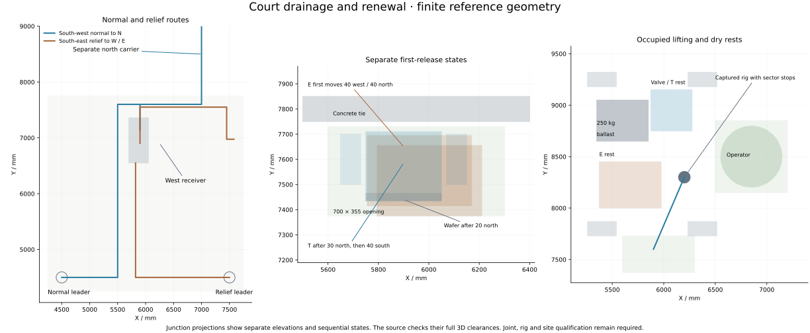
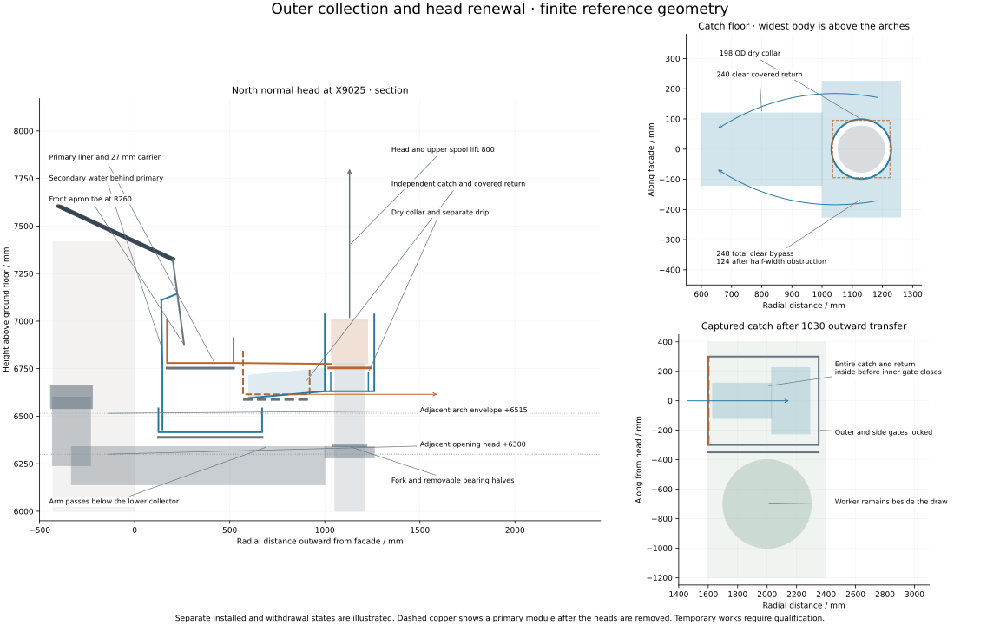

# Join the pitched roof to two independent drainage routes

**The shared gate has an adverse result; no roof/water assembly is selected.** The
10 November [recovery and physical-interface review](roof-water-recovery.md)
preserves the recovered calculations and rejects their use as a joined design.
The inherited floor/portal model requires independent jamb movement through a
continuous concrete floor collector without locating a separation or bypass.
That structural correction must precede a new joined roof calculation. The
inner wet barriers, first wet opening and complete outer renewal also remain
unresolved; the earlier local margins below cannot be carried onto the revised
geometry without rechecking them.

The retained candidate uses the raised 25° slate and lead-free 316L roof,
controlled copper collection around the outside and two southern courtyard
leaders. The south-west normal leader reaches the north drain directly. The
south-east relief reaches the west receiver and its separate east outlet. This
removes the proposed wet pipe across the north loggia and the alternative mast
in the courtyard. These are candidate relationships, not an adopted assembly.

The selected court receiver and its existing north surface inlet remain the starting authority. The proposed permanent roof connections below are a new source decision. The shared gate remains planned until the high-level collectors, their first removal and the additional structural demands have been reconciled. [Previous whole-network comparison](../rwt/rwt-07-network-candidates.md) · [Permanent court receiver](../had/receiver-selection.md) · [Structural house handoff](../str/provisional-house-handoff.md)

## Count the rain on the gutters

The enlarged goods intercept rain outside the slate outline and inside the clear sky opening. Use their actual horizontal projections, subtract the shadowed areas once and retain the existing 216 mm/h pre-site stress. A site-specific wind-effective catchment and rainfall event remain separate inputs.

| Catchment | Flow at the comparison stress |
|---|---:|
| Each exterior normal circuit, including its collecting head | 3.313593 L/s |
| Each exterior surviving relief circuit | 3.557613 L/s |
| Inner normal circuit including the inward-draining cap | 3.258150 L/s |
| Inner surviving relief with its 2400 mm clear opening | 3.258150 L/s |
| Remaining direct court rain | 0.345600 L/s |
| Whole captured horizontal area, including outboard heads | 178.6496 m² |
| Whole event | 10.718976 L/s |

The total inward dose stays 3.60375 L/s. Its allocation between roof goods and paving changes. The earlier 3.0816 L/s applies to the slate catchment alone. It cannot size a continuous gutter projecting into that opening. The exterior roof-only 2.810925 L/s similarly understates the enlarged circuit. [Source-bound edge and catchment calculation](studies/roof_water_edges.py)

## Two southern leaders

Use independently supported 150 mm clear pipes inside 200 mm gross service envelopes. The normal route runs from (4500,4500), via (5500,4500) and (5500,7600), to a new combining connection at (5900,7600). The relief runs from (7500,4500), via (5820,4500), to a new side entry at (5820,6550), axis −750. The new normal branch bypasses the west impact cell and its screens.

At 1.5% fall the 4.500 m normal branch loses 32.03 mm of head in the restricted full-line comparison. The 3.730 m relief loses 30.77 mm. These calculations retain 25% area loss, reduced hydraulic diameter, Darcy f=0.06 and local K8. Their respective clearances beneath the fixed guard rib are 289.90 and 104.75 mm. The normal envelope clears the west receiver by 100 mm. The relief port has 20 and 130 mm side margins within the existing south compartment.

Move the first transverse north-carrier run 70 mm north. Its orthogonal total stays 9.760 m within the existing 12 m developed allowance. Charge K4 for the combining T and K1 for each of the two lined bellows. The combined K6 costs 22.61 mm at the ordinary inward dose and 34.30 mm during the long maintenance event. The west receiver retains 160.81 and 70.71 mm respectively below its high-east intake while the north path works. Relocate the existing non-return obligation to the west branch before this junction. Retain the remote manual isolation. Its existing 10 mm opening-head allowance is a component qualification requirement.

The compact valve, metal seats, flange envelopes, supporting pit and lifting gear are project-defined interfaces. A catalogue metal body does not establish its hidden constituents, opening head or leakage. The +6750 pressure-comparison level produces 77.95 kPa at the lowest boundary, a 1.38 kN closed-end force on the 150 bore and a 1.95 kN orthogonal bend resultant. The 300 mm gross check face receives 5.51 kN. Qualify both low reverse head and the full blocked-roof pressure, with transient and qualification factors added to these static demands. [Located routes, losses and source identities](studies/roof_water_routes.py)

| Single unavailable element | Surviving route |
|---|---|
| Normal roof channel, south-west leader or its buried branch | Lower collector and south-east leader to the west receiver, then the available north or east destination |
| Common north carrier or its receiving territory | High-level transfer to the south-east route and high east outlet, with the west non-return closed |
| West impact body, screen throat or complete receiver | Direct south-west roof route and original court surface inlet to the north |
| South-east relief or east receiving territory | South-west normal and original north surface inlet |
| West non-return stuck shut | South-west normal to north, west receiver to high east |
| West non-return stuck open | Ordinary north drainage remains available. Coincident north blockage requires a separate failed-state assessment |

Both receiving territories flooded together, a blanket or ice event defeating both upper collectors, and an unavailable independent diversion remain explicit rejection cases. The two new pipes do not turn the common north carrier into two independent destinations.

## Open the junction in a controlled order

Use a 700 × 355 clear opening at (5600,7375). Its north edge stops at 7730, before the concrete tie. The T starts at Y7600, with 240 mm maximum flanges. The east crossover turns at Y7550 and has two 210 mm maximum joints. Under full independent roof and court diversion, isolate and drain both north paths, E and the west receiver. Capture E, release its two joints, move it 40 west and 40 north, then lift it to its separate rest. Its retained downstream union keeps 13.86 mm beneath the closed crossing after opposed 5 mm setting allowances.

Two guided all-metal bellows occupy X5650–5750 and 6050–6150. Each has 100 mm neutral face length and 20 mm controlled compression. Anchored outer flanges, twin positive M12 jacks and hard stops retain pressure thrust throughout the operation. Compress both bellows, move T 30 mm north, draw the check wafer 20 mm north and lift it. Move T 40 mm south from that first position, then lift through the opening. The final T envelope retains 20 mm nominal at the aperture's north edge. The reference jacks carry 2.32 kN each under the 100 kPa pressure, spring and guide-force comparison. Actual bellows, flow liners, gaskets, fatigue life and low-head performance require the specified qualification.

Locate the captured rig at (6200,8300), its worker at (6850,8500), the E rest at (5375,8000) and the separate valve/T rest at (5875,8750). Limit the rig to its 90–270° sector and retract to 400 mm radius before slewing. The complete suspended assembly is bounded at 40 kg, with 250 kg ballast in the stated comparison. The operator remains outside the swept load and open pit. Charge the actual rig base, ground bearing, friction, control tools and lifting equipment before use. Operate the buried joints from the dry control station through synchronised M12 drive bars, a 1900 mm guide pole and a camera-guided positive capture head. Captive quadrant V-clamp sectors open 30 mm radially. Their 12 mm axial lift boxes pass through the specified 20 or 30 mm face gaps. Park the E upstream sectors 150 mm east, the wafer sectors 100 mm east and the T side sectors 40 mm south before lifting. Every pickup stays within the stopped hoist sector. Remove the shafts and empty capture cages from the aperture before the associated body lifts. The 20 kg moving-arm allowance includes temporarily supported tools.

The 600 mm buried module beneath the 150 mm guard rib needs a 450 mm empty axial bay and 425 mm southward draw. It retains 15 mm after release and setting allowances. Restore and test the continuous north liner, E crossover, pressure boundary and low-head check before removing diversion. [Finite first releases and occupied rig](studies/roof_water_routes.py)

## Exterior edge under review

The primary spans radial 170–520 mm, with crown bed +6858.554, front +6988.554 and rear +7088.554. The lower receiver spans 125–670, with bed +6495 and rim +6620. Each falls 1:200 from the west and east crowns to its own north and south outlets. The fixed primary apron finishes at radial 260, 95 above the local primary bed. The separately supported board-water apron passes behind the primary and retains the down-facing intake.

The half-width, roughness and K4 comparison leaves 4.58 mm normal and 9.33 mm relief reserve after 10 setting, 25 splash and the respective 11/19 movement allowances. Those movement allowances include the local frame and the current collector-roll comparison. The 100-deep lower alternative fails. A 1200-wide primary front spill retains 26.60 mm to the rear after its separate allowances. [Source-bound edge and catchment calculation](studies/roof_water_edges.py)

Capture the primary module and its shallow crossarms, release the fork pins, move 40 out, 165 down and a further 360 out. The 27-deep carrier leaves 11.55 mm to the lower receiver after 10 setting, 5 fittings and 20 relative movement. The lower carrier remains 27.28 mm above the actual +6300 window heads after 10 setting, 8 local movement and 30 collector movement. Heads and spouts leave first under the full independent diversion. The joined dry-release demand is 19.10 mm, including native relative movement, both local frames and the extra 40 mm lever. Its adopted allowance is 20 mm.

Use 64 roots per circuit from the actual outer collector. Fixed roots end at radial 160 primary and 105 relief. The fixed 50 × 100 × 4 roots support captured 160 × 25 × 4 crossarms, 80 × 25 × 2 rails and 20 × 25 × 2 ribs at 200. A 2 mm 316L backing supports the 1 mm copper liner. Both fixed aprons and their rails are charged to the upper mass envelope. The complete scheduled masses are 49.20 and 45.92 kg/m against 50 kg/m each. The serial component deflection sums reach 3.16 and 6.61 mm under the stated combined loads, including root rotation and the unloaded arm offset.

The primary apron is 0.7 mm 316L folded 25 deep at 50 pitch, with its 580-long cantilever bounded in the component study. The secondary uses 0.5 mm 316L folds 6 deep at 50 pitch, supported at +7110, +6750 and 50 above the local lower rim. Its two continuous 25-high × 20-radial × 2 rails and captive clips stay behind the wet bodies. The fixed aprons retain separate attachment and removal duties. The minimum primary-to-secondary clearance is explicitly charged for thermal travel, setting and local movement. Exact stock, welds, clips and hot-state properties remain certificate and assembly duties. The steel screen requires 165 MPa proof at 100°C and E180 GPa. [Component and movement calculation](studies/roof_water_heads.py) · [316L product-form properties](https://www.outokumpu.com/-/media/files/products/supra/outokumpu-supra-range-datasheet.pdf)

Each normal head sits in a separate 450 × 260 high-level catch. Its covered 240 × 120 return carries the full 3.313593 L/s with half the width obstructed and 70 water depth. The available 105 mm head exceeds the 59.51 required by 5.49 after 10 setting and 30 differential movement. Its 50 mm clear headspace separately accommodates 25 splash and 15 local movement, leaving 10. The outlet floor is 55 above the lower rim, leaving 13 after the movement, setting and wall allowances. The 446-wide clear catch leaves 248 total passage around the dry collar. Its half-obstructed width remains124, greater than the120 return throat. The two smaller side passages govern the friction diameter over the conservative720 developed path. A 198 OD dry upstand, 194 clear bore and 218 OD drip ring retain the separately reported liquid, joint and radial gaps.

Route the head support below the lower gutter. Its 160 × 200 × 3 arm is centred at +6240, upper face +6340, with a 360 drop from the collector. The arm ends before the pipe and a pair of 30 × 60 × 3 forks passes around it. A two-part 240 × 240 × 14 bearing plate receives a positive 180 OD shoulder on the upper 316L pipe spool. The maximum local support stress is 119.43 MPa and its combined deflection is 5.51 mm in the stated comparison. The full head assembly schedule is below its 75 kg dry allowance, with a separate 40 kg water reservation. Each roof root carries 4.716 kN vertical and 6.897 kNm eccentric gravity moment. The local head-support screen also includes vertical head wind and the upper wind couple.

For renewal, release the spout's flat joints and loose metal gaskets, then lift it 350 through the top-open catch notch. Capture the normal head and its upper spool before opening the joint at +6000 and removing the two bearing-plate halves. Lift 800 through the 190-clear fork and 194-clear collar, then transfer outward on a guided trolley to the separate scaffold rest. The 180-maximum joint and shoulder leave 2 and 4 mm after the stated guide allowance. The high catch remains39.27 mm above the outer arch envelope after50 collector movement,6 local deflection and10 setting. Empty the rest before removing the next part. The catch later moves1030 outward so its complete return enters the guarded transfer bay. Keep its outer and side gates locked until the inner gate closes. The worker stands beside the handling line. After the whole part lands, close the inner gate and retain the worker-side guard. Lift 100 mm from the rest, open the outer part gate, translate 900 mm farther out and lower into the empty ground nest at radial 2500–3250 mm. The ground worker stands beside the nest. The source checks the full parts, the 2 m worker, guard, hoist headroom and reserved ground paths. The deck, trolley, capture, lower-pipe support and ground transfer require their named temporary-works acceptance.

The lower collecting head has a separate 200-wide emergency crest 60 above its local bed. It passes the 0.244020 L/s direct rain when that outlet alone is unavailable. Direct this exceptional spill into its closed north or south receiving lane. The full event, actual wind-driven splash and receiving surface remain physical and site acceptance duties.

Carry four outer and two inner 150-clear leaders. The global mass bound retains the heavier 2 mm copper allowance for all 8.4 m of each leader, including its entire blocked-water column. The outer normal head's upper spool to +6000 is 316L and remains within that mass bound. A first facade restraint at +6000 and subsequent restraints at no more than 1.2 m have explicit wind actions and receiving-structure duties. Copper-to-stainless contact has producer guidance, while the actual formed joints, grade, contaminants and site exposure retain qualification duties. [Aurubis compatibility guidance](https://www.aurubis.com/en/dam/jcr%3A9590caba-bde8-4746-94ab-a0cdb53f8950/473EH00002_galvanic_corrosion-2024.pdf)

The complete joined structural source is being integrated with the selected 260 × 120 × 20 court collector and retained 220 × 120 × 20 outer collector. The 220 and 240 court comparisons, independently variable water loads, all leader wind, 22 roof reactions and all-station movements remain part of that review. The final inner carrier allowance is 40 kg/m for each circuit.

## Conditions retained

The +8645.33 slate crown, 275 mm court overhang, independent lower valley and ventilation passages are within the identified SAP-C1 form. The incoming Sarket constituents and bespoke metal-supported lower valley still need their named material and assembly evidence. The proposed 1.94 g silicone residue at the east wet joint remains unapproved. MAT-COORDINATION controls that decision before installed-house adoption. A failed material condition returns the affected detail for redesign.

BCR owns construction resolution and the new supported interfaces. MRA retains the joined failure challenge. PHY owns the required wet, movement and maintenance demonstrations. EPR retains the identified structural and building-physics evidence. DEL retains actual fabrication, temporary works, commissioning and reinstatement. DPL must establish ground, independent receiving levels and lawful destinations on an actual plot. These obligations accompany the reference design and confer no construction release.
