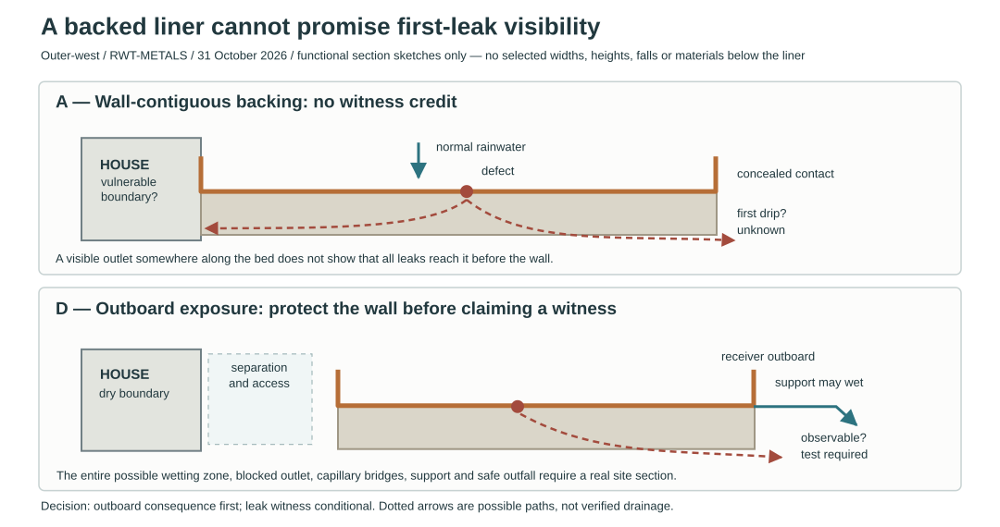

# Outer-west receiver: a leak witness must not become a second gutter

**31 October 2026 — bounded RWT-METALS continuation.** Starting main 4e9839d4ba345ce822f9f03366e443b3641f4b33. This continues the [backed-liner comparison](outer-west-receiver-renewal.md#backing-changes-the-inspection-and-repair-promise) for the outer-west ground receiver. It selects no location, material stack, ground level, joint, outfall or construction detail. The [ground-water policy](../../docs/reference-house/ground-water-policy.md), [whole-house material policy](../../docs/reference-house/material-policy.md) and [rainwater rebrief](rainwater-elegance-brief.md) control.

## Decision: make leakage harmless by position before promising that it is visible

A retained, substantially backed copper trough may be sensible for routine access, but its backing **conceals the underside**. It cannot also be called continuously inspectable, self-draining or early-leak-detecting without a demonstrated path from *each* credible defect to a genuinely observable point. A visible hole at one end of a support does not establish that path.

Develop the receiver **wholly outside the protected wall-base and foundation-wetting territory**, with a separate wall inspection/protection strip and an outboard gravity escape that cannot return beneath the house. Treat the whole potentially wetted backing as wet when testing this position. This is a **site-dependent design direction**, not a proved setback or a permit to wet the foundations. If a complete captured, accessible, harmless section cannot fit, discard the garden-shedding option at that edge and reconsider controlled copper roof collection.

**Do not add a hidden sealed secondary tray solely to make an unreliable trough appear fail-safe.** Such a tray inherits its own seams, trapped-water level, blockage, movement, material, cleaning and renewal problems. It is a separate engineered water system, not a witness gap. A deliberately open, drainable and *inspectable* void is a different conditional option, but it has to preserve support of the wet liner and terminate safely above the real receiving-water condition.

The diagram represents **failure territories and competing paths, not built geometry**. Every position and fall is unselected. Dotted paths are conjectural and receive no performance credit.

## Separate three propositions

| Proposition | What would earn it | What does **not** earn it |
|---|---|---|
| **Visible first symptom** | An observed drip, stain or wet indicator reachable during ordinary inspection, produced by each nominated defect under representative water and contamination states | A hole in the support, a top-side view of a solder seam, or a dry witness during one pour |
| **Harmless escape** | All credible leaked and overflowing water demonstrably reaches an outboard receiving territory before any vulnerable wall, opening, underfloor or foundation interface, including blocked-outfall and saturated-ground states | A nominal outward slope, permeable bedding, a planted strip, or a second pipe sharing the flooded destination |
| **Repairable after detection** | A sequence for controlling incoming water, independent upper-unit removal, supported seam repair or whole-body renewal, terminal/anchor/keeper release, temporary support and reinstatement | Simply removing the grate, finding a wet mark or calling a soldered cross-seam demountable |

Harmless consequence and early observation are independent objectives. A wet area may be harmless but initially invisible; a visible stain may indicate water has already crossed the protected boundary. **Neither should be represented as the other.**

## Compare the paths, not just the materials

| Candidate receiving condition | First leakage consequence | Disposition |
|---|---|---|
| **A. Copper liner on continuous mineral/metal backing contiguous with the wall base** | Water from a failed seam or pinhole may be concealed in the contact interface, spread laterally, pond in a local depression or wet an adjoining porous support before any visible edge discharge | **No early-witness credit.** Reject as a protected wall-adjacent detail until the entire wetting path is shown harmless. Do not call the backing waterproof |
| **B. Grooved backing with one nominal telltale at its outboard end** | Grooves may drain some water, but contact regions, mineral pores, dust/debris, cross-falls and capillary bridges may bypass or stop the route; a groove removes bearing area and can concentrate stress at seams | **Conditional experiment only.** Map every defect tributary, preserve liner support, show cleaning access and test blocked/saturated states. No universal capture assumption |
| **C. Raised/slatted/perforated support giving a visible underside** | A free drip may be observed promptly where open, but a flat liner now bridges openings; the previous strip sensitivity shows why large open spans cannot be assumed | **Alternative construction family**, not a minor inspection addition. STR must resolve actual profile, span, support and loads before claiming it |
| **D. Retained backed liner located outboard, with accessible exterior witness perimeter and harmless open receiving territory** | The precise first outlet of an underside leak remains unproved; the more important aim is that leakage cannot wet vulnerable permanent fabric, whether or not a witness appears immediately | **Preferred next section to develop**. Require a genuine wall-side separation, independent support, assured outboard consequence and a repair route. It is not yet accepted |
| **E. Sealed secondary catch-pan below the backed liner** | The hidden pan becomes another wetted enclosure with its own joints, supports, monitoring, cleaning and potentially common blocked outfall | **Reject as an automatic fix.** Reconsider only when a complete, justified independent system is shown to improve the fault outcome without violating material policy |

A copper/concrete chemical compatibility statement cannot establish this assembly. The [Concrete Society's non-ferrous metal guidance](https://www.concrete.org.uk/fingertips/non-ferrous-metals-in-concrete/) and [American Concrete Institute's concrete corrosion answer](https://www.concrete.org/frequentlyaskedquestions.aspx?faqid=896) describe generally favourable copper corrosion behaviour under stated concrete conditions. That does **not** approve copper sheet moving over a rough concrete bearing, chloride contamination, mechanical wear, soldered seam relief, a mineral bedding's drying or the path of leaked water. [CDA built-in gutter guidance](https://archive.copper.org/applications/architecture/arch_dhb/arch-details/gutters_downspouts/gutter_linings.php) instead emphasises independently considered framing, freedom of movement, positive gutter fall and fabrication/inspection before installation. The existing [shared compatibility record](../../docs/research/roof-rainwater-material-compatibility.md#flat-liner-backing-and-hidden-contact) retains the stricter substrate and retained-constituent duties. Do not merge these different claims into a generic concrete approval or prohibition.

## A fault-origin challenge that can falsify the favoured detail

The complete section must explicitly mark: rear protected boundary; highest normal and failed-flow water surfaces; physical rear edge/possible capillary bridges; sheet/lock/outlet defects; support contacts and joints; accessible observation points; low-level secondary escape; first vulnerable fabric; and the unchanged SITE-WATER-HANDOFF. The hypothetical receiver's location relative to the wall is not a substitute for actual elevations and water routes.

| Defect injected | Challenging condition | Required observed result |
|---|---|---|
| **Rear-side cross-seam leak** nearest the wall | Normal arrival; then blocked main outlet while rain continues | First wetted backing and any route toward the wall identified. A visible witness is credited only if observed; **no** route may cross the protected boundary |
| **Field pinhole or sheet abrasion** over an ordinary bearing | Wet debris and discontinuous/porous contact; test at at least one support high spot and one low spot | Do not assume uniform flow beneath sheet. Record water retained in the contact and actual first observation or lack of observation |
| **Outlet-tail or end-plate leak** | Outlet backing up and independent external receiving water high | Test carried projection, flange and support openings; an open terminal must not be mistaken for a sealed connection |
| **Overflow without any liner defect** | Grate loaded with leaves; primary and nominal witness outfall obstructed together | Escaping water stays below the first harmful boundary *with head/margin* and has a genuinely harmless outboard destination |
| **Ordinary maintenance** | Upper grate removed and incoming roof water not yet stopped | Do not declare a safe working state until diversion or another full-duty route is established |
| **Post-repair reassembly** | Actual dry-side keeper, terminal, backing and movement reinstated | Verify clear outlet, supported seam, free movement, no new capillary bridge, accessible witness and controlled spill path |

Test observations must preserve negative results: if a particular defect produces no witness, the design has **not** demonstrated early detection. A transparent mock-up can help reveal paths but cannot silently stand in for mineral porosity, grit, ageing, frost, movement, load or a saturated final outfall.

## Geometry and failure order

The minimum relationships are qualitative until the actual survey/section supplies elevations:

1. **Dry boundary:** the first vulnerable wall/DPC/opening/floor interface must lie outside all credible splash, leak, backing-wetting and overflow territory. A gap only counts when bridging by joints, supports, leaves, soil, roots and future raised paving is separately challenged.
2. **Gravity:** a purported witness drain must be lower than every tributary leak-wetting region under its actual loaded geometry, and discharge into a receiver whose maximum failed water level does not drown it. A slope in a drawing is not a pass where capillary flow, ponding or debris can interrupt it.
3. **Fail safe:** the emergency outboard spill must operate before the first harmful level for the named blocked-outlet scenario, allowing actual flowing head and a justified margin. It cannot rely on a common flooded destination or a hedge to catch the excess.
4. **Support:** any hole, groove or removable inspection panel interrupts backing. Re-run the actual copper section/load model and STR contact/anchor duties instead of borrowing the earlier 50 mm local seat or 100 mm ideal-strip witness as an approved product size.
5. **Material boundary:** declare every support, separator, solder/flux residue, spacer, drain, anchor, cover and contact. The no-plastic constraint survives concealment. Avoid selecting one galvanically unsuitable metal merely because the exposed face is copper.
6. **Renewal:** if a defect is hidden by required backing, state how the liner is independently supported or wholly removed before that backing is released. Preserve the known terminal, dry-side fixed datum and every keeper release.

Under normal service a proposed witness must remain *dry* except when water enters from a defect, condensation, wind-driven rain or splash. Otherwise a wet spot is not a reliable alarm. Even with a clear witness, routine walk-by observation is not equivalent to permanent monitoring. [Historic England's inspection guidance (2024)](https://historicengland.org.uk/advice/technical-advice/retrofit-and-energy-efficiency-in-historic-buildings/resilient-rainwater-systems/inspection-maintenance-and-repair-of-rainwater-systems/) explicitly distinguishes the easy visual inspection of external rainwater goods from the special access needed for concealed box and valley systems, and recommends open discharge to a visible surface gully where appropriate. Its [maintenance checklist](https://historicengland.org.uk/advice/your-home/maintain-repair/checklist/) asks inspectors to look for leaks, pooling, slopes and external staining. These are inspection principles, **not** certification of the proposed ground assembly.

## Handoff and decision

**Advance D as the preferred direction**, with A uncredited, B/C research alternatives and E a rejected default. In the next real section, prove the actual exterior wall-to-receiver separation and first harmful water level **before** refining witness devices. If harmless leaked-water discharge cannot be established at the pre-site Reference House's outer-west edge, do not preserve this architectural gesture by inventing a buried drain, membrane or pump.

RWT owns wet path, primary/failed receiving and repair access; **DPL** owns actual site levels, soil/receiving-water and destination; **HAD/ROF** own capture and architectural relationship; **STR** owns supports, loads and any void; **MAT** owns complete constituents; **MRA** independently attacks the assembled section and common failures. No owner plot, floor, DPC, roof, terminal size or outside clearance is changed here.

**Evidence status:** architecture-level fault-path research and negative acceptance rules. No selected section, numerical drainage capacity, hydraulic validation, leak mock-up, professional review, site acceptance or whole-body repair has been completed. This remains a bounded RWT-METALS continuation, not the completion of the packet.
