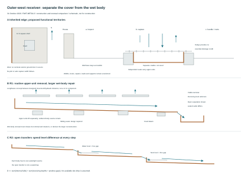
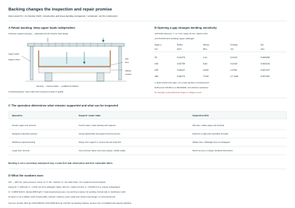

# Outer-west receiver: what can actually be lifted out?

**31 October 2026 — bounded RWT-METALS construction comparison.** Starting main `2512f116e277d3ab724fd0bcf0f13ba1d04533c3`. This develops the [C-B1 brass-trough candidate](copper-assembly-candidates.md#c-b1--genuine-low-zinc-brass-receiving-trough) at the [outer-west trial edge](rwt-shed-result.md). It selects no installed system, receiver width, plot level or alloy. The [material policy](../../docs/reference-house/material-policy.md), [passive ground-water policy](../../docs/reference-house/ground-water-policy.md) and [shared compatibility record](../../docs/research/roof-rainwater-material-compatibility.md#ground-receiver-construction) govern.

## Decision earned

Develop **a retained, hydraulically continuous wet trough with separately removable grates or impact units** as the simpler ground-receiver comparator. Its eventual wet-body repair is a larger, explicit intervention. Do not describe a succession of soldered wet sections as individually liftable modules merely because their covers lift off.

Retain **separate wet trays discharging visibly into one another** as a different conditional architecture. This avoids a sealed inter-tray disconnection only by spending level difference, receiving space and additional splash/overflow territory at each transfer. It does not establish a backwater-tight cross-joint. Reject the unsupported combination of an ordinary loose lap, independent vertical removal and continuous watertight containment.

[Source-bound record](studies/outer-west-receiver-renewal.json) · [Reproducer](studies/outer-west-receiver-renewal.mjs). The A3 sheet is schematic. Only the edge identity and nominal house plan are inherited; the receiver and supports are proposed functional arrangements, not dimensioned construction.

## Locate the complete section before calling it a channel

The retained RWT-SHED source has a **12 m square shell**, a **3.5 m square court**, and no exterior ground-door interval on the west face. That absence supplies no garden ownership, safe splash width or maintenance clearance. Windows, wall inspection and roof access remain. The current section extension is not a selected larger overhang; this study imports neither a landing distance nor a roof-water capacity.

From the west wall outwards, reserve three distinct territories: **a**, wall-base inspection and protection; **b**, demonstrated impact/capture and the wet receiver; **c**, additional handling, maintenance and root territory. Their sizes remain unknown. Keep the hedge out of essential capture, access and escape. Qualify the bare receiver first. A nominal maintenance strip cannot double as an unproved splash barrier, and a stone top does not make leakage beneath it harmless.

For the connected trial, support removable grates or contained impact pieces on their own structural stone seats or designed metal frame. Carry the trough on separately accessible cradles. Do not send pedestrian, hedge or stored-stone loads through a thin wet sheet or its cross-seam. Identify each support's foundation, restraint, wear/contact surface and removal direction; no elastomer pad, plastic anchor, geotextile or hidden liner is presumed. Full water, debris, ice and handling loads remain design inputs.

Provide a shallow, inspectable terminal outside the wall's vulnerable territory, with a real gravity continuation to `SITE-WATER-HANDOFF`. The terminal shown is a **functional receiving space**, not an adopted gully, outlet size or excavation. Do not route this trial into the historical north-carrier bay by assumption. A sunken service position dependent on pumping or groundwater tanking fails the governing brief.

## What the primary construction evidence supports

The shared record contains the inspected sources and their revision/access limits; the following consequences are deliberately narrower than product approval.

| Evidence | Consequence for this section |
|---|---|
| **C11 — CDA detail 10.3F:** its watertight transverse copper seam is locked and soldered, or riveted and soldered | A flow-facing lap does not replace the sealing operation. This is a fixed wet-body seam; renewability of a cover says nothing about its release. Copper practice is not automatic qualification of a CuZn10 or CuSn4 seam. |
| **C12 — CDA detail 10.5B:** a scupper/fascia assembly discharges to a separately moving gutter | A visible open transfer is a real construction family. It does not supply this receiver's capture, surcharge resistance or clearances. Details 10.5C/D connect their conductor heads differently and cannot be treated as the same interface. |
| **B2/B3 — Aurubis CuZn10 and Nordic Bronze sheet evidence** | C22000/CW501L-family brass and CW450K tin bronze are distinct candidates. Their sheet properties do not qualify a fabricated channel, joint, finish or installed environment. “Commercial Bronze” C22000 remains a brass here. |
| **B4/B5 — Wade SN12220 and the public linear-channel guide** | A named nickel-bronze grate is a credible component lead, not a bronze wet body or proof of independent lift-out. The guide's sealed section joints, built-in supports and concrete load basis cannot be omitted or transferred to a custom frame. |

A supplied grate over a copper trough is to be described as exactly that. It is not a genuine brass hydraulic channel. Natural patination remains the development assumption; no lacquer, joint compound or protective coating receives an exemption. Exact alloy, temper, delivered finish, solder/braze, flux and retained residues remain within MAT. A published low lead maximum is not a lead-free declaration.

The later [sheet-solder evidence](../../docs/research/roof-rainwater-material-compatibility.md#sheet-solder-cleanup-and-the-brass-boundary) gives the copper body a matched roofing solder/flux lead, with cleanup and retained residues still to qualify. It does **not** give the CuZn10 body the same recipe: FELDER KD declares ammonium chloride, while Aurubis warns against ammonium-containing flux for brass because of stress-corrosion cracking under tensile stress. Do not assume a formed or restrained trough has harmless residual stress. Qualify the actual brass joining/cleanup process separately. A fully removed fabrication aid is distinct from a constituent retained in the installed seam; neither a metal filler nor a cleaning instruction closes that inquiry. These sources do not select a trough or demonstrate its support, water duty or repair.

## R1 — retained wet body, independent routine access

**Construction.** Develop one wet body between deliberately designed hydraulic/movement divisions, not an arbitrarily continuous 12 m trough. Form the sidewalls and ends; qualify its fixed cross-seams and outlet as a matched fabrication. Use independently supported removable grates or impact units above it. Distinguish routine wet-face/visible-edge inspection from inspection of hidden support contacts. The [backing continuation](#backing-changes-the-inspection-and-repair-promise) below replaces an undifferentiated underside-access promise with supported access or declared larger liner removal; a continuous bed does not expose the underside when the grate is lifted.

**Movement.** The illustrated body has a defined fixed datum near its terminal and sliding seats elsewhere. This is a proposed restraint arrangement, not a sized support detail. Do not rigidly bolt every cradle or confuse a soldered seam with a movement joint. Keep the terminal's capture envelope valid through relative movement and support deflection. If that outlet is rigidly connected to a pipe, include the pipe's restraint and repair; the diagram's open-transfer logic cannot be claimed for it. Required bearing, wear, restraint against uplift and any separator still need material and load evidence.

**Routine work.** Control continuing roof water through a qualified alternative route; lift and secure the actual grate or impact unit; remove debris without driving it into the outlet; inspect the wet face, accessible supports, edges and terminal; reinstate each unit and verify seating and water passage. This does not inspect a concealed liner/backing contact. A cleanable grate must be removable with its fasteners, deposits and handling mass, not just in a catalogue drawing. Isolate the working area from pedestrians and preserve the wall-base inspection territory.

**Eventual wet-body repair.** A damaged seam calls for either a qualified local repair with accessible sound metal and joining/inspection space, or renewal of the larger wet body. Soldered repairs may consume a bounded length. To renew the body, first clear overhead units, support it, release the real terminal and retainers, then lift through its complete envelope. If an outlet tail is captured below the support, removal from above has not been established. Show the access or declared larger support reconstruction needed; do not simply rename it demountable. Rebuild and verify the joints, fall, supports and escape route before returning the roof water.

This strategy reduces routine disassembly of the watertight body. It does not make the body immortal, every seam externally visible, or repair compatible with uncontrolled rain.

## A supported seam must keep its movement and release

**31 October 2026 continuation, main `899a6d32d5c7b37a6d3f5c544c90d5f4204e1c7b`.** Retain R1's terminal-side datum as the development direction, with a **separately supported, releasable dry-side restraint**. A soldered sheet-to-sheet seam does not anchor the liner to its frame. Fixing every cross-seam to cure a support problem would change the restraint system, rather than complete the proposed freely moving liner.

The [local seam/support and keeper sheet](studies/outer-west-seam-support.svg) and `seamSupportContinuation` in the existing [numerical record](studies/outer-west-receiver-renewal.json) develop two distinct matters: necessary longitudinal support coverage, and the conditional first motion of an authored removable keeper. **They do not establish a physically qualified sliding bearing or complete wet-body extraction.** The original R1/R2 sheet and its unselected receiver dimensions remain intact.

### Construction basis: support, anchorage and capture are different

Develop a mechanically locked and soldered **copper** transverse seam, with the matched-process and cleanup obligations already recorded in the [shared compatibility source](../../docs/research/roof-rainwater-material-compatibility.md#sheet-solder-cleanup-and-the-brass-boundary). CDA 10.3F supplies that construction family, not a removable joint. The outside-frame fabrication/inspection approach is a useful starting point before the liner is placed in its supports. The same process is not transferred to CuZn10 brass.

The further [Aurubis/CDA inspection](../../docs/research/roof-rainwater-material-compatibility.md#liner-support-movement-and-release) supports identifying the fixed zone and movement at connections. Aurubis's gutter-frame discussion does **not** prescribe an isolated narrow bearing under each seam. Its complete roof-box construction is not adopted as this ground receiver. The liner field, cross-seam and outlet each need adequate backing; pedestrian, grate, impact-piece and hedge loads remain on independent supports.

A fold, rivet head or solder projection can snag a seat or concentrate bearing. Calling a joint a flat seam does not give it a smooth underside. Here **40 mm is an authored longitudinal support-demand footprint at installation temperature**, not a measured seam profile or minimum bearing requirement. A shaped or relieved contact surface, adjacent sheet support, restraint, wear and corrosion compatibility still require a real fabrication detail. A recess cannot simply remove support from the seam and inherit a pass.

### The finite seat comparison

Use local coordinate `s` along the outer-west wet body. Put the separate dry-side restraint at `s=0`, at the terminal station, and compare a seam centred `L=2000` away. This is a **gauge length**, not the total body length, a selected module or a global site coordinate. Receiver width, water depth, full length and capture territory remain unknown.

| Input | Basis |
|---|---|
| Copper coefficient `α=17×10⁻⁶/K` | Aurubis, second edition 2013, printed p 81 architectural temperature-range comparison; not the different CuZn10 coefficient |
| Installation 20°C; extremes −10/+70°C | Authored sensitivity, not London climate evidence or measured sheet temperatures |
| Footprint 40; seat 50, narrower control 46 | Authored longitudinal geometry, not a selected section or structural bearing requirement |
| Initial relative position `e=±2` | Authored placement sensitivity; it changes the actual copper gauge and is not an admitted fabrication tolerance |
| Seat and fixed datum stationary | Explicit model assumption; actual frame thermal movement, settlement and deflection require relative-motion reassessment |

For each installation footprint endpoint `p=±20`, its position relative to the nominal seat centre is:

`q(T,e,p) = (L + e + p) × [1 + α(T − 20)] − L`.

The footprint itself expands; the calculation does not translate an artificially rigid 40 mm box. The expression is affine in each variable separately, so evaluating the temperature, placement and endpoint corners gives its complete interval. The centre alone travels −1.020 cold and +1.700 hot. The complete support-demand sweep is **−23.00878 to +23.71870 mm** about the stationary seat centre.

| Comparison | Necessary longitudinal result |
|---|---|
| Centred 50 mm seat | Minimum coverage margin **1.28130 mm**, at the hot/right edge |
| Centred 46 mm seat | Misses the hot/right edge by **0.71870 mm**, although the installation-temperature footprint fits |
| Same 50 mm seat shifted +2 relative to the fixed datum | Misses the cold/left edge by **0.00878 mm**; the stationary-support assumption matters |
| Put the fixed datum at the seam instead | Local sweep becomes±22.01870, both extremes at hot; this changes the terminal's movement obligation and is not selected merely for the larger local margin |

These are exact arithmetic within the declared ideal model, not manufacturing precision or installed reserves. A positive interval result establishes no contact area, load capacity, friction, wear, uplift resistance or transverse freedom. Actual sheet/seat temperatures can differ. A material or dimension change requires the relative movement to be recalculated.

“Near the terminal” also does not mean the terminal is motionless. A rigid pipe connection at a second, authored station `s=300` would need to absorb the freely expanding copper's −0.153/+0.255 mm travel relative to the `s=0` restraint. This exposes a second-anchor obligation; it calculates neither stress nor failure. Either place the relevant restraints within one qualified fixed zone, provide a real movement-capable connection, or design the restrained assembly deliberately. The soldered outlet attachment is not credited with structural anchorage or lifting force. An open receiving transition remains a different candidate, with its capture and backwater duties still unresolved.

### An authored dry-side keeper with a finite release

The local section develops a removable cap over a folded dry-edge envelope, rather than an unexplained lift through a hooked perimeter. Its fastener is outside the represented wet liner. During service the liner can move **along the run beneath the cap**, while the cap retains upward movement. This does not resolve transverse expansion or select the folded edge, hardware or material contacts.

All keeper dimensions are authored. The edge envelope is 20 wide × 3 high, from transverse `v=0–20` and `z=0–3`. The cap spans `v=−5–50`, `z=5–9`, with 30 width along the run. An **8 mm cylindrical through-hole** and **6 mm cylindrical stud**, coaxial at `v=40`, leave 1 nominal radial clearance. The stud ends at `z=20`. The model does not infer thread, torque, strength or nut/tool space from those diameters.

**After removing the nut and independent upper unit**, lift the cap 16: its underside reaches 21, clearing the stud by 1. It can then translate 65 outwards through the declared empty working field; its nearest edge ends 17 beyond the stud. The entire axial passage is checked, not just the end position. A 15 lift gives contact at the stud tip and fails the free-runout condition. With the cap still installed, a direct 5 liner lift overlaps it. Thus longitudinal slip and vertical release are demonstrably different in this local geometry.

This is a conditional **cap-release** result. It does not prove access to remove the nut, overcome deposits, support a long body, or lift the receiver. Those operations cannot be credited to an empty geometric pocket. The represented 20 × 3 edge envelope is also separate from the unresolved cross-seam underside.

### Three interfaces before whole-body release

Before eventual body repair or renewal, qualify incoming-water diversion, protect the work area, remove/stage the independent grate or impact units and provide independent temporary support. Then check these three interfaces:

1. **The terminal and every carried projection.** A pipe disconnection may leave a tail or flange below retained support. For the limited straight-lift screen, the aperture must exceed the maximum carried width plus twice its lateral offset; a clear stem alone is insufficient. Actual terminal dimensions remain null in the record. An open receiving transition may have no connection to disconnect, but still needs a free movement envelope and qualified water-management state. It cannot silently be substituted for a sealed pipe.
2. **The dry-side fixed restraint.** Removing sliding caps does not release a still-attached longitudinal anchor.
3. **Every uplift capture.** The local cap sequence demonstrates one possible geometry; it does not release unseen perimeter locks or other retainers.

The eventual sequence must retain independent support at every stage. A body lift, length, mass, handling route or temporary water-management pass is not claimed. Local solder repair remains a consumptive operation with its own sound-metal, all-round joining, cleaning and inspection access. A larger repair that opens a seam or support must state what is rebuilt and how fall, restraint, joints and water routes are reinstated.

**Decision advanced:** keep a defined terminal-station restraint, require the cross-seam's full relative support envelope, and develop a removable dry-side keeper instead of equating sliding with lift-out. Return the actual backing, loads and anchorage demands to STR when the profile is chosen. No court pan, room floor, DPC, threshold, landscape level or occupied IAS/MAT source is changed.

## Backing changes the inspection and repair promise

**31 October 2026 continuation, starting main `d4cad187f71b8c025fa681fab15e4ce847333c67`.** Develop the copper R1 comparator as a **supported liner with backing retained during routine wet-side cleaning**. Do not turn the earlier seam seats into proof that the intervening flat sheet supports itself, or remove backing solely to expose an underside without assessing the changed load path. A formed or stiffened self-supporting trough remains a different alternative requiring its actual profile and design. The following strip calculation neither rejects every such body nor qualifies one.

The existing [reproducer](studies/outer-west-receiver-renewal.mjs) adds `backingContinuation` to the [record](studies/outer-west-receiver-renewal.json). Both earlier A3 sheets remain unchanged. The new sheet is a construction and linear-bending comparison, with no selected receiver or support dimensions.

### Conventional construction and its material limit

The further [C9/C11 source inspection](../../docs/research/roof-rainwater-material-compatibility.md#flat-liner-backing-and-hidden-contact) supplies a coherent comparator. Aurubis's **flat roof/facade sheet** guidance calls for stable support; its separate gutter-frame discussion requires loads and dimensions to be considered. CDA's built-in gutter liner follows a supporting frame while remaining free to move, and recommends fabrication outside the frame where possible so seams can be inspected and watertightness tested before installation. This supports a backed fabrication/installation sequence. It supplies no actual ground-receiver contact, bearing capacity or later lift-out method.

Keep two load paths explicit. Water, debris and copper selfweight pass through the qualified contact/backing to the frame and foundation. Pedestrian, grate, impact-piece and handling loads use independent upper supports, bypassing the wet sheet and solder seam. Independence here means an identified load path; the actual upper frame, cradles and foundation still need STR design. No pedestal size or support resistance follows from the schematic.

Neither source admits an unspecified mineral bed. Aurubis p 106 excludes direct copper-on-concrete within its stated construction guidance; its timber/felt and conditional mineral-substrate examples are not adopted. CDA's separate contact-treatment requirements remain in C13. Qualify the complete backing/contact or separator, fixings, wear, corrosion, movement and retained constituents under MAT. A seam fold, rivet or solder projection also needs compatible shaped support; a nominal flat bearing is insufficient.

### An inspection opening changes the bending problem

Use a **1 mm wide flat strip** spanning between two ideal simple-support reaction lines, one end free in-plane. The span is neither an adopted clear inspection opening nor a bracket pitch. With `b=1 mm`, thickness `t`, span `s`, `I=b t³/12`, uniform line load `w` and `E=118000 N/mm²`:

`R = w s/2`; `M = w s²/8`; `σ = 6 M/(b t²)`; `δ = 5 w s⁴/(384 E I)`; end slope `θ = w s³/(24 E I)`.

The pressure is fixed on the original horizontal projection: an authored water depth over the undeformed base, plus an authored uniform debris action, plus copper selfweight using `8900 kg/m³` and `g=9.81 m/s²`. E and density are the Aurubis p 32 comparison properties. No particular delivered temper, local forming/joining condition or loss allowance is qualified. In particular, p 31's annealed R220 **140 MPa proof value is a maximum, not a minimum resistance**; it is not used as an allowable stress.

The reference trial uses `t=0.7 mm`, water depth `50 mm` and zero additional debris action, giving `q=0.5516163 kPa`, including `0.0611163 kPa` sheet selfweight. All dimensions and water/debris scenarios are authored.

| Span between ideal reaction lines (mm) | Reaction at each line (kN per metre of width) | Nominal bending stress (MPa) | Linear deflection δ (mm) | δ/s | δ/t |
|---|---:|---:|---:|---:|---:|
| 50 | 0.01379 | 2.11 | 0.0133 | 0.000266 | 0.0190 |
| 100 | 0.02758 | 8.44 | 0.2130 | 0.002130 | 0.3042 |
| 150 | 0.04137 | 19.00 | 1.0781 | 0.007187 | 1.5401 |
| 300 | 0.08274 | 75.99 | 17.2491 | 0.057497 | 24.6415 |

These are linear bending outputs, **not strength checks or predictions of the actual deflected trough**. The record also varies thickness through 0.6/1/2 mm, water depth to 150 mm and additional debris action to 0.5 kPa. For example, the 0.7 mm/300 mm trial at 150 mm water plus 0.5 kPa debris extrapolates to 63.5601 mm displacement and 280.00 MPa nominal bending stress. Its large displacement and rotation preclude treating the linear numbers as an established loaded shape or collapse result. Deflection/thickness alone is not a universal validity cutoff for an axially free strip: rotation, deflection/span and actual in-plane restraint matter. There is no universal conservative-bound claim.

The model gives no credit for two-way plate action, formed sides, continuity, membrane action or a seam's stiffness. It also omits ponding feedback: deformation can change water depth, pressure and fall. It excludes rain impact, ice, pedestrian/grate/stone/handling actions and underside uplift, and evaluates no yield, creep, fatigue, denting, buckling, contact, joint or support resistance. These are actual design duties, not loads accepted as absent from the receiver.

### Repair keeps support, or transfers it before removal

Comparing two independent ideal strips at 100 and 300 mm under the same reference pressure multiplies moment/stress by **9**, linear deflection by **81**, and each reaction by **3**. This is a span-sensitivity comparison, not analysis of removing a support from a continuous sheet. It demonstrates why an inspection opening and a removable backing panel need a real intervening support/repair state. Even after emptying, the same 0.7 mm sheet has non-zero selfweight: the 300 mm ideal trial gives 1.9111 mm linear displacement under selfweight alone.

| Operation | Support and access consequence |
|---|---|
| Routine clearing and visible inspection | Manage incoming water; remove independently supported upper units; inspect wet face, exposed edges and terminal with liner backing, fixed restraint and captures retained. This does not inspect hidden contact faces. |
| Inspect through a designed underside opening | Establish the actual supported span/profile, opening, line of sight and hand/tool route. An unmeasured void or absence of visible dripping does not prove the hidden interface dry. |
| Withdraw required backing or repair its contact face | Isolate continuing water, empty and clean; then independently support or remove the wet body **before** withdrawing its required backing. Clearance alone is insufficient. A declared larger removal retains the terminal/anchor/keeper and handling duties above. |
| Reinstate and return water | Verify support/contact, seam relief, fall, freedom to move, restraint/captures, terminal, cleanup and actual leak/overflow routes. Initial outside-frame inspection does not establish the condition of a later concealed seam. |

Backing is not credited as a waterproof secondary collector. Locate where a liner leak first becomes observable, how water can spread along its concealed contact, and the first vulnerable wall/foundation material. If passive secondary containment is needed, its fall, outfall and repair are additional design work. Do not equate a structural bed with a harmless drainage route or claim complete detection from top access.

**Decision advanced:** retain the conventional backed copper liner for the next complete section, keep upper loads independent, and allocate hidden-underface work to a qualified supported intervention or larger liner removal. Reject the unsupported combination of sparse seats, no intervening sheet design and an unrestricted underside-access promise. Actual backing/contact, profile, load capacity, first leak observation, terminal and full handling remain specific unresolved interfaces. The brass body still needs its own complete fabrication/support evidence; this copper-property sensitivity does not qualify it.

## R2 — separately renewable wet trays with open transfers

Each tray has its own qualified watertight body, restraint and terminal lip. It discharges across a **visible separation** into the next receiving tray or independently accessible collector. Removal must not require tearing the neighbour's waterproof seam. A spanning grate or impact frame is independently removable; it must not tie the two trays rigidly together. At a terminal outlet, compare an open receiving space with a genuinely releasable sealed connection rather than silently substituting one for the other.

This is a stepped conveyance arrangement, not an ordinary lap credited as a seal. The proposed free-discharge condition at transfer *i* is:

`z_lip,i >= Z_water,i+1 + g_i`, with `g_i > 0`.

Here `Z_water,i+1` is the governing receiving-water elevation at that transfer for the stated operating/failure case, not just the downstream channel invert. `g_i` is an evidenced separation allowance, not a chosen number. Use the actual discharge lip, including any offset or sheet thickness, and check the clearance throughout permitted relative movement and deflection. Let `h_i+1 = Z_water,i+1 - z_floor,entry,i+1 >= 0`. The required local invert step is therefore:

`Delta_i = z_lip,i - z_floor,entry,i+1 >= h_i+1 + g_i`.

For a serial chain of `n` trays with non-negative internal falls `F_i` **from each tray's entry invert to its actual outlet lip**, the available channel-invert drop from the first entry to the last outlet lip must satisfy:

`D = sum(F_i) + sum(Delta_i) >= sum(F_i) + sum(h_i+1 + g_i)`.

The transfer sum contains `n - 1` terms. A level installation with zero available drop cannot provide positive free separations between serial trays, even before internal falls or flowing depths are added. Lowering later trays is not free territory: it changes the final receiving and repair levels. An actual downstream backwater can erase the separation. That invalidates this **free-transfer claim**; it does not prove that all submerged gravity flow is impossible. No rainfall, depth, gap, slope or receiving level is selected here.

These are channel-invert datums, not house floor levels. A raised discharge lip that gives a negative `F_i` lies outside this non-negative-fall comparator. Even with positive `F_i`, a lip raised above the local tray bottom needs its ponding and release behaviour assessed. The final lip-to-terminal transfer lies **outside `D`**: its receiving level, free gap and onward route add a separate requirement. This is not the complete drop budget to the site destination.

The stepped layout also needs direct roof-water capture across the transfers, splash containment, protection against debris bridging, independent supports and handling clearance. It may be worse than the retained body even where levels permit it. A nominal lap in the flow direction can also obstruct a middle tray's straight upward lift beneath a retained upstream sheet. Show the first motion, release of every overlap/retainer and reinstatement; an upward arrow alone is not a removal proof.

## Common failures and the actual choice

| Condition | Required consequence in either architecture |
|---|---|
| Primary outlet blocked, or a grate/impact unit obstructed | Trace continued arrival to an outboard escape which remains reachable from that compartment. A second outlet beyond a sealed division is not a local backup. Removing debris later supplies no present capacity. |
| Terminal or site water rises | Use the actual receiving-water elevation at every affected transfer. A buried outlet and nearby surface relief sharing the flooded destination are not independent by naming. |
| A wet seam leaks or a support settles | Name the water path beneath the receiver, its first observation and first vulnerable fabric. Do not assume the structural stone support is a waterproof secondary tray. If separate containment is needed, detail its outlet and eventual repair too. |
| A module is open during maintenance and rain continues | Qualify diversion or another full-duty surviving route for the exposed territory. A smaller grate opening or empty tray is not rain isolation. |
| Full body repair disturbs a seat or boundary | Declare the larger intervention and provide access, temporary stability, reconstruction and verification. Routine access and eventual major repair have different promises. |

The outboard spill must act below the first harmful wall, opening or boundary level **with the flowing head and margin included**, and must reach a genuinely harmless destination. This is a necessary level/topology duty, not an asserted capacity or safe landscape. No essential protection is assigned to a hedge, occupant response or pump.

**Next construction choice:** compare an actual fabricator's retained CuZn10 wet-body detail against a copper wet body with separately identified brass/bronze upper components. Require complete joint/support constituents and one demonstrated repair sequence. Advance open-transfer trays only if a connected level, capture, access and failure comparison justifies their extra interfaces. A CuSn4 alternative remains explicit and unadopted. Neither the generic Wade installation nor the roof-handbook details are transplanted as an approved house assembly.

## Validation and handoff

Run `node project/rwt/studies/outer-west-receiver-renewal.mjs --check` to verify the pinned inherited edge source and deterministic record/sheets, and `node project/rwt/studies/outer-west-receiver-renewal.test.mjs` for the focused controls. They cover full footprint/placement expansion, a narrow seat, relative support movement, signed and zero gauges, retained stud/cap capture, complete terminal envelopes, strip units/equilibrium/scaling/selfweight, invalid inputs and deterministic outputs. The new A3 sheet is rendered and inspected; the original two sheets remain byte-identical. Exact-head repository/publication checks remain required for integration. This is a located construction and maintenance comparison with an explicit linear-bending sensitivity, not a hydraulic solver, structural acceptance calculation or installed prototype test.

RWT-METALS remains planned. RWT-SHED's edge disposition is retained; RWT-ROBUSTNESS still owns full-duty failure acceptance, ROF/HAD the roof and architectural interfaces, MAT the complete constituents and DPL the real receiving/site conditions. No house geometry, completion status or construction authority changes.
