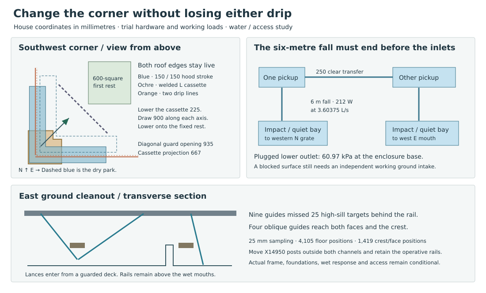

# The corner, its leader and the ground cleanout

**Retain one welded corner receiver with one removable leader. Develop a temporary catch that travels diagonally, two independent low-level receiving chambers, and guarded cleaning from above the east deck.** The existing straight withdrawal and a direct six-metre downpipe discharge both fail. This comparison locates replacements and the remaining house-side decision. Construction, system admission and RWT-06 completion are still open.

## Take one corner and its leader out, then restore them

Dimensions are house coordinates in mm. At southwest the [two primary edges](studies/live-receiver-corner-failure.json) meet at (4450,4450), with the transferred secondary 20 farther into the court. Reflect the [south end module](studies/live-receiver-renewal.json) onto the west face. **Both low leader axes land at (4500,4500).** Charging each face with an independent outlet there is impossible. A welded L combines the two 471.43-long end modules, each 350 deep, with one shared downward spigot. Each next retained gutter ends at coordinate 4821.43.

1. Erect the guarded work deck with the corner, both roof layers and normal drainage intact. The paired service catch has two 230-wide arms reaching coordinate 5450 from a common low-coordinate edge of 4365 on each axis. In dry park translate the whole L **150 east and 150 north**. Its nearest point is then 4515, 45 clear of both secondary drip lines. Approach on the reverse diagonal. During every intermediate position two outlets discharge into independently supported fixed heads. The historical straight catch lost its return at 270 while intercepting perpendicular drips out to 3200.
2. Put each upper service spout over a fixed head, one initially at (5750,4850) and the other transposed. Allow a 150-square jet inside its own 350-square mouth, starting 100 from each near edge. At the other diagonal endpoint there is still 25 around the jet. The entire south head at X5650–6000/Y4750–5100 clears the permanent trough’s front by 50. Give the live L a +6800 crown, two falls to +6785 and +6880 returned rims. Extend a supported, clear side branch to each spout. Keep all upper collector material above the +6740 corner and below the lower drip in the capture zone. Establish the temporary system before opening anything. Wind, splash and real concentrated valley flow require a wet corner test.
3. The neighbouring troughs **still drain toward the missing corner**. Give each retained side a 250-clear guarded pickup at coordinate 5300–5500, with +6605 sill, falling into a separate lower side inlet on its service head. Temporarily close the two end seams after opening and testing the pickups. The live hood covers the 478.57 between the newly closed seam and the near edge of each pickup, with 150 overlap at that edge. At 3.60375 L/s the trial pickup requires +6665.34 including 5 mm setout and one critical-velocity head of local loss, 9.66 below the original +6675 front spill. Wall-side relief and end slots in the removed module cannot receive water. Retract its two 75 mm scupper tongues 80 courtward before the drop. Their wallward edges then clear the fixed q−90 wall by 45. Stagger the two corner tongues in elevation and capture them individually. Restore and test both on return.
4. Capture the corner independently. Give the one OD150 leader two radially removable split bands and a straight removable top spool from Z6200 to 6540. Withdraw the captured bands and move the unloaded spool from (4500,4500) to (5200,4385). Its 75-radius envelope leaves 25 to the next pickup, and the fixed pipe top is 135 below the moving assembly. A one-piece fixed riser would obstruct lowering. Establish individual upper and lower pipe clamps before separating each remaining leader length. Work top down in individually captured sections of maximum 1200 and lower each to the deck or ground cradle. Keep all brackets open to the court and clear of the door opening and drain to the isolated chamber. Fit bottom up, testing one connection at a time. Release torque, real clamp envelope, longitudinal movement, capacities and the actual lower adapter are installation gates.
5. Replace the intersecting straight corner guards by a chamfer from (5475,4780) to (4780,5475). Between 48 mm posts it gives 934.88 clear for the L’s 666.70 transverse projection. Lower the carrier 225 before translating 900 along each axis. Its Z6335–6515 body clears the mid/top rails by 121/101. The final footprint lies inside a dedicated 600-square stand at (5200,5200), with 50 minimum plan reserve. Lower to stand top +5750, positively restrain, then disconnect. Use a positively captured two-axis carriage with paired dry support lines and a transfer/carriage for outgoing and incoming pieces. No hand hangs below the moving piece. Restore the corner, its spigot and both neighbouring end joints, leak-test both faces and every leader, then return the upper L to dry park before disconnecting its temporary outlets. Remove the apparatus in reverse order.

### What happens when a leader is blocked

The fixed service heads extend down outside the diagonal draw. Offset their lower legs to (5400,4500) and (4500,5400), maintaining their 900 coordinate difference. Join these two points with a vented, 250-clear level transfer channel, Z6000 bed and +6190 rim. Its 1.273 m length passes **under** the raised draw with 145 vertical and clears the vertical first-rest descent by 299 in plan. For one blocked downstream inlet, the full 3.60375 L/s needs +6076.97 at the other end under the critical-control model with 5 mm rise, K=1.5 and Darcy f=0.05. Test the two submerged and free controls separately. A blockage in a pickup before that transfer still requires the permanent face’s remote wall-side relief or a different service state. The shared corner spigot supplies no redundancy during its removal.

Run two independently supported, vented temporary lines **below the +5540 scaffold floor** and above occupied doors to the two ground chambers. At the normal chamber reserve X4350–4800/Y6775–7225. Its 250-wide throat projects north across 75 to the west leg of the actual N intake (X4250–5250/Y7300–7695). At the east chamber reserve X5550–6000/Y6650–7100. Its 250-wide exit leads east to the existing west approach at X6025, then the X6125 inlet. Retain both source guard shadows at that inlet. These chamber bodies leave **750 clear** between them. Check each temporary line’s supports, open door, window, guard and hoist paths at each occurrence. Install the ground chambers and pressure-tested lines first and the high catch last. Isolate from above, drain and clean a ground chamber from the dry aisle before removing it. The other ground route must remain available.

**Reject a raw drop.** A six-metre ideal fall gives 10.85 m/s. At the assigned event a rectangular momentum comparison gives conjugate depths of 198.81, 177.90 and 114.99 for widths 200, 250 and 600. Even the entire 600 width exceeds the selected E body’s 100 depth. No uniform stream spreading occurs by declaration.

Give each 450-square chamber 400-square clear interior, a separate impact plate and a quiet bay behind a 300 × 60 submerged baffle opening, bed −25 and low sill +50. The incoming jet carries approximately 39 N mean vertical momentum and 212 W at the trial fall. At that flow the baffle passage velocity is 0.200 m/s. Its assigned K=8 costs 16.34 mm. With 250 clear at the low sill, +5 level error and one additional velocity head, the quiet side needs +110.34, the inlet +126.68, leaving 223.32 below the +350 enclosure. A final 165 fall to −110, including sill velocity, gives **70.45 mm** conjugate depth at 250 clear. This is a bounded target for a ground diffuser, not proof of distributed flow, dissipated spray or containment.

Seal each impact enclosure and take its separate inspection vent above the high transfer rim. A low plugged outlet must back up to the high transfer without discharging through a ground lid or vent. At the −25 base this introduces **60.97 kPa** static pressure and about **9.76 kN uplift** over a 400-square lid, before transient or safety factors. Support that load and the separate jet plate before field use. Retain a locked, dry-removable lid and replaceable baffle, opened only after positive isolation, venting and draining. A blocked receiving **surface beyond** a free outlet will still spill onto the court. The remaining E inlet must take it at acceptable water level; the chamber cannot relieve a blocked court.

## Get a cleaning head to the gutter

The [stock 135° holder](https://skyvac.com/product/skyvac-elite-hairpin-neck-135-tool-holder/) is 300 × 240 × 60. Its catalogue envelope does not fix the two clamp axes or the nozzle insertion depth. Do not select that undocumented trajectory. As a house-specific attachment compare a formed 50 OD U with two parallel vertical legs, 260 return, 150 inlet stub and flat 25-high suction shoe. Raise the shoe above the front lip, translate inward clear of the secondary, lower to 5 above the bed, then sweep sideways. Bring it back out in reverse. The pole stays outside the receiver. A clear camera view, trapped nozzle, captured hose, air loss, suction release, wet loading and electrical/noise conditions still need the actual assembly.

| Profile | Clear sweep and controlling gap |
|---|---|
| Existing 200-wide gutter at Y4420–4620 | 100 bend radius and 85 wallward shoe. Sweep nozzle axis Y4510–4590 at Z6735, insert at Z6870. Minimum shank-to-secondary gap 15, pole-to-front 65. The shoe reaches to within 5 of each edge. |
| Trial modular 350-wide gutter at Y4350–4700 | The same bend puts the pole 15 into the front. Use 150 bend radius and 155 shoe. Sweep Y4510–4670 at Z6595, insert at Z6705. Shank-to-secondary gap 15, pole-to-front 85. |

The test requires effective pole length 5980–6770 or 5815–6630 respectively for a 1000 low grip and 100 ground allowance. Four [1.5 m pieces](https://skyvac.com/product/skyvac-elite-pole-set/) and an optional [0.75 m half piece](https://skyvac.com/product/skyvac-elite-half-pole-75cm/) define a measurable assembly range. Measure all clamp overlaps. The proposed U is project tooling, not a manufacturer-matched attachment.

On the four real faces, sample 300 straight stations per face at 10 spacing from 4505 to 7495, using the wider tool. Each station needs **one** R300 standing position for the entire transverse sweep. Retain both active N grate legs, the west E inlet and a 640 × 590 machine at (5600,5530) as exclusions. If the E walking covers cannot be occupied and the low hand stays at 1000, 115 east, 142 north and 15 west stations miss this screen. With installed closed, load-rated E covers and the lower hand at 1175, every sampled straight station has a position within 600 reach from a 1450 shoulder. The upper hand can be at 1500 on the same vertical shaft. Demonstrate usable two-hand force and walking transition from a supported floor. Do not credit the last 55 at each physical corner to the straight U. Service that end under the isolated L catch on its protected deck; inspect both trough surfaces directly when the cassette is on its stand.

At the northeast corner, mirroring the [south scaffold’s 400-square feet](studies/live-receiver-renewal.json) places one at X5900–6300/Y7300–7700. It overlaps the E well by **175 × 100**, as well as the north intake. Reject that foot and the blanket rotated scaffold. Price a three-foot spanning frame instead. Put the 400-square pads A (4500,5900), B (7100,6050) and C (4500,6500) outside both wet intakes and the two ground chambers. B is only 50 south of the E well. The west pair is clear of the principal door; the 750 chamber aisle remains clear. For a 5 kN vertical load at each outer cassette corner, static equilibrium fixes the reactions below. Negative is hold-down. These are a unit load case for a deliberately asymmetric frame, not signed foundation design reactions.

| Point load | A, B, C reactions, kN |
|---|---|
| Southwest (4350,4350) | +18.13, −0.29, −12.84 |
| Southeast (7650,4350) | +13.37, +6.06, −14.43 |
| Northeast (7650,7650) | −14.13, +6.06, +13.07 |
| Northwest (4350,7650) | −9.37, −0.29, +14.66 |

An unanchored bare frame therefore fails at **all four corners**. Northeast alone needs roughly 1.44 tonnes of counterweight at A for the 5 kN point action, before scaffold weight distribution, working deck load, guards, wind, hoist, assembly or impact. Do not balance it with presumed ground capacity or a resident. Price engineered dry anchors and installation in the occupied court, or take the loads to proven shell supports without cutting its weather boundary. Keep the original covers and both drains operating through erection and strike.

## Clean the east mouths from above

The [east outfall](rwt-06-east-ground-outfall.md) also crosses the selected 50 × 100 rails and the **terminal support at X14950**. Two existing post lines at Y6350/7450 occupy the high and ordinary channels. The selected shallow rail underside is −1129.41 at the −1300 crest. The deeper native-spool comparison has a different rail section and level. Move the X14950 posts to Y5950/7850, with nominal 150-wide footings leaving 75 to each outer wet boundary. Retain the rail running level and route each 575 arm outside its rail with its whole underside at/above −1175. One 5 kN reference action demands 2.875 kNm at a post before self-weight, eccentricity, uplift and adjacent reactions. If the real footings, arm and water-retaining joins cannot fit this section, reject the clear-lane assumption and resize the outfall.

With both outlets tested, isolate E, retain N, close the walking covers and empty the rack/handling field. Use a guarded movable support for a captured 50 OD wet cleaning lance and camera over the two mouths. Each indexed guide needs 200 × 180 clear through the 180 deck and pivots at mid-depth. Reserve ports at X14350/14750 with Y6100, 6250, 6850, 7175 and 7530; at X15550 use Y6250, 6850 and 7380. At each of the two upstream X stations the Y6100/6250 windows overlap by 30. Provide **one 200 × 330 trimmed frame at Y6010–6340**, with a captured cover/guide indexed at either location. The 13 guide positions therefore require 11 physical openings: two common frames and nine individual 200 × 180 frames. Frame the openings or use positively restrained replacement covers. Confirm actual deck reinforcement, local edges and the rail supports. Shut every port flush and load-test before E module handling.

A rigid straight segment from guide to tool face is also the insertion and extraction path. With only nine central guides, **25 points on the high sill** cannot be approached past the Y6525 rail. The four oblique guides remove those misses. At 25 pitch the [study](studies/ground-mouth-cleanout.mjs) checks **4105 floor samples and 1419 crest/face samples** on both sides of the solid −1300 sill, with 5 separation from steel, a 50 head tangent to the lining, explicit panel thickness and maximum subdeck stroke 2050. The longest preferred bed stroke is 1803.43. The surveyed domain runs from X14200 to X16000. It does not include the whole upstream basin, beyond-site disposal, tools for large rigid debris or the unknown X13500 footing.

Keep the dirty drum and change-out at the dry laydown; draw and empty the shrouded head from the surface, with no worker below the deck. In this cleanout phase the rack is absent. Bypass the two northern upstream ports on Y8175, back south to Y7775 before the cartridge stage starting at X15300, then east to the personnel stair. Shut and prove all covers before reintroducing the rack and using its own 650 escape strip. Actual lance, fixture, matter removed, drum transfer, guard/body sweep, rated closed covers, and all downstream clearing need physical agreement and tests.

### Price the failed west inlet

Extend the west edge at X6125 southwards while preserving the two existing guard shadows. Carry the authored slope from −78 at Y6950 to −96 at Y7400 across the *proposed* extra length. Test −35 quiet stage, K=1 and loss of the **deepest quarter** of the whole effective width. In 1 mm strips a 125 extension gives 3.548 L/s with no approach loss; 150 gives 3.668. Charging the source's upper 3.36 mm approach sensitivity, 250 gives only **3.597**. A 300 extension gives **3.726 L/s**, 0.122 above duty. At 5 mm approach loss even that falls to 3.484. Neither a convenient K nor uniform debris ensured this result.

Reserve the extra X6025–6125/Y6650–6950 direct approach and a corresponding 100-wide captured/removable gutter under the edge at X6125. The new 300 length falls **inside** the fixed Y6600–7200 stair and the west gate. Require a spanning removable ramp/guard with feet outside the whole 625 effective length, reprofile the actual court beyond the chamber outlet, extend the catch modules and positively join their spill to the hood. The proposed ground chamber ends at X6000, 25 outside this approach: check its footings, short spout/opensurface and backwater with the gate in both positions. Keeping the full new length, stair support, worker route and first susceptible line together is a HAD/RWT source change. The previously [proposed split chute](rwt-06-selected-water-event.md#conveyance-and-first-wetting) cannot provide its 250-to-600 transition by association.

## Programme decision

| RWT-06 duty | Internal answer and remaining boundary |
|---|---|
| Clean and rod | A measured substitute head, four-face working positions and both east mouths have a route for bounded debris. Retain field checks on actual neck/adapter, grip, noise/power, screens, raking and recovery. |
| Remove and replace outlets/downpipes | Reject duplicated corner outlets and straight full-edge reversal. The L, two live end pickups, removable leader spool, lower crossover and first rest provide a reversible reference. The northeast scaffold cannot be copied onto the well. Require a located spanning erection/support and verified end connections before using it. Major over-roof remains an optional independent site operation. |
| Visible inspection transitions | Two accessible low-level break chambers, two known building-side ground destinations and top access to the east spill. Verify pressure, inspection covers and whole blocked-backup path. |
| Court intake and thresholds | The existing [325 mm E mouth](rwt-06-selected-water-event.md) carries 3.60375 L/s at −39.43 in the clean K=1 case. With 25% effective width lost it carries only 3.097 L/s at quiet −35. The missing 0.507 L/s cannot be assigned to an unavailable N. The high-corner transfer does not remove this adverse ground state. |
| Wall base and splash | The geometric +15 crest and −35 quiet target allocate 25 each to movement/tolerance and splash. Actual pressure-resistant fabric, first-wetting level, transient response at both break boxes and the 250-to-600 E intake transition remain unproved. Even the ordinary placed 250 stream's lossless conjugate depth is 99.10 in the 100 body; narrowing it to 200 gives 110.53. |
| Site handoff | Retain the separate N far level ≤−1000 and E ≤−1600, two wet aprons and independent dry access. A common flooded site rejects the operating state. Real plot, capacity and lawful disposal remain DPL/site inputs. |

**Keep RWT-06 started.** The finite house decision is to join a genuinely supported corner intervention to a ground intake and first wetting section that can survive its assigned obstruction. Price a larger, still clear west admission and a positive low-level diffuser/impact enclosure before committing to this family. If the frame, join or spill limits cannot be met, return the failed inward-roof/ground service arrangement to HAD/ROF for architectural replacement. RWT-07 owns comparison of whole-network candidates after those boundaries are settled. No real discharge, working installation or qualified first harm is inferred. Run `node --test project/rwt/studies/corner-service.test.mjs` and `npm run test:rwt`.
