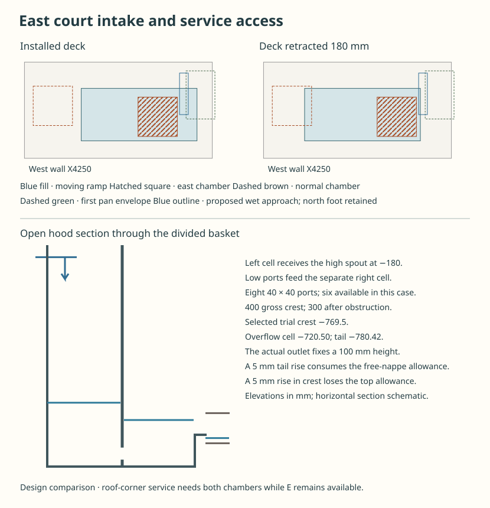

# The east court intake and the roof-corner chamber

**Requeue RWT-06 behind HAD-COURT-INTAKE.** The selected house has two exits, but its east inlet misses the blocked-north duty. Giving the water a larger opening changes the ramp, first catch pan, gate support and roof-corner maintenance route. A worked open-well alternative recovers hydraulic width. Its ramp and temporary east chamber still occupy the same space. HAD must select a joined court section before water detailing resumes. The [two-exit architectural selection](../had/water-replan-result.md) remains the historical source.

## How much inlet can be bought?

Use the actual graded west edge at X6125 with the north intake unavailable. The conditional quiet stage is −35 mm. The house geometry places the protective return at +15 with 25 mm each for splash and tolerance. The first level at which the assembled collar, sill or wall suffers harm is still unknown. The event assigns 3.60375 L/s. Reuse the [finite-inlet solver](studies/short-inlet-review.mjs) with the deepest quarter obstructed, n = 0.04 and one total K = 1. The table puts K at the entrance. Reallocating it to the lip is a separate sensitivity. No extra fixed loss is deducted from the stage.

| Wet edge in mm | 100 mm approach | 150 mm | 200 mm |
|---|---:|---:|---:|
| Existing 325, two spans | 2.505 | 2.401 | 2.315 |
| Remove central shadow, retain 25 north foot, net 425 | 3.492 | 3.370 | 3.267 |
| Remove both shadows, net 450 | 3.745 | 3.616 | 3.507 |
| Retain north foot and extend 50 south, net 475 | 3.753 | 3.621 | 3.510 |
| Extend 300 south with both existing shadows | 3.744 | 3.599 | 3.479 |
| Six wet panels with moved latch, separate closed collector | 4.321 | 4.131 | 3.975 |

Entries are L/s. With only the central shadow removed, moving K to the lip gives 3.764 at 100, enough to reverse the sign. Net 450 and 475 cease to meet the entrance-loss case at 155.15 and 157.45 mm respectively. A 50 mm extension of the north pan wet edge, a 10 mm return and a 1.5 mm sheet use 61.5 of its 100 mm dry edge. Keep five 305 × 550 north cassettes and the 25 mm north foot. Extend the actual approach, offset ledge and wet throat with the pan. Do not count a flooded N grate as a feeder. Flow across an actual short, obstructed brink and the assembled first-harm level require wet evidence.

## Can the ramp leave the mouth clear?

Move the toe from X5125 to 4900. Rise 74 over 1100 to X6000, then remain flat to X6225, Y6600–7200. Put longitudinal supports outside the wet approach. Move the hinge south to (6075,6577.5). A 645 × 40 leaf clears an upstanding north rail at Y7255–7315 by 32.19 through the swing. Its open western park leaves 27.5 to the captured 550-wide module at Y6900 and 25 on the weather side. A 600-wide load would consume the latter allowance. Price the relocated hinge, raised north catch, load-carrying edge connection and closed-gate load.

Try 120 × 60 × 5 RHS, 120 vertical, E = 200 GPa, on two independently anchored points at X5275/5725 on each rail. The north member stops at X6195 and the walking plate continues to 6225. The elastic screen conservatively extends one rail to 6225 and puts the full 5 kN edge point on it, with 5 kPa on a 655-wide tributary, a full 15 mm steel plate and rail self-weight. Ideal reactions are −3.59/+14.03 kN for the east point and +11.13/−0.70 kN for the west point. The east tip moves down 0.76. At X5975/6025 the calculated underplate air above quiet water is 13.01/14.61 after charging 5 mm setout. This prices one rail only. Plate cross-span, the 30 mm tip, eccentric attachments, anchored hold-down, deck stiffness, racking, guided stops, guard force and actual floor support still need design. No person stands on a moving deck.

The trial plate and two rails weigh at least 128.6 kg before guides, hold-downs and hardware. Buy the western pan's 25 mm underlap to catch a nearly vertical jet at X6125. This puts its outside lip at X6100. The installed deck projects 125 over its first lift. With all covers shut, positively capture and retract the deck 180 west, lock it at X6045, then release the pan under separate capture. There is 55 clear to the parked deck; the underlap still needs its own horizontal release. Reinstall the pan and check the wet seam before restoring the loaded ramp.

**The two roof-corner chambers expose the spatial veto.** The [roof-corner exchange](rwt-06-corner-and-cleanout.md) needs the normal and east chambers available together. The raised east chamber at X5550–6000/Y6650–7100, rim +350, is wholly inside the ramp plan in both positions. The 180 stroke also overlaps the normal chamber by 80 × 425. A 705 west stroke to give 30 clearance at the east chamber takes the toe 55 through the west court wall and still competes with the normal chamber. Chaining a cover-release interlock cannot clear a chamber during live corner work. A different ground route is credible but must retain the separate discharge, the 750 dry crew aisle or a priced replacement, and the guarded window/stair access. At full blockage the trial ground line imposes 60.97 kPa and 9.76 kN on a 400-square lid.

## Can the open hood spread the jet?

Keep the existing 250-wide side opening and spout at X7375/Z−180. In the 200-deep hood try a removable 190 × 590 basket, X7355–7545/Y6605–7195. Put its bottom at −875 in the hood's lower recess. A baffle at X7460 reaches −140, above the spout, and separates impact from overflow. Eight 40-square ports between −852 and −812 at 50 pitch feed the second cell. Give the downstream lip 400 real mm at Y6660–7060, crest −769.5. The outlet remains 600 × 100. Detail the actual 5 mm connection to the outlet, vent and impact cover, wall thickness, cleanout and positively captured vertical removal. No through-flow is borrowed from outside the 600 clear outlet. Gross blocked water up to −110 is 85.76 kg before the basket and fittings.

Two blocked ports give 0.0096 m² clear, 0.375 m/s and 57.46 mm at trial K = 8. With 25% of the lip obstructed, 300 effective mm require 49.00 mm head at K = 1. The two pools sit at −663.04 and −720.50. A horizontal 200-wide jet at the velocity of the 695 drop gives a 114 mm conjugate depth against a 212 mm nominal impact pool. This is a comparison for sizing the impact cell. The real vertical plunge, venting, unequal port feed and splash need a wet test.

The 600-wide east route gives 17.23 mm uniform tail depth above the −797.65 outlet invert. Allow 10 between tail and lip, and 20 between the second-cell stage and the −697.65 soffit. A 200 or 250 effective lip cannot fit both limits. The 400 gross trial has only 0.92 below and 2.85 above its internal stage allowances. Raising tail 5 loses the lower allowance; raising crest 5 loses the upper. To accommodate tail +5 and crest setout ±5 with a quarter obstruction at any chosen crest requires 591.15 gross mm. Even the full nominal 590 basket length is short before end walls. The theoretical bare 600 offers just 0.37 mm of allowable crest range. Widen or lower the actual discharge window, or buy a different energy break with a physical wet witness. This result tests the priced horizontal-lip detail. It does not reject every possible diffuser.

## Source disposition

Develop the [south ordinary access](studies/collector-access-recomposition.mjs) as the leading architecture. Keep the west stair for isolated renewal and price a demountable west approach or independent low-level feed for the corner chamber. The existing south option includes a detachable 100 mm weather tip and gives ordinary window access on locked covers. Its six wet panels and underlap connect to a closed collector with its own draw, catcher and terminal requirements. A decision to retain the open well must supply its own continuously falling pan, baffled outlet and first release. An alternate chamber location must preserve both live recipients through the actual feed, service and reverse installation. The selected west ramp, trial south arrangement and closed east machinery cannot be combined by taking only the favourable numbers from each.

HAD-COURT-INTAKE owns that spatial decision with RWT/STR/OAS. Reconcile the northeast support, upper corner first rest and ground pads with the same plan, using the [six duty register](rwt-06-finite-exit-map.md) for ordinary clearing, first release, complete renewal, live water, first wetting and downstream handoff. Preserve an explicit pre-site tail/spill envelope. Actual site levels stay with DPL and full network verification stays with RWT-07. RWT-06 resumes after the house has supplied a constructively coherent internal source. [Executable comparison](studies/court-intake-decision.mjs) · [Regressions](studies/court-intake-decision.test.mjs).
