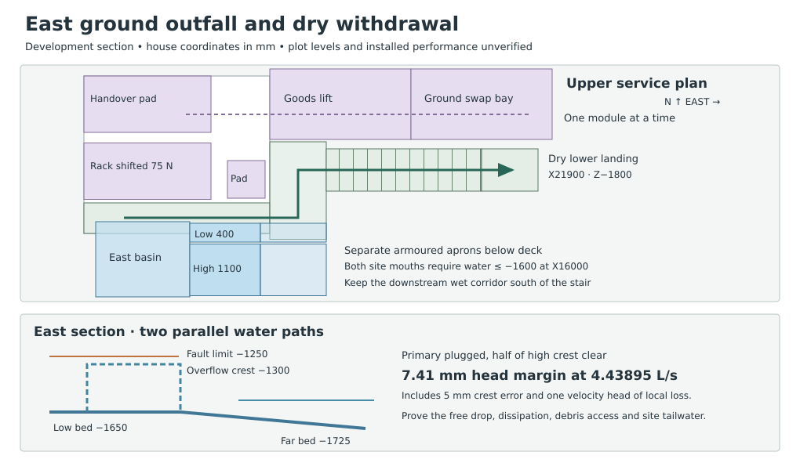

# East ground outfall and dry withdrawal

Retain the HAD open chute and original east-facing basin as the reference to develop. Give that basin an ordinary outlet at bed level and a separate high overflow. Keep the north receiver independent. The south-facing native fork can clear the long draw, but combining it unchanged with the plant dock would conceal both outlet tips. It needs a different building section and service route before it can replace the east basin.

## What receives the water

House coordinates and levels are in mm. The [RWT receiving interface](studies/selected-receiving-interface.json) supplies the chute lip at (12750, 6900, −1200), the 2000 × 1600 basin, both event limits, and the 1500 east continuation. The basin bed is set at its allowed maximum −1650. The existing 50-square posts at X13500/Y6350 and 7450 remain wet. Their buried bases, splash and erosion still require a detail. The separate 80 mm flange-catch drain receives local leakage only.

| Element | Trial setting | Where it discharges |
|---|---|---|
| Ordinary mouth | X14500/Y7275–7675, 400 clear, bed flush at −1650 | Its own open channel drops 75 to −1725 at X16000 over the same Y interval. |
| Blocked ordinary outlet | X14500/Y6125–7225, 1100 clear, broad level crest −1300 | A ventilated drop to a separate protected impact apron leads east at 1 in 20 to the other X16000 mouth. |
| Retaining sides | 25 mm edge returns and a continuous 50 mm divider preserve two lanes within 1600. Specify −1175 minimum at the three non-spill rims, divider and channel sidewalls. | 75 mm above the declared fault water. Actual splash, jump containment, wave, movement, waterproofing and tolerance must fit that budget or the section grows. |

This is a **change** to the previously reserved 1600-wide spill edge. Only 1100 is built as the high crest. No co-flow through the plugged ordinary opening is credited. At X16000 each mouth daylights onto its own lined receiving strip. Reserve X16000–17400 in the same two Y intervals for a fenced site apron, then keep the armoured receiving corridor eastward at Y6100–7700. The independently surveyed discharge beyond the aprons must maintain water at or below −1600 at both mouths, remain stable against scour and permit external inspection. At that maximum tailwater a static 50 mm can remain over the basin bed. Do not count it as drain-dry storage or use the basin as a staff pit.

| Assigned event | 400 mm ordinary | 200 mm ordinary after obstruction | Ordinary blocked and only 550 mm of the high crest open |
|---|---:|---:|---:|
| 3.60375 L/s, whole inward roof and court | −1574.22 | −1560.38 | −1262.29, 12.29 below −1250 |
| 4.43895 L/s, separate N-renewal contingency | −1571.67 | −1549.16 | −1257.41, 7.41 below −1250 |

These are required upstream levels under a bounded energy model. Compare the ordinary cases to −1400. The two [assigned events](studies/fork-outlet-joint.json) are alternatives. Neither includes the outer roof or the proposed plant threshold’s separate normal and blocked discharges.

For a rectangular opening use critical depth $y_c=(q^2/g)^{1/3}$ in metres, where $q$ is discharge per metre of clear width. The high crest needs 1.5 critical depths plus one velocity head (0.5 critical depth) for local loss, with 5 mm adverse level and no approach-velocity credit. For the channels use the higher of upstream critical control at the raised invert and the downstream maximum tailwater plus its velocity head. Add a loss budget of $(1.5+0.05L/D_c)y_c/2$, with hydraulic diameter at critical depth. This bounds losses on the subcritical branch and assumes a ventilated free control if the outlet draws down. A remaining 400 mm high crest fails the larger event. At 550 mm the settled receiving reach is over 270 mm below even a crest built 5 mm low. Demonstrate the actual nappe, air supply, jump, apron dissipation, backwater, edge losses and splash through the whole range. The critical-depth estimate does not model the falling jet.

**Isolation.** With E open and N disabled, the whole event must pass the actual roof/court entry, body, chute, basin and at least one competent E ground lane. Before N renewal, demonstrate E at the applicable larger duty and with the specified obstruction. With E isolated, clear the deck first, verify the separate N intake, discharge at (5000,13550,−600), and north basin and continuation to Y16650 with tailwater ≤−1000. N alone takes the assigned event. Keep it operating throughout E removal, refit and wet test. If debris covers both E mouths, common flooding submerges them, or the external receiver is closed, E is unavailable. Neither a second lane downstream of the same basin nor starting a pump recovers a missing independent house route.

## Get people and the outgoing module to ground

The [HAD renewal](../had/studies/water-replan.json) locates the closed-cover walkout, release station (13100,7800,0), R300 worker, north fixed strip starting at Y7450, cartridge pad, rack, and handover pad. The [MAT handling source](../mat/studies/upper-access-renewal.json) gives the two rack lines at X12600/14100 and 200-square plates at Y8150. Their south face at Y8050 leaves only 600 clear to Y7450. On the proposed centreline Y7775 each plate encroaches 25 into the body sweep. Emptying the rack leaves its feet in place.

1. Before opening any covers, leave the house on the existing closed-panel route. Reserve an unobstructed Y7450–8100 on the north strip. Shift the **whole** temporary rack, its fixings and 2700 × 1200 storage pad 75 north. The nearest plate is now at Y8125, the stage-to-handover gap is 225 and the loaded north transfer increases from 1800 to 1875. Re-register the foundation, bearing, forks, operator stations and lifted sweeps. All guards and controls must fit outside the 650 clear. Wet post heads must stay below deck.
2. After shoe release, move 25 south from the station to Y7775, then east to (15775,7775) before any suspended cartridge or module traverses the strip. This leaves 25 each side of the R300 body. Require remote capture and operating positions east of the crossing during transfer. Vacate the west side before motion. Retain the separate 800-square cartridge pad at (15300,8200) and the original order of module release and reinstatement.
3. At X16200 enter a 1200-long guarded return landing at Y7325–9400. Turn north on the level to Y8800, then east down a 900-clear stair at Y8350–9250. This keeps the flight and lower landing 650 north of the wet corridor. Allow 12 rises of 150 and 11 goings of 300, then a 1200 lower landing ending at X21900/Z−1800. The selected low ground and continuation beyond that landing must be dry, outside both discharged flow paths and available at each operation. The channel mouths are 200 west of the added upper landing. Its short plan overlap with the downstream wet strip requires a spanning edge, with all posts and footings clear of both wet continuations. Grade −1800 is a trial, not a surveyed escape route.
4. Deliver the restrained outgoing body to the original 2700 × 1200 handover at X12250/Y9600, then transfer straight east on Y10200. Budget a 2600 × 900 powered skid for the larger 2500.5 × 763 moving envelope, 150 side space in the 1200 corridor, and a separate 3000 × 1500 restrained goods platform at X16200/Y9450. Lower to −1800 and transfer straight to a 3000 × 1500 ground swap pad at X19200/Y9450. Clear that pad onward before receiving the replacement and reverse the sequence. No person rides the platform or walks alongside a moving skid in the narrow strip. A site needs independent staging and vehicle approach east of X22200. Select and qualify the restraint, drive, interlocks, gates, loading and supports. The existing 5 kN handling reference supplies a test demand, not a rating for this new goods lift.

The upper deck underside at −180 is only 1070 above the faulted water. No worker goes underneath it. Provide above-deck captured inspection and clearing openings for each mouth and the apron without cutting a loaded track or the occupied escape strip. Before releasing any blocked part isolate E, demonstrate N and protect the dry walkout. If independent openings, removal and first rest cannot be arranged, reject this below-deck servicing section. No access below the deck, blind reach or entry into a wet flume is credited. The inboard native-spool lower work platform is a separate structural comparison.

## Why the existing southern alternative cannot substitute

The [native fork](studies/fork-outlet-joint.json) delivers its two tips at (13175,4500) and (13525,4500) into a [south basin](studies/forked-side-outlet.json) at X12550–14150/Y2750–4750. The [MAT plant loading dock](https://github.com/adamnoden/architecture/pull/1430) occupies X12130–14230/Y3400–5350. **2.16 m²** of their plans coincide. The respective tips lie 850 and 705 inside the nearest dock edges, beyond even a 600 horizontal reach before adding depth. The parked fork starts at X14240, only 10 beyond the dock end, where the plant exchange needs an onward receiver. A high deck could span the water, but an unholed deck cannot provide that tip access. Reject the unchanged joint arrangement. A redesigned spanning dock would need its own openings, supports, dry handling and southern lawful discharge. The adopted northern-coordinate east handoff cannot be rotated on paper and carried to another site edge.

**Decision boundary.** Advance the two-mouth east site reservation, raised temporary rack and separated staff/goods landings for coordination. Keep RWT-06 open. Reject sites that cannot provide both the E and N downstream limits under the assigned faults, a harmless lawful continuation, dry access and independent receiving territory. Survey, common flood, soil retention, installed hydraulic and handling tests and the actual first susceptible fabric remain unproved. Reproduce the comparison with `node project/rwt/studies/east-ground-outfall.mjs` and run `npm run test:rwt`.
