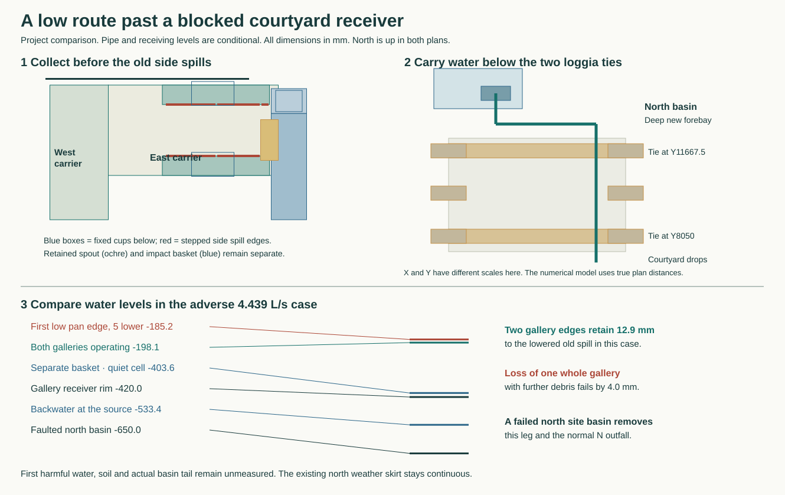

# A lower return for the blocked east court receiver

**Develop a separate buried return from the east collection well to the north basin.** Retain the existing N and E primary routes, the high N chase, the closed north weather skirt, the walking covers and both real site discharges. A blocked E spout needs interception **in the pan**. A blocked basket or shoe under the separate direct roof pipe needs interception **in the basket**. Connect both low pickups to a dedicated, inspectable return below the two loggia ties. If the north receiving ground is unavailable, the internal manifold must also pass water backwards into the working east outlet. This is an alternative on the current house. The selected HAD geometry remains the six wet cassettes and two site receivers. [Selected house](../had/court-intake-selection.md) · [Reproduce the alternatives](studies/court-bypass-choice.mjs) · [Source coordinates and loads](studies/court-bypass-choice.json)

## Bring broad and concentrated water to the wet pan

Keep the 200-long clear reach at X5925–6125. Along it, fall from −30 at Y5750 to −72.75 at Y6625 and −96 at Y7400. The two slopes are 4.886% and 3%. Blend the change to zero across X5250–5925 on the west and X6125–6600 on the east wherever there is actual stone. The largest additional transverse gradients are 1.15% and 1.63%. Both Y ends match the prior surface, the western N lip stays −92, and the ordinary south ramp is outside the changed field. At the Y6597.5–7200 maintenance gate the fixed −80 stair now needs an adapter varying from −8.59 to +10.00. Buy the extra 2 mm at its north end and keep the adapter out of the working aperture while E takes the event. Keep the flush support sockets and removable ramp sections. Survey joints, normal use, the two door thresholds and actual stone before selecting the regrade.

At the synthetic 216 mm/h event the duty is 3.60375 L/s. The 763.5-long paired-end entrance with a uniformly high lip, deepest quarter blocked, n=.04 and the complete 200 approach now gives **4.45888 L/s**, or 4.10891 with a further 2 mm of level error. The stage reserve is 4.997 mm. The old 4% contour had 0.159 mm. The isolated 250 chamber spout, with two 5 mm end errors, still supplies only **1.24788** through its own width. Keep its contained feed separate. Do not spend a broad-mouth result on a concentrated discharge. [Native short-reach calculation](studies/short-inlet-review.mjs) · [Previous two-chamber fault](rwt-06-raised-roof-court-service.md)

From the E chamber at X5900 take the 190-wide covered feed at Y6890–7080 to X6135. Lower the proposed clear roof and invert by 8, to −108 and −168. Replace the nominal 1.5 roof with a separately supported **9 mm** traffic plate over the 190 clear span. A full 5 kN on one simply supported 100-wide effective strip asks 176 MPa and 0.59 mm at E=200 GPa. Two vertical 5 mm errors leave 2.60 mm to the changed stone profile before this deflection and 8.73 below the nose to the pan. On the same clear hydraulic section, the restricted K3 case retains 9.32 mm above the water plus setout and 82.26 mm entrance energy. Test the whole wet plate, cheeks, welded support, cleaning access, concentrated impact and bearing. Isolate, empty and capture the nose before retracting it 65 west. The western carrier must still slide 50 east after the fixed gable clears. If a slip or supporting frame cannot fit this small vertical budget, use an independently supported high pipe and re-prove its *low* receiving arrangement.

## Catch the two different backups

Keep the selected 230-wide E spout, 270-wide open-top hood notch and the fifth carrying cover. Compare two independently supported wet shells underneath ten separately removable walking panels. End both shells at Y7360 and bring the receiving toe of the fixed north gable to Y7340. The west shell remains 330 × 760 × 300. The east shell is 960 × 510 × 300, with the steps at X6735/7040/7290 welded within it. The sole detachable wet joint crosses X6430. Its lowest floor is below a backed event. Use a positively retained, continuously supported joint and prove its leakage under head. A loose cascade over a step cannot close this reverse-water condition. Pay an independent cold-replaceable joint or reconstruct the entire seated piece. Its materials and force are separate from the MAT east flange study.

Form two open **110 mm internal-territory galleries** within the existing eastern plan at Y6850–6960 and 7250–7360. The centre has 290 clear before side sheets, compared with the original 230 spout. In each inner wall provide stepped spill edges X6750–7040 at −224, 7040–7290 at −244 and 7290–7340 at −255. They sit 8.45–21.55 above the local upstream pan floors. End dams, welds, setout and the horizontal carrying strips matter. The two outer gallery beds start at −395 and fall 2% from each end to the long bottom slots. At X6920–7120 the slots discharge into fixed 240 × 135 mouths, under the carrier. Their lower ends nest 25 into the mouths, leaving 15 after two 5s; their closest side has 5 after setout. With lower ends at −445 and the roof of the moving wet shell limited to −148 the total 297 fits its 300 comparison. Independently support the standing cups and seal their pipe connections. No walking load reaches the removable water sheet.

| Imposed flow | Both gallery edges, blocked spout | One entire gallery unavailable plus further quarter blockage | Direct basket backup, upstream impact / quiet cell |
| --- | --- | --- | --- |
| 3.60375 L/s | Water −201.89, 16.72 below the adverse old side | Water −187.07, only 1.89 below | −486.06 / −456.94 |
| 4.43895 L/s | Water −198.10, 12.92 below the adverse old side | Water −181.16, **4.02 above** | −450.86 / −403.58 |

The edge calculation removes 5 at both ends of *every* piece, obstructs the deepest quarter of all remaining edge and uses a K1 free crest on the actual stepped levels. It lowers the former first side another 5 to −185.18. For the separate gallery-channel comparison put the **entire** flow into one 80.25-clear rough channel (n=.025); at the larger duty its depth plus a bend allowance stays 11.76 below the lowest adverse crest. Both bottom openings have their own contraction and three-velocity-head loss. Meter all six edge segments, including deposition at the deepest end. If one whole gallery is unavailable do not authorize long N work with the larger roof diversion on this safeguard.

An entirely blinded spout never sends water into the basket. Conversely the Ø128 N-maintenance nozzle ends at (7450,7000,−80), directly over the basket. In the latter case cut separate **80 and 60** wide flush windows in the north end of the basket at Y7180, between −620 and −455. At this elevation the divider is at X7460. The two openings at X7372.5–7452.5 and 7467.5–7527.5 leave 7.5 at the side and divider. Rounded corners, retained plate strips, loaded deflection, guides and the actual 1.66 mm basket skew reserve need a full specimen. The low edge has 19.37 mm above the earlier adverse ordinary impact pool after one 5 error. Air, spray and intermittent use of this branch are expected. Collect the slots behind a continuously sealed stationary-in-use pocket within the **existing hood tail** X7350–7550/Y7200–7340. The wet pocket stays with the detachable hood when it moves. Its pressure-faced bottom connection is 150 × 120 clear at (7450,7270,−915), with 25/10 gross land in the 200 × 140 zone. Use positive top-operated retainers and lifting capture, a separate fixed shoe below, and a valved drain and test point. The calculation deducts 10 per clear dimension, 25% further area and K3 at the transition. It integrates free and submerged parts of the vertical windows at Cd=.55 against the actual backed pocket. No head is spent twice across a nominal air break.

## Carry the water to a real basin, in both directions

From the three receivers join the 150 ID return at the west side of the lower well. Its core route is **(7000,6940,−1025) → (7000,12800,−1112.9) → (5300,12800,−1138.4) → (5300,14100,−1157.9)**, invert levels. The 8.86 m pipe falls 1.5% throughout. Allow a 200 OD coupling envelope and 12 m total developed length with branches. It goes below both actual low loggia ties at Y8050 and Y11667.5 with 102.15 and 156.41 paired clearance. Its nearest plan gap to the P26/P30/P31 cap rectangles is 100. The native main N carrier is centred at X5025; the lower pipe turns toward it only outside the building. The south cup stops 15 outside the dry platform plan after setout. This is a new cast-in or pre-foundation installation. Keep its sleeve, bedding, pressure boundary and access chambers structurally separate from the 52-head foundation. Excavating a live 100 mm cap margin would require a different temporary-works scheme. [Actual ties and heads](../str/studies/current-house-grid.json) · [Independent lower crew platform](../str/east-service-platform.md)

A line at −1157.9 cannot simply discharge on a −1000 basin bed. Put an accessible 500 × 600 forebay at X5050–5550/Y13800–14400, floor −1350, with a −900 communicating edge inside the **existing north basin**. Keep the original vertical outlet and its independent air gap. Provide a removable surface trash cover, a rodding/lifting eye and a serviceable anti-return device with positive manual isolation at the new forebay. A continuous vent to a protected opening above the quiet level and test points at both ends are required. Allow cleaning from sealed accesses at the house pickup and the two direction changes without putting a person in a buried pipe. Price the approximately 1.35 m-deep wet chamber, confined excavation, flushing, sediment removal and handling without entering the forebay. RWT's isolated N and E basins and their downhill overflow land remain separately conditional. [Site levels and required ground continuations](rwt-06-finite-exit-map.md#exact-building-side-site-water-handoff)

Use 75% of bore area, 75% of hydraulic diameter, f=.06 and K14 inclusive of bends, tee entries, outlet and **open** check. At the north basin's maximum fault tail −650, the house-side hydraulic grade is −573.13 / −533.37 at the two duties. The higher leaves **113.37** to the −420 cup rim before extra loss. Check the real valve's opening head, air pockets, the two elbows, dirty chambers, displacement surge, tributary head and pipe shock. A closed north check prevents an individual lost north receiving territory from flooding the court through the new connection.

A stopped northern leg must not silently turn a fixed gallery cup into a low discharge in the service well. Run the full assigned flow **back through the manifold into the two basket windows** with the eastern basket, ports, shoe and discharge available. Both windows together have 90 effective width. At the larger event they require −517.66 on the pocket side, against the adverse E impact pool. The lower connection and another 1.2 m, K4 local manifold allowance bring the gallery grade to **−468.55**. The lowest permitted cup rim, −425, leaves **43.55 mm**. This bidirectional connection is why an open west-pointing hood spout is rejected. A failed north site and a blocked east route together have no admitted destination. All these calculations use each assigned event only once.

## Remove the wet parts without breaking the weather screen

Keep the full north plate X6075–7225/Y7395–7400, Z−120 to +50, during E work. The competing above-grate design has three 300-wide retracting lips, three independent weather shutters and three outboard tips. Its 652.5 effective width gives 29.19 mm head at 3.60375, with 10.81 left below −35 after setout. It also needs continuous five-pan, basket, saddle and moving-wall containment up to −15, and a clean 900 × 150 grate pocket. The buried comparison preserves the continuous ordinary weather plane and removes those three live crossings. It purchases the deep pipe, non-return valve, wet hood joint and vessel-like bottom connection instead. If the loggia corridor or north basin cannot take that work, reconsider the complete raised option, including its weather sequence. A shallow tee to the existing grate still runs uphill by 25–46 before losses. [Raised return, operating N stage and weather conflict](rwt-06-raised-roof-court-service.md)

1. With both routes intact, close household access, secure the real gates, remove and stage the two ramp halves and prove the working N receiver. Erect the weather roof, west discharge, full original skirt and covered two-flap entry. Stop and test the E chamber feed, both side galleries and direct upper pipe. Keep N working during the complete E exchange. Lock the low bypass valve from a dry station, place an independent supported blind and witness actual pressure and drainage before any joint releases. A failed N after stripping E requires stopping work and the retained independent high route.
2. Above the guard take the ten walking caps in order with the wet pans still supported. Keep a **305 × 250 × 16** fifth strip and its two 25 × 45 dry rails at Y6895/7105 independent of the water body. The blank weighs 9.58 kg. A full 5 kN on one 305-spanning rail gives 45.2 MPa/0.078 mm. The Ø128 pipe has just 6 paired margin inside its own 160 opening. Capture the dedicated insert from above, fit and prove the supported pipe before restoring N short/long maintenance. No walking load lands on the thin spout or pipe.
3. Drain, secure and release the low feed nose. Secure the east carrier at two points. Its first movement is **vertical** through the open upper notch, clear of both fixed gallery cups. A 30 south stroke hits the notch by 10. Raise the west shell's underlap at its correct time after 50 east. The bodies turn upright on a positively restrained fixture under the 1970 roof; their 330/510 travel depth leaves 160/70 at each end in the 650 airlock, at 300 width through the actual 602.5 gate. Gross water envelopes are 75.24/146.88 kg before shell, new gallery walls, attachments and residual silt. The approximately 12.16/18.80 kg five-face sheet figures exclude those added parts. Resist the signed lift into dry heads. Neither the N grate nor the roof is a crane foundation.
4. Move the shoe 25 east before lifting the guided basket. Keep the native shaft clear of any protruding window hardware. A whole 200 × 900 × 790 hood with a 140 west spout misses the airlock by at least 139 in the assessed 900-up attitude. Use a **horizontal supported split at −650** on the bottom-port alternative. Its two wet shells become 200 × 900 × 540 and 200 × 900 × 265 including the lower connection. The upper clears the gate by 31.25 per side when upright. The joint lies 30 below the new windows and 47.65 above the original native outlet. Its 2.20 m perimeter sees 4.61 kPa at the old side spill and **6.03 kPa at −35**. Price positive dry-side dogs and actual independent backing, guided first separation, a replaceable seal with declared constituents, and pressure testing. No credit transfers from the separate 0.79 mm MAT flange. Release the bottom socket only under line isolation and a zero-head witness. If the seal, controls, access or register cannot be built inside those margins, reject this hood. No cutting through a charged joint.
5. Clear cargo through one flap at a time on an independent capture/support system. Neither crew nor the carrier shares a 650-long vestibule. Maintain separate staff egress before handling the native E body, cassette and outboard rack. Restore the lower socket, hood and basket, test reverse and forward pressure states, re-seat the east/west carriers, reinstate the chamber feed and dry covers, then remove the weather enclosure. With an open well, attach the independent −800 platform before personnel entry. Remove it before the native spool rolls. [Native first release and outer cartridge](../had/studies/water-replan.json) · [Earlier wet-carrier and N-short changeover](../had/court-intake-selection.md)

The split hood must reserve its actual pressure hardware. A 20 external collar on all four faces is 240 × 940 and adds 2.19 kg per 6 mm frame. Allow **260 × 960** overall plus 20 vertical for restraints. No inward ring can spend the basket’s 1.66 mm remaining adverse side clearance. For the upper reserved package take original Y upright and yaw so that its 560-height dimension lies along travel and 260 across. It then has 45 at each end of the vestibule rather than claiming bare-body clearance. Check eight positively retained guides or another full perimeter clamp, the local socket backing, top-operated release and anti-tilt during the 40 stroke. A blocked socket or failed indicated isolation stops the opening sequence; no operative enters below a suspended hood.

For a supported alternative, use a 585 × 550 transfer cart on 400 wheelbase/track, deck +210 on +90 rails. Rent or build for at least 250 kg *total* suspended/rolled gross within a 4 kN trial vertical action. Weigh each staged assembly and drain retained water before release. No wheel bears on the live N grate. At the source three dry pad axes A(4500,5900), B(7100,6050), C(4500,6500), the 4 kN vertical reaction triples at the east and west hoist stations are −6.81/+3.71/+7.11 and −5.24/+2.72/+6.52 kN. Tension attachment, pitching restraint, the two-direction low grid and a separately supported chain block are part of the purchase. A catalogue 500 kg REID PGRS20 is 1158 wide and 1856 high at its lowest roller. The 1970 roof gives only 114 above, and there is no founded wheel field around the east lift. Its nominal goods rating does not buy this duty. [REID manufacturer datasheet, PGRS20](https://static1.squarespace.com/static/6569b20e9cbb583dfda54830/t/65ae9104a5bd96560bade11e/1705939204950/REID-UK-PortaGantryRapide-Datasheet-V7-lo%2Bres.pdf)

Pass through the guard on Y6898.75, one weather flap at a time. Rails leave 30 above the +50 weather crest after paired setout. At each X6075/5425 plane bridge a 150 gap with a removable 200 rail under positive support. On the four parked wheels at X5750 ±200, the nearest wheel remains 25 from the 100-long bridge territory. With opposite pulls restrained, retract the little two-rail bridge, shut and prove the first flap, and open the second. Leave 32.5 each end of the parked cart and 26.25 each side of the limiting gate. Buy a guarded transverse transfer table at (5070,6898.75) so the loaded cart travels south without rotating over N. The southward run retains 27.5 paired to the actual western weather-post foot. Stage at (5070,5510) on a new 750-square first rest X4730/Y5135 entirely in the existing 1500-square stage. The narrow 650 × 360 basket block does not take the whole cart. Price four-direction restraints, delivery of the empty crossing rails, retrieval from both sides, operator refuges, low overhead hoist/roll transfer, escape under a failed draw and the real capacity of each dry root. This two-flap mock-up and a joined supporting frame are required before anyone handles a load.

Record the first wet sensitive point at the north portal/shoe and the south tray/jamb under N-only, E-only, cup reversal and blocked-basket conditions. Quiet −35 and the +15 protective crest remain geometric controls. Measure real stage, velocity, debris, splashing, gate transients, capillary leakage and settlement at the assembled interfaces. The two receiving sites must stay independent and below their stated levels. There is no physically established first-harm level.

## Six programme duties and the one house decision

| RWT-06 duty | Internal disposition and downstream evidence |
| --- | --- |
| Cleaning and rodding | Retain the four loaded-pole stations, camera and shorter 240 high-eave return, plus corner deck. Keep all real pole joints in the 5.795–6.610 m effective range. Buy gallery and hood cleanouts, separate socket control, two external change-of-direction accesses and removable basin screen. Test wet tools, debris and safe reach on the selected house. |
| Outlet/downpipe removal | Keep captured corner cassette, leader reversal, native E outer-before-inner draw, N short-before-long sequence and supported dry crossing. Where a receiving neighbour, low side collector or individual longitudinal pickup cannot stay independently live, reject live cassette renewal. Buy the separately erected 15.8 × 19.19 m over-roof, its 16.623 L/s site discharge and +250 corner cover for that exceptional repair, or reject the plot/roof combination. The 241 mm final ridge reach requires a positively retained tool/bridge. The new inboard wet shells, pressure joint and load-bearing roots require the architectural choice below. |
| Visible gullies and inspection | Retain observable entries, removable walking caps, basket and separated terminal products. The new north forebay, return-cup telltales, open cleanouts and closed-socket drain must be accessible before affected parts are released. Include rods, seals and material declarations in the house selection. |
| Court, doors and thresholds | The regrade and covered feeder price the two separately delivered flows. The low pan galleries, actual basket ports and two-direction receiving leg address the distinct failures. The previously selected contour/receiver does not contain this geometry. HAD must adopt or reject the altered permanent section against a simpler independently accessible receiver. |
| Wall base and splash | Retain the north protective fold/portal collar and south +15 pan/jamb, with −35 quiet comparator. Identify concealed plaster/air line, insulation and backing as the first susceptible targets. Physical first wetting, capillarity, movement and splash under each registered fault remain downstream. |
| Site handoff | Keep the N/E locations, faulted maximum levels −650/−1250, downhill continuation maximum −1000/−1600 and separate safe service territories. Add only the deeper 500 × 600 N forebay, location, conditional backpressure and necessary cleanout/working territory. Real ground, hydraulic acceptance, independent outfalls and lawful disposal remain with the site and validation owners. |

**Keep RWT-06 open behind one new architectural selection, HAD-COURT-BYPASS.** Its controlling programme requires one accepted or explicitly rejected permanent receiver, its supports, actual service access, and shown continuity when the other route is unavailable. The low bypass moves the floor, wet enclosure, material seal, deep structure and northern ground interface; RWT does not silently change HAD's completed intake. Compare one simpler permanent accessible receiver, such as an isolated accessible sump with two independently maintainable outlets, against this whole arrangement on the same house. A concept rectangle or a second fitting sensitivity will not discharge the gate. RWT-07 retains whole-network synthesis. [HAD owner and exit](../had/house-architectural-design-programme.md#select-the-permanent-receiver-and-blocked-water-return)
