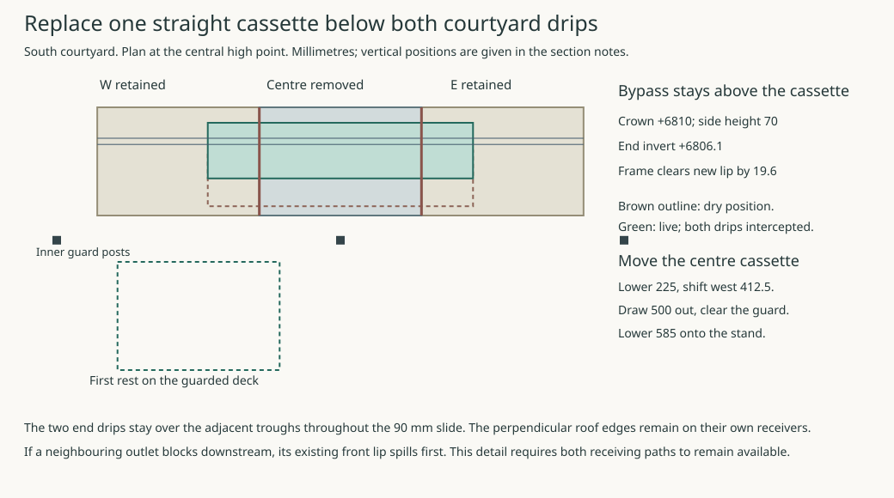
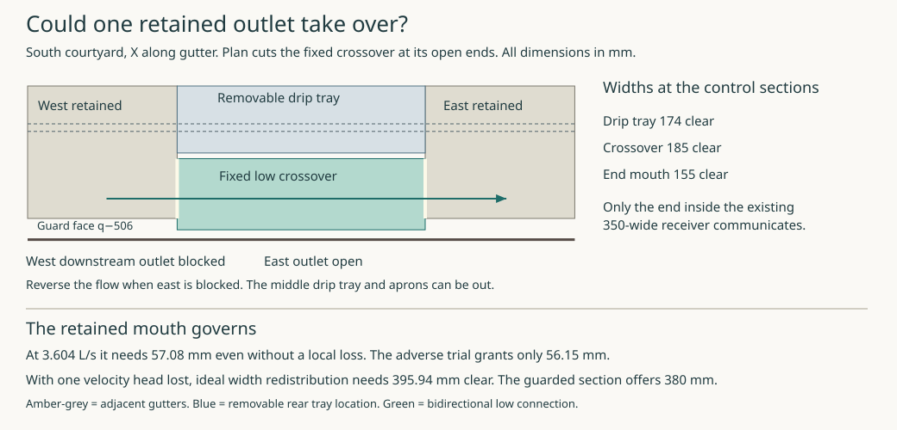

# Replace the centre cassette of the south courtyard gutter

**Keep the adjoining gutters in place. Divert both drips from the centre cassette into those neighbours before releasing any wet joint.** A short tray can do this throughout its movement without crossing a perpendicular roof edge. This supports a straight-bay design with two live receiving runs. It does not give single-fault continuity if one run is blocked downstream.

### Two drips and two fixed receiving ends

Take the middle of the seven modules in the earlier south-court receiver trial, **X5764.29–6235.71**, at the high point X6000. The adjacent troughs fall west and east to the existing trial outlets at X4500 and 7500. Here *q* is 4250 minus world Y. The primary roof drip is at q−200/Z7006.74 and the transferred secondary at q−220/Z6913.89. Retain their respective authorities. The raised ordinary outer-north eave is a separate occurrence. The roof edges turning at X4450 and X7550 remain on their existing receivers. [South receiver source](studies/live-receiver-renewal.json) · [Perpendicular-edge failure](studies/live-receiver-corner-failure.json)

Use a 771.43 × 180 mm bypass with a 1:100 fall from its central crown at Z6810 to its two open ends. Each end extends 150 mm across the seam into the adjoining trough. Slide the tray towards the wall by **90 mm**, from q−420…−240 to q−330…−150. It picks up the lower drip after 20 mm and the primary after 40 mm. Before pickup, the old cassette remains live. During pickup each drip lands either in that cassette or in the bypass. Both bypass ends are already over live gutters and remain inside their q footprint by at least 30 mm throughout. At the final stop each drip has at least 50 mm to the nearest bypass side. Its 70 mm walls finish at Z6880, 33.89 mm below the lower drip. Its 1.5 mm skin and 20 mm underframe leave 19.64 mm above the revised centre-cassette lip. The nearest perpendicular edge remains 1,164 mm beyond either end. These are vertical-drip and rigid-body comparisons; concentrated jets, deflection, wind and splash still require a wet trial.

The bypass can approach its dry position horizontally above the inner guard, whose top is Z6664. Keep it captured on two guided supports independent of the removable cassette. Guides crossing above it must stay above Z6784.64; supports descending below that level must stay outside the cassette and fork sweeps. Check the actual bearings, guide span, stiffness, positive travel stops, first pickup, front release and access before accepting the temporary apparatus. The tray needs no moving drainage hose or changeover valve. Return to the dry stop while the normal cassette is live, let residual water drain to the adjacent troughs, then export the supported tray.

### Separate the seams before lowering anything

Give the inner end of each retained neighbour a **closed Z6680 stop**, 5 mm above its existing front spill. Water cannot run freely from that neighbour into the empty centre bay. Raise the centre cassette’s end inverts to Z6710, form its 1:100 centre crown at Z6712.16, and take its side lips to Z6765. Each floor ends 20 mm short of the seam. An independently supported removable apron spans 35 mm on either side of the seam, falling 1:20 towards the neighbour from Z6696. Provide a 300 mm clear outlet; taper the centre floor and put the apron side returns outside its incoming lip. The nominal wet overlap is 15 mm, with 13.25 mm clearance below the floor at its end in the seated position and 12.75 mm under the apron over the blind stop. Across the whole slide, the apron’s highest point passes the lowest centre-floor edge with 12.5 mm to spare. Those quantities cannot be spent twice on movement and fitting allowance.

After the bypass is receiving both drips and the centre is drained, release each apron from a front-accessible restraint and slide it **80 mm along the gutter towards its neighbour**, without first lifting it into the overlapping floor. Its entire 70 mm length parks 45–115 mm beyond the seam; the bypass discharges another 35 mm beyond the parked apron. The two blind stops and apron guides stay with the neighbours. Reverse that slide under the still-live bypass after reseating the centre cassette. Reinstate the wet laps and test both normal branches before returning either drip. Fixing stroke, end-cap joints, bed support, tolerance, an accessible release and actual water capture across the lap still need construction details.

| Supported movement | Geometric decision |
|---|---|
| Centre cassette capture and first drop | Retain the 450 mm travelling carrier and its Z6560 underside. Until shifted sideways, allow at most 46 mm of pickup gear beyond its front face while reserving 10 mm to the inner guard. Capture and unload the end restraints before lowering. The former 200 mm drop would put the higher cassette lip **5 mm into** the adjacent carrier's elevation on the sideways shift. Drop **225 mm** instead. The moving body occupies Z6335–6540, 20 mm under the adjacent carrier, 121 mm over the midrail and 76 mm below the top rail. |
| Transfer to the guard bay | Shift 412.5 mm west to X5587.5. The whole 471.43 mm cassette then clears both adjoining 48 mm posts by at least 152.79 mm. Lowering alone leaves the X6000 post in its outward path. |
| Outward draw and first rest | The old 400 mm outward movement leaves the cassette 54 mm short of clearing the outboard face of the inner guard rail. A 464 mm stroke is the minimum for 10 mm reserve. Use **500 mm**, to q−950…−600. The cassette is now 46 mm outside that guard. Lower 585 mm onto a trial 520 × 400 mm stand at X5327.5/Y4825 with its top at Z5750. The stand stays 21 mm beyond the guard and leaves 901 mm to the outer rail. Guide and cradle, actual pad/hoist loads, supported transfer, deck and rescue require qualification. Reinstallation reverses the supported moves. |

### Where the two live routes stop

At the stress-test 3.60375 L/s, the ideal critical specific energy is **36.75 mm** through a 300 mm normal end and **55.88 mm** through a 160 mm clear bypass end. At the higher central bed the normal tray has 16.09 mm beyond its ideal requirement. Charging the complete event to one bypass end and the full climb over its central saddle leaves 10.26 mm gross before entrance, turning, roughness, debris, waves and any freeboard allowance. Each comparison uses the whole stress flow once; neither establishes the true distribution or capacity.

Most importantly, an obstruction **downstream of an open receiving end** does not act like a plugged outlet within the upper tray. A blocked neighbour reaches its +6675 front spill **131.14 mm below the bypass outlet** and 17.5 mm below the low apron invert. It spills onto the court side before backing up across either air gap to direct water to the far end. Stop using this arrangement as a passive one-fault repair method unless that spill is caught on its own harmless, maintained route or the receiving topology changes. The adjacent wet corners, roof/deck repair, full edge renewal, protected escape, drainage at the eventual plot and installed first-wetting height remain separate. [Calculated levels and stops](studies/middle-eave-exchange.json) · [Reproducer](studies/middle-eave-exchange.mjs)

### Can a blocked neighbour use a lower crossing?

**Keep both outlets available during the middle exchange.** A fixed low channel across the removed bay would connect the retained troughs before either spills. It offers a smaller-flow test condition, but the existing guard and gutter cannot accommodate this version at the assigned 3.60375 L/s once even a modest head loss is charged.

Split the same 471.43 mm middle bay in depth. The rear cassette at q−277…−100 still catches both drips by at least 57 mm. Narrow its co-moving carrier and removable end aprons to its own footprint. Its new lip at +6773 clears the live bypass underside by 11.64 mm, and clears the neighbouring carrier by 12 mm after the 225 mm drop. Keep each neighbour's +6680 blind stop alongside the rear cassette. Open the front part of both stops into a fixed channel at q−480…−292, with two 1:100 floors falling from +6607.36 at X6000 to +6605 at the ends. This joins the retained bed, which reaches +6604.64 at the seam. Keep the channel walls at the existing +6675 spill and its supports independent. It has 15 mm to the rear cassette and 26 mm to the round inner guard face. A 20 mm underside frame allowance leaves 35.5 mm above the dropped cassette. The original 350 mm carrier and 300 mm aprons cannot be reused across this split. A workable shortened joint, guides, support and front release would still have to fit the clearances.

With the bypass collecting and the centre released, water backing up behind a blockage downstream at X4500 can cross east to X7500. Reverse the direction for the other fault. Both openings of the crossover must remain clear. Charge the full stress flow once to any branch being tested, without assuming which share of the roof or either valley enters it. Hold the donor water at or below +6665, 10 mm below front spill. Grant a quiet approach velocity of up to 0.15 m/s (1.15 mm of energy head). The independent 5 mm adverse bed-level trial is separate from guard clearance and from freeboard.

| Section | Clear width | Static head | Minimum head at full flow, lossless | Remaining with 5 mm adverse bed and inlet credit |
|---|---:|---:|---:|---:|
| Ordinary rear cassette at crown, using all its lip height | 174 mm | 60.84 mm | 52.85 mm | +4.14 mm |
| Fixed crossover at crown | 185 mm | 57.64 mm | 50.73 mm | +3.06 mm |
| Crossover into either existing trough | **155 mm** | 60.00 mm | **57.08 mm** | **−0.93 mm** |

The crossover extends 30 mm farther out than the retained trough. Only 155 mm between walls opens into that trough. For given flow and width, minimise depth plus velocity head and a trial local loss of K velocity heads over **all** positive depths. With K = 1 and even the nominal bed levels, the 155 mm mouth falls short by 10.77 mm. Allow the ordinary lip to rise to 10 mm below the upper bypass and redistribute the two tray widths optimally. The normal and crossover crowns then require 186.23 + 209.71 = **395.94 mm clear** in their respective full-flow states. Guard to rear boundary gives 396 mm gross after a 10 mm guard reserve. Four 1.5 mm skins and a 10 mm separation leave **380 mm clear**. Changing the split inside these elevations cannot cure the shortfall. The assumed K is a resistance sensitivity, not a measured fitting coefficient.

**Carry 2.00 L/s to a wet trial.** Combine the smallest width (155 mm) and highest bed (+6607.36) in one conservative rectangular control. With the bed 5 mm high and no approach-velocity credit, 52.64 mm is available. Critical depth is 25.70 mm, exit kinetic head is 12.85 mm and a separate 12.85 mm can be spent on **all** losses from donor to control. This needs 51.40 mm, with 1.25 mm spare. Keep the healthy water surface below +6625.70 at the mouth, even with its invert 5 mm low, to avoid drowning that critical depth. This is a conditional free-control comparison. The actual contractions, short channel, debris, both simultaneous inflows and receiving tailwater require a wet test. At the actual end alone the optimistic K = 1 adverse limit is 2.486 L/s before checking the rest. Neither number assigns a local roof tributary. [Calculation and assumptions](studies/middle-eave-crossfeed.mjs) · [Numerical results](studies/middle-eave-crossfeed.json) · [USBR critical-depth relationships](https://www.usbr.gov/tsc/techreferences/mands/wmm/chap02_12.html)

Test with the cassette out, plug X4500 downstream of the crossing, and measure first front spill, approach stage and both end stages and flows. Repeat with X7500 plugged. To keep the assigned full event, give overflow its own located receiver outside this congested centre section, or establish a lower source-bound duty for the failed side and prove the remaining outlet can take both its own runoff and the transfer. A blockage at a crossover opening or both downstream outlets would require a separate escape route.
