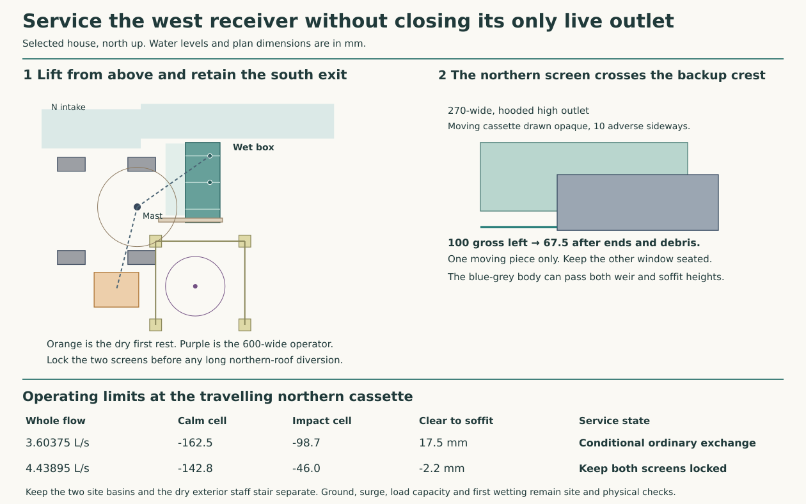

# Service the permanent west receiver and keep an independent outlet

**Use the selected west receiver. Change one screen at a time in the ordinary house state. Lock both screens before diverting a northern roof module, and use a separate weather diversion for a stuck component or major repair.** The northern screen passes directly in front of the emergency east intake on its way out. Ignoring that brief obstruction would allow the roof-diversion case to fill the underside of the intake cover.

This completes the six pre-site access, courtyard transition and handoff decisions in RWT-06. RWT-07 receives this house and its operating limits for whole-network synthesis. The first damaging water level, installed capacity, structural ratings, material permissions and a site disposal route remain unqualified. [Selected architectural section](../had/receiver-selection.md) · [Calculated cases and coordinates](studies/court-service-selection.json) · [Reproducer](studies/court-service-selection.mjs)

## The first movement changes what can pass

The west box at X5700–6050/Y6550–7360 has a baffled impact compartment and a quiet compartment. Its low 150 ID branch drops to the northern forebay. The separately vented high branch spills over the −300 crest and discharges freely into the original eastern chute. The floor’s 200 mm approach to the 216 mm credited grate remains clear. With 2 mm additional adverse level, the selected cover/grade comparison accepts **3.6763 L/s against 3.60375**. Concentrated temporary corner and roof flows enter through their own contained south connection.

The two 210 × 130 screen cassettes lift on the quiet side of the 5 mm baffle. Fit a dedicated parallel blind to each. Its blade must be fully home before its screen rises. Either travelling part can shadow the high E inlet at Y7010–7280, between the −300 sill and −140 soffit. Give the complete moving blade/frame/yoke the same 210 mm maximum along Y, including its captured lifting tail. Disregard all holes in that moving body. Charge two independent relative 5 mm shifts to the overlap, 5 at each end of the remaining crest, the existing quarter debris, highest sill −295 and lowest soffit −145. The retained fixed screen pays the full published K4 loss with its own worst quarter absent. Treat the remaining side opening as the only usable crest. Measure the actual three-dimensional contraction, air passage and impact with the body halted at its worst intermediate elevation.

| One seat blinded, the other screen in service, with N also stopped | E crest after travelling frame, end errors and debris | Quiet / impact mm | Air left below adverse soffit | Decision |
| --- | ---: | ---: | ---: | --- |
| South blind or screen moving at 3.60375 L/s | 148.125 mm | −216.6 / −152.7 | 71.6 mm | Ordinary exchange comparison |
| North blind or screen moving at 3.60375 L/s | 67.5 mm | −162.5 / −98.7 | **17.5 mm** | Governing ordinary witness |
| North blind or screen moving at 4.43895 L/s | 67.5 mm | −142.8 / −46.0 | **−2.2 mm** | Reject simultaneous screen exchange and northern roof diversion |

The long case still clears the −35 quiet floor reference in the impact cell. It fails earlier at the roof over the free overflow. A filled pressure opening needs a different hydraulic and air path. Keep the source’s free-overflow model within its domain. At the worse ordinary stroke the impact remains 63.7 mm below −35 and the downstream E line retains 278.9 mm of driving head after the source neck, pipe and nozzle losses. With both screens fully down, the accepted long N-off control reaches −219.96 in the quiet compartment and −123.13 upstream under one-screen/one-quarter obstruction. If the one working screen has only half its hole area, the upstream long level rises to −2.10. A rapid human response or the empty box’s storage earns no design credit. [Native heads, backwater and E outlet](../had/studies/receiver-flow.mjs)

## A guarded exchange from ground level

Keep the grating locked until both site destinations are available, the ordinary N L-inlet and low leg are proven, and the idle E has been wet-tested with the low branch isolated. Check its air break, downstream tail, free mouth and the sealed hood that keeps incident drips out while N operates. Test the same route after reinstatement. Verify the low-side check/seat under reverse pressure and the clear, independent vents. Use an instrumented stage/flow witness at both chambers and the remote discharge. Never begin with N isolated, the adjacent screen unverified, or a roof/corner exchange in progress. The ordinary adverse calculation covers an unexpected loss of N during the allowed exchange.

Use a witnessed clean spare cassette. There are 135 credited full holes in the adverse 190 × 110 measured view. Gauge at least **102 clear 9 mm holes** in the retained screen and also keep the declared inlet, neck and receiving areas. Bring the spare to the dry rack. Shut the public court, secure the native rig/ramp in its ordinary state, install and test a separate hard operator bay and positively capture one lid at a time. Insert the first blind, positively seat and lock it, draw the dirty screen upright, lower the clean screen to its marked seat, then withdraw the blind. The other window stays screened and live throughout. Witness the newly seated clear screen before closing the second window. Clean and gauge the removed one on the dry rack, repeat for the second, and restore all panels and catches. If the old screen cannot be inspected through water, or a seat, stop or retained guide does not work, isolate and drain under an independent weather diversion first.

The smooth pickup point must travel on the **quiet face**. Reserve X5947.5 for the vertical guide, 31.5 beyond the credited active grate at X5916; limit its lateral frame/guide projection and setout to retain a positive gap. Connect each submerged moving item through its own captured stainless lift tail to an identifiable eye at approximately −100 beneath its lid. Keep the tails separated from the weir and low neck, resilient against fouling and out of the protected airstream. A loose chain on the working perforated strip is rejected. Use a camera and an independently indicated positive hook closure. The screen level near −795 is too deep for the modelled 1.9 m unloaded hook-setting wand: it would need 2.182 m from the protected station. The surface eyes need at most 1.683 m. Where a tail or blind must be withdrawn, provide the verified replacement/witness before reopening the grating. Test reflection, dirty water, darkness and a failed latch. A lifted 24 mm lid may redirect rain while airborne. Lift it clear of the floor, keep all feet and stored pieces off the 200 mm approach, and wet-test the actual partially opened state.

For the local lifting comparison, station the mast at (5215,6710), set a 450 × 350 dry first rest centred at (5005,5875), and operate from (5800,5910) south of the wet box. Set the four independent 280 × 140 shoes at X4550/5260 and Y6200/7140. They clear the original three 400-square corner pad zones, two N grate regions, wet box, apron, lowered west gate and first rest by at least 30 mm. No member can bear on a flush rig socket, cover or court membrane. The three lid centres and two screen axes need at most 895.4 mm mast radius. Buy at least 900 mm verified reach to their actual pick eyes and at least 861.1 to the first rest. Weigh the lid, spreader, wet debris and every loose accessory together. The largest retained flat plate alone has an 18.48 kg gross blank.

Use an indexed retracting arm. Raise the lowest edge to +1250 before pulling a load towards the mast, retract to 400 radius, slew across the empty north/west sector, and extend straight to the dry rest. A return from screen bottom −925 requires a 2175 mm stroke before the horizontal movement; size the hook height, compacting tail, rigging and beam overhead accordingly. Permit only a captured load, 40 kg maximum verified gross. Keep the operator in the protected bay, with at least **68.5 mm** between the complete moving half-diagonal and the R300 body throughout these strokes. The retracted sweep leaves 342.4 mm to the nearest court side. Prevent free slew or dropped load on power loss. Control the angular sector, trolley stops and line force. A stuck guide goes back to its positive seat or the affected water is isolated and the assembly shored. No tool operator lifts the weighted cassette by hand.

The protective rails are independent of the lift base. Reserve a three-sided bay from X5400 to 6300, Y5520 to 6365, open south to the retained, held-open patio doors. Four 120-square support positions at its corners clear the rig shoes, wet routes, source sockets and rest by at least 35 mm. The south approach at X5800 leaves 40 mm beyond the worker at the narrower guard feet, with 306 mm at the held door jamb/leaf bounds. The proposed northern guarded face has a **98 mm horizontal clearance**, X5800–5898, for a controlled unloaded Ø24 setting wand between +250 and +700. For each of the five pick points the straight sightline clears its opening by at least 13.95 mm after the tool radius. The person and every load stay outside this slot. Provide assessed guard support and crowd exclusion, retention, wind and wet footing. Stage, assemble and dismantle from the closed, load-bearing court before opening a lid. Verify staff and parts pass the actual threshold independently, and preserve manual exit on a power fault.

The rig is a **conditional engineering envelope**. Price two attached lifting links per lid gathering at the single controlled pick point. Keep their spreader within the stated load silhouette or recheck the larger body. Install 250 kg restrained ballast at (4760,6670), for example in twenty separately handled 12.5 kg blocks. Keep the arm stowed until ballast, levelling and guarding are complete. At 0.60 kN vertical including a 1.5 moving factor and a separate 0.15 kN lateral action up to 2.60 m, the least restoring margins around the west/east/south/north support-centre lines are **0.125 / 0.362 / 0.568 / 0.631 kNm**. Both the unloaded hook and the full loaded sectors are included. Frame weight provides no favourable moment in these figures. With a 60 kg frame charged to bearing, one pad alone would ask 92.9 kPa. On the adverse combined floor gradients the comparison needs a minimum friction coefficient 0.095 even before wind, wet dirt or movement. Prove load distribution, anti-slide restraint, soil/slab and paver support, settlement, oscillation, wind and all joints on the actual selected landscape. Do not share the temporary tower cap’s rating or the guard’s fall load. If a compliant lift, dry staff station or insulated surface support cannot be installed, close the receiver to attendance, divert the entire roof and court to separate discharge, and undertake a supported dry repair. [Lift planning and examination](https://www.hse.gov.uk/construction/safetytopics/lifting-operations.htm)

## The six duties passed to RWT-07

| RWT-06 duty | Pre-site house decision | Release condition or rejection |
| --- | --- | --- |
| Cleaning and rodding | Retain the four ground pole stations, camera, 240 mm return head and 5795–6610 mm useful pole lengths on the raised roof. Keep the source 12.33 mm adverse shoe clearance. Rod both buried changes of direction, the N nonreturn connection and the two E/underdeck mouths from above, with capped access and a dry first rest. | Demonstrate the actual joints, stiffness, wet controllability, silt and visibility. Keep people off loose or wet covers. If the cleaner cannot reach a root, restore the independent roof cover and service it from protected access. [Roof access comparison](rwt-06-raised-roof-court-service.md) · [Ground cleanout and dry handoff](rwt-06-east-ground-outfall.md) |
| Outlet and downpipe removal | Keep the middle-cassette contained boots, corner two-chamber diverts, guarded corner deck and native E outer-before-inner draw. Keep N short-before-long, with its separately supported 133 mm temporary tube into the south compartment and a proven high N alternate before opening a carrier. The west calm-side screens stay locked throughout. | The roof boot has 9.37 mm free head at long duty. The N roof-pipe cartridge has only 3.05 mm adverse lateral reserve and the actual short crew 18.2. Lengthen the clearance or use whole-roof diversion if the supplied fittings and support cannot meet them. Isolate/blank the E nozzle before the E draw. Major exchange buys a 15.80 × 19.19 m site reservation and a separate 16.623 L/s discharge plus independently secured last ridge reach. [Roof/temporary water duties](rwt-06-closed-control-and-canopy.md) · [Major site footprint](rwt-06-over-roof-site-envelope.md) |
| Visible gullies and inspection | Keep the perforated walking plates, two separate screen seats and blinds, hidden-side water witnesses, independent low/high vents and two observable site outlets. Use the captured, gauged spare and bounded top exchange above. | Reject a common removable screen, blind pulled before its clean replacement seats, simultaneous roof diversion, inaccessible hook or hidden live bypass. Reinstate, wet-test the dormant E, check drainage and inspect every closure before returning the court. |
| Court, doors and thresholds | Keep the −30/−85/−96 falling floor, formed south feed, tapered gate transition and actual 600 × 900 dry eastern crew platform. Foul water/plant services retain their own systems. Use the actual west keeper (6130,7275) and independently supported guard. The rejected fixed low cups leave no working body on this platform. | Fit-test the selected two flaps, retracted nozzle, stair/guard and free discharge, including blockage, shutter/guide tolerance and walking loads. No standing on an opened carrier or temporary pipe cartridge. [HAD selection and source](../had/receiver-selection.md) |
| Wall-base and splash | Protect the N portal collar/shoe, hidden inner DPC/insulation/plaster line, and the south +15 pan end and jamb backing. Use the accepted −35 quiet comparison, direct chamber impact and closed high E hood. | Record actual first moisture on protected dry-side witness material during steady, transient, stopped N, stopped E and maintenance operation. Inspect/dry by the named access. Keep the first harmful level unknown until observed. Two lost outlets, failed common screens, submerged air break or wet concealed fabric reject use; a geometrical crest gives no permission for water entry. [Threshold and wall-base witness](../had/studies/north-protective-return.mjs) |
| Site handoff and protected escape | N low branch enters the separate 500 × 600 forebay at (5300,14100,−1171.4). Preserve the original N outlet and north basin X4250–5750/Y13450–15150, normal/faulted tail ≤−800/−650 and north continuation to Y16650 at ≤−1000. E free-discharge reaches the original chute and basin X12500–14500/Y6100–7700; normal/faulted ≤−1400/−1250, continuation to X16000 at ≤−1600. Preserve the dry 650-wide staff band, 900-wide stair to X21900 and separate restrained goods landing, with no worker riding the load. | Keep the 400 clear normal and 1100 clear fault channel, scour/ground reserve and both downstream receipts separate. DPL must survey levels, infiltration/attenuation or lawful disposal, separate flood territories, base/footing conflict and site access. If site water can submerge a working free lip, both basins share a lifeline, or the required dry escape cannot land, reject this plot/arrangement. [East water and staff](rwt-06-east-ground-outfall.md) · [N/E terminal authority](studies/selected-receiving-interface.json) |

The west low branch and old ordinary N route share the N site. Only the separately vented high E spill and its distinct receiving territory earn credit when N is stopped. Force the change before each authorised N isolation. Before an E strip-down prove N, isolate, vent and positively blank E, then restore the nozzle from its supported rest before striking the weather boundary. Common flood, unmaintained screens, simultaneous work on both destinations or unavailable major temporary outfall remain explicit rejection cases. No hydraulic verification, material exception or occupied roof access is inferred from this development completion.
