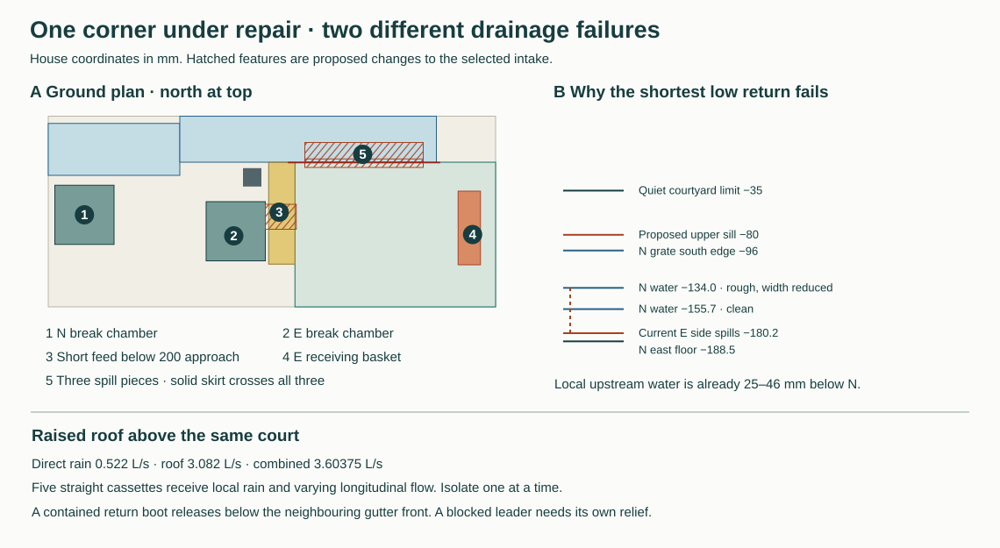

# Service the raised roof and receive a blocked court basket

**Develop the short-return cleaning tool and the contained two-ended cassette transfer. Keep RWT-06 open.** A concentrated temporary chamber outlet has no demonstrated way to use the whole court mouth. Routing it straight to the basket saves that spreading requirement but introduces a different failure. A backed basket can overtop its final side pan 145 mm below the courtyard water limit. The nearest N channel is already higher than that spill. Develop a continuous high return onto the existing N grate before selecting an assembled corner-service system. The original house court and its state order remain authoritative. [Selected court](../had/court-intake-selection.md) · [Calculated cases](studies/joined-service-routes.json)

## Roof cleaning, exchange and major repair

The raised slate edge encloses 8.7025 m² of direct sky and drains 51.36 m² of inward roof. At the existing synthetic 216 mm/h event those produce 0.52215 and 3.0816 L/s respectively. Each 2.95 m eave receives 0.4248 L/s of direct roof flow and each valley another 0.3456. One shared corner receiving both adjoining half-faces and its own whole valley collects 0.7704 L/s. A closed-end transfer, cross-feed from another leader or additional catchment must be traced before using this smaller number as a fault duty. The 4.43895 L/s case carries the temporary loggia roof as well.

**Ordinary cleaning.** Carry the project 50 OD U, 150 bend radius, 155 shoe and raised approach over the +6675 front. Shorten its return from 260 to 240. With the inlet axis at 4510, shoe at +6705 and the whole 175 outer tube radius, the old curved surface has 10.42 mm nominal under the +7107.33 lower drip. Independent 5 mm movements of tool and roof in each axis give −7.67 mm. The shorter leg gives +12.33. The pole remains 85 beyond the outer gutter. The effective 5795–6610 setting is a range to achieve across the manoeuvre. Six metres of catalogue poles before overlaps cannot achieve its upper end. Use the existing full/half pole and grip comparison on all four faces, the locked well covers and a separate corner-deck clean. Before adopting a physical tool, demonstrate the joint overlap, actual grip and force with wet debris, reverse sweep, camera image, 3300 W unit, 76 dB operation, hose and a clear exit. The stock 300 × 240 × 60 attachment does not define its clamp axes. [Ground positions and equipment](rwt-06-corner-and-cleanout.md#get-a-cleaning-head-to-the-gutter)

**One straight cassette at a time.** Both new drips at Y4525/4545 land in the former dry Y4490–4670 park. Move the 180-wide field tray to dry Y4565–4745, live Y4475–4655. Taper its ends to 110 width. They stay 25 inside the fixed neighbour front and receive the wet drips with at least 40 reserve. A 175-high side on the +6810 bed leaves 122 below the lower drip. With quarter-width obstruction, critical control, one velocity-head loss, two 5 mm errors and 20 freeboard, the side has 29.12 mm spare at 3.60375 and 11.84 at 4.43895.

An uncontained horizontal jet can travel 393 mm using the available surface energy. The next cassette ends 321 mm beyond the outlet. Instead put a vented, square, removable return boot on each tapered end, extending 140–250 into its retained neighbour. Continue its side plates to +6640, 35 below the lowest front spill. It stays at least 25 from the parked seam apron, 26.43 from the nearest turning secondary and above the inclined receiving bed by 23.25 after paired setout. The 110 outer boot leaves 237 of clear transverse receiver. Even counting just two 107 × 23.25 openings at the bottom, a K4 escape costs 106.95/162.27 mm at the two stress flows. The remaining head to the tray rim after a flooded neighbour reaches its spill, 20 freeboard and two 5s is 173.05/117.73. This bounds a contained first landing. A blocked leader still needs its independent outlet. [Existing cassette movement](rwt-06-middle-eave-exchange.md) · [South end relief](rwt-06-wall-side-relief.md)

Each of the five interior bays receives 0.06789 L/s of its own direct rain. In bays 1 and 5 another 0.10183 arrives along the trough, in 2 and 4 another 0.03394, and at the middle crown none. Before breaking a joint, give the headward neighbour a 100-clear rear pickup starting 35 beyond the joint, at +6615 into the separate deep wall-side collector. A quarter obstructed edge, 5 high and K1 puts that local water below +6632. Retain the full-duty 400-wide scuppers for the separate leader-fault case. Authenticate an independent low collector and outlet on each face, especially the turned corner, opposite heads and open loggia. While the ordinary route is live, prove the boots, pickup, alternate leader and blocked-neighbour relief. Then park the seam aprons, capture the cassette, lower 225, transfer to its guarded first rest and reverse. The L-corner has its own 900 diagonal transfer and three-pad frame. Remove and stage the entire south ramp before installing the corner frame and its two low chambers. Their 700 aisle leaves 50 each side of a 600 body.

**Major repair.** Reserve the external over-roof with its own 16.623 L/s discharge and 15.8 × 19.19 m equipment/gate footprint, erected and rain-tested while the permanent roof works. Raise the pitched protection by 250 to buy 147 mm beyond a 2 m working envelope at the four corners. A bare hand cannot reach the ridge clip 841 from the 710-offset side platform. Specify a captive sliding clip tool or a positively supported bridge for the final 241 plus usable engagement. Retain the low horizontal handling fixture, the separately supported slate/lead first rest and the protected alternate exit. The real plot, bracing, wind, external roof discharge and guided tool remain release conditions. [Roof and original site trial](../mat/ring-roof-family.md)

## The concentrated feed and two different receiving failures

With N unavailable the selected west approach is X5925–6125, Y6625–7398.5. Its paired-end, uniformly high case gives 3.63000 against 3.60375 L/s, only 0.1593 mm of stage reserve. A further 0.25 mm gives 3.58884, and 1 mm gives 3.46636. A ±1% flowmeter needs a setpoint of at least 3.64015 to demonstrate the assigned flow. Use actual stage/flow uncertainties and wet the completed corners, end stops, skirts and obstructions.

The low E chamber actually feeds Y6750–7000. If that width stays concentrated, the same 200 approach passes 1.26929 nominal, 1.00898 with a +5 lip and 0.96948 after both ends move in 5. Using the 180 from the actual spout toe gives 1.02522 in the +5 case. If the full-mouth blocked quarter (190.875) all lands on the concentrated feed, only 59.125 is left and the comparison gives **0.25809 L/s**, below even the one-corner 0.7704. Water could spread across the open floor or return north before entering E. Its delivered distribution and the open termination at the pan must be proved separately.

| Corner delivery | First physical release, destination and decision |
|---|---|
| Existing +50 open sill | The retained N chamber projects 25 onto its own true west grate. The E chamber stays at X5450–5900 and clear of the full approach. Keep this ordinary reference for a full-scale concentrated/debris trial. A 22-clear distributing header between mast and approach cannot spread a debris-laden stream by assumption. |
| Raised E chamber and separate high 108 copper run | A 1425 rise, independently supported 1:30 run and genuine slow bend can put a tilted nozzle through the 160-square fifth-cover opening with 13.17 after two 5s. It needs pressure-rated vent, lid, line, anchors and an isolated, positively supported changeover. A plugged sealed pipe can transmit backpressure. An open nozzle discharging into a blocked basket cannot divert the continuing inflow upstream. Reject this as a stand-alone fault solution. [108 tube](https://lawtontubes.co.uk/product/copper-tube-plain-straight-length/) · [Matching N18 dimensions](https://aalberts-ips.co.uk/products/item/89641/) |
| Short covered E feed below the apron | Compare X5900→6135, Y6890–7080, invert −160, crown −100. Effective 140.25 width, a quarter blocked, K3 and f=.08 leave 74.26 mm inlet-energy margin even at 3.60375. The traffic-bearing roof has just 5.3 mm to the finished grade after two 5s. It needs a load-bearing flush top, independent support, a cut west upstand and a sealed retracting nose. Withdraw its tip 65 west to 6070 with the fixed sleeve ending 6080 before the existing pan can go 50 east. This buys 10 after setout and protects the 200-wide surface. Its distal basket can still block. |

**The decisive return level.** When the basket or chute blocks after the air break, the fifth pan's −280.18 spout with 100 side rise can spill at **−180.18**. At the closest N east entrance the bed is −188.5. If the proposed local connector places the whole assigned event in that section, its rectangular-flow comparison gives −155.66 clean at n=.02, or −134.04 with one quarter of the width obstructed at n=.03. A local gravity connection from the existing pan head is uphill 24.52–46.14 before any entrance or friction loss. Even the isolated 0.7704 corner share in the clean local section gives −176.19, about 4.0 above the spill. These are imposed local-flow cases; the actual distributed N intake and backwater must be measured. The deeper trunk at X5025/Y7750 buys only 0.73 mm in the clean case and loses 20.89 in the restricted one. Its sealed full-height return must also survive. Reject the simple low tee.

**Develop the above-grate return.** Keep all escaped E water in a backed wet boundary to −15, including the basket, four falling saddles, moving wall returns and the fifth side. That raises the fifth containment by 165.18. Price 2.41 kPa static head there at quiet stage, about 41.1 kg of additional standing water over a 305 × 550 footprint relative to its floor, and actual impact, walking load and independent hangers. Water returning through the built west mouth may use the ordinary court. Protect every lower route into the service well and occupied floor.

Give three 300-wide sill pieces X6200–7100/Y7360–7425 a common crest −80 over the actual N grate. Two 3 mm joint stops, two 5 mm end setouts and a quarter obstruction leave 663 clear. K1 gives 28.88 mm head and 11.12 reserve against −35 after the sill moves up 5. A 25-long grate toespan alone requires 33.08 mm orifice head versus 17 nominal drop. Buy a contained, open-top 900 × 150 receiving pocket Y7400–7550, within the real perforated grate. At 44.18% perforation, quarter blockage and trial Cd=.60, 0.92 mm pond head over its effective area fits the 6 mm adverse sill-to-highest-grate gap. Test distribution, backwater through the 9 mm holes, deep debris at either edge and cleanout. The underlying N crossbody needs 54.46 mm depth in the rough restricted case, leaving 13.54 of the 68 cover void before bend, inlet or tail losses. N has a full event in this fault, counted once.

**The current weather skirt prevents that first motion.** The real north plate spans X6075–7225/Y7395–7400, from −120 to +50. The −80 sill crosses all 900 mm of its length at installation. During the proposed 55 north draw its south edge needs the first 40 mm just to clear the 5-thick plate. Only at the final park does Y7415 leave 5 after paired setout beyond the well. Erecting the complete existing skirt first would cut through the installed spill. Taking it down first would open the enclosure. Reject both sequences.

Develop a supported sealed changeover around the last 900 mm of north skirt, or isolate the spill while both original systems and the weather roof operate and secure the dry boundary before any E body is released. Demonstrate the intermediate blocked-basket state, access to both sides of the blind and the full supported first rest. A removable 900 mm slot alone loses the enclosure. The N grate must remain operable throughout E work. [Selected weather plate and rain states](../had/studies/water-replan.json) Before N work, blank the E connection and remove all pocket parts from its grating while E and the high bypass operate. The selected 125 ID N nozzle ends at −80, 200 above the low side spout despite 4 plan overlap. Retain the fifth pan with its own bearings and wet seals, and use a smaller captive blank/split top cartridge around the pipe. Exchanging the whole 305 × 550 carrier would remove that pan. Prove N short work before the long body and keep the independent N high-chase backup when E blocks. With both low receivers unavailable the present source earns no discharge. [N temporary branches](rwt-06-closed-control-and-canopy.md) · [Conditional external heads](rwt-06-finite-exit-map.md#exact-building-side-site-water-handoff)

## First water and release

At the north court the permitted wet stone, metal and outside concrete end at the protective shoe and portal collar. The concealed inner DPC at −30, insulation, plaster air line and occupied sill backing depend on unbroken folds, liner saddles and end closures. At the south court mark the pan rear/end and the jamb backing at the actual +15 crest. Test from the hidden dry side with witness points during isolated N blockage, E blockage, chamber service and the 4.43895 N-long diversion. Record the first harmful location, water stage, splash, capillary leakage and actual pressures, then reopen and inspect the joints. Keep the first harmful level unknown until witnessed. [Protective returns](../had/studies/north-protective-return.mjs) · [Three threshold arrangements](../mat/three-door-floor.md)

The next internal decision is whether the raised containment, split sill and pocket can stay continuous through a complete fifth-pan, west-pan and N short-module exchange. Compare one supported wet mock-up and one lower independent outfall if the containment or N-tail budget cannot be bought. The conditional N/E external basins, safe overflow territories, DPL survey and disposal, and installation/weather commissioning remain separate. RWT-07 stays gated.
