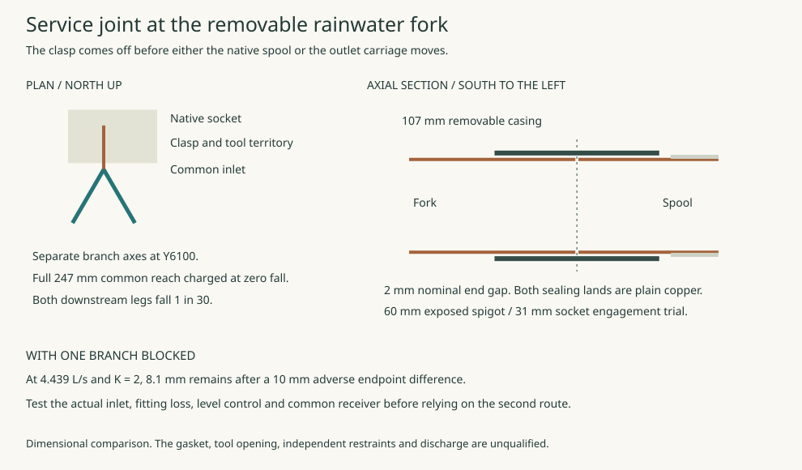

# A south receiver clear of the pipe-removal lane

**Preserve the straight draw and move the water sideways.** An east-facing spill shared the 5.52 m spool-removal route in the [bank-rail comparison](rwt-06-upper-first-release.md#reject-the-unchanged-rail-across-the-east-spill). A south-facing basin and spill clear it in plan. A removable quiet header at the existing downward pipe lip fails the available head with the trial 25 mm retaining allowance. Turning the same native outlet south before the drop has a usable static head budget and a retractable catcher clear of the draw. Complete blockage sends water into the dry lane within 6.41 seconds at the assigned flow. A separate west spill cannot carry the full event within the retained dry-service geometry.

[Plan and section](studies/side-receiver.svg) · [Source and assumptions](studies/side-receiver.mjs) · [Numerical results](studies/side-receiver.json)

## Turn the receiving territory

Rotate the complete 2,000 × 1,600 mm basin and its 1,500 mm continuation so both drain south. Centre the basin on the native outlet at X12946.4. The north retaining edge is Y6050, the spill crest Y4050 and the end of the reserved spill Y2550. Keep the original ordinary water limit −1400, fault limit −1250, designated low spill −1300, far-end water limit −1600, and strictly higher non-spilling boundaries. These are conditional ground requirements. The tray discharges south at Y5800, 250 mm inside the basin. Its 600 mm width leaves the original 500 mm side margins and 1,750 mm downstream territory. Neither a real jet nor directed disposal has been proved there.

The basin has 375 mm to the declared draw field at Y6425 and 275 mm to the known south post face at Y6325. The north landing Y8100–9300 remains available in this plan. On the other side, both basin and spill come within **146.4 mm of the nominal house façade**. No footing, disturbed ground, room for a retaining wall or splash protection is included in that distance. The source post boxes also exclude actual footings. The southern territory can be rejected independently of the header if actual support, access, fabric or site reservations consume it.

## Can a removable quiet header clear the north rim?

Take a 600 mm clear tray under the downward outlet. The low point of the nominal tilted 159 mm outlet is −1184.80. Leave a trial 10 mm free air gap above the quiet pool. A transverse outlet crest at Y6750 feeds the tray at 1% toward Y5800. The 700 mm to the fixed north rim costs 7 mm. To pass over an unbroken rim, budget 5 mm underside clearance, 5 mm downward motion and 2 mm sheet. Under the trial 25 mm rim margin the crest must therefore be at least −1206, while the quiet pool must stay at or below −1194.80. Wave, splash and movement evidence does not establish that 25 mm is sufficient.

At the 3.60375 L/s reference duty, give a quiet approach its full 0.15 m/s velocity-head credit and ignore contraction and friction. The greatest available specific energy over the crest is **12.35 mm**. For effective width *b* and discharge *Q*, the minimum specific energy in a rectangular section is 1.5 times the critical depth, the cube root of Q²/(gb²). The comparison treats the nozzle jet as dissipated before the quiet approach. A concentrated high-speed jet bypassing that pool is a different, unqualified transfer. [USACE HEC-RAS Hydraulic Reference Manual, chapter 6](https://www.hec.usace.army.mil/software/hec-ras/documentation/HEC-RAS%205.0%20Reference%20Manual.pdf)

| Effective width | Minimum energy | Deficit at 25 mm rim margin | Greatest rim margin at zero loss |
|---|---:|---:|---:|
| 600 mm | 23.15 mm | 10.80 mm | 14.20 mm |
| 300 mm | 36.75 mm | 24.40 mm | 0.60 mm |

Reducing the retaining margin to rescue this tray would spend the allowance needed for wave, movement and tolerance. Lowering the basin or finding greater receiving head would change the site requirement. Neither change is adopted.

## Working and failed states

| State | Required sequence and available water territory |
|---|---|
| Both routes in service, or N being renewed | E needs the collector, header, basin and the entire south spill installed and available. Outboard removal rails stop short of the basin in ordinary use. The rejected header prevents admission to either state. |
| E being renewed | First verify the separate N system can carry the assigned event throughout, including temporary-weather and N receiving conditions. Isolate E, drain, cap and capture the residual. Lift or withdraw the side tray under positive support before any outboard rail is fitted or spool rolled. Its footprint begins 194.4 mm beyond the proposed parked track and clears the nearest source post in X by 226.6 mm. A tool, lifting path and stow on dry supported ground still have to fit. No support, temporary landing or stored tray may occupy the southern basin or spill. These remain open to local rain and external water throughout the draw. No entry into either basin is assumed. |
| Reinstatement | Return and positively secure the complete spool. Remove the temporary rail and supports, install the supported terminal, clear the entire south spill, inspect and test E before readmission or any N isolation. Loss of N or unsafe external water precludes beginning E work. No flood-safe intervention is established. |

## Turn the native outlet before the drop

Clock the exterior N18 bend 90° south at fabrication. The horizontal approach, its brazed socket, and the existing single inlet release remain on the rolling spool. Its south-facing free port is X12950/Y6647/Z−880.9. Accounting for the different lip orientation, the lowest edge rises **224.4 mm**, to −960.4. There is no new detachable pressure joint beneath the floor or at the terminal. The straight horizontal tube remains accessible from the opened terminal end, subject to a real cleaning tool passing the N18 and the full tube. The altered gravity moment and complete three-dimensional centre of gravity still need to be joined to the carrier bearings, locks, drive and lifting points.

A 600 mm clear catcher lies below the port. Its rear/open inlet sill is −1005, its outlet crest −1060, and the floor rises towards the back so residual water can drain towards the crest. Tall sides and a roof at −740 start at Y6535, 112 mm ahead of the nominal nozzle. Before that station keep the receiving tongue and both low curbs at or below −1005, clear of the actual enclosing bend prism. Full-width ideal critical energy is 23.15 mm. At half width, 36.75 mm puts the quiet pool at −1023.25 before contraction, losses and splash. The rear sill supplies just **19.39 mm** of remaining energy head after crediting the full 0.15 m/s quiet-approach velocity. A blocked or aerated jet can wet the dry draw lane through the upstream opening. Still-air geometry and ideal crest energy cannot admit the device.

Two 50 mm captured bearing heads on each side, at X12950 ±400 and Y6100/6230, carry the sliding assembly. The operating catcher occupies Y6045–6745 and overlaps its fixed tail by 105 mm. After the east path is isolated and drained, release its service latch and slide the cassette **460 mm south** into its captured stop at Y5585–6285. The head footprints stay at least 30 mm inside the moving guides over the whole stroke. Their maximum X extent clears the nearest represented 50 mm post face by 100 mm. The cassette remains on dry land, 35 mm before the fixed tail starts turning. Its 604 mm gross wet box has 38 mm each side inside the stationary 680 mm clear tail at overlap. Specify the draw arms outside the tail, keep its clear aperture and rodding route, and provide positive end locks. A qualified externally operated drive, overload limit, accessible fastening, guide cross-section and supported exchange of the cassette itself are outstanding.

The 130 mm distance between the north and south bearing lines has a real price. With the moving centre of gravity anywhere along the cassette in any stroke position, either line can see **4.96 times its gravity downward or 3.96 times in uplift**, before impact and handling. These are signed load multipliers, not simultaneous loads at all four heads. Even the 600 × 700 × 320 mm bounding box holds 134.4 kg of water before adding fabricated metal. A gravity-only seat or a person lifting the box cannot be credited.

### Fixed wet path and ground

The compact original south receiver leaves only 28.9 mm between its west wet face and the eastmost face of a represented cap. The higher candidate moves the basin centre **400 mm east**, places its north rim at Y4750, and keeps the east-going jog downstream of the stored mobile box. The fixed channel runs (12950,6150) → (12950,5550) → (13350,4950) → (13350,4500). The two central corners turn 33.7° and then restore a southward discharge. The 680 mm width measured in X gives 565.8 mm normal width through the diagonal. Taper to 600 mm through the final straight. At 1% fall along the actual centreline, its nominal −1110 inlet floor, 2 mm sheet and 5 mm downward movement clear the trial north rim by **92.8 mm**. Dynamic depth, corner overshoot, air, debris, the return lips and tailwater are separate hydraulic duties.

The basin occupies X12550–14150/Y2750–4750 and its open southern spill occupies X12550–14150/Y1250–2750. The lip retains the 250 mm upstream, 1,750 mm downstream and 500 mm lateral reservations. The two represented caps P06 and P17 are each 432.5 mm west of the nearest wet face in plan. Their Z−750..−180 is distinct from the required basin bed at or below −1650. That is a temporary excavation and foundation interface as well as a final plan gap. A 150 mm wall and a 150 mm construction reservation, both trials, would leave only 132.5 mm in plan. No site clearance, soil stability or right to discharge follows. [Structural grid](../str/studies/current-house-grid.json)

### Incoming and outgoing spool

With N independently able to handle the event, isolate E and secure residual liquid. Retract the catcher while the spool remains seated. The installed bend clears the low sill by 18.1 mm and the tall shroud by 25.6 mm after 10 mm combined placement and deformation allowance. Moving south increases clearance to the tall shroud. Its fixed guide heads and the parked box stay at least 140 mm south of the dry draw field Y6425–7375. The bent spool still needs its existing inlet sequence and supported removal of the upper assembly; no downstream joint has to be released.

Roll the complete pipe 90° only after the catcher locks clear. For this altered bend, the source enumerates continuous extrema of every vertex of the 460 × 190 × 460 enclosing prism around the inclined pipe axis. The outlet now rotates **from south to down**, with over 263 mm Y clearance to parked hardware and over 445 mm X clearance to the outermost bridge after allowance. The 112.9 mm X separation at the parked rail end permits rotation before deploying the removable rail extension. The other end and the straight body keep their inherited geometry. At the final lock, ±1° play plus 10 mm movement leaves 178.2 mm between this end envelope and the nearest rail cap in Y over the entire straight draw. At maximum east travel its lowest bounded point is **−1337.7 mm**. Keep the full central strip between the rails clear of intermediate crossheads and prove the actual ground and kit against that level. The reverse operation returns the parked wheels before removing the rail extension, rolling back and advancing the catcher. Reassemble, verify latches, test the joint and water path with access open, and clear both receivers before readmission.

The basin and its entire southern spill remain free of rail supports, parked loads and personnel during E renewal. Temporary works may not occupy them. E remains unavailable during that work, and N needs a real, independent full-duty route in every permitted maintenance phase. An N failure after isolation has no newly proved backup. During N work the deployed, tested E system must survive the assigned event. Whole-site flooding, an unavailable receiver or the unproved temporary-roof capture prevent that operating claim.

### Complete blockage and the first uncontrolled spill

Seal the moving box’s whole forward outlet at Y6045 while the stated 3.60375 L/s continues to arrive. Its quiet floor is nowhere below −1060. To the −1005 rear and low side curbs, even an empty 600 × 700 mm box can store at most **23.1 litres**. The first uncontrolled discharge therefore occurs in **at most 6.41 seconds**. A wet start, occupied volume, jet or earlier splash shortens the interval. The open rear at Y6745 and the low side edges from Y6535 to 6745 are inside the dry draw field. The fixed tail begins at Y6150. Water falling at these low edges has no demonstrated return to it. The air gap below the raised pipe does not restrain water escaping from the catcher.

**Independent west-side spill trial.** Cut an upstream side slot at the mobile west wall X12648 with a low crest at −1045. It may start assisting before full forward blockage. A separate fixed catch at X12375–12648/Y6265–6415 receives it and runs west to X12450, then south to Y4900, east to X12875 and south to a separate lip at Y4500. Its proposed invert falls 1% from −1100 to −1124.63. The direct leg stays 83 mm west of the ordinary tail and the turn keeps more than 40 mm between their outer footprints. It crosses the north rim independently, with over 95 mm calculated underside clearance. The side branch bypasses both the forward mouth and the dogleg until discharge into the **same basin**. Its 1,750 mm downstream landing fits, but only 250 mm remains to the west wet boundary. Full jet capture, splash, sliding guide runners, seats and reinstatement are unproved. Grant perfect local interception and zero downstream head loss to test whether a working spill is even possible.

The fixed west guide head ends at Y6255. The dry draw field begins at Y6425. A west-going catch above the head that keeps 10 mm from each boundary has 150 mm gross, or **146 mm clear** between 2 mm side walls. At the first uncontrolled sill, the −1045 crest can pass at most **2.08 L/s** under the same quiet, rectangular, lossless comparison. Even from empty, the remaining accumulation reaches the rear/low edges within **15.2 seconds** under constant full inflow. Cutting the entire side opening flush with the −1060 floor and accepting continuous shared operation only raises its ideal capacity to **3.31 L/s**, short of 3.60375. A clean flush slot would need **158.9 mm clear**. Treating the full 170 mm as clear, without walls or movement margins, gives only 2.48 mm ideal clean head margin. A quarter obstruction of even that generous width fails by 8.87 mm.

Reject this west-side route in the retained guide-and-draw layout. The 6.41-second result applies to the original fully blocked mobile outlet; storage and timing for a blockage elsewhere in the fixed tail depend on where it occurs. Plan separation from that dogleg cannot cure the undersized upstream relief. The [temporary two-path source](studies/temporary-two-path-control.json) offers the N chase as an unadmitted court alternate during N-short work. If it independently receives the affected flow, that is a different building-level survival case. In its distinct N-long case, loss of the N outlet can put 4.43895 L/s on E, including 0.8352 L/s of loggia rain. If the E forward opening is also sealed, the empty original box reaches the same sill within 5.21 seconds. This is an additional fault during that combined assignment. The loggia flow is not added to the ordinary 3.60375 L/s reference. With N unavailable for renewal and full duty assigned to E, current geometry has no contained escape. The southern basin also remains common to both outlets under terrace flooding or excessive receiving head. No weather warning, operator intervention or basin capacity is credited across those cuts.

**Disposition.** The high outlet and dry stow remain mechanically useful comparisons. They **fail the assigned blocked-outlet maintenance case**. Before accepting the arrangement, change the upstream escape geometry or provide a genuinely separate full-duty path during N renewal. Its catch must intercept actual first discharge and bypass the fault without rejoining it, with finite elevations, width, physical separation and room for access. Only after such a path exists can physical splash/air/obstruction tests qualify its performance. Real receiving levels, lawful disposal and excavation near P06/P17 remain separate site duties. The north route, high eave and first-wetting checks in the [packet exit map](rwt-06-finite-exit-map.md) also preclude RWT-06 completion.

## Take the air break across the draw lane

Develop a removable fork in place of the sliding open catcher. Attach it to the existing south-facing pipe at X12950/Y6647/Z−880.88. Two enclosed 155 mm bores separate by Y6250. Each passes the old failure plane at Y6045 and opens over the existing trial basin at Y4500. The outlets are 350 mm apart at X13175 and X13525. The pipe ends have 545.5 mm lateral margins, 250 mm to the north rim and 1750 mm to the south spill crest in plan. Actual jet impact and splash still need checking. [Dimensioned operating and parking plan](studies/forked-side-outlet.svg) · [Calculation](studies/forked-side-outlet.mjs) · [Results](studies/forked-side-outlet.json)

A blockage in either separated leg leaves the other connected to the inlet. A single tail with relief slots only at its far end would still lose both exits to a plug in that tail. The two bores have a common fabricated fork at the head. A blockage across its inlet, a common debris mat, a flooded basin or an obstructed final spill can still defeat the arrangement. The fan lines in the drawing describe the outside transition. Two full circular bores cannot occupy the same space at the native port.

### Head required with one branch blocked

Each route is 2246 mm long on plan. A 1:40 fall uses 56.2 mm of the available height and puts the terminal axes at −937.04. Allowing 10 mm downward movement, the lowest outside pipe surface clears the −1250 fault water by 223.5 mm. At the trial retaining crest of −1225 it has at least 198.5 mm clearance. A higher actual side wall, deeper clamps or a flooded site can consume this margin.

Use the full assigned flow in **one** half-full 155 mm barrel. Its area is πD²/8 and its hydraulic radius D/4. The screen uses equal half-depth endpoint water levels, Manning n = 0.020 as a sensitivity, zero inlet velocity credit, and an outlet debit of one velocity head. The residual fitting allowance covers the common transition, bends and other local losses. No measured fitting coefficient or upstream water level is available. [FHWA HEC-22, fourth edition, chapter 9, sections 9.1.4–9.1.6](https://www.fhwa.dot.gov/engineering/hydraulics/pubs/hif24006.pdf)

| Duty in one barrel | Friction loss | Exit velocity head | Remaining head with aggregate fitting K = 2 | Limiting fitting K |
|---|---:|---:|---:|---:|
| 3.60375 L/s, ordinary assignment | 10.0 mm | 7.4 mm | 23.9 mm | 5.21 |
| 4.43895 L/s, N-long maintenance backup | 15.2 mm | 11.3 mm | 7.1 mm | 2.63 |

The 1:100 control is short by 26.6 mm at the larger duty and K = 2. At 1:40 that duty also fails if the actual fitting K reaches 3. Test the native elbow and full-size dividing chamber with either branch plugged, air available at the other free lip and the actual upstream head. If a divider at the shared inlet leaves only half the nominal half-full intake area serving, local velocity reaches about 0.94 m/s at the larger duty. Its 45 mm velocity head is not itself a loss, but the small residual makes contraction, recovery and surcharge at that throat decisive. Backwater along the existing carrier, cleaning under routine split flow and downstream flood remain open.

### Isolate, disconnect and park clear

Carry the fork and both branches on one positively captured assembly with a single inlet disconnect. The two free ends avoid a closed loop of three pipe joints. The native N18 is an end-feed fitting. A compatible inspectable removable joint on its actual surface, a dry-side means of operation, sufficient straight engagement and reinstatement testing are prerequisites. The 75 mm axial hardware reservation is a design limit. A ferrule or stud left on the rolling spool changes its envelope and centre of gravity and requires the roll, rail and lock checks again.

1. Prove N can carry the event throughout the work. Isolate, drain and cap the E route, capture the fork and remove the connection restraints. Pull the whole unit 460 mm south on level guides. Its two ends still overhang the basin in this transfer state. Keep the native spool locked.
2. Move the captured carriage 1650 mm east on a cross-traveller outside the north wet rim. The proposed parking box, including a 10 mm movement allowance, starts 90 mm beyond the basin's east side and clears the dry draw field by 153 mm. Both moves and positive locking must finish before the native spool rolls. The return operation restores the fork, proves its joint and tests both outlets before N can be isolated.
3. Keep the 100 mm guide heads at Y5400/5900 and the two operating runners at Y5260–6500. Through the full south stroke the least guide-edge overlap is 90 mm. A cross-member at the two runner noses would sweep through the existing X13500/Y6350 post. A 100 mm deep transverse at Y6150 instead reserves 115 mm in Y, including movement. Separate arms must reach the upper fork. The whole parked assembly clears the known post by 53 mm in Y during cross travel. Cross rails, footings, dry storage, clearance over the east retaining wall, guards and crew access require an actual external section. No support or standing position is credited in the wet basin.

The two separated reaches alone account for 32.0 kg of nominal copper and 68.4 kg of water when full. The transition, connections, carriage and drive add unpriced weight. At the two guide stations a concentrated total weight anywhere in the moving envelope can demand uplift at either station. The source records the reaction range per unit weight. During east travel the Y-guide frames must ride on positively held trucks with continuous support on both X tracks. Leaving their bearings at X12650 and X13750 would put even the two nominal full tube runs outside the eastern support line at the final stop. A distributed as-built load, unequal trapped water, individual truck reactions, stops, safe drive and extraction of the whole cassette remain unresolved.

Retain this fork for a full-size blocked-branch test if the native connection and dry external handling space can be detailed. It earns a geometrically separate path past the failed catcher outlet and a finite loss budget. It does not establish full-duty service through a blockage of the upstream carrier or shared fork. The high-eave, first-wetting and real-site obligations in the packet exit map remain open.

## Make the native outlet separable

Place a **247 mm level inlet** between the clocked N18 socket at Y6647 and the start of the fork at Y6400. The two branch axes reach their full separation at Y6100, before the failed catcher cut at Y6045. Keep the removable joint on that straight, at Y6586. The upstream spool and downstream fork must each have independent gravity, shear and axial restraint before the joint is released. This is a service and geometry comparison. The stock joint contains a synthetic sealing sleeve and remains outside the house material policy without a separately justified exception. [Fork and joint calculation](studies/fork-outlet-joint.mjs) · [House material policy](../../docs/reference-house/material-policy.md)

**Use two plain tube ends.** The STRAUB OPEN-FLEX 1 row for 159 mm tube covers 157–161 mm OD. It gives a 107 mm casing width, 181 mm casing diameter, 212 mm closing dimension and 12 Nm screw torque. Without an insert, the catalogue lists a 5 mm pipe-end distance limit. Compare a 2 mm gap; set and check it in the supported assembly. A 60 mm exposed copper spigot on the native side plus a trial 31 mm socket engagement makes a 91 mm cut. The opposing straight fork end begins at Y6585. A centred casing occupies Y6532.5–6639.5, covering 52.5 mm of each tube and leaving 7.5 mm to the native socket face. Keep the full sealing lands straight, round, clean and free of braze fillet. Establish actual insertion, marked seating, tube-wall stiffness and the separation through movement. The catalogue limits cannot all be spent together. Compare the complete joint or develop a removable metal-sealing alternative with its own release and occupied volume. [STRAUB product table, page 1](https://www.straub.co.uk/pdf/datasheets/STRAUB%20Open-Flex.pdf) · [Fitting and disassembly, OPEN-FLEX 1](https://www.straub.co.uk/pdf/fitting%20instructions/STRAUB%20Flex%20Open-Flex%201%20Fitting%20Instructions.pdf) · [Aalberts 159 mm N18 end-braze fitting](https://aalberts-ips.co.uk/products/item/89710/)

**Only the bare stub travels with the bend.** Undo the native quarter-turn about its inclined axis and bound both circular ends in the original 460 × 190 × 460 mm operating prism. With 60 mm exposed, the smallest margin is **9.07 mm east**; the lower face has 11.09 mm. A 5 mm relative fabrication allowance on each checked coordinate leaves at least 4.07 mm. A 10 mm east error fails by 0.93 mm, irrespective of shortening the distal end. Exposure beyond 71.09 mm breaks through the lower face even at nominal position. These are part-to-prism checks. The separate whole-spool movement allowance remains in its own calculation. Include neither the removable casing nor the assembly tool in the roll. [Six-face results and original 53.5 mm control](studies/fork-outlet-joint.json)

The new tube adds 0.804 kg of copper and up to 1.132 kg of water in the exposed part. At the clocked position the corresponding gravitational moment about the roll axis is bounded by **6.21 Nm** before braze and end hardware. The old 4.5 kN moving-weight comparison then leaves 134.73 kg for its other remaining items. The 500 Nm drive and 1,000 Nm holding targets still need the complete wet spool and lock. Neither the 12 Nm screw setting nor the casing resists the required pipe thrust. The 155 mm bore contributes about **185 N per metre of static differential water head** at an obstructed end; establish the actual head, momentum, surges, transfers and support fixings. Keep the fork inlet locked and supported while both pipe ends and the gasket are exposed.

**Give the joint a removable working space.** Reserve X12750–13250/Y6436–6736/Z−1020.88 to −455.88. This leaves 36 mm from its southern limit to the proposed splitter face and 225 mm in X to the nearest known post face. The back of the receiving pipe stays straight through this territory. Keep all fork gussets, permanent rail attachments and receiver arms outside the required tool path. In the assumed crown-up orientation the catalogue closing dimension puts the top 121.5 mm above the axis. Compare the HAZET 5108-3CT, 234 mm long with a 24 mm head and 18° ratchet angle. A near-vertical 18° sweep plus a 35 mm hand allowance fits the *Y and Z projection* of this pocket with 24.89 and 34.5 mm to spare. The actual bolt axes, hex insert, socket insertion in X, bolt withdrawal, reusable assembly tool, open casing, gasket peel and person's approach still need a measured sweep. The native rectangular elbow envelope overlaps the service territory and does not resolve local clearance to its formed socket. Drain and verify zero pressure, loosen both screws alternately, remove the two locks, release the sleeve, then lift the whole coupling clear. The manufacturer's assembly tool is required on return. [HAZET tool dimensions](https://www.hazet.de/en/products/hand-tools/nut-driver/operating-tool-nut-driver/product/ean-4000896218882) · [STRAUB current manual, Open-Flex 1](https://www.straub.ch/fileadmin/Straub/Downloads/02_Technisches_Manual/260206_straub_web_tm_25_EN_01.pdf)

**Restore fall after the level joint.** With one outlet blocked, charge friction over the level lead as well as the surviving graded leg. The occupied path is 2264.78 mm, of which 2017.78 mm falls. At 4.43895 L/s and the comparison loss coefficient K = 2 plus exit, **1 in 40 leaves only 1.30 mm** before a 10 mm adverse endpoint difference. At **1 in 30** the remaining heads *after* that difference are **24.87 mm** at 3.60375 L/s and **8.11 mm** at 4.43895 L/s. At the higher duty, combined fitting K must stay below 2.72 under these assumptions. The revised doglegs retain 169.93 mm between their outside faces, ≥187 mm above the rim under the inherited movement comparison and the same 90 mm parked basin clearance. The hydraulic result is a half-full, equal-depth energy screen. The horizontal common inlet can retain sediment or water; its blockage disables both arms. Measure actual upstream level, losses, residual drainage and cold-weather behaviour. With N independently available, wet-test each blocked leg, the supported joint and the restored clear outlet before relying on E for N renewal. No installed joint, hydraulic duty, support or site outfall is selected.
