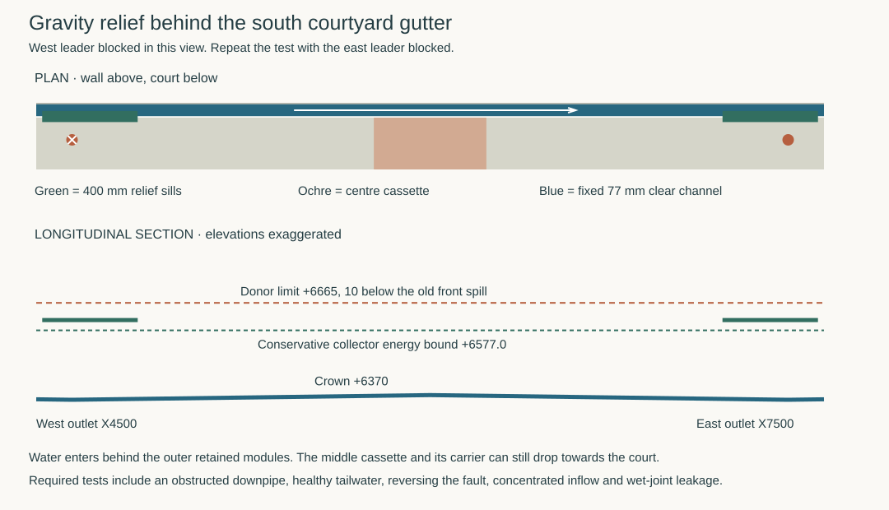

# Give the blocked south eave a wall-side relief route

**Develop a fixed, deep collector behind the original full-width south gutter.** Two low scuppers empty into it from the retained outer modules. If either original downpipe blocks, water can cross behind the removable centre to the other leader without spilling over the front. This replaces the split middle tray as the full-event development route. The 155 mm mouth of that alternative remains a 2 L/s wet-test case. The original bypass, removable aprons, supported 225 mm drop, 500 mm outward draw and first rest still apply. [Centre exchange](rwt-06-middle-eave-exchange.md) · [source geometry and calculations](studies/south-eave-relief.mjs)

## Fit the fixed water path around the moving gutter

Here q = 4250 − world Y. The trial rear wall of the existing receiver is at q−100. Place the new collector between q−90 and −10 and X4350–7650, leaving 10 mm each to the moving rear edge and the nominal weather face. Two 1.5 mm skins leave **77 mm clear**. The floor crowns at +6370 and falls 1:100 to +6355 at both outlets, X4500 and 7500. Continue the end pieces rising back towards the outside caps. Retain the wetted walls to +6675. Neither a plate nor a screen closes the cross section above an outlet. A plugged end chamber must fill back into the channel and still communicate with the far end.

Cut one **400 mm clear** hooded scupper in each retained outer module, at X4375–4775 and X7225–7625. Form a level +6610 shelf from q−130 to −55 through its rear wall. That 75 mm shelf falls into the collector across a free lip. Return the cheeks, backguard and cover to +6690 at these two inlets to contain the lateral jet and drain it into metalwork. Water can enter during ordinary heavy rain. Protect the weather face from splash and any leaking seam. The shelves and aprons stay away from the centre cassette throughout its drop. Retain front-operated cassette releases, with pins retracting into the dry space above the collector or flush behind its q−90 face. The former wall-side restraints need a coordinated replacement.

At either outlet a 150 mm long opening across the full 77 mm floor feeds a retained wet end box. Take a closed **120 × 90 mm clear** side branch to the same-side primary leader on q−250 below the ordinary gutter mouth. From q−50 its invert drops from +6210 to +6203.33 over 200 mm at 1:30. Keep the two leaders separate. Reserve a 150 mm wide box in X, with a separately ventilated head and no vent or access spill below +6675. Terminate vents above that level with debris-resistant access. When a leader is blocked below the join, its box and side branch must contain the resulting surcharge, including local seals and the water column to the blockage. A low open hopper would simply transfer the spill to the facade. A blockage inside the ordinary gutter mouth leaves the separate raised scupper available.

The loaded header sits above the +6300 window heads. Its lowest 1.5 mm floor and 20 mm frame leave **33.5 mm** to that opening datum, and the two end boxes leave **75 mm** to the nearest raw side jambs. These figures require a measured weather face, actual opening trims, services, movement and deflection. Support the trough below on independent brackets at the two outer piers and centre pier, nominal X4500, 6000 and 7500. Limit fittings and frames in the centre to q−90 or farther wallward. The water alone can weigh **24.64 kg/m** at the end section if filled to its rim. The max span is 1.5 m plus the 150 mm end overhang. Qualify liner joints, attachments back to structure, end-box reactions, debris and abnormal head. Provide outward-facing cleanout plates below the main gutter and above the raw window heads. Locate access to each end and both sides of the crown from the guarded work deck, including a supported cap removal and a debris removal/flush trial. Outer-module renewal needs its own scupper release. [Primary modules, carrier and guard](studies/live-receiver-renewal.json)

## Full-flow decision and acceptance limits

Challenge **each reversed failure with one 3.60375 L/s total**, including water collected by the healthy gutter. Assigning it all to the blocked side conservatively loads the relief. The physical rain ledger at 216 mm/h is 3.02715 L/s on the whole inner roof plus 0.57660 L/s directly on the court. The full-event upper test avoids depending on an unverified corner split or adding those ground litres again. [Physical catchments](studies/live-receiver-renewal.json)

| Location | Calculation and condition |
|---|---|
| Donor trough and scupper | Hold the water at or below +6665, 10 mm below front spill. At 400 mm clear the full-flow critical depth is 20.23 mm. Allow its exit kinetic head plus one more for local loss and a 5 mm high sill. The upstream trial retains 300 mm clear, at least 45 mm water depth, 1.65 m travel, Darcy factor 0.05 and one approach velocity head lost. It adds 5.80 mm. Required donor energy is at most **+6661.25**, leaving **3.75 mm** with no approach-velocity credit. A half-width blocked scupper fails. |
| Wall-side collector | Use a ventilated rectangular reach on the subcritical branch, with a free control at the healthy outlet or internal crown. At 77 mm, critical depth is 60.67 mm and velocity head 30.33 mm. Over the longest 3.125 m run, critical velocity and hydraulic diameter conservatively bound the reach loss at 50.31 mm for Darcy factor 0.05. Price the remaining local losses at two critical velocity heads, 60.67 mm total. Highest bed including a 5 mm upward deviation, critical specific energy and all those losses give an upper energy level **+6576.98**. This leaves **28.02 mm** below even the 5 mm low scupper lip. |
| Healthy end box | Keep its **measured receiving surface at or below +6340**, at least 10 mm below the lowest trial outlet lip. Limit the healthy leader’s piezometric head at the side boss to +6300. With the side branch running full, four local velocity heads, one outgoing head and Darcy friction require a box level of +6328.9, 11.1 mm below the limit. Partial filling, priming, venting and the actual box-to-leader transition must pass the entire discharge. A submerged outlet invalidates the free-control comparison. Entrance jets, air entrainment, hydraulic jumps and splashing need observation. The loss factors are explicit trial limits. [USBR critical flow](https://www.usbr.gov/tsc/techreferences/mands/wmm/chap02_12.html) · [USBR friction and hydraulic radius](https://www.usbr.gov/tsc/techreferences/mands/wmm/WMM_3rd_2001.pdf) |

Keep the bypass live, remove the centre and plug the west branch below its join. Test distributed drips and a concentrated donor inflow. Record front spill, levels at both scuppers, the crown and healthy box, discharges, facade wetting and support movement. Repeat with east blocked and with a plug at either primary mouth. Refit and remove the bypass with both drips monitored. Route qualification requires the assigned flow, the two stage ceilings, dry uncontrolled edges and accessible restoration. A failed test requires more collector or leader territory or a different roof discharge. Tightening the middle split does not answer it.

The existing building-side N and E ground receivers each still owe the **same combined event once**. The two eave leaders need actual ground terminals, erosion control and flow into that ground system without wetting the threshold or obstructing the court escape. No unrestricted drop onto occupied paving is accepted. Both leaders blocked together, a blocked relief scupper, major roof works and ultimate corner exchange retain separate duties. RWT-06 remains open (canonical lifecycle started). [Ground receiving interface and remaining exits](rwt-06-finite-exit-map.md#exact-building-side-site-water-handoff)
