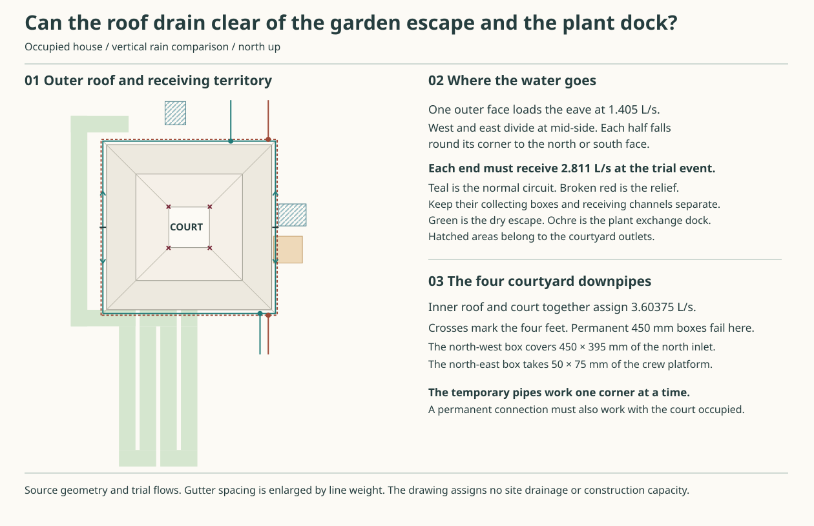

# Collect the outer roof at the north and south faces

**Carry the controlled copper network to the joint design review.** The exterior circuits can discharge clear of the west garden escape, the front approach and the east plant dock. The four interior downpipe feet still need a permanent connection. Two tempting arrangements at their lower ends would obstruct the north drain or the east maintenance platform. Neither candidate below can yet be selected as the complete building system.

## Count each area once

Use the 25° slate roof with a 12.4 m outer edge, 7.75 m ridge square and 2.95 m clear sky opening. The lead-free envelope comparison keeps the Penrhyn/Sarket field and separate 316L primary and secondary valleys. The old 12 m wall-line partition and the earlier 3.1 m opening do not give the eave duties of this roof. The table uses vertical rain at the existing **216 mm/h stress**, with no infiltration, evaporation or storage credit. The plot, wind-adjusted effective areas, event return period and installed capacity remain open. [Roof geometry](../mat/studies/ring-roof-family.json) · [Metal substitution and renewal](../mat/whole-envelope-selection.md) · [Rainfall basis](rwt-01-rainfall-and-hydraulic-basis.md)

| Catchment | Area on plan | Delivered flow | Route to compare |
|---|---:|---:|---|
| Four outer trapezoids | 4 × 23.424375 m² | 4 × 1.405463 L/s | Exposed copper collection. Keep the western escape and eastern transfer routes dry under the named failure. |
| Four inner eaves and four valleys | 51.3600 m² | 3.08160 L/s | At each corner, two adjoining half-faces and one valley give 0.7704 L/s. Capture at the shared corner leader. |
| Direct court rain | 8.7025 m² | 0.52215 L/s | Falling paved surface, ordinary N inlet and the selected west receiver. Concentrated leader flow needs its own entry. |
| Entire roof and sky opening | **153.7600 m²** | **9.22560 L/s** | Exterior 5.62185 and inward 3.60375. The valleys are already included. |

The additional 0.8352 L/s from the temporary loggia roof belongs only to its repair state. Screen exchange is confined to the ordinary 3.60375 L/s comparison. The long diversion at 4.43895 L/s loses 2.2 mm of air clearance under the high east outlet while the northern screen is moving. Secure both screens first. The ordinary site path and the west receiver's low branch share N. Only the vented high E route has a distinct destination when N is stopped. [West receiver service states](rwt-06-permanent-receiver-service.md) · [Current HAD receiver](../had/receiver-selection.md)

## Two whole networks

**A. Controlled collection.** Keep two separately supported high-level paths around the outside. The west and east faces each fall away from a mid-side crown. At each outer corner deliver that half-face to the adjoining north or south arm. Add the rain along that face. Each normal outlet can therefore receive **2.810925 L/s**. The corresponding relief circuit must accept this entire amount when its primary is lost. No water has to reverse over a crown. Bring both discharges down on the north or south façade. There is no open shoe over the west escape or east cargo area.

**B. West garden shedding.** Keep the controlled N/E/S network, omit the western eaves collection, and take the whole western 1.405463 L/s at ground into a separately supported continuous copper body. Each N/S circuit now receives 2.108194 L/s. The removable grates and impact pieces have a credible renewal sequence. The western drip is at X−200. The east edge of the required 1.2 m-wide dry escape is at X−1400. This leaves at most 1.20 m between drip and path for the outboard impact, splash, blockage overflow and service envelope. The folded western return also occupies the south-west ground right up to the wall. The source provides neither a safe no-hedge splash width nor an independent discharge inside that strip. Reject B on this house unless the actual arrangement demonstrates both. Hedge loss, frozen/full wet body and a blocked receiving site must leave the bypass usable. [Located receiver construction and first removal](outer-west-receiver-renewal.md) · [Free-shedding comparison](rwt-shed-result.md) · [Approved Document H, H3 §1.13](https://assets.publishing.service.gov.uk/media/5a80cf9ded915d74e33fc8ae/BR_PDF_AD_H_2015.pdf)

## Place the four exterior outlets

Coordinates are mm, north up. Reserve a 240-wide removable vertical assembly and separate 400-wide outward-directed receiving channels at each X station. The facade check takes the worse of both HAD storeys and the 16 SAP-C1 opening moves, including a 215 arch-ring envelope, then checks the existing round service terminals and shell corner. North X9175 looked clear on the earlier façade. It loses 110 mm after the corner window moves. North X9025 restores 40 mm. A normal drain on the south-west face would land on the garden-to-front escape. The east face houses the reserved plant exchange, court outfall, crew stair and goods landing. [Occupied house and escape](../had/studies/water-replan.json) · [Structural opening shifts](../str/studies/house-corner-rewind.json) · [East plant dock](../mat/plant-threshold.md)

| Face / circuit | X | West / east incoming flow (L/s) | West / east arm (m) | Invert difference at the two incoming lips | Clearance beyond 240-wide vertical reservation |
|---|---:|---:|---:|---:|---:|
| North normal | 9025 | 1.82745 / 0.98348 | 15.565 / 9.515 | 30.25 mm | 40 mm |
| South normal | 11150 | 2.07512 / 0.73581 | 17.690 / 7.390 | 51.50 mm | 115 mm |
| North relief | 11750 | 2.10212 / 0.70881 | 18.545 / 7.045 | 57.50 mm | 127.5 mm |
| South relief | 11750 | 2.10212 / 0.70881 | 18.545 / 7.045 | 57.50 mm | 130 mm |

These lengths follow sharp plan corners on the gutter centrelines, 270 and 397.5 out from the wall. At 1:200, the 18.545 m arm costs 92.725 mm fall. Discharge each arm at its own level into the corresponding open box. A rigid joint between the two incoming beds would silently change the fall on one arm. Fit independently released corner transfers or matched expansion details, each with visible drainage and protected movement. A stop-ended expansion joint across a running invert needs its own connected outlet. A continuous 18.545 m length of copper moves about 25 mm over an 80 K range at the project coefficient of 17 µm/m/K. Locate each fixed point, sliding bearing and wet seam. Do not let a soldered outlet act as the hanger. [Copper hung-gutter joint families](https://live.copper.org/applications/architecture/arch_dhb/arch-details/gutters_downspouts/hung_gutters.html) · [Shared compatibility record](../../docs/research/roof-rainwater-material-compatibility.md)

The north kitchen foul branch has been studied at X9150 and X9275, crossing the wall at low level and projecting 450 mm beyond it. A 240-wide wall-hung normal stack at X9025 would overlap the old Ø50 run by 20 mm in plan. Place the normal downpipe on a separately supported head **900 mm outboard** of the wall. Its 240-wide envelope now starts at 780 radial, 330 beyond that branch end. Start the open receiving channel at the outside head, not across the foul cleanout. Resolve the real support and maintenance space, and rerun the test against the selected services export. The high cross-spout and low drain are at different elevations. [Kitchen waste and service routes](../mat/studies/whole-house-service-baseline.json)

Keep the outside primary and relief mouths independent of the courtyard N and E basins. For a plot brief, reserve two separate 400-wide corridors north to Y15250 and two south to Y−3250. The south pair leaves 200 mm between lanes. These checks cover location and separation from the recorded escape, garden, scaffold feet and current court basins. They do not qualify a 200 mm partition against scour or a shared flood. DPL must establish receiving levels, backwater, a lawful continuation, copper runoff treatment and ground/access at all four mouths. Failure to find two independent destinations at the required heads excludes the candidate for that site.

## What fits at the edge

The raised outer slate and board drips are at +7325.16 and +7142.30. Both presently drop inside the primary footprint, 170–370 out from the wall. Preserve the primary crown invert/front/back at +6938.55/+7048.55/+7088.55 and fall the beds from there. Raising its back by the field rise puts it **56.12 mm above** the board drip. Develop a separately supported secondary apron with its own landing behind the primary, while preserving the 80 mm down-facing ventilation slot. Test the 386.61 mm primary free drop for wind and splash. Two channels beneath the same blocked mouth cannot buy redundancy. [Matched roof/eave section](../mat/ring-roof-family.md)

Price a lower fault receiver 125–670 out, highest invert +6635 and highest rim +6760. The 150 mm primary first drop clears that rim by 28.55 mm at a common crown, or **18.55 mm** after opposed 5 mm tolerances, before any cleat or hanger. Then draw 400 radially away. A fixed primary sump beneath those arms would obstruct the drop. Compare an independently supported outer collecting head, nearest face at least 850 out, fed by a captured removable cross-spout. Lock the head, prove the full relief route and divert the wet arm before separating the spout. Provide a real first rest and wet-test the emptied bay and the reinstated joint before removing the diversion. All four corner transfers per circuit, bracket loads, travel at the mitres, moving apron and vent intake still require a connected section. A lower fixed trough that traps the upper one fails even if both have enough area.

At 0.004 residual fall and Manning n=0.020, a straight 200 mm trough with half its width obstructed conveys 2.290 L/s at 75 mm depth and 2.877 L/s at 90 mm. That small margin provides no credit for the corner, collecting box, entrained air or tailwater. A local 180 mm overflow crest, less two 5 mm ends and 25% obstruction, costs **73.46 mm** of head at the whole outlet duty using two critical depths. Replace it with a 1.2 m front spill and the figure is 20.07 mm. Charging 6 mm longitudinal fall and 10 mm relative setout leaves just **3.93 mm** below the primary's rear lip before waves, deflection and splash. Reject the existing lip as a proved harmless spill. The joint gate needs a turned-down, positively caught spill or a revised rear/front level that also preserves the independent board drip, wind intake and removal envelope. Block the primary locally over a door as well as at its outlet. Reject common brackets, a blanket across both openings, a frozen receiver, a submerged outlet and copper-laden water sent onto an incompatible metal or unqualified planting.

## The missing permanent courtyard connection

Retain the four removable shared corner leaders. The oldest accessible normal lower adapter is still a condition in the [corner service study](rwt-06-corner-and-cleanout.md). The two modern 160-square pipe territories at about +3650/+4050 belong to **one quadrant under repair at a time**. The separate 133 mm N-work tube and the E cartridge isolation are also temporary. The receiver's 3.6763 L/s broad-duty check takes a distributed surface approach. None proves that four concentrated normal streams reach it.

At the four 4500/7500 corner axes, reusing the service-sized 450-square box at each foot covers **450 × 395 mm** of the north-west L intake and **50 × 75 mm** of the north-east crew platform. The 450 box also cannot fit in the 370 mm gap between the temporary N chamber and the screen lift shoe. Staggering those service events does not help a permanent fitting that must stay in place during each. Do not pour a six-metre jet onto occupied paving or count the same destination twice.

Compare ordinary flush adapters with inspectable separate discharge and a header carried at high level. Both need a source-owned first joint, a reachable first rest, and a captured alternate *upstream* of the blockage. The N and west impact entries have separate duties. Permanently occupying the service spout or the temporary roof-pipe socket would delete the very maintenance state that justified it. Accepting any new aperture, moved crew platform, retained wet header or deep undercourt crossing changes the house. Prove all four arrivals in normal and single-outlet-fault operation, and replay corner exchange, N works, screen lift and E isolation before selecting it. Retain the existing measured-head limits, the unknown first damaging water level and the separate full-diversion site reservation.

A pipe following the east side at X7500 cuts the 1.1 m-long retained well. The X7650 girder closes the outside gap. Beneath the −950 well floor, a 25 mm cover plus 150 bore alone puts the invert at or below −1125, already below the −1100 impact chamber floor. A free outlet back into that chamber fails before pipe wall, structure or fall. At north-west, the existing +600 lift of the 303-wide N inlet module passes through the proposed permanent foot. North-east also needs to clear both legs of the retained high-E line. The overhead alternative following X4500 instead cuts both western tower support positions; a jog changes the hangers, fit with two temporary pipe bands and the first removal. There is no four-way approved shortcut.

A more economical **southern pair** deserves a joined section. Trial 150 ID and 200 gross through two arms along Y4500 to X5820, then north to a *new* side entry in the west impact box at Y6550, axis −750. A 1.5% fall over the longest 3.730 m gives a 55.95 mm drop. At the guard rib crossing Y6200, the pipe crown at −644.75 is 104.75 below the reserved −540 rib underside. The centred 200-wide port leaves just 20/10 at the two sides of the 230-wide west cell projection, before tolerances and structural reinforcement. With 25% area lost, D reduced to 112.5 mm, Darcy f=0.06 and local K=8, the 3.730 m line costs 27.52 mm of head at 3.0816 L/s when running full. This is a pressurised-path sensitivity, not a free outlet or a claim that the whole roof normally arrives on that arm. The moving-screen/N-out impact level of −98.7 sits **1.3 mm above** the flush NW grate at −100 even before those losses. A connected open heel there could spill backwards. Prove separated submerged-joint pressure, cleanout, inlet energy dissipation and an independent visible blocked-state return. A 600 mm module beneath the 150-wide guard rib needs at least 400 mm axial travel into a cleared adjacent bay to lift with 25 mm clearance, before releasing a socket. A 300-square rodding lid cannot do that job. A northern Ø200 gross crossing also cannot fit in the 125.65 mm raw gap between the old N line crown and tie underside at X7000/Y7750. The south pair merits development. The northern joints, supported inspection bays and a changed impact-chamber wall need a house decision before adoption. [Current roof/court and ground service geometry](../had/studies/receiver-selection.json)

RWT-07 completes the small network comparison and rejects the unjoined whole-house implementations. ROF/RWT/HAD now own the section and permanent corner-to-ground decision at the shared gate. MRA can later challenge a selected arrangement. The missing joins cannot be passed to installation, and the present comparison confers no construction, plot or material acceptance.

Run `python3 -B project/rwt/studies/outer-network.py --check-svg project/rwt/studies/outer-network.svg` from the repository root to check the catchment, opposing flow arms, clearance, overflow and ground conflicts. [Primary inputs and checks](studies/outer-network.py)
