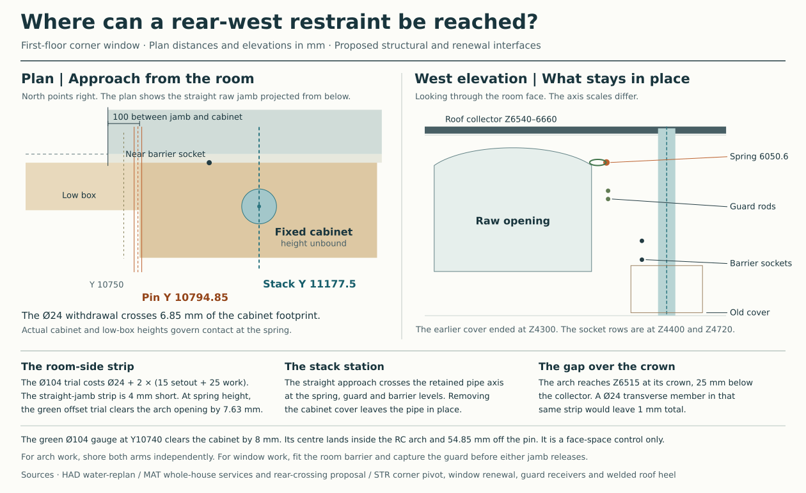

# Can the corner arch end clear of the pier?

**Keep a support at the inner concrete arch's corner end. Develop a joint that can rotate about all three axes while retaining the three translations.** Carrying the same arch entirely from its far jamb fails a movement check even when the roof and floor continue to use their existing piers and rings. The independent brick arch, window, permanent guard, ceiling loads and occupied room stay in place. [Original spring and two-eye pivot](partial-corner-arch-bar.md#can-the-pivot-be-fitted-inside-the-end-link) · [Whole-house comparison](str-house-result.md#development-choice-on-the-independent-water-plan)

## What happens when the restraint changes

The roof already bears away from the eight corner arches. The floor and roof still affect the springs through the movements of their supports. Use the same signed event on the entire house for all three comparisons: wind programme 31, negative 2.25 kPa pressure on the active façades and a negative 1.5 kN guard load at local X2240 on the east opening of the north-east pier. Retain the 180 × 215 mm concrete arch, its opposite jamb, self-weight, spandrel, ceiling and directly applied window/guard fixing shares. The comparison uses 0.20 cracked bending stiffness, 0.08 pier torsion stiffness, two lower bearings and released floor-to-roof yaw. [Signed hinge control](studies/current-house-arch-bearing.json) · [Re-solved arch-end actions](studies/corner-arch-end.json)

On the original single-axis hinge, the most tensile equivalent edge force at the east seat is −12.64 kN. Its signed contributions are +0.65 kN from gravity and ceiling, −0.44 kN from remote house wind, −7.98 kN from aperture pressure and −4.86 kN from the guard. Removing only the remote wind action would still leave −12.20 kN at the same stiffness. A real bypass changes stiffness, forces or support movements and requires a new solution.

| Near-end support | East window W7 | North window W3 on the same pier |
|---|---:|---:|
| Single-axis hinge. Lowest equivalent edge force over 180 mm | −12.64 kN | −6.54 kN |
| Three translations held, three rotations free. Near force X / Y / Z | +2.95 / +3.88 / −0.66 kN | +2.82 / +2.75 / +1.44 kN |
| Same articulated support. Rotation-induced movement at the corners of the end face | ±1.86 mm | ±1.35 mm |
| All six near degrees of freedom released. Relative outward movement, 18 / 36 arch elements | 124.79 / 124.83 mm | 86.31 / 86.34 mm |
| Free end. Calculated closing movement across the end face, 36 elements | 5.01–14.05 mm | 15.45–23.49 mm |

The forces are in each member's local axes, with Y positive into the building. The first row describes force lines for an existing moment-transferring support. The articulated model releases every moment at the **physical arch centroid**. Keeping its translations costs torsion elsewhere. At the east jamb root and arch knee, signed torsion changes from −0.96 and −0.73 kNm to −3.57 and −3.60 kNm on this event. Size those sections and the new anchorage under the signed envelope before using the joint. The east and north seat resultants on the refined mesh are 4.92 and 4.20 kN. Only 0.80 and 2.60 kN act in compression normal to the cut. The corresponding tangential forces are 4.85 and 3.29 kN, giving required friction ratios of 6.04 and 1.27 if friction alone were used. Provide a positive shear and thrust path. A single pin permitting rotation about its own axis cannot supply these kinematics.

With the near end completely separated, the far root must carry the arch and jamb above it. The 36-element east case gives +5.77 kN wall-normal and +5.46 kN vertical reaction, with −9.97 kNm about the local X axis at the house reference. The force-free arch moves relative to the actual pier. It would close the near cut and move outward past even the entire remaining 70 mm insulation layer, which already contains material. Contact or damage would change the response before the linear prediction could be realised. This factored displacement is a test of the assumed load path. Service movement, contact behaviour and strength require their own checks.

## Where the joint and its release can go

At the rear-west mirror of this detail the existing 24 mm pin axis is at Y10794.85/Z6050.59. Its centre is only 5.15 mm south of the cabinet in plan, so the bare pin projects 6.85 mm into the cabinet footprint. The cabinet height is unrecorded. Measure it and the adjacent low box before relying on a room-side draw at this level. The cabinet's face cover at Z3500–4300 serves the soil crossing. It stops below both temporary-barrier fixing rows, Z4400 and Z4720, and more than 1.75 m below the pin axis. The soil stack itself continues through the spring level. A lead-in on its axis at Y11177.5 would hit the stack even with the cover removed. [Window and barrier exchange](studies/current-house-window-renewal.json) · [Soil service source](../mat/studies/whole-house-service-baseline.json)

The 100 mm strip between the straight rough jamb and cabinet is a plan measure. At the spring elevation, the arch curves back. A trial 104 mm working gauge centred at Y10740 leaves 7.63 mm to the curved raw opening and 8 mm to the cabinet footprint. That is a possible **finish access** location to develop. Its centre sits in the reinforced inner arch and nearly 55 mm off the actual pin, so drilling through on that line would remove structural material and would not withdraw the original straight pin. Above the crown, only 25 mm separates the arch extrados at Z6515 from the roof collector underside at Z6540. A 24 mm item would consume all but 1 mm of that depth before cover, anchors or tools. [Located geometry and checks](studies/corner-arch-end.json)

Keep the near and far window fixings available for their established capture sequence. Before freeing either permanent guard jamb, fit the independent room barrier and capture the guard. At the rear-west window, the cabinet still obstructs a universal claim for those socket operations. Separate the cabinet face and soil pipe in the access drawing before counting on that route. For replacement of the structural joint itself, independently support the inner arch, the attached load and the corner restraint before releasing hardware. Develop a mechanically retained articulating bearing with concrete and reinforcement terminated at the joint, a removable housing and a demonstrated installation and withdrawal path. Check both arms, the far-jamb torsion, rotation room, thrust reversal, weather and fire boundaries, cabinet access and the permanent soil stack. Until that connected detail exists, the articulated seat is a development choice and the unsupported end is rejected.
