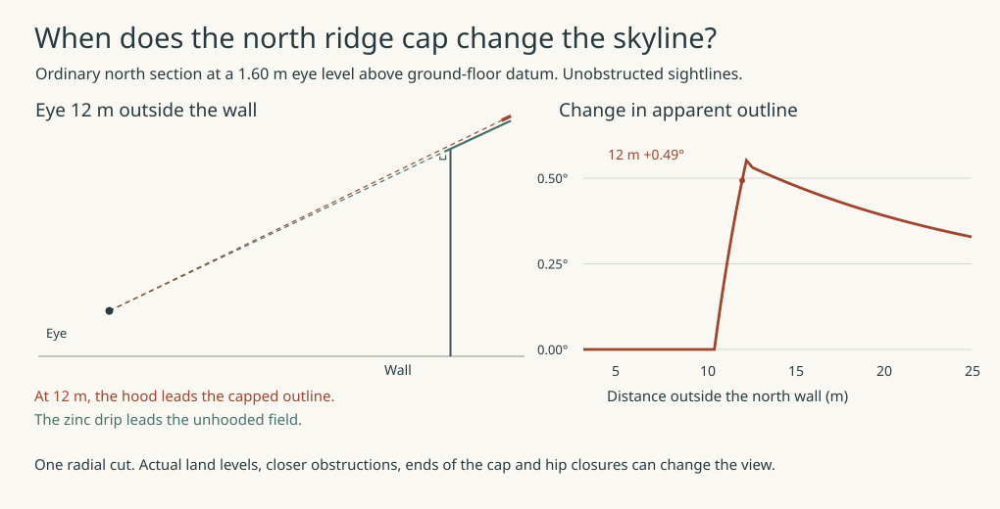
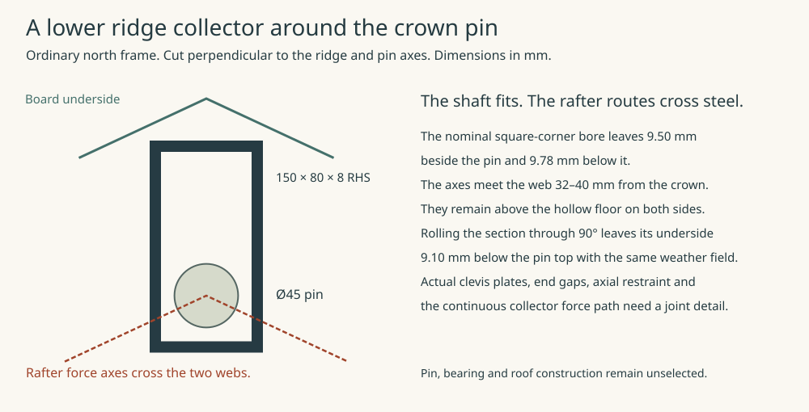

# Current selected house — structural re-entry

The [court-intake selection](../had/court-intake-selection.md) now prices the corner working deck, three reversible ground reactions, P33/P36 brackets and floor-level lateral ties. These are additional temporary and local court actions to incorporate in signed combinations; the domestic ground slab and provisional roof frames do not already qualify them.

**Current candidate handoff.** [SAP-C1](provisional-house-handoff.md) supersedes the earlier single-corner-spring and low-crown arrangements below. It includes both storeys’ new jambs, 32 structural ties, 96 whole-house winds, the 52-head stripped uplift register and the affected inhabited/roof interfaces. Historical member and foundation envelopes retain their stated source.

**Current disposition.** STR-HOUSE closed on the [documented architectural rewind](whole-house-corner-rewind.md). The numerical controls below belong to their original geometries. The altered two-storey jambs and the raised north roof need a joined successor before structural adoption.

STR-HOUSE consumes the architectural independent-water source merged in PR1332. This is structural development, not a whole-house structural selection. The [interface audit](studies/current-house-interfaces.json) preserves historical calculations and their input guards.

The [eight corner-arch junctions](corner-arch-junction.md) now use altered, coupled RC piers and an independent outer brick arch. The current complete window still needs more allowance at the finished reveal. The spatial window/guard model now conserves five signed actions at all 52 proposed heads across 73,728 states. H6 at 55 mm pitch clears the nominal local shear/torsion geometry but fails the 5 mm inward cage-placement challenge in both arch and jamb. The junction record gives the simultaneous forces and site/fabrication limits. The eight roof/floor anchor terminals and the physical rear-west window renewal remain open.

## Governing comparison: the pitched roof, perforated floor and all 52 heads

**There is one proposed structural system here, not a selected house structure.** The HAD architectural source is the Services utility-wording merge `fb7629e1` (HAD blob `089f0dac2f2e89272dc2ea85a10c2208f2fd797d`). Its nine string changes describe the utility working envelope and identify the Services source; the roof, floors, walls and garden geometry are unchanged. Its shifted roof is shown on the [actual house](studies/current-house-shifted-massing.svg). The [load-path drawing](studies/current-house-joined-frame.svg) connects that roof to two first-floor collectors and the common ground grid. The eight-M24 shoe, original unshifted roof/shaft ledger, uniformly 650 mm floor edge, flat prescribed overturning couple and generic 300 kNm pier splice do **not** establish this result.

| Where the load goes | Source and result | Limit |
|---|---|---|
| High roof to wall heads | [Pitched frame](studies/current-house-roof-route.json): a continuous ridge purlin transfers the elevated horizontal force into the 24 actual inclined primary legs; twin horizontal ties and both welded rings carry it back to the four RC returns. The real purlin centre is 200 mm above the hinge. The saddle attaches to one outer rafter, which carries its weak-axis bending (6.45 kNm), strong-axis bending (5.16 kNm) and torsion (0.57 kNm) into its own 260 mm eccentric heel. The opposite rafter stays pinned. [Rafter service displacement](studies/current-house-rafter-service.json) retains the earlier adverse gravity-pattern bound and adds full service wind: the hip reaches 13.63 mm against 13.85 mm, including the 0.10 mm sampling allowance, relative to the two heels. Replace the former 40 mm pin with a 45 mm comparison, increase the heel welds, and align shoe webs within 6 mm. Proposed eave **7297.52**, ridge **8288.42 mm**. Vertical roof G/Q/ULS/uplift remain **413.487/216.225/882.545/−324.338 kN**. | Roof band pressure and distribution are authored comparisons. The 13.63/13.85 mm hip result is nominal. Minimum delivered section dimensions, maximum installed mass, connection fit and installation stiffness are unbound; neither its 0.22 mm difference nor the court ring’s 0.978 utilisation is available fabrication tolerance. A modest section or height increase remains an option. The one-sided eccentric ridge saddle and its weld/roof-layer clearance must be detailed; the actual welded fitting and crown work envelope still require a fabrication/clearance check. Stripping the ridge, a ring or the RC floor invalidates this permanent mechanism. Temporary shores/ties are not designed. |
| Ring and real support stiffness | [Space-frame reactions](studies/current-house-ring-space.json) and [six stiffness challenges](studies/current-house-roof-stiffness.json). Each of the 22 wind reactions is recovered independently from the vertical grillage within 0.001 kN. Nominal same-station, same-wind stress utilization is **0.712 outer / 0.978 court**. Six support/joint stiffness assumptions give 24.30–24.69 mm overall roof displacement. Twelve additional CHS diagonals would add about 558 kg before joints, with no compelling benefit in this comparison. | The court's **1.018** alternative combines extrema from different wind states and different beam ends. It remains an adverse diagnostic, not a simultaneous load case. Nominal springs 40 kN/mm, comparison range 10–250 with mixed activation; test actual contact, stiffness, substitutions and site pressure. Neither the 0.978 nor the sensitivity is a fabrication or post-damage margin. |
| First-floor plate and two edge beams | [Membrane](studies/current-house-membrane-reactions.json), [signed sections](studies/current-house-floor-stops.json). The RC200 slab keeps the court, stair, entry and trial 400-square wet opening. A 15 mm stair lip cannot act as a separate bracing beam. Existing edge beams with eight additional mid-height H12 bars have **9.23/10.83 kNm** weak-axis demand/resistance; field membrane limits are **132.15/176.19 kN/m** in the two directions, below the independently reserved 327.82 kN/m. Outer **140 × 750** with eight H12 per flexural face; court **140 × 650** with six. Bottom +3170 retained. Actual strong-axis M **170.39/105.80 kNm**, compared with adverse capacities **217.48/145.16**. | Do not reuse the 148.11 kNm predecessor outer section or claim stock mesh in a 15 mm sliver. The upper first-floor mesh is about **2.378 t**, the two edge cages about **1.648 t before laps** in a 1.85 t action allowance. New outer upper edge is 470 mm above first FFL and at least 280 mm below the lowest sill. Reinforcement continuity, all bar/rod lanes, local splitting, construction joints, independent window clearance and combined corner transfer remain open. |
| Returns and capillary joints | [Four outer L sections and four court ties](studies/current-house-ground-ties.json). The actual coupled outer pier moment reaches **512.06 kNm resultant**. Twelve located H20 bars participate in a biaxial fibre section; eight intermediate H12 are not credited across the splice. Three per-pier blind-thread blocks connected by a 20 mm unperforated L web weigh about **114.24 kg per pier**. Four court holds are shifted over P32, P34, P35, P37 and need **164.21 / 142.58 / 155.30 / 159.08 kN** in the independent stripped comparison. Each pair of lower ends develops into two of the original eight H22 shaft bars, not two additional invisible bars. | The folded court rods, grout, female/male thread qualification, actual six other starter bends/hoops, remaining transverse pile section and eight full roof/floor corner details still need joined detailing. The no-through-bore splice stops a path through its own stock only; it does not dry the connected slab and common RC grid. No soil capacity, no lower 52-cut requirement and no thermal or moisture release. |
| All 52 proposed shaft heads | [Joined signed register](studies/current-house-joined-foundation.json): G **7123.026**, Q **762.310**, factored gravity **10759.550 kN**. Every named case conserves N and both plan first moments; three state families each run all **96** wind programmes and preserve horizontal shear/yaw. In that earlier load allocation, independent component axial limits **−487.87/+667.27 kN** are not simultaneous. Even with 382.80 kN of positively retained shell, one corner shaft could need **486.18 kN tension**. The present spatial arch/guard states above supersede those head reactions for their stated load and stiffness domains. The two existing 600 × 450 ground returns at the south-west court elbow share load by compatible cantilever displacement; sending it only south gave P39 −23.03 kN under gravity, versus +30.41 kN with both real arms. | These 52 axes are a topology, not a foundation choice. Fixed bases, stiffness, pile-group interaction, settlement, lateral/tension capacity, live groundwater and the actual cap/bearing/starter assemblies must support the reported signed demands. Do not add the optional water pit to every ledger: it is separately located. |

The [lower staff-bay comparator](studies/current-house-service-bay.json) requires 1.345 m³ of suspended concrete, 36.53 kN fixed on the two real east nodes and a local −1840 grade for 500 mm clear air. Its 140 mm floor passes 5 kN on 200 × 200 plus 5 kPa; the proposed anchorage has only **6.96 mm** clear to the eight starters against **25 mm**. **No bay joint passes.** Retain the 450 mm bridge and develop the [independent inboard platform](east-service-platform.md) with four separate heads, signed panel contacts and the shifted south ladder. No pipe sled load enters this staff slab.

**Governing next action:** complete the eight actual roof/floor/pier and court-anchor bar junctions and the remaining physical window/guard joints, local RC stress fields and genuine outer masonry returns, including independent renewal at the rear-west fixed cabinet. Close the high purlin saddle, weak/strong collector corner, actual stirrup/rod/thermal clearance and temporary holding sequence. Then rerun the signed register for the selected assembly and admit or reject its real soil/site demands. Those joins remain conditions on the successor, which has not been adopted.

## Superseded 1343 mechanism comparison: load path, restraint and occupation

**Historical comparison only.** At this stage the architectural inputs reproduced HAD at `ede8302b` (the complete court-pan body is 420 mm long, 131.5 mm high). Only the HAD geometry is selected; the following STR geometries are not. Earlier checks below retain their original domains.

| Compared arrangement | What the source now establishes | What prevents selection |
|---|---|---|
| [Common grid](studies/current-house-grid.json) and [52 signed shaft cards](studies/current-house-head-actions.json) | Distinct 400 mm shaft locations including twelve at four outer corner groups. Gravity origins total 6,991.71 kN permanent / 762.31 kN variable; both plan first moments and total force reconcile. The original conserved roof contributes 407.706 / 216.225 kN. Independent shaft minima/maxima across cases reach −518.62 / +692.82 kN. | These are **predecessor** roof cards; they cannot certify the shifted roof, final foundation or capillary assembly. Spacing as low as 550 mm requires site, group stiffness, settlement and uplift checks. |
| [Shifted welded roof](studies/current-house-welded-heel.json), [row allocations](studies/current-house-welded-network.json), [joint drawing](studies/current-house-welded-heel.svg) | Eight ordinary and four hip frames at 45°. Inward ordinary station shift clears neighbouring steel. Continuous rafters, twin side rails and fabricated 300 mm heel box introduce concentrated forces through real webs. Proposed eave 7,297.52 mm (+197.52), ridge 8,288.42 mm; G 413.487, Q 216.225, ULS down 882.545, uniform suction −324.338 kN. | Vertical row/heel resistance does not establish global horizontal roof bracing, erection, shop/weld quality or weather/fire/renewal. The earlier eight-M24 butt joint and stacked offset do not transfer. The [whole-house axonometric and elevation](studies/current-house-shifted-massing.svg) show the +197.52 mm frame proposal. The separate packed field and local cap change its exterior profile at the ordinary north section. [Compare the sightlines](#what-can-be-seen-of-the-raised-ridge). |
| [Upper closed rings](studies/current-house-ring-floor-stations.json) and [lower collector](studies/current-house-floor-closure.json), [plan](studies/current-house-floor-closure.svg) | 22 upper stations connect the roof to the first floor; local ring demand without favourable weight ranges −107.27 to +195.02 kN. The retained shell comparison credits only 114.40 kN roof steel, 48.98 kN ring, 118.95 kN aligned RC floor reaction and 100.46 kN solid upper cores. At factored minima global suction leaves +58.46 kN down, **but local uplift remains**. Eight lower corner stops, four additional at the court, must take up to 110.33 kN uplift. The proposed 62 m rolled floor collector weighs 2.294 t. Its static bending comparison is 118.45 versus 139.74 kNm; stripped/temporary conditions get no stabilising credit. | 36 full-height stations are a [control](studies/current-house-ring-fullheight-control.json), not a requirement. The upper-only alternative still needs rolled-member shear/restraint, elastic one-sided contact, splice and end bearing, eight positive DPC crossings and forces at every final shaft. The spare 49 mm above typical ground arch extrados is not fire/installation clearance. |
| [Real spring and movable window](studies/current-house-arch-movement.json) | For a genuine inner masonry arch at a corner RC toe, far-jamb datum and near sliding shoe close the thrust through a permanent spring tie. Actual support forces approach H 15.16 / V 18.37 kN; 215 mm radial ring contains the declared eccentricity. | The fixed band leaves only 810 × 1,530 mm hard clearance at the compared window. The separate 0.124 m² fanlight adds nominally 2.48 kg of 8 mm glass before frame/glazing; the existing guard/whole-window event does not transfer. Slider renewal needs temporary shoring. **Reject under the current full-frame/guard renewal contract.** A smaller split cassette or in-place assembly would require a new OAS/HAD/IAS installation, release and handling demonstration. Compare a curved, load-bearing RC inner arch integrated with both jambs; retain genuine outer masonry and independently replaceable window. No RC arch pass is inferred. |

### What can be seen of the raised ridge?

The [shifted massing study](studies/current-house-shifted-massing.svg) already shows the steel-driven 197.52 mm rise at house scale. The later [north roof section](../mat/ordinary-eave-joined.md#carry-the-cold-roof-over-the-welded-frame) lifts the zinc field another 11.03 mm and compares a local cap with a different crown connection. The packed, uninterrupted field has its theoretical ridge at Z8299.46. The proposed cap peaks at Z8464.73 and its hood projects 330 mm towards the outer eave. The lower-purlin option still needs its own vent and weather closure. Use the uninterrupted field as a geometric reference.

Take an unobstructed view perpendicular to an ordinary north roof bay, with an eye 1600 mm above the ground-floor datum. Measure horizontal distance from the outer wall. At less than 5.93 m (and outside the gutter) the front gutter edge leads both profiles. The zinc edge then leads both until 10.43 m. From there the leading **top** of the raised hood appears above the zinc. The original field ridge only overtakes its own zinc edge at 12.24 m. The raised apex overtakes its hood at 12.60 m. At a 12 m stand-off the modelled change is **+0.49°**. These sightlines apply to the centre of the drawn face. The real plot and eye levels, ridge ends, hips, screens, landscaping and any equipment can change them. The courtyard and oblique views need their own sections. [Source and calculation](studies/north-ridge-outline.py)

### Can the lower ridge member keep the existing crown joint?

**A bare pin fits inside the lowered hollow section. The original rafter force paths cross both side walls.** At the two ordinary north crown points, X4700/7300 and Y9875, the ridge tube and hinge pin are parallel. The two opposed rafter axes meet the same point in plan and drop away from it at 25°. MAT’s field and 10 mm normal packing permit the upright 150 × 80 × 8 mm ridge tube to occupy Z7655.58–7805.58. The current Ø45 crown pin is centred at Z7695.86. The earlier Ø40 proposal exceeded the structural stress comparison. [Crown and collector force model](studies/current-house-roof-bracing.py) · [Current Ø45 pin comparison](studies/current-house-roof-route.json) · [MAT roof levels](../mat/studies/raised-roof-edge.json)

In the ideal straight-sided bore the pin has 9.50 mm to either side, 9.78 mm below and 79.22 mm above. On each side of the ridge, the rafter axis meets the inner web face 32 mm from the pin at Z7680.93 and exits its outer face 40 mm from the pin at Z7677.20. Both points are above the bore floor at Z7663.58. A lug or load transfer that follows those rays needs openings with restored collector continuity, a locally interrupted and bridged section, or a different path to the pin. Passing each rafter force into the tube wall also changes the joint and must preserve independent half-frame rotation and the one-sided saddle action. The axes locate the obstruction to the current load path. Actual lug ends, retainers, welds, tube corners, assembly and refurbishment access still need drawings.

| Trial within the same ordinary roof field | Geometric consequence |
|---|---|
| Roll the same tube onto its 150 mm wide face | At 75 mm from the ridge the lower board is lower. The highest allowed soffit is Z7709.26. The Ø45 pin top at Z7718.36 passes through the full 8 mm lower wall. The vertical second moment would also be 35.9% of the upright value. |
| Raise the upright tube and the local roof together | A 72.78 mm rise above the maximum-low position leaves 10 mm vertically above the bare pin. It says nothing about the projecting lugs or the two rafter ends. |
| Keep the full 200 mm normal-depth rafter zone at the crown | Reserving its extrapolated top at the crown plane and a 10 mm vertical steel gap takes a 160.61 mm rise, only 4.66 mm less than the 165.28 mm local cap. This is a sufficient gross reservation. An engineered termination can change it. |

Retain the raised cap as the comparison that preserves the existing elevation of the continuous ridge collector. An uninterrupted weather field needs a developed crown connection and its own high-level vent. These section checks do not select a house roof. [Geometric calculation and diagram source](studies/north-ridge-hinge.py)

**Historical 650 mm edge (superseded on the outer loop).** At the actual entry and stair voids the current floor provides only 85 mm from structural axis to void; ordinary RC200 mesh cannot carry the full ring demand. A 140 × 275 mm downstand leaves 30 mm above typical ground arch extrados but fails its section/ductility comparison. Instead keep the RC200 soffit and rise inside the 140 mm upper wall: a 650 mm overall edge reaches only +370 mm above finished floor, 380 mm below the lowest of all 25 upper windows. Its 62 m requires 5.642 m³ gross RC (3.906 m³ above the former slab top). The adverse model charges full new concrete weight with no stabilising credit. In the six-H12-each-face cage, M 121.85 < 148.11 kNm and V 136.79 < 294.40 kN. The physical plan reuses 1.674 m³ of slab/RC corner and replaces 2.826–3.437 m³ of below-sill wall material. On the stated 16–25 kN/m³ displaced core comparison, the net concrete less displaced material is +13.27 to +53.98 kN. Long bars and hoops add about 1.01 t before laps, corners and loss.

The [edge/rod calculation](studies/current-house-floor-closure.json) rejects the straight 32 mm sleeve through the first cage: 10 mm interference. At 14 ordinary stations a positive two-M16 through-bolt and top/bottom spreader alternative fits the revised cage with 3 mm each side after the declared combined 4 mm positioning budget; about 9.50 kg of plates per station. The 140 mm wall hides a permanent structural part, and its access, bottom plate pockets, local splitting and splice detailing have real consequences. The eight corner stations also meet the ground-tie/lateral cage and do not inherit the ordinary detail. The RC edge avoids the additional rolled floor ring, the ceiling downstand and a projection into the stair; verify actual diaphragm transfer/torsion, upper floor and port joins, full corner anchorage and window/steel envelopes before selection.

**Former scope, not a current instruction:** join the shifted welded roof and integral RC floor edge to the eight corner restraints, remaining positive anchor and jamb details, and all 52 proposed head positions in a single force-and-first-moment ledger. Include actual roof bracing, first-floor restraint, permanent and temporary states, architectural window renewal and capillary crossings. Keep the current 450 mm bridge and −750 mm deep nodes until a shallower anchored cage actually fits; the independent water-carriage and external ramp/anchor loads remain budgets pending owner source. Neither an envelope field quantity nor a water-route proposal qualifies soil, floor support, glazing or assemblies.

## Three occupied interfaces on the actual support layout

The [calculation and section records](studies/current-house-occupied-interfaces.json) and [paired plan and section](studies/current-house-occupied-interfaces.svg) give MAT, IAS and RWT the following bounded structural comparisons. They leave the whole-house ledger and geometric selection open.

| Interface | Source-bound result | Decision and remaining limits |
|---|---|---|
| Ground RC200 | The 104.895 m² slab/seat has 53.862 m² directly against actual grid or cap concrete, 50.634 m² in supported spans, and a 0.399 m² threshold projection. Longest clear slab span is 2,967.5 mm between outer-S and court-S. Minimum thickness 195, face cover 40–50, second H12 axis effective depth 127. At 3,167.5 mm design span H12/100 at both faces/both axes compares M 16.67/55.34 kNm/m, V 21.05/91.12 kN/m, and 10.18/12.67 mm service movement. | Under full service pressure and 400 microstrain restrained, crack comparisons are 0.434 mm (H12/150), 0.361 (125) and 0.294 (100) against an authored 0.30 mm reference. At 500 microstrain the last also exceeds it. Uniform H12/100 costs 3.725 t before laps/edges; a base 150 plus developed local extras compares at 3.009 t before laps, plant and edge details. No cement dose, waterproof slab, gas barrier, crack leakage, ground bearing or joint admission inferred. |
| IAS formed 400 × 400 well | Proposed X1812.5–2212.5, Y9252.5–9652.5, Z3170–3370. Inside 2.57 m NW-W EW field, 590 mm from wet-beam face; not through either RC receiver. Three extra EW H12 each side/face, two NS H12 each side/face. Divert the full 13.49 kN strip to one edge, plus a separate 2 kN characteristic point. The renewed wet-beam upper comparison is 40.81/71.45 kNm and 68.25/68.82 kN: **little spare shear**. | Develop west EW bars round the integral edge and east ones into actual wet beam. [Six EW hooks and header lanes](studies/current-house-formed-well-bars.svg) are located; close mesh/link tolerance, bend confinement and opening-edge service behaviour. Preserve formed void and full structural/fire/air closure; per-foot contact, trap installation/release and whole tray renewal are not proved by the section. |
| RWT pipe above the bridge | At actual 50/4,250 fall and 4,700 move, the exterior 159.9 mm body alone needs a 115.2 mm downstream recess below −180, or 75.2 if the exterior cover underside rises to −20. The travelling 285 mm flange is larger. With the body below the full warm floor, the flange needs a 290.3 mm downstream recess **and penetrates the retained warm build-up**. Keeping that flange below it throughout requires 352.9 mm. | Isolated predecessor-loaded field sections 330/370 mm deep can screen while a retained top cage and continuous warm slab still conflict. At 160 mm all three sections fail. Use all three actual lines: 1.6 m court/spine and 1.8 m outer. No recess, grade change, assumed removable flange or permanent floor cut follows. Retain the 450 mm field as the unmodified structural control. |

## Evidence trail by stage

The following records explain why the comparison changed. Their forces, geometry and local rejections remain evidence for their named alternatives. The governing direction and next action are above.

### Bridge, node and raised-tie local comparisons

The new bridge has support axes 1,600 mm apart and 1,000 mm clear in the initial 600 mm NS-node comparison (950 mm with the later 650 mm NS candidate). The court core acts 132.5 mm east of axis X = 7,950; the new weather leaf acts 371.25 mm east of axis X = 9,300. Those are the actual eccentricities, rather than the old grid's offsets.

The [bridge calculation](studies/current-house-bridge.json) uses declared C30/S500 properties. It assigns gross wall-mass envelopes, separate floor and ceiling budgets, the actual ordinary roof-seat action, and a 5 kN characteristic wet-carriage/rail point budget. All absolute ingredient torques go to one end; favourable cancellation and equal torsional sharing earn no capacity. The 250 mm field passes the declared section screens at both 40 and 50 mm cover. Its reinforcement is 4H20 at each face in the 600 mm court member, or 4H25 at each face in the 900 mm spine member, with four-leg H10 links at 75 mm. The 200 mm alternative fails. These are enforced design budgets and section comparisons, not a measured takeoff or construction acceptance.

The [representative node](studies/current-house-nodes.json) widens each spine node to 900 mm east–west by 650 mm north–south. This supports the complete weather-wall footprint with 27.5 mm east reserve, adds 3.206 kN concrete per spine node relative to the original 600 × 600 mm node, and preserves 25 mm to the water portal. The declared node domain is N ≤ 850 kN and |Mx|, |My| ≤ 100 kNm. Its conservative tie demand is 385.14 kN per direction against 682.95 kN from 5H20. Orthogonal top and bottom layer elevations, cover, clear bar spaces and 750 mm straight anchorage reservations are explicit. That is a force-and-space reference; it does not certify the pile, soil, reinforcement intersection or shop cage.

The current joined reference initially retains a 450 mm field depth. The passing 250 mm section is not automatically an anchored shallow bridge: its lower bars lie 200 mm higher and require an explicit force-turn/development detail. The deep nodes remain at −750 mm. No water-bed, floor or grade change follows automatically from the section result. The old 600 mm spine node is rejected because 122.5 mm of its weather leaf lies beyond the node, even when the field member itself is 900 mm wide.

The [raised tie and end shoes](studies/current-house-tie.json), shown in the [section](studies/current-house-tie.svg), retain the formed 40 mm bore at Z = 2,200 mm and the original M30 end hardware. A 100 × 20 mm central strap at Z = 2,240 mm clears the complete 2,300 mm incoming component after 7.006 mm self-weight sag, without favourable tension: reserve is 35.244 mm at the court portal and 71.094 mm at the garden portal. The earlier 12 mm strap fails that same sag test.

The offset shoes transfer through the existing M30 rods and lower RC-face compression pads. A rod force of 1.8H at Z = 2,200 mm, opposed by a pad force of 0.8H at Z = 2,150 mm, gives resultant H at Z = 2,240 mm. The governing archived thrust H = 29.979 kN demands 53.963 kN rod tension against the declared 102 kN section resistance. Raw arch clearance is 32.442 mm; no voussoir drilling is inferred. Crosshead, toe, cheek and shop-weld force screens are explicit. The enlarged formed collar replaces the old 50 mm finish assumption and carries a real thermal/fire/material detail cost. Actual splitting, threads, welds, collars and installation remain STR-RECONCILE duties.

### Initial bridge-stage gap register (historical)

| Duty | Current state |
|---|---|
| Changed bridge actions and eccentricities | Source-bound section comparison reproduces |
| Incoming component versus actual north ties | Explicit raised strap and equivalent-force shoes reproduce |
| Spine node bearing and representative force/space envelope | 900 × 650 mm reference now located; final cage fabrication remains downstream |
| Whole-house gravity and signed lateral/uplift ledger | Active: allocate actual roof, wall, slab and service origins once to named supports |
| Roof corners and collector continuity | Active: the historical collapsed corner envelope is not a complete jack/hip/collector route |
| Current RC200 / glass100 / mineral-DPC bearing and occupation | Active: join actual continuous load/restraint path without silently importing the older warm/cold floor comparison |

Selection requires the last three duties and actual critical reactions to fit their declared support domains. Final multi-arm anchorage fabrication, thermal/material qualification and actual site/physical acceptance remain downstream; an identified insufficient bearing or unexplained transfer does not.

Method provenance is the [JRC 2008 Walraven presentation](https://eurocodes.jrc.ec.europa.eu/sites/default/files/2022-06/EN1992_1_Walraven.pdf), torsion slides 83–89, alongside the owning RC method. This dated source establishes method provenance, not current UK or National Annex compliance. Run `npm run test:str` for the structural regression tests and the complete ordered producer checks.

### Stacked RC roof and four-corner stability trial (historical)

The [roof network](studies/current-house-roof.json) replaces the unlocated corner sharing with end-supported secondary members between the actual hips and adjacent primaries. The longest plan span is 4,577.5 mm, rather than the ordinary 3,245 mm. Computed fabricated closed boxes are 250 × 150 × 12 mm for primaries/hips and 150 × 80 × 8 mm for secondary members. Their properties are calculated project fabrication references. Each ordinary primary is tested against the entire central roof strip plus both adjacent corners, deliberately overlapping local load envelopes; those envelopes must never be summed as building mass. The structural roof/load area of 144.15 m² and global gravity/uplift origins are retained once. It is not the RWT catchment: the current assigned inward roof (47.8125 m²) plus court (12.25 m²) totals 60.0625 m²; outward roof fields retain separate receiving handoffs.

The core-width RC roof collector is 140 × 400 mm, from Z = 6,540 to 6,940 mm. It passes a declared 200 kN point over a 1,300 mm axis span with 2H20 at each face and H8/75 links. The lower edge remains 25 mm above the existing upper-window ring extrados. This explicit stronger roof raises the eave and ridge by **446.99 mm**. It preserves the protected ceiling but changes external proportions, eave height and vertical rainwater runs. It is a proposed source rewind; the selected HAD model has not been silently changed. The steel-and-connection budget plus a 1.5 kPa normal-area nonsteel budget totals 426.95 kN against the retained 432.45 kN roof-G limit. Actual mass must remain inside the separate maxima.

The [upper-wall transfer record](studies/current-house-wall-transfers.json) locates ten actual unsupported intervals against the lower structural cores and their openings. Integral reinforcement strips remain inside RC200; the void-edge strip is clipped to 385 mm rather than crossing the entrance void. Section and fully cracked creep/shrinkage screens select stronger steel where needed. The rear wet-wall strip requires 3H16 at each face. Actual end-seat, anchorage and floor-field accounting remain integration duties; the result does not treat the strips as new independent building weight.

The [lateral candidate](studies/current-house-lateral.json) uses four continuous RC corner L-piers in the existing 140 mm inner-core footprint. Each physical leg is 1,000 mm; the conservative flexural section is 900 × 140 mm. The raw first-window aperture has 37.5 mm reserve. This deliberately replaces inner-core arch-abutment material locally and needs a formed RC/masonry transition; outer weather-brick appearance is retained. A full rectangular facade to the increased ridge receives the authored ±2.25 kPa design wind envelope. The four parallel legs each receive V = 60.807 kN and M = 265.056 kNm. Symmetric 8H20 per leg passes the declared N–M domain from −100 to +500 kN. A 25%-gross cracked stiffness screen gives 17.161 mm against H/500 = 17.436 mm.

That global drift result is **not** masonry or window compatibility. Actual first-floor sway is 4.304 mm and upper-storey relative racking is 8.670 mm. An explicit ±10 mm infill/RC return interface is required; the present bonded plaster, arch and window junctions cannot simply inherit that movement capacity. The corner group resolves base moment over a real 860 mm pile couple: required compression is up to 558.20 kN and uplift 408.20 kN per governing pile. Those are site-admissibility requirements, not demonstrated soil resistance. A full-section, unperforated 20 mm metal splice at Z = −50 to −30 mm is the candidate capillary break; opposed anchored bars transfer force through its faces. MAT is joining its DPC/air/gas edge and thermal price to this exact geometry.

The smallest buried-node correction is now **650 mm north–south**, preserving axes Y = 6,100 / 7,700 mm. It gives 32.5 mm to the actual transverse wall cores, instead of the old 7.5 mm, while retaining 25 mm to the full 900 mm water portal. These buried solids do not narrow the finished exterior working band. This supersedes the initial 600 mm NS node comparison; actual RWT rail/catch/body envelopes are being checked against the changed buried faces.

No whole-house structural selection is claimed yet. Remaining finite joins are the conserved origin-to-foundation ledger, actual strip/end anchorage and representative splice/collector forces, the wind-movement/inner-arch transition, and the matched architectural adoption of the changed roof and support domains. Final shop fabrication, material, fire, actual site and physical qualification remain separate.

## Rejected coplanar bolted roof — historical comparison against the stacked option

The [exact end-node comparison](studies/current-house-roof-connection.json) and [rendered house section](studies/current-house-roof-connection.svg) document the former proposal, rejected after accounting for bolt-group moment and hollow-box load introduction. The historical trial used a **200 × 140 × 12 mm fabricated steel collector** with a **250 × 400 × 20 mm vertical knife/clevis plate**. The primary and collector share depth rather than stacking the whole primary above a 400 mm RC ring. Eight M24 bolts, a literal sloping bolt grid, plate combined stress and opposed weld-group force/moment screens are recorded. Its geometry remains a control; the welded node in the current comparison supersedes it.

The ring remains at Z = 6,540–6,740 mm; the primary and tie underside is Z = 6,645 mm, 25 mm above the protected ceiling top. The knife's lower stem occupies 80 mm of the 176 mm wall/ceiling closure, so it replaces some insulation locally. A 25 mm mineral protection envelope would bottom at 6,515 mm, 71 mm above the retained finished ceiling. Its material/fire/thermal admission remains unearned. The complete 220 mm hardware-width envelope likewise requires a real local metal/roof closure, rather than pretending it fits entirely within a 140 mm core.

This connection raises the weather eave and ridge by **129.99 mm**, saving **317 mm** against the stacked RC400 control. That provisional recommendation was withdrawn when the bolt group and hollow-box force introduction failed. The stacked control is rejected on height and whole-design merit; the historical height is not an immutable owner constraint. The previously published lateral calculation uses the higher stacked roof as an adverse action comparison until the final coplanar/pier section and movement card are rebound together. It is not a claim that both roof sources are selected.

The section and tie figures have been rendered and inspected. The roof drawing includes actual normal-layer depth and physical overhang fall; local bolt positions follow the sloping primary. Numerical reproduction does not establish architectural adoption or physical qualification.

### Subsequent adverse joint control

The initial eight-bolt witness is **rejected**. It checked direct resultant without distributing moment through the actual sloping bolt group. Explicit down/up and horizontal-reversal combinations now preserve that failure. A hollow primary also cannot imply a solid clevis. The +130 mm massing remains a useful proposal, but that bolted connection is not an accepted force path. The next revision will use the actual conserved row/hip ledger and a conventional common welded node, including positive reverse loading and box-force introduction. The coloured front elevation also now distinguishes the 144.15 m² structural roof domain from the 60.0625 m² inward-roof-plus-court rain assignment.

### Predecessor roof network: conserved loads replacing local envelopes

The [current finite row network](studies/current-house-roof-network.json) now assigns each actual secondary-member row to the adjacent ordinary primary and diagonal hip. Eight ordinary frames at 12.7816875 m² each plus four hips at 10.474125 m² each conserve **144.15 m² exactly**. Physical secondary length is **280.2 m**. The short 127.5 mm inner-eave axis gap is a common terminal diaphragm, not an imaginary short hollow member with two full cleats.

Every primary, tie, common seat, crown and wind-bracing weight is a separate located origin. With a 1.5 kPa normal-area nonsteel budget, total roof G is **407.706 kN**, Q is **216.225 kN**, the actual uniform ULS downward total is **874.741 kN**, and the no-favourable-G uplift challenge is **−324.338 kN**. The separate collector replaces the old wall-head collector in the forthcoming whole-house ledger; its mass is not quietly moved into this roof allowance.

Each row also ranges independently from −2.25 to +6.3 kPa, with discrete metal adverse weights included. Maximum ordinary-frame court/outer reactions are **42.911 / 58.675 kN**; hip reactions are **27.851 / 59.216 kN**. Maximum tie force is **48.830 kN**. An unsigned 75 mm torque bound to one seat is **7.349 kNm** for ordinary frames and **6.247 kNm** for hips. Thus the new provisional node card is **70 kN down / 25 kN up / 60 kN either-sign tie / 10 kNm torsion**, rather than invented owner requirements of 200/65/139.

A computed 200 × 140 × 12 mm primary, 150 × 80 × 8 mm secondary and 150 × 100 × 8 mm tie pass the declared member screens. Secondary vertical deflection now resolves both local section axes. The actual metal origins and member-length limits must remain in this ledger. The welded-seat and rotated-hip question was answered later by the shifted welded trial; the earlier single-knife/eight-bolt witness remains rejected. No new roof or house geometry is selected by these calculations.

### Earlier 6 November handoff (superseded)

PR1340 preserved this earlier source and was subsequently closed in favour of its verified descendant PR1343. The old handoff is not a dispatch instruction or a description of the current review state.

### Source roles at that earlier checkpoint

| Source | Actual claim |
|---|---|
| `current-house-interfaces` | Exact selected-HAD interface audit |
| `current-house-bridge` | Local section comparison; no automatic shallow-field anchorage or grade change |
| `current-house-nodes` | Proposed 650 mm NS node geometry/force-space reference; no completed whole-house reaction allocation |
| `current-house-tie` | Raised strap/end-shoe arithmetic and located incoming clearance; final actual arch/load/interface evidence remains bounded |
| `current-house-roof` | Larger overlapping local-load and stacked RC400 comparison, superseded as the preferred design direction |
| `current-house-roof-connection` | Useful coplanar height/elevation comparison; the eight-bolt force witness is explicitly **rejected** |
| `current-house-roof-network` | Predecessor finite row/hip and located metal ledger, retained for its matching earlier shaft cards |
| `current-house-wall-transfers` | Ten actual source intervals with section/service screens; actual end seats, anchorage and whole-floor accounting still need joining |
| `current-house-lateral` | Higher-roof adverse action comparison; neither masonry movement compatibility nor the capillary path is selected |

### Predecessor welded-node brief (superseded)

The predecessor required a 70 kN down / 25 kN up / ±60 kN tie / 10 kNm torque witness, with a real hollow-box force introduction and explicit 45° hip geometry. Its inner row had only 127.5 mm of axis space and could not carry the assumed double-cleat purlin detail. The uncalculated 250 × 140 × 16 mm collector trial was a brief at that time. The [shifted network](studies/current-house-welded-network.json) and [welded heel](studies/current-house-welded-heel.json) subsequently located the two ordinary rows, twin rails, internal web and actual ring; the 250 mm collector is not the governing detail.

### Shallow bridge: adverse anchorage result to preserve

The actual new ordinary court-seat maximum is **42.911 kN**, at Y = 7,622.5 mm, only 77.5 mm from the north support axis. The independent read-only bridge calculation places it there, separately from the worst rail position: court M = 27.9045 kNm, T = 26.3046 kNm, V = 104.761 kN, longitudinal corner interaction 0.87568; spine M = 30.4789 kNm, T = 38.6152 kNm, V = 76.1973 kN, interaction 0.72935. These review figures are **not yet reproduced by an owning new script**; the committed bridge file still preserves its earlier source point/action comparison.

A candidate downward 90° return of the field bars into the deep node appears to fit at assumed 3 MPa bond. Conservative corner forces including the full end-moment envelope and V/8 shift are 132.705 kN for H20 / 165.186 kN for H25, needing 704.0 / 701.1 mm at that bond assumption. The candidate offers 735.7 / 729.6 mm, respectively. **It fails the adverse top-of-pour bond screen:** applying 0.7 × 3 = 2.1 MPa to the horizontal/bend zones, and 3 MPa only to the vertical tail, gives about 106.4 / 130.8 kN. Do not change the selected 450 mm field, water-bed or grade on that candidate.

A future shallow-bridge challenger would need the actual shifted end-moment/node compression path at the 325 mm node face, or an explicit confined positive head/eye; neither may assume good bond everywhere. Check mandrel bearing, splitting/hangers, positive torsion into the transverse arm/pile and all 3D bar lanes. The 400 mm pile axis is 325 mm from the wet node face. Candidate lower tails at 525 mm sit one pile radius away, while their curved portions sweep 425–525 / 445–525 mm and overlap inner pile/starter lanes in plan. No completed 3D starter/hoop/bar clearance exists. Existing EW top bars at Z = −250 collide with proposed NS field bars; rotating the EW layer to −302.5 mm is only a review suggestion, not selected geometry. No field bar may be counted again as an independent node bar.

### Blockers at the predecessor handoff (current disposition above)

- **Arch and movement:** the SW upper-window skewback projects X = 1,110.29–1,300 mm; the proposed RC toe at 1,262.5 cuts about 152.2 mm of that projection. A slip line through that bonded bearing is not an arch force path. First test the independently spring-tied genuine arch on actual sliding vertical-load shoes, both thrust abutments, positive out-of-plane guides and a renewable frame independent of the structural tie. Price any fixed fanlight/sash/reveal consequence. If it fails, compare the explicit integral curved RC inner-arch exception; do not substitute a disguised boxed lintel.
- **L-pier coupling:** Igxy/Igxx ≈ −0.584. The published full-Igxx sway needs transverse diaphragm restraint and corresponding secondary/base moments; a freely responding isolated L has only about 0.659 Ig effective inertia. The nominal ±10 mm note is not a finished movement detail. Actual floor-fed facade wind and the tied/sliding panel must determine travel, tolerance and guide forces.
- **Whole-house load/support ledger:** roof origins are now conserved, but all wall, slab, stair, grid and collector origins and every actual pile/head have not been allocated. Twelve corner-group positions are not the complete support list. Keep signed uplift and moment combinations distinct; do not attach the old N = 0…850 kN / ±100 kNm domain automatically to the new uplift extreme.
- **Moisture:** the upper solid plate at −50…−30 mm isolates only the upper pier. The retained RC200 floor remains connected below it through grid/piles; it is not a whole-floor capillary break. MAT is tracing a conditional lower-source-cut or separate-field boundary, including every real support and alternate bulk-water exposure. No lower cut, universal plate count or whole suspended-RC moisture acceptance is selected.
- **Exact below-floor coordination:** the 650 mm NS candidate leaves 25 mm to the full 900 mm portal, 75 mm to the rail bodies and 93.5 mm to the 763 mm carriage. Side posts at X = 7,950 / 9,300 and Y = 6,350 / 7,450 lie inside node plan footprints: their upper ends must terminate/anchor at actual node undersides rather than pass through RC. The finite underside-plate/rod force reference remains to author.

Run `npm run test:str` to reproduce the structural regressions and study outputs. That health result includes explicit failed controls and WIP boundaries; it is not a whole-house structural pass. Final shop fabrication, material, fire, actual site and physical qualification remain downstream after the intrinsic design joins above are resolved.

### Current common-grid and threshold register — 6 November, second session

The [located lower grid](studies/current-house-grid.svg), [full head register](studies/current-house-grid.json) and [reproducer](studies/current-house-grid.py) give one explicit, **unadopted** support arrangement: **52** distinct 400 mm shaft positions, including the twelve corner-group positions. The four local nodes straddle the water passage at X7950/9300 and Y6100/7700; the outer pair sits at X11667.5 and Y6000/7800. None intrudes into Y6450–7350. The original 58 positions and the corner groups cannot simply be added. Even this consolidated comparison puts two shafts only 550 mm apart at the north-west court/loggia return. It is not a site-independent promise of efficient piling or group capacity. The rail/sidepost and wet node detailing still use the retained 450 mm field, not the rejected shallow anchorage.

At the south-court threshold the 600 mm court-S support occupies Y3650–4250, top −180. The transition Y3987.5–4060 is over the real beam. The declared RC200 seat continues to Y4460: **210 mm is cantilever**, rather than a new pedestal. A 1 m strip with 5 kN/m characteristic line load at its far edge and 7.5 kPa G has demand 1.80 kNm/m; continuous top H12/150 has ample section reserve under the declared C30/S500 screen. This is a distributed-strip and footprint result, not concentrated pad/sill capacity, drying, thermal or waterproofing admission. The whole-floor RC still has a continuous capillary route to the grid below the upper L-pier plate; every head must be treated explicitly in any lower-source-cut comparison.

This register fixes physical head identities for load bookkeeping; it does not by itself select a foundation, distribute all roof/floor actions, qualify a beam/shaft group, or accept 52 metal cuts.

### All-head design-action comparison

The [support action schedule](studies/current-house-head-actions.json) now assigns roof rows, collector steel, ceiling, wall cores and leaves, floor fields, finite stair/bridge members, outside decks, equipment and the union of the common grid and its caps to the 52 named heads. Each origin balances vertical force **and both horizontal first moments**. The generic warm/cold grid is not another mass. Gross wall allowances deliberately fill opening territories for downward design, and the common RC volume counts the slab/grid/cap intersections once. These **6991.71 kN G / 762.31 kN Q** totals are reproducible budgets, not a measured structural take-off. The roof slice remains **407.71 G / 216.225 Q / −324.34 kN**; the wall-head steel ring adds 55.76 kN exactly once outside that roof mass.

| Whole-grid comparison | Result and limit |
|---|---|
| Four mirrored L groups, actual plate to head path | Full 12.4 m wind rectangle, ±2.25 kPa, ridge +8220.9 to shaft-head −750: 250.29 kN shear and 1122.65 kNm base moment per axis; includes 0.57 m of plinth. The restrained-axis Ixy/I = −0.584 creates reversing secondary group couples. It does not disappear at individual heads. |
| Fully adverse local axial range | **−518.62 kN** at P02 to **+692.82 kN** at P12. Opposing full X/Y envelopes, row loads and unfavourable local gravity influences are included. These are separate maxima, not simultaneous building reactions. 45 of 52 can require tension with no favourable dead-load credit. |
| Shaft-head moments and horizontal load | Maximum absolute eccentric-force components 20.22 and 17.24 kNm in this routing model. Each corner group requires direct lateral transfer of up to 62.57 kN per axis; an unknown group share is not counted three times. Vertical force from its overturning couple is already in the axial range. |
| Spatial and stiffness limits | Each main span is treated as end supported; local offsets are carried as moments. Entry-bridge residuals travel through the finite side members, not across a gap. The remaining nearest-axis fallback is at most 133.75 mm inside the actual 600 mm rib width. The longest ground-floor comparison field is 4.00 m; the independent ceiling comparison reaches 6.203 m. Their real section, bearings and integration are still design duties. |

The [calculation](studies/current-house-head-actions.py) reports actual case loads separately from independent station-by-station adverse bounds. Its 52 coordinates and signs are suitable for MAT comparing 52 possible cuts against a separate protected field; they neither admit 52 metal joints nor prove wet-ground capacity, common-grid continuity, group stiffness, positive roof tie-down, independent ceiling support, the external deck details or the whole-house design. The 550 mm head spacing in one return is still an explicit adverse cost.

### Separate the rafter ends rather than welding intersecting noses

Shift the two ordinary frame lines on each face from 4377.5/7622.5 to **4700/7300**. This moves the steel supports, not the court, ridge, roof valleys, apertures or receiving plot. At the innermost physical eave the ordinary and 45° hip now have **81.0 mm between actual primary solids**. At the first purlin row, even two 60 mm connection reservations leave 161.0 mm. The [changed row network](studies/current-house-welded-network.json) reassigns the original field areas accordingly; the longest adverse purlin span is 4.90 m, with 14.05 mm calculated service displacement against 19.6 mm. Twin 120 × 60 × 8 horizontal rail ties run **outside** the continuous inclined 200 × 140 × 12 box. The new G/Q/ULS roof origins are 413.49/216.225/882.54 kN; no-favourable-G uplift remains −324.34. Maximum seat gravity is 65.01 kN, absolute tie action 55.27 kN.

The [section and rotated hip plan](studies/current-house-welded-heel.svg) and [force and component record](studies/current-house-welded-heel.json) show why the rejected bolt group is unnecessary. Shop-fitted cheek plates introduce force into two actual rafter diaphragms; aligned internal webs transfer it through a closed 300 mm cassette to the ring, with an external all-round shoe weld before the roof is closed. Without those webs a 100 mm local skin cantilever reaches 1601 MPa: the casing is not a solid block. The budgeted heel mass is 0.894 kN against 1 kN. A real pin at the crown preserves the three-hinged calculation. The ordinary and 45° assembly both reserve the raked overhang, actual first purlin and twin rail space. The hip/rail minimum vertical clearance is 23.1 mm, and the adverse tie-centre offset increases its curvature/displacement comparison to 13.34 mm against 13.85 mm. These are close limits, not tolerance-free reserves.

Keep the collector beneath the heel: **120 deep × 220 wide × 20 wall**, Z6540–6660. The 16 mm version fails the south-court two-heel comparison (1.012). The 20 mm arm compares at 0.882, even allowing the full torsional action into either arm at the hip. The true roof envelope, including the crossfall across a 140 mm diagonal primary, costs **197.5 mm** at eave and ridge over the selected HAD geometry; the 130 mm and 447 mm versions remain comparisons. A 220 mm continuous band and 300 mm local cassette cannot occupy a 140 mm core unseen: fire closure, metal bridging, eave/downpipe levels and source adoption remain real architectural costs.

**Superseded full-height control:** the earlier signed end-supported comparison used **36 distinct full-height restraint stations**. The later closed-ring model puts 22 upper restraint stations on the first-floor collector with residual tension at eight lower stops; 36 through-ties are not the current recommendation. A location clear of upper and lower openings is not a qualified full-height hold-down. In particular, straight rods at the north piers must avoid the real transverse arch tie, and any positive tension route across the floor/DPC is an additional material and force junction. The earlier 52-head schedule belongs to its named 4377.5/7622.5 and 250 mm collector comparison; it is not silently promoted to the shifted roof. The structural body and site weld are a calculation proposal, not a selected house, material certificate or excuse to install 36 elaborate joints.
