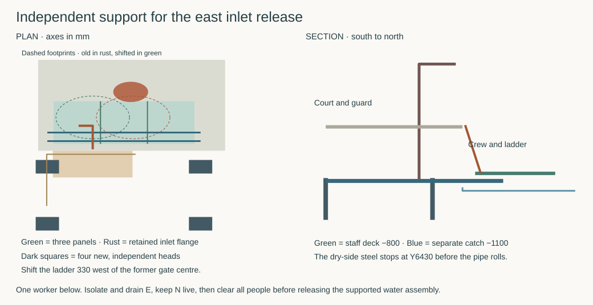

# A dry platform for the inboard east rainwater connection

**Keep the 450 mm structural bridges. Develop an independently founded frame and three lift-out floor panels for the upper-first spool. Move its south gate and ladder 330 mm west.** The former concrete pit puts 36.53 kN on P36/P37 and cannot fit its anchors. Its replacement has a different load path. It gives one worker access to the actual bolted inlet connection inside the court. The far end, receiver and dry escape beyond the east facade have their own RWT duties. [Earlier concrete pit](studies/current-house-service-bay.json) · [upper-first spool](../rwt/rwt-06-upper-first-release.md) · [calculation and geometry](studies/east-service-platform.py)

### Carry personnel independently of the pipe and catch

Use the RWT opening X6125–7650/Y6125–7400 and its Z−800 platform at X6250–7400/Y6220–6820. Fabricate three 383.33 × 600 mm cartridges. Their 50 × 8 mm grating bars sit flush between three longitudinal 100 × 50 × 5 mm ribs per cartridge. Use at most 30 mm bar pitch, with actual slip resistance, bonded seams and local pad contact tested. Each assembly including lifting eyes, seats and pins is limited to 50 kg. The conservative nominal bars and ribs alone weigh 45.92 kg. Lifting is mechanically supported. Retain the source 600 mm transverse envelope through the west handling opening.

Drop each unit vertically onto ledgers at Y6260 and 6380. Price a 5 kN station load on one 200 mm square plus 5 kPa on the entire deck, with 1.5 on live and 1.35 on dead. The worst outer contact develops **33.92 kN down and 24.04 kN uplift** at the two rows on one unit. A gravity-only board tips. Provide positive uplift keepers on the south row. An individual Ø20 solid shoulder in double shear, two 8 mm ears and a 12 mm central lug screen the full uplift on one connection. Provide positive transverse stops, 40 mm minimum edge distances and captive, visibly engaged keepers. Detail welds, pickup and release from above after unloading. Charge the whole point to a single grating bar and one rib, even with a bad distribution across adjacent bars.

Support both 110 × 100 × 10 mm EW ledgers between 160 × 90 × 16 mm NS side members at X6200/7450. The ribs end at Z−900. The ledgers below them end at Z−1010. Side members stay outside the panel width and above Z−1010. Their permanently retained northern limit is **Y6430**, 35 mm south of the tolerance-enclosed locked draw, with another 5 mm allowed for the support. Remove every panel and the ladder before rolling the inlet. The pipe rails, rear pan fixture, weather roof and sled use separate foundations. [All-angle pipe envelope](../rwt/studies/upper-first-release.json)

| Structural comparison | Result and boundary |
|---|---|
| Members | Nominal stainless plate boxes use a 170 MPa elastic comparison and E = 200 GPa. Bar/rib bending is 142.1/103.7 MPa. Ledger combined stress is 129.3 MPa. Reaction signs, combined shear/torsion, post bending and the guard transfer are in the numerical record. Bind the supplied 316L plates, welds, corrosion, local stability, fabrication tolerances and service slip. [Material data](https://www.outokumpu.com/-/media/files/products/supra/outokumpu-supra-range-datasheet.pdf) · [computed values](studies/east-service-platform.json) |
| Four new heads | Use X6200/7450 and Y5100/5900, with pinned, positively retained bearings at Z−1600, and bracing in both directions. Up to 300 mm square per head leaves **50 mm** to the plan of P36. Two longitudinal pin/roller lines carry the EW ledger reactions. Guided and anchored bearings must accommodate thermal movement while their positive stops carry each stated shear direction. No soil friction or hanger load on the house bridge is credited. |
| Foundation demands | Limit the entire fixed and demountable frame to 9 kN dead, including the ladder and gate. The signed envelope per head is **48.37 kN uplift, 72.79 kN compression and 4.20 kN horizontal**. It includes the whole platform point and area, an additional 2 kN on the ladder, guard point, gate wind and outward ladder pull. Horizontal overturning is conservatively charged to one support pair in each direction. A Ø30 positive head pin, 20 mm central plate and two 12 mm ears screen the resultant with the 100 mm square bearing seat. Select real pile/geotechnical resistance, shaft/head joints, bracing, settlement and installation sequence before the court deck closes. The 50 mm separation does not establish excavation feasibility. |

The local catch is a distinct gravity-drained pan at −1100. Keep its south spill edge at or below −1040 where the dry-side steel crosses it, giving 30 mm below the fixed ledgers. Even a flat, unobstructed 60 mm-deep catch over the entire opening holds only 116.66 L before spill. The source's possible tube and bend water is **156.91 kg**. Isolate E, verify its pressure and drained inventory and prove the 80 mm drain and receiving point before opening the flange. Bound residual water below the measured usable storage in a blocked-drain test. Keep N carrying the assigned event throughout. [RWT operations](../rwt/studies/upper-first-release.json)

### Get to the bolts and back out

At the old gate centre X6900, a 600 mm wide worker proxy that clears the south rim overlaps the retained Ø285 flange by **68.6 mm** at the ladder foot. Moving the gate, ramp and weather opening west makes a specific exit possible. Keep the south bund at Y6075 and the 175 mm upper opening extension. Centre the new 700 mm gate and 650 mm ramp at **X6570**. The ramp runs Y5750–6125. Use the 600 mm ladder at 82° with top Y6145/Z+30 and heel Y6261.65/Z−800. The heel pins directly to a lug on the south ledger at Y6260, 1.65 mm from its centreline. The full additional 2 kN ladder load enters that steel, clear of the removable grating. Restrain the head separately on the independent uprights.

A worker with 300 mm occupied radius needs centre-to-rung backset of **310–331.8 mm** between the closed rim and native flange. Credit 310–330 mm, including the same 5 mm *total relative position allowance* in the clearance checks. The least revised flange gap is **26.4 mm**. Transferring south to Y6475 first joins the two established tool stations at X6455 and 7270. The working 200 mm footprints fit the panels. Loaded posture, PPE, actual valve isolation, matched bolt sockets, second hand and torque remain physical acceptance items. The native duty here is separation of the two supported flange halves. No replacement valve body or its extraction space has been invented.

Mount the guard and ladder reactions on the independent frame at X6170/6970, Y5800, through two proposed 130 mm square, flashed and capped service curbs south of the new edge beam. The 100 mm posts leave 15 mm per side gross for the sleeve, motion and seal. A 275 mm return reaches the gate at Y6075. The two curbs narrowly clear the ramp. HAD, MAT and STR must form the openings without severing primary bars, maintain the weather skin in both plugged and occupied states, and qualify bracket torsion and relative movement. The guard calculation combines the inherited 1 kN horizontal point, a separate 1 kN ladder pull and 1 kPa gate wind. The revised 725 × 1100 × 40 leaf is limited to 30 kg. Post tip deflection screens at 8.91 mm, falling to 2.44 mm at ladder-head level, which consumes part of the 5 mm relative allowance.

The gate hinges at X6195/Y6075 and opens south to a positive 90° stop. It stays clear of the climbing body while opening. An upper attendant can wait east of its sweep. For self-egress, climb before any lift, open the gate from the well without a key, and walk south at X6570 to Y5480. Turn west there to X6000 before approaching the open south court door. The transverse body route clears the actual opened leaf tips by 75 mm after allowance. At X6000 it has over 500 mm to either fully opened leaf. Keep both leaves usable from the court and the house route to its front exit available. An incapacitated worker cannot be assumed to climb. Establish an independently recoverable casualty route and competent lifting method within the 1970 mm weather roof before entry. Loss of the upper attendant, safe water isolation or the return route takes the platform out of service.

Erect the weather protection and guard with rated covers secured. Capture and place the three panels, prove the two ledger rows and all four heads and secure the ladder before entry. After disconnecting and retaining every fastener, the worker exits. Lift the supported upper assembly with all people outside its sweep, then capture the panel bridles, retract keepers from above and lift the panels and ladder clear before the locked spool draw. Reverse the order on return, with the pan seated and captured before anyone re-enters. The structure needs no occupied platform below a moving water assembly. STR-HOUSE remains open.
