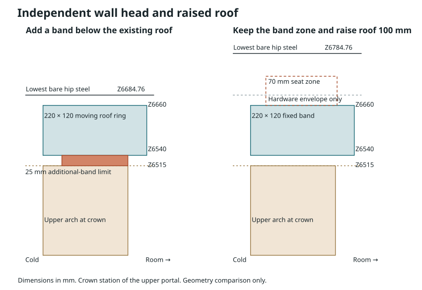

# Reserve the existing band for the fixed wall head

**Develop the raised tied-roof comparison.** Free the existing roof-band footprint for a fixed wall head and place individual roof bearings and positive restraint in a new zone above it. Use **+100 mm** as the first drawing datum and carry **+60 and +120 mm** as controlled section comparisons. The current slate profile, roof structure and house selection are unchanged until a joined successor earns adoption. [Rejected four-point retrofit](floor-portal-separate-support-replay.md)



## The upper arches set the section

The eight upper portal openings have a clear crown at **Z6300**. Above each one the 215 mm inner arch reaches **Z6515** at its extrados. The existing roof ring begins at **Z6540**. An additional continuous wall head between these solids has only **25 mm gross height**. The old 140 mm ordinary wall zone at q262.5–402.5 provides the in-plane width of the first strip comparison. [Paired opening source](studies/reconciled-house-interface.json) · [Pinned inner-arch section](https://github.com/adamnoden/architecture/blob/7a1b697431e9c1556f426068068b96356d3158ca/project/str/studies/floor_portal_house.py#L427-L509)

On each elevation the far jambs stand at 2702.5 and 9297.5. The native full-face pressure assigns **3.634 kN/m** of ordinary upper-façade load to the wall head. Across the resulting **6595 mm** ideal simple span, a solid **140 × 25 mm** strip has **242 MPa** gross stress and **78.3 mm** transverse deflection against the earlier 181.8 MPa and L/250 comparisons. At that span it takes about **74 mm** gross depth to reach the deflection comparison. With only 25 mm available, the simple bay must shorten to **4589 mm** or less. An ideal fixed-ended strip reaches 161 MPa and 15.7 mm while asking each end for 13.17 kNm under reversing pressure. No moment connection or service gap fits by assigning ideal fixed ends. [Pinned upper-face actions](https://github.com/adamnoden/architecture/blob/7a1b697431e9c1556f426068068b96356d3158ca/project/str/studies/floor_portal_loads.py#L538-L566)

Using the **220 × 120 × 20 mm** band footprint as a **fixed wall head** keeps the steel clear of the structural arch without adding a second line. The same unperforated simple lateral comparison gives **32.15 MPa and 6.62 mm** across 6595 mm. The two existing northern pier axes at **4377.5 and 7622.5** offer a genuine shorter layout comparator. With those supports, the largest intervening north bay is **3245 mm**, while both original roof heel stations **4700 and 7300** remain nearby for separate bearings. The northern piers still need positive head connections and a continuous load path down past the open loggia. Locate equally real receiving bodies on the other elevations. The old roof spring coordinates alone supply no such backing.

Vertical transfer controls before the gross lateral screen does. Over 6595 mm the two uniform factored **30.29 kN** outer seat reactions and factored band weight give **67.42 kNm** in the simple strong-axis comparison. The old gross comparison is 72.73 kNm. Applying the separate adverse seat values at both locations as a sensitivity gives **87.83 kNm**. This does not form a simultaneous load case. Preserve the short vertical routes, then resolve actual eccentricity, torsion, transverse wind, positive uplift and local seat loads in the new frame. [Current roof-band and support source](studies/current-house-welded-heel.json) · [Roof force source](studies/current-house-welded-network.json)

## Put roof movement in the roof zone

The retained bare hip leaves **24.76 mm** over the old **Z6660** band top. In the trial the band remains fixed relative to the wall and complete tied roof sectors rise, including rails and weather field. Reserve a separate, **70 mm** hardware envelope over that band, after two 5 mm setting allowances. It allocates drawing space for a bearing and positive shoe before any selected hardware, movements, fire closure or tool access. The historic room-side assembly's separate 32 mm head and ±35 mm vertical stroke would need **102 mm** before settings. The new fixed-band topology has its own movement and retention duty.

| Roof datum rise | Available above band, after setting | Beyond the 70 mm hardware reservation | Slate eave / field ridge / cap |
| --- | ---: | ---: | ---: |
| 60 mm | 74.76 mm | 4.76 mm | +7478.42 / +8469.33 / +8705.33 mm |
| 100 mm | 114.76 mm | 44.76 mm | +7518.42 / +8509.33 / +8745.33 mm |
| 120 mm | 134.76 mm | 64.76 mm | +7538.42 / +8529.33 / +8765.33 mm |

At **+100 mm** the old 260 mm heel-centre lever to the band centre becomes **360 mm** and the projected full-face wind screen increases by **2.79 kN** at its retained pressure and reference. Recalculate tie, saddle and shoe moments and the loaded erection stage. At each roof sector locate one deliberate fixed restraint, the positive uplift path and compression bearings, and movement at the other seats or within the sector joints. A free strain of ±720 μm/m produces **±4.08 mm** at each arm from an ideal central fixed point, or **5.77 mm** vector relative movement at an orthogonal outer seam. Fixing the north arm at one of its source piers lengthens the worst paired seam comparison to **6.65 mm**. Those are plan movements at the outer seam, with vertical/rotational movement and temperature gradients still to carry. A roof joint that meets a shared hip or valley must draw the load paths on both sides and an independent weather connection above. [Bare-hip source](studies/floor-portal-permanent-seat.json) · [Comparison receipt](studies/floor-portal-fixed-wall-head.json)

Take one north paired-portal section and one hip/valley across both roof sectors into the next drawing. Keep the paired apertures, room-side wall faces, accessible threshold and both water paths as held design inputs. Draw the independent wall-head load route and its fire, thermal and air returns. Put roof movement on the roof side of that fixed enclosure and show lead/slate, ventilation, copper collector outlets and renewal under movement. The change raises the visible roof line and every connected goods datum, requiring fresh roof pressure, wind/support, rainwater and access coordination. Neither the gross strip comparison nor the reserved gap selects the framing, a bearing or the house.

Generate the receipt and section from the same source set.

```sh
python3 -B project/str/studies/floor-portal-fixed-wall-head.py project/str/studies | diff - project/str/studies/floor-portal-fixed-wall-head.json
python3 -B project/str/studies/floor-portal-fixed-wall-head.py project/str/studies --svg | diff - project/str/studies/floor-portal-fixed-wall-head.svg
```
