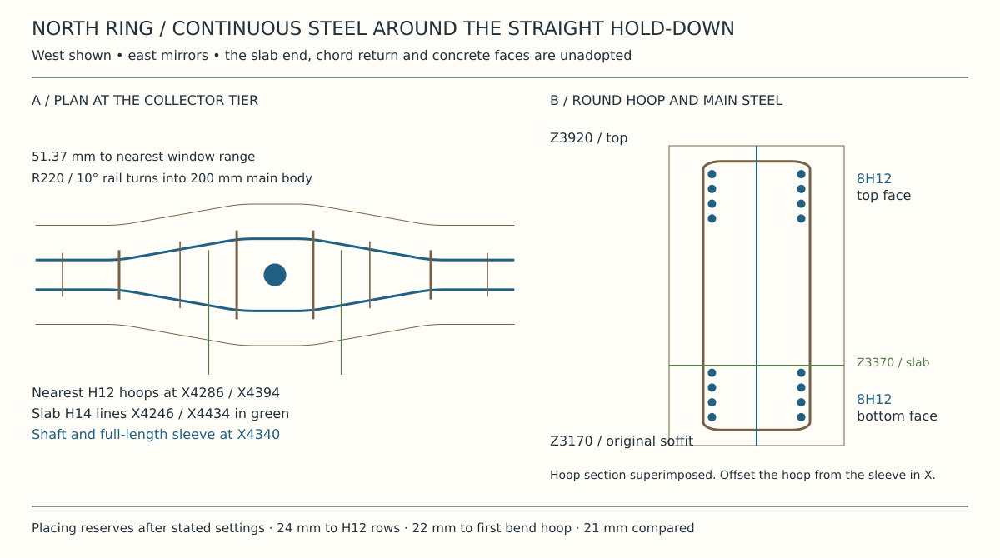

# Continuous north floor cage around the hold-down

**Use the 200 mm body and shaped bar return to develop the north collector.** The prior 180 mm body clears the sleeve as an object but leaves only 14 mm for placing on each side. The new straight steel-through-cage path clears the 21 mm comparison. The cast outline widens locally around the first bend hoops. The slab boundary still needs an independent, developed reinforcing detail. [Straight north hold-down design](floor-portal-twin-garden-tie.md)



## Clear the vertical sleeve and preserve the bending cage

The Ø32 sleeve stays at **X4340 and X7660 / Y11667.5**. The main body occupies existing **Z3170–3920** with no extra downstand. In the west station place the longitudinal H12 pairs on **Y11616.5/11718.5** for **X4310–4370**. Preserve eight bars per face. Return each side 30 mm in plan with two **R220 mm**, **10°** tangent arcs and a straight intermediate segment over **208.63 mm**. The principal path returns to the regular 140 mm cage within west **X4101.37–4578.63** and east **X7421.37–7898.63**. The nearest actual upper rough window ranges retain **51.37 mm** in plan. Their raw sills sit **480/280 mm** above the collector top.

Move all four tiers at each face **22 mm** toward mid-depth. A rectangular sharp-corner layout would put the former corner H12 into the actual fillet by **4.14 mm** even for an H8 hoop. Take H12 centres explicitly at **Z3241/3278/3315/3352** and **Z3849/3812/3775/3738**. Keep the 25 mm clear between adjacent tiers. Use rounded, closed H12 hoops in the curved returns at **X4340±54 and ±220** and the smaller H8 hoops at **±134 and ±300**, before continuing ordinary steel. Use the local side-leg positions in the receipt and one cage jig. The H8 and H12 centreline corner radii are 20 and 30 mm. Provide the shape, closure and crossbar development as part of the shop cage.

Reserve a **108 mm** centre pitch across the sleeve and **80–86 mm** on the adjacent bays. Ordinary reinforcement retains the 100 mm convention outside this local station. At the former 100 mm pitch, the closest H12 hoop would leave only **18 mm** after 10 mm relative setting. The single larger bay makes space for the sleeve and is included explicitly in the reduced shear comparison below. The two nearest H12 hoops leave **22 mm** between the sleeve and the link after 10 mm relative setting. The principal H12 rail has **24 mm** after a single **5 mm combined** rail-to-former setting budget. Independently positioning the two pieces at 5 mm each would give only **19 mm**, below the 21 mm comparator. Register both on the same fixture, allow up to 2.5 mm at each against that datum and recheck their actual relative set-out before pour. Fix the vertical former and keep these envelopes clear during placement. A 2 mm symmetric metal wall in the Ø32 envelope gives an ideal Ø28 passage and just **2 mm** radial play around the Ø24 rod. Verify the straightness, threading, separate coupler sequence and full insertion from the actual adjoining cavities. This small internal clearance cannot be taken from the tested concrete-placing gap. [Concrete Centre placing guidance](https://www.concretecentre.com/TCC/media/TCCMediaLibrary/Products/Errata_How2_SecondEdition_Mar18.pdf)

## Carry the bend forces into the closed hoops

The first-generation EC2 bend comparison uses the original trial C30/37 and H12 vertical spacing. At **49.17 kN** full design-yield bar force and conservative **18.5 mm** nominal half-spacing, the minimum inside mandrel is **276.87 mm**. The shaped cage gives **428 mm**. One 10° turn produces **8.54 kN** transverse force per fully stressed bar, or **34.16 kN** across the four rails at one face. The nearest H12 hoop is at most **24 mm** from either end of its assigned curved region. One H12 crossbar has **49.17 kN** steel-only capacity at the same stress. Develop that closed hoop and verify the local concrete compression spread, splitting, shear and bar path under reversal. The main bars continue through the turn. Any splice must be beyond it and earned with the full continuous path. The poor-bond straight full-yield comparator is **621 mm** from the existing trial strength. [Concrete Centre bend and anchorage comparison](https://www.concretecentre.com/TCC/media/TCCMediaLibrary/Events/Online%20course/CCIP_HowToComp_Feb18.pdf)

Removing the 32 mm sleeve from the gross concrete width gives **168 mm** in the sleeve station. The section comparison uses the original 140 mm at the regular transition and the new reduced effective depth of **613.5 mm**. The prior signed bending and shear envelopes are **170.39 kNm / 151.43 kN** before this change. Gross comparison resistances are **208.83/214.25 kNm** at 140/168 mm and **320.24/296.52 kN** after an adverse effective-depth/pitch adjustment. These answer whether the former floor-edge demand alone rules out the shaped cage. Keep roof, shaft and diaphragm actions separate until the joined replay. Do not use these numbers for local bearing, sleeve stress field or the cap anchor. [Previously validated edge section demand](studies/current-house-floor-stops.json)

## Give the slab and chord their own load paths

Reserve **H14** north–south bars at west **X4246 / X4434** at **Z3201 / Z3333** and mirror at the east. Their 188 mm local pitch retains **819 mm²/m** versus the old H12/150 comparison of 754. After 5 mm setting they keep **66 mm** to the sleeve and **22 mm** to the nearest hoop. The bottom bar clears the principal cage at each orthogonal crossing by **22 mm**. The top bar leaves **zero** reserve there after setting. Do not treat local area substitution as a diaphragm result. Either intentionally tie and gauge the orthogonal stack or detail a vertically separated crossing. **Z3320** is a trial for the east–west top slab steel below the H14, changing the older effective lever. Check its transfer and displacement separately. A conventional TTH12 heading fails as specified. It serves H12 and requires C32/40, and a Ø40 bottom head on the current slab axis would leave only **11 mm** of bare underside cover. Moving that head above the cover exclusion would require at least **Z3230** and new interaction with the lower principal bars. Prove a headed or hooked slab end on both faces without assuming bond in the sleeve or cutting a collector bar. [Floor and slab source](../mat/loggia-soffit.md) · [Ancon UK TTH catalogue](https://www.ancon.co.uk/downloads/81/Reinforcing%20Bar%20Couplers%20UK%20IRE%20Edition.pdf)

Reserve an inboard plan-chord strip at **Y11420/11464/11508/11552 and Z3270** for the separately calculated **4H20** reinforcement. Its nearest separation to the trial north–south bars is **41 mm** after 5 mm setting. Shifting the force centroid by 181.5 mm costs **16.98 kNm** at the old 93.54 kN chord witness. Develop the transverse return to the real collector and both adjacent walls before relying on that strip. Reconcile this lateral model with the distinct mid-height reinforcing allowance in the collector mass ledger. [Lateral chord source](studies/current-house-lateral.json)

The main cast body projects **30 mm** beyond either original concrete face. At the first H12 bend hoop the form witness is **208.01 mm** wide. Retaining the original 27 mm inner finish moves its plane locally, while retaining 110 mm glass and the current brick seat reduces the former 50 mm cavity to **20 mm** at the main body and about **16 mm** at the hoop. Coordinate a shifted thermal/drained return and sill support rather than accepting the narrowed cavity by implication. The east return also meets the solid rear divider. The section proves the principal ring cage around the sleeve. It leaves the slab and chord terminations, roof shoe, current two-sided cap cage and DPC, service and bay checks, and signed 52-head replay open.

```sh
python3 -B project/str/studies/floor-portal-north-cage.py . | diff - project/str/studies/floor-portal-north-cage.json
python3 -B project/str/studies/floor-portal-north-cage.py . --svg | diff - project/str/studies/floor-portal-north-cage.svg
```
