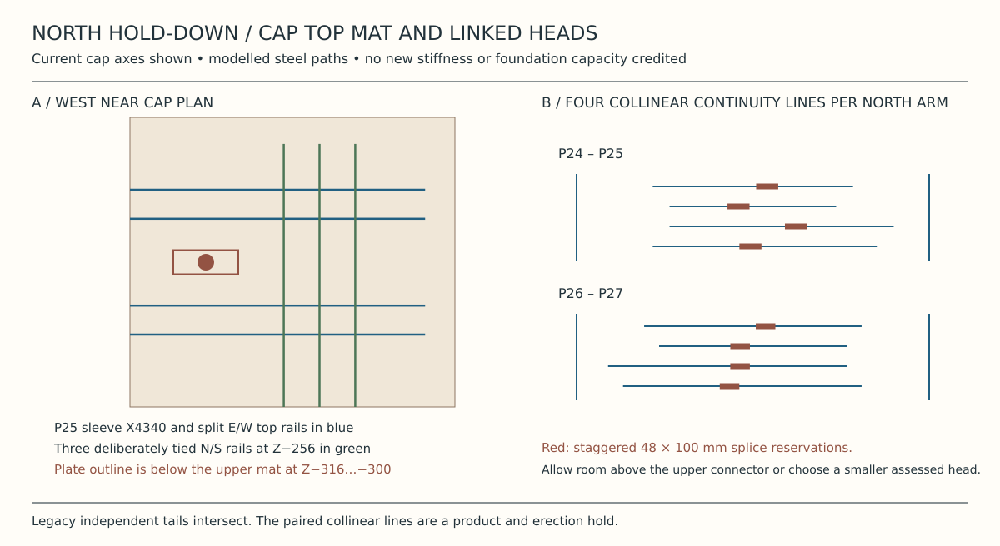

# Retained north heads with a clear cap entry

**Use a split, jig-tied cap mat for the next retained-grid connection.** The central top bar of the older west cap conflicts with the straight vertical hold-down before reaching its shallow plate. Moving the shaft would transfer the roof eccentricity into the perpendicular ground girder and project the Ø400 shaft 60 mm outside the unaltered width. Keep **P24/P25/P26/P27** at their current grid axes. Separate the north hold-down bore, cap chord and transverse girder steel from the tapered arch above and the DPC. [Straight sleeve and shallow plate](floor-portal-twin-garden-tie.md) · [Current foundation grid](studies/current-house-grid.json)



## Assemble the cap layers with deliberate crossed contacts

The old Ø20 E/W bar on **Y11667.5, Z−238** crosses the Ø32 sleeve at X4340. Bare overlap at their intersection is **26 mm**. In the west cap replace that bar with **2H16 at Y11577.5/11757.5, Z−238**. Keep separate **2H20 at Y11517.5/11817.5, Z−236**. Mirror the detail in X at P26. For the perpendicular upper chord use **3H20 at X4484/4550/4616, Z−256** in the west. These axes preserve the three-bar section while moving its centroid 50 mm from the original beam centre. Resolve the resulting local tie and torsion in the actual coupled actions. The upper mat clears the older translated shaft flares by **26.05 mm** and the sleeve by **56 mm**, each after 10 mm relative setting and any applicable curvature allowance. The shallow plate at Z−316…−300 leaves at least **44 mm** of vertical clearance to the E/W top steel after the same setting.

The two upper directions meet at **12 deliberately tied crossings**. The layer height difference is 18 mm at H16/H20 and 20 mm at H20/H20. The same fixture registers the touching members, then carries the finished mat into the form as one assembly. Separate settings apply to independently installed steel and penetrations. Verify the jig, ties and concrete placing around the fixed crossings. The alternative of 49 mm between independently set upper layers drives the lower N/S line into the old flared bars. It does not supply the same layout.

Keep **5H20 E/W at Z−572** with offsets **−245/−194/0/+194/+245**. Put **4H20 N/S at Z−552** with offsets **−245/−194/+194/+245** and assemble the crossing the same way. Reject the old fifth N/S central lane, which leaves **12.47 mm** to P6 after setting. This bottom comparison leaves **21.82 mm** to the translated shaft steel and **21 mm** between independently set parallel bars. At the old separate **385.14 kN** tie demand, four H20 provide **546.36 kN** steel-only. The actual north girder tie, transverse bottom force envelope and binding into the same cap remain unverified. Retain the present −630 mm arm soffits in this geometry comparison. [Original layer and shaft profiles](studies/open-loggia-support.json)

## Join the two north arms before placing their cap steel

The west arm runs P25–P24 over **1597.5 mm** and the east P26–P27 over **1800 mm**. The old independent 1200 mm H22 tails overlap when extended from both inline heads. They intersect the other end's curved flare even if the P27 west loop is shifted down by 60 mm. Use four shared longitudinal trajectories per arm instead. Give both roots in each paired lane the same Y and Z at their straight tangents. Shorten the tails to opposite ends of a central mechanical connection. Keep the west far head's wet arm distinct from the inline end at the east far head. [Absolute prescribed axes and geometry receipt](studies/floor-portal-north-cap-layer.json)

| Fit comparison after 10 mm relative setting | West | East |
| --- | ---: | ---: |
| Independent full tails at their governing intersection | −32.09 mm | −32.09 mm |
| Generic staggered connector spacing to the nearest represented starter or connector | 23.99 mm | 23.99 mm |
| Generic connector to the rerouted companion top chord rails | 29.22 mm | 29.22 mm |
| Shortest remaining straight distance from connector centre to a bend tangent | 312.48 mm | 413.73 mm |

The envelope is an **Ø48 × 100 mm** positional comparator, before tooling and actual assembly motion. Stagger neighbouring envelopes in X. Retain the upper mat positions through the sleeve node, then move the split H16s to Y±110 and side H20s to Y±180 about the girder axis, using tangent R220 bends from X4280 westward and X7720 eastward. The high connector at Z−282 leaves only **20 mm** below a legacy H8 top leg at Z−224 if both occupy the same X. A product no larger than **Ø46** would retain the 21 mm comparison. For the Ø48 study, locate both closest hoop planes at least 62 mm away and check the 124 mm local bay as a different shear detail. The linked H22 connections still need a component that can engage both already bent tails and supply the required reversal and stiffness. Alternatively, detail a preassembled continuous cage and a true insertion sequence. Assign no ordinary straight-bond capacity to the shortened steel ends.

Prefer the **Leviat TTP22** as the first finite fitting comparison. Its international catalogue gives a Ø42 mm largest body, 245 mm maximum open length and 205/60 N·m coupler/locknut torques. The circumscribing envelope leaves **24.31 mm** to other starters or connectors and **23 mm** to the coincident upper H8 leg after settings. The **nVent EL22P13LN**, Ø40 × 273 mm at full opening, leaves **26.31 / 24 mm** respectively and adds 28 mm to the full envelope length. The bar-end gaps, engagement, two-wrench reactions and access are separate. The cited UK taper approval size table omits TTP22, and the nVent 22 mm article row lists approvals other than CARES. Confirm the exact bar grade and matched product resistance, signed reversal and stiffness before selection. [Leviat international catalogue, p. 6](https://www.ancon.co.uk/downloads/82/Ancon%20Tapered%20Thread%20Couplers%20International%20Version.pdf#page=8) · [CARES TA1-B 5015, table 2](https://www.ancon.co.uk/downloads/6726/Ancon%20Tapered%20Thread%20Couplers%20CARES%20Technical%20Approval%20Report%20TA1-B%205015%20Issue%203%20%282019%29.pdf) · [nVent UK catalogue, p. 14](https://www.nvent.com/sites/default/files/acquiadam/assets/LENTON-CAT-CP7J-TaperThreadedRebarSystem-UKEN.pdf)

Produce a complete cage at each far head. The inherited P25 shape is a translated nominal comparator, and its P26 geometry uses an X mirror. P24 has two outer-girder directions and the perpendicular wet arm. P27 has only the inline arms. Their shown starter routes use those roles. Design their full transverse and bottom steel, confinement, continuation toward the adjacent unmodelled heads, placement and real end anchorage. A clear bend or connector envelope cannot stand in for that work.

## Develop the cap stress field and moisture crossing

For the prior stripped vertical witness only, the Z−300 plate face and Z−572 E/W mat give a **272 mm** comparison lever. With the earlier signed reaction magnitudes on each actual head, the resulting ideal chords are **17.58 kN west** and **17.80 kN east**, and reverse with the input sign. If two H16 share either chord, the old 2.1 MPa poor-bond comparator would need **83.3/84.3 mm** at those witness forces or **828 mm** per fully yielded bar. Keep these stated checks distinct. The ideal chord cannot assign concrete spall, fracture, slip, stiffness, cap resistance or governing head loads.

Develop the shallow plate or forged head, positive connection into the reconstructed cage, its local struts and hanger steel, verified lapped or mechanical continuity and the separated DPC/air return. Use current coupled force envelopes and actual local eccentricities for all four heads. Reconcile the head development with the roof shoe, slab and arch joints before replaying all 52 foundation reactions and the affected service and bay interfaces. Keep STR-FLOOR-PORTAL open.

```sh
python3 -B project/str/studies/floor-portal-north-cap-layer.py . | diff - project/str/studies/floor-portal-north-cap-layer.json
python3 -B project/str/studies/floor-portal-north-cap-layer.py . --svg | diff - project/str/studies/floor-portal-north-cap-layer.svg
```
