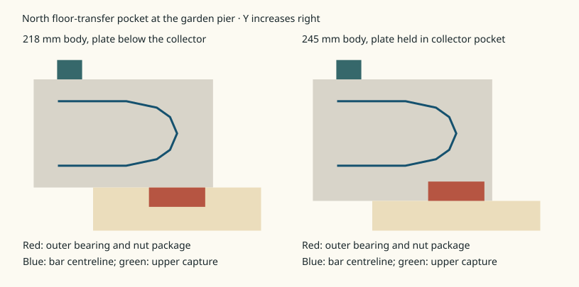

# Captive north collector trial

**Reject the bearing pocket cut into the existing lower pier.** Carry a deeper, locally formed collector end for the next joint test. The 245 mm detail below gives a finite recess for the bearing package and separates it from the trial bars. It still needs a positive confined node, assembly-tool clearance and signed joint stiffness. The full-depth return design keeps the lower arch tie untouched. [North floor transfer](floor-portal-north-transfer.md)



## Turn the top and bottom bars into the same node

Use the 137.5 mm force-line offset and the 130 mm effective couple. For the historical 33.207 kN stripped witness, the **35.12 kN** chord force means **155.28 MPa** at equal share across two H12 bars. Keep the bar axes at ±53 mm around each support. One U-return per bar plane turns through a **65 mm centreline radius** centred at Y11602.5/Z3261. Its outer tangent reaches Y11667.5. With the trial sleeve, external link, cover and set-out, only **2 mm** of spare outer envelope remains. At the roomward end, the previous straight-bond comparison would extend each tail to at least **Y11308.17**, before laps, transverse bars or other connectors. Neither the assumed equal share nor the two millimetres authorises casting. The bearing node still has to deliver the force into both bends with a checked mandrel, fit link legs, resist splitting and develop the top and bottom chords.

A positive bore-and-bearing arrangement can draw two opposite reactions. At Y11667.5 place the upper tie's captive bearing against the collector underside. At Y11530 place the lower tie's bearing on the collector top. The latter's provisional 12 mm plate, 8 mm washer and 19 mm nut occupancy reaches **Z3409**, leaving **26 mm** below the 15 mm finish underside. It requires a local no-service recess into the distribution zone and a finite driving/inspection sequence from above. The upper tie package below the 218 mm concrete body reaches **Z3113**, 48 mm above the garden arch's maximum extrados at Z3065. This is an elevation clearance and says nothing about the pier footprint. Its plate needs **140 × 92 mm** clear including plan setting, cutting about **28.2%** of the solid pier's gross horizontal area in that slice and reaching the west structural edge. Reject this externally hanging pocket. It would modify the lower compression pier rather than simply leave space above the arch.

## Recess the outer capture above the pier

| Collector body, top Z3370 | Local soffit | Plate top to lower H12 after 10 mm setting | Effect |
| --- | ---: | ---: | --- |
| 218 mm | Z3152 | −11 mm | The complete recess intersects the bar allowance. |
| 230 mm | Z3140 | 1 mm | Leaves no credible extra fabrication and operating margin. |
| 245 mm | Z3125 | 16 mm | First geometric comparison that leaves additional separation at this plate width, while lowering the local soffit 45 mm. |

The body footprint is **325.5 mm** laterally and **204 mm** longitudinally outside the flat renewable loggia panel field. This saves the ordinary flat module and moves the coordination cost onto the local garden shoulder, solid end-pier head, fire cover and warm boundary. The nominal 39 mm package recess provides **zero** additional vertical access space within that same cavity. Compare a shop-captive retainer fitted before closure and a specifically drawn side service opening, without routing tools through the working concrete bearing. The 245 mm datum is anchored to the trial fit and can move if the actual nut, retention, fire protection or tool requires a larger allocation. [Owning soffit and shoulder](../mat/loggia-soffit.md)

The work compares a **120 × 72 mm** wide plate and a **70 × 72 mm** alternative threading between the bars. Both consume the outboard Y edge reserve after set-out. The wide plate in the 218 mm recess intersects the lower bar by 1 mm even before setting. The narrow plate leaves just 2 mm sideways after setting. At the same vertical witness, these have **4.36/8.26 MPa** average demand on their net plan areas. Projecting each footprint normal to an ideal **48.34 kN** single diagonal gives **9.23/17.49 MPa** gross demand. The narrow contact exceeds even the 11.22 MPa old CTT *comparison*, without credit for actual confinement, density or load spread. Reject the bare narrow clamp as the chosen solution. Keep a physically wider positive capture and check actual nodal geometry, contact, plate bending, trim, anchorage and tools. [Source strut and node distinctions](open-loggia-support-study.md)

## Close the eccentric vertical moment on three existing heads

At each return, put the near head at the origin and take the next head down each perpendicular girder. The return falls strictly inside each triangle. The source-bound receipt conserves the vertical force and both moments at either sign. The tensile reference branches below require positive restraint at **all three** heads.

| Return | Near head | Loggia arm | North arm |
| --- | ---: | ---: | ---: |
| West | P25 · 28.114 kN | P29 · 2.547 kN | P24 · 2.546 kN |
| East | P26 · 28.400 kN | P31 · 2.547 kN | P27 · 2.260 kN |

The older P25-region H22 starter geometry is centred at **Y11700**. Translate it **32.5 mm south** to the current P25 axis as an adverse comparison. At X4377.5/Y11530, a Ø32 sleeve entering **Z−180 to −300** passes only **7.77 mm** from starter P8's sampled centreline. The bare envelopes overlap **19.23 mm**. Taking the lower end to **Z−400** and sliding the sleeve in X over the entire **±24 mm** cover-screened range gives at most **5.32 mm** bare clearance after the 0.5 mm between-samples bound and 0.05 mm bar-arc chord allowance. The 10 mm relative setting therefore consumes that clearance at every permitted X position in this Y section. Reject drilling or casting this continuous sleeve into the translated old cage. Develop a mechanically connected transfer to the two real girder arms from a different reinforcement topology. The translated starter source stays a comparison against current P25 and does not establish the current or mirrored P26 cage.

This is a vertical-only lever solution on three actual head axes. The short end lies outside the bare shaft envelope and therefore needs force transfer through the girders and cap. The full response may depart from these shares. The actual cap requires developed starter bars, a sufficient local stress field, a sealed DPC transfer and compatible bracing at each girder, before interpreting any site uplift capacity. Finish the load path to the fixed wall head and re-run the signed coupled assembly including all 52 heads. Keep STR-FLOOR-PORTAL open. [Grid and named supports](studies/current-house-grid.json) · [Signed comparison receipt](studies/floor-portal-north-captive.json)

```sh
python3 -B project/str/studies/floor-portal-north-captive.py . | diff - project/str/studies/floor-portal-north-captive.json
python3 -B project/str/studies/floor-portal-north-captive.py . --svg | diff - project/str/studies/floor-portal-north-captive.svg
```
