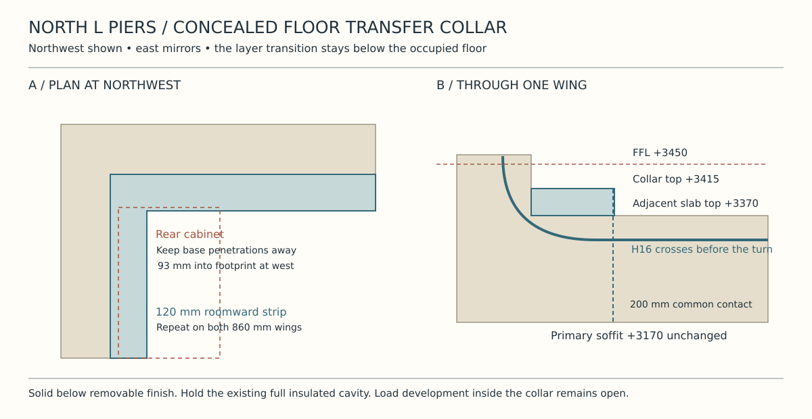

# Concealed diaphragm collars at the two northern L piers

**Develop a concealed monolithic collar into each northern L pier.** Form a straight receiving face 190 mm roomward from the wall centre and turn the top-mesh reinforcement into the L behind it. The 140 mm stem comparator lets each bar turn before it reaches the slab-to-wall face, assigning a large additional vertical action there. The wider collar brings the crossing onto a straight part of the bar and gives the concrete a larger zone for turning the forces. It requires a designed stress field into the existing pier. [Existing lateral system](studies/current-house-lateral.json) · [North floor cage](floor-portal-north-cage.md)



## Seat the collar under the existing finished floor

Use both **860 mm** wings at each north corner. Add the **120 mm roomward strip** from the old inward wall face to the receiving plane. Keep the concrete soffit at **Z3170**, ordinary slab top **Z3370** and local collar top **Z3415**. With FFL Z3450 and a 15 mm floor finish, the new solid leaves **20 mm** below that finish. Keep the removable floor at its existing level and provide a deliberate dry service/panel transition at the step. The extra 45 mm concrete over the two-strip union adds about **0.216 kN per corner** at 25 kN/m³. The ordinary slab still contacts only **200 mm** of the collar depth. Do not include the exposed upper 45 mm in the transverse contact area.

The four nearest raw upper openings clear the adjoining wing ends by **107.5 mm** in plan. The nearest side sills at Z4200 lie **785 mm** above the collar. Put the enlarged volume roomward, holding the exterior support face, **110 mm cellular glass**, **50 mm cavity** and **102.5 mm brick** at their current coordinates. Check the three-dimensional wall/slab boundary and material continuity, with the air and cavity closures developed separately. [Selected house openings and furnishings](../had/studies/open-north-loggia.json) · [Existing slab and wall section](../mat/loggia-soffit.md)

At NW the west strip lies **93 mm** into the rear cabinet's footprint below the floor finish; its concealed service and base-fixing zones need exact locations before accepting the reduced service depth. At NE the nearest northern principal emitter stops **32.5 mm** outside the new north strip. The included plan addresses only those identified conflicts. Coordinate terminal services, skirting removal and finishes against the final collar.

## Integrate the top mesh into the receiving bars

Use four **H16** per loaded leg at **175, 325, 475 and 625 mm** along each wing. Set the two directions at **Z3315 and Z3331**, with 16 deliberate orthogonal contacts in a common jig. These bars replace the affected top-mesh runs. Retain the ordinary lower slab mesh and reconnect the top mesh beyond the developed collar strip. Curve the crossing bars **R165** towards the continuous RC wall and leave **850 mm** of straight development beyond each tangent. The actual 314 mm inside mandrel exceeds the **303.54 mm** full-yield C30 comparator, and the poor-bond straight full-yield requirement compares as **828.16 mm**. The upper straight bar gives **26 mm** cover after 5 mm setting at the ordinary deck top. The inside corner of the concrete step at u70/Z3415 is **124.85 mm** radially from the bend centre. Subtract that from the 165 mm centreline radius, then deduct 8 mm of steel radius and 5 mm of setting to leave **27.15 mm** cover. The original Z3410 collar leaves only **23.85 mm** there. Reject that lower step with the same upper bar.

A separate H8 placed radially ahead of the upper H16 would need the shoulder at about **Z3433**, even allowing the same combined fixture. This leaves about **2 mm** below the floor finish underside. Reject that receiver position and develop confinement beside the bend or around an explicitly designed strut. The ideal 90° bend at the old friction witness produces **56.07 kN** resultant per rod, or **240.3 N/mm** along its radial arc. The clear cover calculation earns its position. It does not resolve bearing spread, splitting, hoop anchorage or the confined pressure field.

Put closed links 45 mm on either side of each crossing. The **90 / 60 mm** pitches clear the bars by **22.97 mm** after two 5 mm settings. Rephase the local H10 wall face grid at a 150 mm pitch through **Z3300 / Z3450**. This changed grid leaves **9.06 mm** nominal fixture reserve at the orthogonal crossing after the combined 5 mm setting. The new upright H16s pass the old principal H12 rows with only **1.97 mm** after that combined setting. Independent 5 + 5 mm positioning produces **3.03 mm overlap** there. Use a registered cage, check the orthogonal crossings before placement, and confirm the local mix can consolidate around the actual formed details. Select no independent installation around legacy poured steel.

Continue the floor chord through four concentrically bent **H20** bars without a short separate longitudinal fan inside the wall. Their centreline radii are **536 / 484 / 432 / 380 mm**. At 52 mm centres they retain **22 mm** placing after two 5 mm settings. Put the chord at **Z3265**, 5 mm below the older mid-depth comparison. The closest H16-to-chord clearance remains **21.89 mm** after settings. Shift the chord centroid **193.5 mm** roomward and use the resulting **95.16 kN** isolated historical diaphragm witness. The exact adjoining chord returns and development farther around the floor still require proof.

## Close the actual interface forces

Use **μ = 0.6** as a declared separate sensitivity and give the interface concrete no shear contribution. Four H16 give a steel-only friction screen of **209.8 kN** when crossed at right angles. At **95.16 kN**, the positive tension demand is **39.65 kN per bar** at the straight receiving plane. At the old corners, old isolated gravity bending is **10.84 kNm/m NW** and **18.72 kNm/m NE**. Applied conservatively as same-bar top tension with the reduced lever, it adds **12.33 / 21.29 kN** respectively. The resulting **51.98 / 60.94 kN** per bar compares with **87.42 kN** at design yielding. Those old floor moments are gravity witnesses used as a conservative sensitivity and give no actual combined joint action. The two old gravity shears are **16.87 / 22.16 kN/m**. Resolve the actual deflection, interface opening, local wall stress field and transfer under the joined signed actions. A plain 860 × 200 gross interface would average **0.553 MPa**, above the old 0.5 MPa general comparison. [Original floor-field actions](studies/open-loggia-support.json)

A narrower 80 mm roomward addition leaves the proposed plane 15 mm inside the turn and incurs **14.48 kN** additional vertical action at the same interface witness. The unchanged 140 mm body incurs about **111.7 kN**. Reject both at the straight-interface assumptions. A depth reduced to 195 mm on the same soffit brings the upper bar below the 25 mm cover target. The selected outer collar plane lies 25 mm before the bend, allowing straight crossing even with setting. The bend's internal reactions still enter the monolithic collar and old L and need confinement and a positive load path. Keep the actual H16 meshing transition, bar test fit, load redistribution and completed signed 52-head and service-interface replay open.

The [straight lower receiver comparison](floor-portal-straight-receiver.md) rejects a conventional straight cage in the existing 200 mm slab. It locates the separate thicker deck requirement and the retained northwest WC port as the governing architectural reopen conditions.

```sh
python3 -B project/str/studies/floor-portal-north-collar.py . | diff - project/str/studies/floor-portal-north-collar.json
python3 -B project/str/studies/floor-portal-north-collar.py . --svg | diff - project/str/studies/floor-portal-north-collar.svg
```
