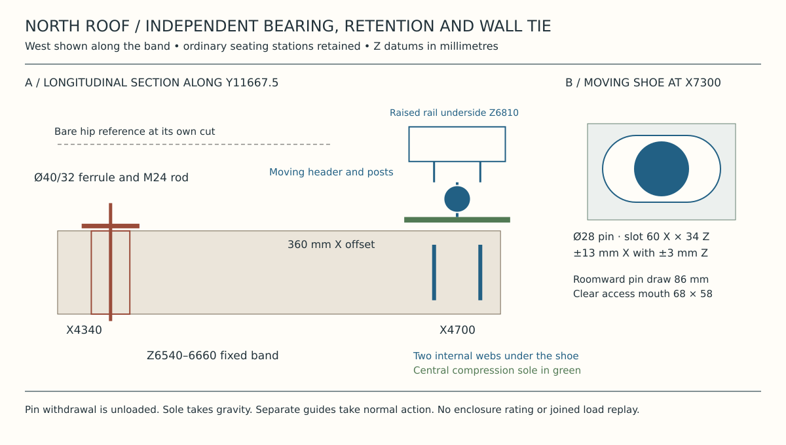

# North roof shoe with a separate band ferrule

**Develop the pin-and-slot shoe with a compression-only sole.** Carry the moving roof on the sole and retain it under uplift with a fixed transverse pin. Separate normal guides send lateral action into the fixed box without asking the pin cheeks to act as guides. Keep one deliberately fixed X restraint per sector. Place the two independent wall-rod connections on the shifted axes already chosen for the straight north hold-down. [Raised wall-head section](floor-portal-fixed-wall-head.md) · [Straight north hold-down](floor-portal-twin-garden-tie.md)



## Locate the pin and guide movement

The ordinary north roof seats stay **X4700 / X7300, Y11667.5**. The fixed box still occupies **Z6540–6660**. Keep the existing **+100 mm** roof comparison and reserve the local shoe above Z6660 up to **Z6730**. The bare governing hip leaves **44.76 mm** after setting beyond that 70 mm body. The body does not include the moving roof member's final attachment, welds, roofing or rated enclosure.

At X4700 use a fixed hole for the trial X datum, with its own combined signed force design. At X7300 put a **60 × 34 mm** milled stadium in the moving 20 mm tongue around a **Ø28 mm** pin on **Z6706**, running across Y. Use X as the slip axis. Geometric X travel is ±16 mm with the pin centred vertically and **±13 mm** at either maximum **±3 mm** relative Z position. After 3 mm installation and 1 mm running reserve, the new seat has 9 mm available. From the fixed X4700 datum, ±720 μm/m produces **±1.872 mm** at X7300 and **±5.017 mm** at the farthest represented point on this same north arm. The separate **6.65 mm** diagonal seam movement compares two orthogonal roof arms. Use it for the seam joint and cover, independently of shoe travel. A reappearance of the old **±35 mm Z** demand would need at least a 98 mm slot before steel ligaments and defeats this body. The actual roof-sector rotation, differential Y and Z movement, taken-up contact, lead/slate and air and weather closures require a new connected replay. [Movement source](studies/floor-portal-fixed-wall-head.json)

The **110 × 44 mm** fixed sole and **90 × 42 mm** moving pad retain a 3780 mm² rectangular contact over the compared X position, giving **8.01 MPa** at the old separate 30.29 kN gravity seat action. Keep the pin free during ordinary downward support. Prove pad stiffness, surface contact, rotation, materials and friction in the selected assembly rather than relying on bearing stress alone. Reserve reversible normal guides at **X±70 mm** relative to the shoe and **Y±52 mm** from the band axis, each with an initial 24 × 20 mm contact face. They need their own positive load transfer down into the fixed steel, guide geometry and signed roof normal force. The older 8.94 kN façade load witness remains a wall-head comparison.

## Develop the uplift path through the fixed band

The **96 mm** long pin bears on two **12 mm** fixed cheeks at **Y±30 mm** around the central **20 mm** moving tongue. With the old separate 33.207 kN uplift witness, its ideal distributed-bearing bending stress is **192.61 MPa**, the mean double shear is **26.96 MPa** and the nominal combined stress is **198.19 MPa**. The point-loaded simple-pin deflection upper comparison is **0.0248 mm**. The tongue and each cheek see **59.30 / 49.42 MPa** mean projected bearing. The **8 mm** lower tongue ligament carries about **103.77 MPa** over two ideal shear planes. The upper ligament is 7 mm. Keep a real milled plate, inspected fillets and an as-selected rated pin; the conditional S355 elastic comparison does not qualify pin metallurgy, impact, bearing contact, compression, wear or prying. Prove the fixed shoe's X reaction without loading a moving slot end by default.

At each roof seat put two **12 × 180 × 80 mm** internal webs at **X±24 mm** to engage both side walls of the **220 × 120 × 20 mm** box. Install and inspect these in the shop before box closure. For the same uplift witness an ideal 80 mm effective strip of the 20 mm box skin between webs gives **74.72 MPa** bending and **0.0072 mm** point deflection. A 5 mm effective throat along each receiving web gives **18.45 MPa** mean shear under even share. Develop the actual fork, sill and webs and the side-wall load spread for concurrent actions. This isolated screen keeps existing steel box dimensions and does not establish effective width or weld-group strength by assumption.

The upward route from each shoe transfers **360 mm in X** to its **X4340 / X7660** positive wall rod. Use a shop-welded **Ø40 outside / Ø32 bore** vertical ferrule through both 20 mm skins. Reserve a **Ø60 × 15 mm** positive top bearing washer and separate retained M24 nut; the comparison with a 19 mm nut and 6 mm thread projects **40 mm** above the band. The 33.207 kN witness gives **11.95 kNm** on that isolated X route. Deducting a Ø40 cut at both box skin planes and giving no section credit to the sleeve yields **332,444 mm³** net gross elastic modulus and **35.96 MPa** for that comparison. The old threaded area gives **94.07 MPa**. Average bearing on the annulus is **21.14 MPa** and average shear on a trial full 5 mm weld is **52.85 MPa**. These figures still require the actual ferrule welding, hole reinforcement and side-web transfer. The earlier 1.25 kNm at the shifted rod relative to the gravity pier is a separate local support moment. Do not duplicate it in the 360 mm shoe-to-ferrule transfer.

## Operate the retaining hardware from a separate enclosure

Draw the pin roomward along **Z6706**. From the Q284.5–380.5 envelope, **86 mm** travel clears the cheek by 2 mm and brings the inner tip to **Q466.5**, 37 mm beyond the ordinary finish. Reserve a **68 × 58 mm** clear removable opening at this axis. Keep the straight local passage from Q429.5 to at least Q500 free of stops and gutters. The Ø28 pin with two 5 mm settings needs 38 mm diameter. The 17 AF socket for a separate keeper fastener has an actual **Ø24 × 39.5 mm** envelope. Operate the calibrated extension outside the access mouth. Confirm the keeper type, drive and hand space, the dry enclosure and demountable rated air/fire closure before adoption. Prove unloaded removal, controlled temporary support and reinstatement. [Gedore keeper socket](https://shop.gedore.com/en-at/6134010/)

Engage the ferrule nut from above with the roof open. The actual 36 AF socket used as a comparator is **Ø50 × 58 mm**. Its engaged envelope is Z6675–6733, and a nominal 25 mm Z lift to remove it leaves **16.76 mm** below the governing bare roof allowance, before its ¾-inch drive, counterhold and lift tolerance. Installed-roof access for that vertical nut remains a distinct hold. Do not route it through the removable horizontal-pin opening. [Gedore ferrule-nut socket](https://shop.gedore.com/en-at/3300501/)

At the two ordinary heels, connect the moving receiver toward the existing twin-rail centres at **Y±116 mm** from the seat. The raised underside is **Z6810**. A trial **100 × 50 × 6 mm** transverse RHS spans the 232 mm between rails from Z6760–6810. Use two 40 × 40 × 5 mm moving posts, 30 mm tall at X±24 mm from the seat, with 6 mm to each RHS edge after the full post footprint. They rise from the shoe top. At the old uplift the simple header comparison gives **75.32 MPa** in bending and **0.068 mm** displacement. The isolated one-rail cantilever sensitivity is **150.64 MPa**. At old gravity each post takes **21.64 MPa** compression. The partial moving additions (header, posts, slotted tongue and moving pad) are **0.051 kN** before connections and retainers. Charging them without displacing the earlier 0.894 kN approximation leaves roughly **0.055 kN** within the old separate 1 kN heel allowance. Qualify the actual rail attachments, eccentricity, lateral loads, end plates and weight, and carry fixed diaphragms into the wall-band ledger. [Existing ordinary twin rails and dead-load basis](studies/current-house-welded-heel.json)

The two ordinary heel layouts need a complete local solid scan, including the wider header outside the fixed band, its rails, the roof enclosure and operator cover. Do not use that geometry under a hip by default. The binding roof sketch still needs each independent normal guide and its fixed X duty, roof movement including attachment rotation, the bolted enclosure and measured material properties. Reconcile every seat, hip, valley, tie and shifted roof action with the floor and foundation work before replaying all 52 head reactions. This develops the north shoe detail. Keep STR-FLOOR-PORTAL open.

```sh
python3 -B project/str/studies/floor-portal-north-roof-shoe.py . | diff - project/str/studies/floor-portal-north-roof-shoe.json
python3 -B project/str/studies/floor-portal-north-roof-shoe.py . --svg | diff - project/str/studies/floor-portal-north-roof-shoe.svg
```
