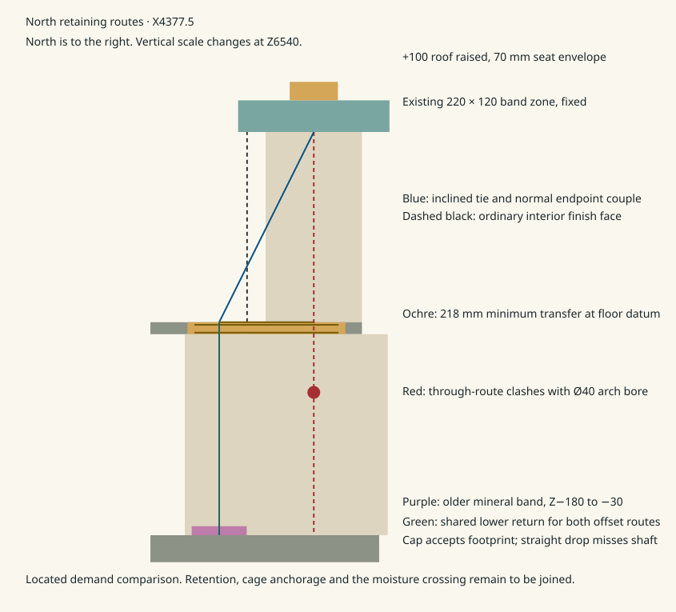

# North wall head and offset hold-down

**Prefer the [paired garden tie and straight hold-down redesign](floor-portal-twin-garden-tie.md).** This page records the local first-floor transfer, the fallback if that redesign cannot earn its arch hardware and widened lower pier. The straight sleeve through the unchanged north pier cannot clear the arch bore. Turning the tie at the floor preserves the upper wall face and the centred arch tie, at the cost of a positive eccentric collector. The raised roof stays at the +100 mm comparison datum. [Fixed wall head and raised roof](floor-portal-fixed-wall-head.md)



## Place downward support and uplift on real axes

The roof seats at **X4700 and X7300** lie inside the fixed band supports at **X4377.5 and X7622.5**, with a **322.5 mm** offset from each bearing. The inherited ordinary-roof uniform downward case gives **30.29 kN** per seat. On the simple 3245 mm north bay, the paired loads and factored band weight give **11.44 kNm** and **32.35 kN** at each support. Across the lower garden pier, the upper support is **36.25 mm** off the centre of the pier in X. This imposes a local **1.17 kNm** from that downward comparison. A separate façade pressure case gives **8.94 kN** per return as a tributary share. Leaving the upper core as an unbraced cantilever would ask the collector top for **23.96 kNm**. Connect the band normal restraint to the floor diaphragm and perpendicular returns, and keep the vertical compression bearing and uplift retainer distinct.

Use the fixed 220 × 120 band zone. The +100 mm raised hip leaves **114.76 mm** after the two nominal setting allowances, including a **70 mm** allocation for the bearing and retaining shoe. Leave axial freedom at the moving shoe and put normal restraint at designed diaphragm nodes. The earlier roof-sector comparison gives **6.65 mm** relative movement across an asymmetric seam. Seat stroke, rotation, contact, local attachment and erection restraint arise from the new joined system. The slot, retaining head and service access still need a positive joint. Keep the weather, ventilation and water closures independent of the retention hardware. [Existing roof action source](studies/current-house-welded-network.json) · [Raised section and movement comparison](studies/floor-portal-fixed-wall-head.json)

## Compare the path to the lower returns

| Route | Geometric and force result | Disposition |
| --- | --- | --- |
| Straight sleeve through the garden pier | A Ø32 sleeve in the existing 140 mm core can offset up to **24 mm** on the 25 mm cover and 5 mm cover-setting screen. The Ø40 arch bore needs **46 mm** separation from centre to centre with the 10 mm relative setting. Widening the core by the **22 mm** deficit consumes all but **5 mm** of finish and leaves only **2.5 mm** to an existing H8 link at the controlling lower position. | Reject in the existing fabric. Keep the arch tie intact. |
| Local transfer at the first-floor collector | Move the positive tie route **137.5 mm** roomward at the floor, from Y11667.5 to **Y11530**. The old stripped north-pad action of **33.21 kN** gives **4.57 kNm** of eccentric moment. A nominal **130 mm** effective couple would require **35.12 kN** of chord force. To enclose both sleeve centres with 25 mm cover and 5 mm setting, a local body spans at least **Y11484–11713.5**, before anchor heads, bars and ties. A 15 mm lining beyond the minimum body costs **101.5 mm** of local room depth. These dimensions are trial boundaries. | Develop a dedicated reinforced collector-to-return block and leave a removable dry facing. The 200 mm slab and the ordinary upper wall alone supply no proved anchorage. |
| Inclined tie across the upper storey | Incline from the wall-head underside **Z6540** to floor structural top **Z3370**. The opposed horizontal forces are **1.44 kN** each at the same old action. Over **3170 mm** they balance the same **4.57 kNm**. At the floor, the sleeve and settings project **66.5 mm** past the finished wall. With a 15 mm lining this needs **81.5 mm**, exceeding the 70 mm cover trial by **11.5 mm**. The line leaves the upper core's cover envelope over most of the storey. | Retain as an architectural challenger requiring a shaped full-height recess or projecting cover and two independently braced endpoint connections. |

The lower and upper H12 centres need **44 mm** to each concrete face to fit the 25 mm cover screen, 5 mm setting and outside H8 link. The 130 mm couple therefore needs **218 mm** overall. Keep the trial top at **Z3370** and take the trial local soffit down to **Z3152**, 18 mm below the existing soffit. Price that local projection against the ceiling, arch and renewals. An unchanged 200 mm slab gives only **112 mm** effective spacing, increasing the chord force to **40.77 kN** and the poor-bond length to **257 mm**. At the 218 mm transfer, put the illustrative two H12 chord bars per face at **Z3196 and Z3326**, with their X axes at **±53 mm** around each loggia return. That retains 21 mm bar-to-sleeve clearance after 10 mm of relative setting with the Ø32 sleeves. Including a trial H8 link and cover setting gives a **194 mm** outer body in X, **27 mm** beyond each side of the 140 mm core. This uses the entire room-side finish zone before lining. The **35.12 kN** couple force distributed to two H12s needs about **222 mm** of straight bond at the older author's 2.1 MPa poor-bond comparator. At the outer node only **16 mm** is available from the load line to the cover plane. **Reject the straight-ended cage at this footprint.** Develop a positive headed, returned or bolted termination with local confinement and a deliberately priced widening. Retain the 130 mm couple as a demand calculation until that termination fits. [Slab and poor-bond controls](open-loggia-support-study.md)

The two lower returns are solid actual cores at **X4377.5/Y11530** and **X7622.5/Y11530**. Their centres lie **327.5 mm** in X beyond the closest upper raw window edge. The cover trial must still be checked against the developed room and service finish. The returns lie within the actual north bays of *loggia-W* and *loggia-E*. The girder centrelines are **122.5 mm** away in X, and **P25/P26** are **137.5 mm** to the north in Y. A simple longitudinal point-load witness sends **92.33%** to the near head and **7.67%** to **P29/P31**. The perpendicular eccentricity also imposes **0.1225 kNm of torsion per kN** before any redistribution by the cross ties. The Ø32 sleeve fits inside each **600 × 600 mm** cap footprint, but protrudes **0.15 mm** past the Ø400 shaft outline before cover or setting. Reject a straight drop into the shaft cage. At the reference action the unredistributed cap moments are **4.57 and 4.07 kNm** about X and Y. Carry both actions, shear and positive compressive and tensile transfer through the actual lower cage. A bearing membrane or a compressed mineral DPC cannot provide uplift continuity by assumption. The current ordinary two-course inner mineral-band comparison is **Z−180 to Z−30**, directly across both return axes in this grid layout. The alternative warm/cold field comparison gives **Z−530 to Z−380**. Each uses its own floor and support datum. Neither supplies a joined north-return restraint or addresses the separate whole-field capillary bypass. Draw the actual connector, capillary interruption and air/thermal returns together at the same final set-out. [Ordinary loggia wall base](../mat/loggia-envelope-boundary.md) · [Warm/cold field comparison](../mat/joined-ground-floor-and-court-boundary.md) · [Whole-field moisture route](../mat/ground-pier-boundary.md) [Grid source](studies/current-house-grid.json) · [Open-loggia geometry](../had/studies/open-north-loggia.json) · [Source-bound calculation](studies/floor-portal-north-transfer.json)

The old uplift and downward cases establish how each route transfers force in its own comparison. The [next captive-collector comparison](floor-portal-north-captive.md) rejects cutting the retained pier for a hanging plate, prices a deeper local recess and balances vertical load on the adjacent head triangles. The actual paired anchorage, reinforcement and confinement, support-block shear and torsion, and the return foot joint remain open. Then replay the adopted roof, wall heads and connected collector with signed pressure and prescribed movements, recovering every one of the 52 foundation-head reactions. The roof and whole-house gate remain open while these joins are unresolved.

```sh
python3 -B project/str/studies/floor-portal-north-transfer.py . | diff - project/str/studies/floor-portal-north-transfer.json
python3 -B project/str/studies/floor-portal-north-transfer.py . --svg | diff - project/str/studies/floor-portal-north-transfer.svg
```
