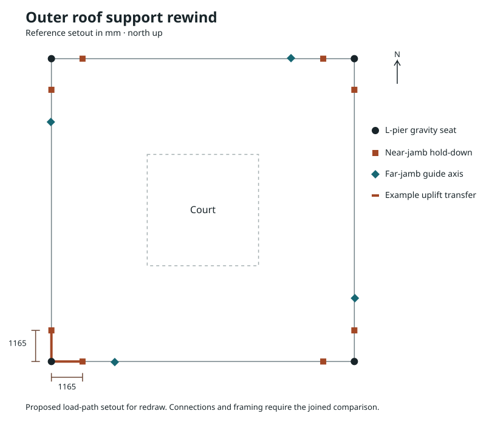

# Floor and portal reconciliation

## North hold-down and principal collector cage

The [paired garden tie detail](floor-portal-twin-garden-tie.md) places the north hold-down on a straight vertical line outside the voussoirs. The [current principal cage](floor-portal-north-cage.md) replaces the first-floor 180 mm clearance trial with a locally widened, shaped 200 mm main body on the existing vertical floor datums. It clears the sleeve against the 21 mm placing comparator with a common fixture. The single 108 mm bay carries a separate shear comparison. The actual slab end and lateral chord development, thermal finish, roof retainer, current west and east cap anchorage, service interfaces and signed 52-head replay remain open. These joins supply the structural packet closeout.

**15 November disposition. Retire the nested hip heel and collar and redraw the outer roof support.** Remove the combined hold-down and lateral guide assembly from the four L-pier heads. Take direct compression, uplift and horizontal restraint to distinct locations. Start with the support arrangement below. STR-FLOOR-PORTAL remains open for the joined successor and holds both final house gates.

The [subsequent separated support replay](floor-portal-separate-support-replay.md) rejects the four-point room-side guide retrofit developed from the comparison below. Rewind to independently braced wall heads supporting tied roof frames or segments with deliberate fixed restraints and a defined movement route. The four-guide setout is now a rejected comparison.

## Outer roof support rewind

The proposed 300 mm hip cassette allocated the same steel and access space to the pitched-frame load transfer and four vertical tension collars. All four collars foul the matched webs. Moving only the sockets offers at most two compatible centres within the retained cassette and plate geometry. Moving the webs misaligns the shoe transfer. Interrupting the lower weld and returning it around the sockets fails the finite weld-group screen throughout the tested family. Even the extended centred groove leaves **0.0717 kNm** of transverse moment in the controlling comparison, equivalent to **0.42 mm** of movement of the 170.8 kN force line, before fit-up and inspection. That groove result does not carry the simultaneous transverse actions. Retire these variants, including the compact rotating cartridge, and remove their serial development instructions from the active design path. The following dated studies remain the record of the alternatives tested. [Hip geometry](studies/floor-portal-hip-diaphragms.json) · [Weld groups](studies/floor-portal-heel-return.json)

Draw the outer load paths as follows, using the paired monolithic jambs as a starting geometry:



| Duty | Rewind setout and design cost |
| --- | --- |
| Downward reaction at each outer hip | Keep a direct, compression-only seat centred on the existing L core. Develop the hip-to-ring transfer as unobstructed steelwork, with access from the shop and an exposed seat before the roof closes. Remove the projected concrete cap, socket perforations and guide recesses from this candidate. Recheck the finite compression patch, actual erection sequence, rotation and air/fire/weather return. |
| Reversing vertical reaction | Take positive hold-down through separate, inspectable shoes at the eight **near** paired jambs, local stations **1497.5 and 10502.5** on each face. Carry vertical transfer from the hip into the two adjacent ring arms over **1165 mm** each. The historic exterior roof-only corner tension witness of **47.24 kN** costs **27.52 kNm** bending in each arm for a symmetric local split and **55.03 kNm** for a one-arm transfer. The later installed [roof and water comparison](../rof/studies/roof_water_receiving_union.json) puts **54.68 kN** tension at the southeast corner, giving **31.85 and 63.70 kNm** in these transfer screens. The continuous ring, active bearings, torsion, actual anchor forces and the jamb feet still need a joint solve. |
| Horizontal restraint and released travel | Compare one dedicated radial guide on each of four **far** paired jambs in a rotationally symmetric arrangement. Starting from the south face and proceeding east, north and west, its guide-axis coordinates are **(2702.5, 312.5), (11687.5, 2702.5), (9297.5, 11687.5), (312.5, 9297.5)**. Reserve a separate accessible face-mounted guide and structural backing outside the existing cage. Pricing the removed cap slots as usable clearance would preserve the original obstruction. Develop support for wall heads and jambs that lose their previous roof restraint. |

The four guide directions resist plan translation and yaw in the rigid-body comparison, with any three surviving locations retaining that rank. Two cannot do so. A uniform expansion about the court centre gives zero tangential movement, but 1 mm/m strain in one plan axis alone gives **2.85 mm** of incompatible motion at a guide. For each 1 kN of pure X or Y force with zero yaw, equilibrium requires at least **0.366 kN** at one guide, equal ideal springs give **0.433 kN**, and one unavailable guide gives up to **0.865 kN** in the same rigid model. The source full-face projected roof and ordinary upper-façade roof tributaries are **91.88 kN** before goods, other loads and actual sharing. At that scale these factors give **33.61, 39.74 and 79.48 kN**, respectively. The four-guide rank is a starting arrangement for the new frame and receiver, and concentrating the actions carries a real load cost. Retain a distributed off-heel guide comparator if the four stations demand disproportionate wall-head or roof work. [Pinned wind load definition](https://github.com/adamnoden/architecture/blob/7a1b697431e9c1556f426068068b96356d3158ca/project/str/studies/floor_portal_loads.py#L538-L578) · [BCSA bridge bearings, §3.10, articulation analogue](https://steelconstruction.info.iceblue-digital.co.uk/images/1/1c/BCSA_51-10.pdf)

The inherited **94 × 46 mm** corner cassette cannot simply be transferred into those **180 × 205 mm** jambs. Omitting the bars gives **27.80 mm** of concrete web after setting at the centred position, above the retained 25 mm screen. With the four source H12s and 10 mm relative setting, all centres that could clear that web screen have at least **1.78 mm** of bar interference, even with the cage links and tools omitted. The receipt bounds the unsampled translations and the accompanying radial rotation. A shorter **69 × 46 mm** centred envelope based on the historical 45 mm jamb tongue clears these plan-only screens, with **38.62 mm** web and **10.54 mm** to the nearest bar after settings. It still needs a guide that carries the revised action and can be installed and renewed. First draw a backed and accessible wall-head guide outside the cage. If that projection cannot be accommodated, compare the smaller pocket with moving or enlarging the structural support, then redraw the room, finish and renewal interfaces before another coupled run. [Historical jamb tongue](https://github.com/adamnoden/architecture/blob/7a1b697431e9c1556f426068068b96356d3158ca/project/str/floor-portal-guide-hardware.md#L19-L34) · [Rewind calculation](studies/floor-portal-support-rewind.py) · [Source and calculation receipt](studies/floor-portal-support-rewind.json)

### Re-entry and affected evidence

1. Draw the four corner seats, two adjacent ring transfers, a complete near-jamb tension route to the ground grid and a far-jamb guide including its working stop, swept volume, casing retention and removal. Show the envelope and bar schedule for both positive and released directions. Maintain independent jamb and wall-head stability throughout installation and guide renewal. Treat conventional bearings and guides as comparators and reconcile all hidden constituents against MAT.
2. Draw the same assembly in the inhabited upper corner and at the north and east service zones. Keep paired openings and practical guard and window renewal. Recheck the ceiling, room finish, air and fire lines, insulation return, pipes, outlet access and east intake/threshold against the exact new backing and projection. Carry the governing roof shape and independent rainwater paths as starting geometry. Any change to the profile, roofing mass, weather return, drainage or receiving support re-enters ROF/RWT/MAT/HAD on that geometry.
3. At the first finite section, reconcile heel, ring, compression-only contact, moving positive tie and actual guide stiffness with signed actions and six-component equilibrium. Re-run the coupled load and movement comparison with all eight portals, the actual roof and all 52 heads, including unfavourable asymmetric contact, restraint tolerance, thermal gradients, shrinkage and support movements. Reuse the signed families and source domains as inputs. The prior reaction, contact, movement, stiffness and foundation cards belong to the retired arrangement or their earlier comparison. The independent service and water results retain their stated source envelopes, subject to applicability at the changed supports.

Reproduce the bounded rewind comparison with `python3 -B project/str/studies/floor-portal-support-rewind.py --check`. It selects a direction for redraw and rejects the nested corner trial. The current controlled house and the provisional SAP-C1 geometry are distinct sources and neither carries a passed structural handoff. The coupled exit, receiving-gate checks and owner decisions remain required.

## Dated receiver and heel comparisons

The sections below record the former cap, shoe, cage and collar development in sequence. Their proposed next details are historical comparisons. The support rewind above governs current work.

## Radial receiver at the outer L piers

The [source-bound predecessor](https://github.com/adamnoden/architecture/pull/1489/commits/7a1b697431e9c1556f426068068b96356d3158ca) locates six radial guides on each of four L piers. The complete cassette is 94 × 46 mm in plan. Its 70 × 20 mm tongue carries ±10 mm released travel, 2 mm running allowance at each edge, and 5 mm slide plate plus 6 mm carrier cheek on each side. The local comparison deducts two independent 5 mm setting allowances from the minimum gross concrete web. The 25 mm screening dimension is a comparison input. Required cover, confinement and anchorage remain open.

| Compared at all 24 guides | Gross web | Web after settings | Margin to 25 mm |
| --- | ---: | ---: | ---: |
| 140 mm arm, full cassette | 19.56 mm | 9.56 mm | −15.44 mm |
| 140 mm arm, cassette reduced to bare tongue width | 28.17 mm | 18.17 mm | −6.83 mm |
| 180 mm arm, full cassette centred 20 mm farther into each arm | 39.58 mm | 29.58 mm | +4.58 mm |

The limiting straight-arm station is 725 mm in all three comparisons. The full 140 mm assembly is short even before the two setting deductions. Holding the current radial angle, guide centres and travel length fixed, a narrower cassette alone cannot meet the screen: even a 20 mm envelope, the tongue's width before adding the receiver, is short.

The [standalone calculation](studies/floor-portal-receiver-cover.py) checks the full oriented cassette against the six exposed edges of the L union. It includes controls for a cassette edge crossing the re-entrant corner while all four cassette corners fit, and for the closest point falling between cassette corners. The [receipt](studies/floor-portal-receiver-cover.json) replaces the predecessor summary's rounded 9.60 and 29.62 mm with the values calculated from the recovered coordinates. The 180 mm local plan comparison also clears the retained [H20 layout and H12 stations](studies/current-house-ground-ties.json), with minimum screened plan gaps of 38.98 and 60.13 mm respectively after settings. These gaps address the stated plan obstructions only.

Run the study with Python 3 and compare its stdout with the receipt.

```sh
python3 -B project/str/studies/floor-portal-receiver-cover.py | diff - project/str/studies/floor-portal-receiver-cover.json
```

## Next comparison and dependent evidence

Compare the 180 mm plan with a revised guide location or orientation at 140 mm before choosing a pier geometry. Retain real guide travel and a positive load route in either option. Build the full receiver, bar, link, coupler and bearing detail and demonstrate its cover, splitting restraint and erection tolerances. If the 180 mm pier is pursued, carry the changed body, bar locations, stiffness and mass into the ring, floor collector, feet and foundation model. Re-run the signed 579-case demand and 104 individual-head movement comparisons with all 52 head reactions, plus the strain controls. Reconcile the widened geometry against the occupied rooms, finishes, roof and court receivers, service openings and renewal paths before offering it to either final gate.

The predecessor's coupled results describe its 140 mm comparison. The numerical force and movement records are recoverable at the pinned head, with its [recorded CI run](https://github.com/adamnoden/architecture/actions/runs/43263256156). They do not transfer to the widened pier. The [interface review](floor-portal-interface-review.md) and [shared contract](../triad-interface-contract.md#structural-direction-and-selection-compatibility) continue to govern the withdrawn SAP-C1 structural handoff and the receiving gates.

## Outward cap and core-only bearing comparison

Moving the 40 mm enlargement outward keeps the inner concrete face at q402.5 and the ordinary room finish at q429.5. The outward L origin shifts 40 mm in both plan coordinates. The 1040 mm local legs preserve the world end stations, and the guide centres move 20 mm outward across their respective legs. The [24-guide plan receipt](studies/floor-portal-receiver-cover.json) gives 29.53 mm of concrete web after settings, with 34.78 mm minimum H20 clearance and 60.20 mm minimum H12 station clearance. These are local plan screens with the retained bar positions.

The cap-only comparison confines the enlarged footprint to Z6215–6515. The 140 mm pier and damp-proof course footprint continue below it. The glass zone in the enlarged cap strip changes from 110 to 70 mm before local closure and fixings. The [ordinary wall section](../mat/ordinary-eave-joined.md#connected-section-and-actual-stops) supplies those starting dimensions. The 180-to-140 concrete step uses a rigid sectional connection for demand recovery. The contact quadrature splits at the actual 40 mm projection, so the projected strip and underlying core have separate vertical reactions.

The core-only alternative uses an authored **5 mm initial vertical gap** over the projected strip and retains compression contact over the old 140 mm core. All six lateral guides per pier retain their prior force law and travel reservation. The installed question is whether the roof seat can stop at the core edge, keep the projected strip clear under load and setting, and retain the radial guide, closed glass return and inspection access. The 300 mm cap depth and 5 mm gap are comparison dimensions.

### Coupled comparison

| Signed demand case envelope | Peak head tension, kN | Peak L-end torsion, kNm | Peak collector-end torsion, kNm | Peak absolute L-guide Cartesian component, kN |
| --- | ---: | ---: | ---: | ---: |
| 140 mm full-height reference | 159.45 | 2.345 | 11.951 | 28.41 |
| 180 mm full-height outward | 156.99 | 4.304 | 12.201 | 25.88 |
| 300 mm outward cap, shelf bearing | 159.24 | 2.690 | 11.978 | 27.40 |
| 300 mm outward cap, 5 mm shelf gap | 159.24 | 2.695 | 11.970 | 29.24 |

All four models recover equilibrium at the 52 heads. Each column has its own case witness. The full-height outward comparison retains the old 140 mm damp-proof contact as a stiffness input. Its connection across the added footprint still requires a physical transition.

The touching shelf attracts **135.59 kN** of vertical compression at the southeast cap, with **18.42 kNm** about the lower-section global X axis in that same case. The core-only seat leaves the projection unloaded in all 579 signed cases and 110 movement cases. Its minimum modeled contact-point gap is **4.884 mm** under signed loading and **4.967 mm** under imposed movements. Peak core compression moves from **71.80 to 128.52 kN**, the largest individual L-anchor tension remains **8.78 kN**, and the largest absolute Cartesian component of L-guide force rises from **27.40 to 29.24 kN**. The two cap models give the same 159.24 kN peak head tension. The P10 −1 mm fixed-head movement control gives **1459.92 kN** tension with the relieved seat. This is a kinematic model demand.

In the case producing 128.52 kN of core compression, southeast guide 5 carries the simultaneous force vector (−22.814, −25.887, 0) kN, a **34.505 kN resultant** in that case. The predecessor plate-root screen uses the largest Cartesian component. A diagonal guide requires the actual tangential resultant for its plate and weld checks.

Develop the **core-only seat** as the next finite detail. Draw the steel bearing and its end at q262.5, the gap over q222.5–262.5, and the supported 70 mm glass return. Establish the local plate pressure and closure across the entire projection, including setting and plate deformation. Detail the outward cassette anchorage and confinement into the 140 mm core for the simultaneous actions in the [coupled receipt](studies/floor-portal-cap-replay.json). Keep the room edge and lower damp-proof geometry in the replay. STR-FLOOR-PORTAL stays open until the actual joint and dependent interfaces are resolved.

### Replay

The [companion patch](studies/floor-portal-cap-replay.patch) applies to the exact pinned predecessor and records the changed footprint, mass, split contact and step forces. The [runner](studies/floor-portal-cap-replay.py) checks both the predecessor and the applied patch. It uses Python with NumPy 2.3.5 and SciPy 1.17.0.

```sh
git fetch origin refs/pull/1489/head
replay_dir=$(mktemp -d)
git worktree add --detach "$replay_dir" 7a1b697431e9c1556f426068068b96356d3158ca
git -C "$replay_dir" apply "$(pwd)/project/str/studies/floor-portal-cap-replay.patch"
OPENBLAS_NUM_THREADS=1 python3 -B project/str/studies/floor-portal-cap-replay.py "$replay_dir" cap300-relief5 signed
OPENBLAS_NUM_THREADS=1 python3 -B project/str/studies/floor-portal-cap-replay.py "$replay_dir" cap300-relief5 movement
```

Use `140` for the base, `outward180` for the full-height outward comparator and `cap300` for the cap whose projection has initial vertical contact. The signed screen retains the 579 predecessor cases. The compatibility screen retains six free-strain comparisons and 104 individual unit head movements. Both use the inherited fixed-head and frictionless-guide comparisons.

## Finite core seat, cage and glass return

The [finite detail study](studies/floor-portal-seat-detail.py) locates the complete trial at all four L piers. Narrow the 300 mm tall cap from 180 to **175 mm**, keep the 140 mm core and room-side face, and leave **75 mm** between the cap and the fixed wall-glass/cavity datum q152.5. A 5 mm outward cap setting leaves **70 mm** without using the 50 mm cavity. Place the six radial guides at old-core coordinates 220, 475 and 680 along each arm, 52.5 across it. The adjusted guides leave **27.10 mm** minimum concrete web after settings. Keep the earlier q50 line with this narrower cap and the web falls to **24.59 mm** against the 25 mm screen. The glass must turn continuously across the two faces and down the cap shoulder. Retain it independently of the moving roof shoe. Locate the supported toe, head/drain and air return before awarding a thermal, fire, restraint or renewal result. The comparison sets a geometric reservation for those details.

Keep the soffit at Z6540 and end the bearing shoe at q262.5. The highest hardware over the shelf is Z6525 for a **15 mm** authored gap. Two independent vertical settings and the prior modelled 0.116 mm approach leave **4.884 mm** before real plate flexure. The ring source has a 20 mm skin and the outer skin edge overhangs the core by 40 mm. Assigning all of the earlier 128.52 kN cap reaction to one 100 mm strip at the overhang tip gives about 771 MPa, so that strip idealisation cannot be used as an elastic deflection bound. The physical seat needs the actual web-to-core transfer width, local plate stiffness and toe geometry.

The twelve staggered H20 lines bend from Z6140 to 6450. Below the Z6215 shoulder they keep **25.05 mm** side cover after settings in the old core. The continuous 3D bar-pair clearance lower bound is **23.18 mm** after settings. The trial embeds Ø38 × 48 CXL20W couplers below the seat and gives each a 2 mm radial weld-toe reservation. The minimum coupler/weld clearance is **21.61 mm**, minimum plate edge reserve **1 mm** and minimum coupler-to-cassette separation **26.31 mm**, all after settings. The moved 680 guide leaves only **15.58 mm** at the retained H12 station 600. Moving its cap end to 590 gives **25.58 mm** in the independent station screen. Its finite bend, ties and connection remain separate geometry to resolve. The original, unstaggered centres leave only **6 mm** between couplers. The geometric reservation allows at most 2.31 mm radial weld toe at the packing screen. A 5 mm external toe would also overrun the plate edge.

Three rounded H8 loops at Z6355, 6394 and 6433 maintain **21 mm** vertical separation and **2 mm** above the highest hoop to the cassette, after independent settings. The exact straight and curved centreline screen tests all twelve bars across the full relative ±10 mm height band. The limiting bar clears by **0.057 mm** after the geometric and sampling deductions. The Z6350/6390/6430 control overlaps by **0.398 mm**. These margins support comparison at the drawn dimensions. Cage deformation, joint hooks, concrete flow around the actual welded sleeves and final tying/installation tolerances still control selection.

The installed packing model exposes a different failure during assembly. Turning each bent bar fully into a fixed, pre-welded plate creates four reciprocal collision pairs at the lower straight leg. Common-angle turning also fails, with **−11.57 mm** screened clearance. The Ø35, 48 mm CXL20/C sleeve avoids rotating the continuation bar, but the straight piece below CXL20W is only 17 mm. It is **31 mm short** even before the Type C locknut and wrench envelope. Pre-threading individual seat segments avoids those relative turns. A subsequent straight feed of the closed links still fails: the loop overlaps the retained lower straight bars by 15.70 mm after settings or the pre-threaded sleeve envelopes by 10.31 mm from above. Moving the Type C splice below the cap while retaining the original H20 grid also fails. Even a staggered Ø35 sleeve beside a bare bar leaves only **16.50 mm** clear, and sleeve side cover is **20.50 mm** after setting. Develop a separable seat and a mechanically closed multi-piece link, or a different no-rotation tension connection with a demonstrated cage sequence. Verify the weld and carbon-equivalent-specific procedure independently of the dimensional fit. [Leviat reinforcing bar coupler catalogue, pp. 16–17 and 23](https://www.ancon.co.uk/downloads/81/Reinforcing%20Bar%20Couplers%20UK%20IRE%20Edition.pdf)

The trial leaves the original lower pier and DPC as the inherited comparison. Complete the compression transfer, cage bursting and installed sliding law before using the reference joint. The geometric screen carries no product, connection or construction acceptance.

### Movement and adverse guide pressure

The moved anchor and guide points enter the ring model as actual port locations. The candidate removes obsolete 140 mm bearing and bar subdivisions from that ring mesh. Retaining the displaced bar nodes had introduced 3 mm segments and failed the unchanged dimensional balance check. The established bearing and anchor stiffness assumptions remain comparison inputs. A shop-installed stiffness or a checked weld may move the force split.

All **579 signed cases** and **110 movement cases** retain all 52 heads. The signed sweep gives **130.54 kN** maximum core compression and **8.585 kN** maximum single-anchor tension. Its smallest projected gap is **14.890 mm**, with zero shelf compression. The two 5 mm vertical settings leave 4.890 mm before actual plate flexure. Using that signed compression in the isolated 100 mm strip yields 783 MPa, corroborating the prior adverse comparison. The 110 movement cases separately retain all 52 heads. The minimum projected contact-point gap is **14.969 mm**, with zero shelf compression. The largest radial release travel is **5.754 mm** in the model. The reference imposed-head demand is separate from installation and product tolerances.

Three signed cases also test the previous fixed-direction **20% friction** overdrive with the relocated ports. All remain open at the shelf. The W(1,4) downward pressure case with court wind enabled, with goods at Z7400, gives **56.180 kN** resultant at the governing L guide, from **55.089 kN** tangent and **11.018 kN** radial components. Its direction reversals remain visible. Treat this as an adverse test, with the actual stick/slip law and assembled normal pressure still held. [GGB-CBM sliding material product data](https://www.ggbearings.com/en/our-products/metal-and-bimetal-bearings/ggb-cbm)

The 70 × 60 mm tongue with the earlier 75% effective bearing area gives **17.49 MPa** on the concrete backing under that tangent, above the prior 17.00 MPa pressure comparator. The same screen would require at least **61.72 mm** effective depth with that width and area factor. Extending the existing cassette down by 2 mm to trial 62 mm depth consumes the whole 2 mm upper-link reserve. At unchanged tangent, a 73 × 60 mm active face instead gives **16.77 MPa**. Its longer cassette still clears the planar web and coupler screens at **25.98 mm** and **25.14 mm**. The trial H12 station would need to move from 590 to 589 to retain **25.58 mm**. The three-case repeat with the longer blade's changed model stiffness drives the W(1,4) resultant up to **57.57 kN** and the pressure to **17.18 MPa**. Reject the unchanged pressure assumption as a sizing method. Rework force spreading and splitting restraint with the actual H12 bend before choosing a longer guide. Increasing depth alone gives no placement or splitting pass. The supplier's static sliding-material pressure is a separate contact interface.

### Full-width backing and splitting comparison

Keep the 70 × 60 mm sliding face and compare a 94 × 60 mm fixed backing on each loaded side of the existing cassette. This spends the width of the full 94 mm travel envelope without increasing the 94 × 46 mm plan or lowering the casing. The pinned friction replay reproduces the governing **55.089 kN** tangential and **11.018 kN** radial demands with **2.974 mm** simultaneous radial travel. The independent imposed-movement envelope gives 5.753 mm. Use ±10 mm for the authored travel comparison and 12 mm for an adverse load position that also spends the 2 mm running allowance. The latter is a geometric sensitivity, separate from the recorded motion cases.

The inherited triangular depth profile places the resultant 10 mm from the centre of a 60 mm backing. The [compression-only study](studies/floor-portal-guide-backing.py) enforces force and both first moments with an affine pressure field clipped at zero. A full rigid face averages 9.77 MPa gross, but the model gives **21.458 MPa** peak at the simultaneous witness and **26.753 MPa** at 10 mm radial eccentricity. The latter engages only 89.4% of the face. The independent mathematical bound fills the highest weighted region at exactly 17 MPa to maximize the depth moment at each radial moment. No pressure field bounded between zero and 17 MPa can balance the inherited depth eccentricity beyond **10.864 mm** radial eccentricity. At 12 mm the largest attainable depth eccentricity is 9.392 mm. A centred depth resultant would give 16.00 MPa in the affine screen at 10 mm. It needs a separate **0.551 kNm** reaction couple at the governing force and a revised connection stiffness. A thick cheek alone supplies neither. [Affine pressure equilibrium comparison](https://highways.dot.gov/sites/fhwa.dot.gov/files/FHWA-HRT-14-094.pdf)

With no spreading, the prior 75%-area nominal pressure is still 17.489 MPa. With no concrete contact the cheek cannot transfer tangent force by bearing at all. The 6 mm cheek strip at the loaded depth edge gives a 334 MPa unsupported-wing elastic comparison at the simultaneous travel, rising to 572 MPa at 10 mm. These strip stresses screen the cantilever effect and require the actual two-dimensional plate, bedding and fastening. Keep radial friction transfer separate from normal backing pressure and check load reversal on the opposite cheek.

The [receipt](studies/floor-portal-guide-backing.json) bounds the oriented cassette clearance at all 24 guides to the twelve bent H20s and eight trial H12 paths. After settings it retains at least **35.061 mm** to H20 and **26.359 mm** to H12. The highest closed H8 still has 2 mm vertical reserve to the cassette. A nominal 2:1 plan spread at the governing guide intersects the q80 H12 axis at the 590 mm station, while the q42 axis misses by 2.03 mm before charging its radius or setting. This is geometry in the 60 mm face band. The H12s are locally vertical, and the H8s are below the load introduction. Neither establishes developed horizontal splitting reinforcement. The 2:1 bottle-strut comparator gives 13.77 kN transverse tie force at one dispersal node. The straight H8 leg projects about 14.53 kN nominal gross yield onto the radial axis, before any anchorage, position, combined force or splitting-plane checks. Develop an explicit path from the loaded cheek to a radial tie at the loaded depth, with anchored confinement and actual wet concrete flow and construction sequence. [University of Texas strut-and-tie study, Figure 5-17](https://ctr.utexas.edu/wp-content/uploads/pubs/0_4371_2.pdf)

Run `python3 -B project/str/studies/floor-portal-guide-backing.py --check` for the geometry and pressure receipt. With the same pinned worktree and seat-detail patch prepared below, run `OPENBLAS_NUM_THREADS=1 python3 -B project/str/studies/floor-portal-guide-backing.py --replay-travel "$replay_dir"` to reproduce the three retained friction cases and their simultaneous travel. The geometry, bedding, backing stiffness and guide law remain separate open inputs to the next signed and movement replay.

### Opposed depth-rocking guide shoes

A trial has one removable shoe on each side of the existing ±10 mm radial blade. Put the two 70 × 12 mm sliding strips at 17 mm above and below the bearing mid-depth. Place a radial pivot along the back of each shoe at mid-depth so its reaction passes through that depth. With both strips in contact, a freely rocking shoe has equal strip reactions. The opposite shoe takes over on tangent reversal. Retention must locate the unloaded shoe without preventing rotation or carrying the main force. The blade still moves radially over the strips. Keep end travel and set-down clearance, and transfer radial friction separately. An off-centre radial friction reaction can introduce moment into the shoe and its retainer.

The [executable comparison](studies/floor-portal-guide-rocker.py) uses the retained 55.089 kN witness, with the 12 mm adverse radial sensitivity as a separate position. At this sensitivity the existing 94 mm backing gives 17.249 MPa even with perfect depth centring. The centred affine minimum is 94.960 mm. A **98 × 46 mm** plan leaves **25.603 mm** concrete web after settings across all 24 placements, and the ideal centred backing peak is **16.252 MPa**. Increasing the cassette to 98 × 48 mm cuts that web to 24.938 mm. A 100 × 46 mm cassette also fails the 25 mm comparison. The uniform 98 mm extension leaves **24.746 mm** to the closest coupler in the retained envelope screen. A mixed layout uses 96 mm at station 220 and 98 mm at 475 and 680 on each arm. It retains **25.603 mm** concrete web, **25.526 mm** to couplers, and a sampled, remainder-bounded **25.426 mm** to the H12 paths. These figures cover the existing casing thickness and do not establish the developed splitting path.

Even the 98 mm backing allows only **0.798 mm** depth eccentricity at 12 mm travel. The pivot, contact geometry and friction effects together have **44.0 N·m** moment allowance. That is a **4.70%** difference in pad reactions relative to their sum. At the 96 mm station, the same adverse force and travel combination gives 16.737 MPa and leaves only **15.1 N·m**, or a 1.62% imbalance. This deliberately applies the governing outer-station load to the narrower inner receiver as a comparison, since the mixed profile has no connected replay. Ideal equal load gives 32.8 MPa mean on each strip. If one strip stays off its mate, the full load on the remaining strip gives 65.6 MPa mean and a 937 N·m unbalanced moment. The shoe must rotate until both strips engage or have a separately designed transient load path. The cantilever blade and 0.5 mm relative pad setting trial require 1.03° of shoe rotation and 0.54 mm rim movement. Those are lower-detail movement demands before retainer, dirt and installation features.

A simple 15 mm-radius steel line pivot with 65 mm effective contact length gives approximately **1.41 GPa** elastic peak pressure at the witness. A dry conformal pivot sharing the same nominal friction radius would need a friction coefficient at most 0.053, with the entire moment allowance assigned to the pivot. Both are comparison models. A line pivot and a conformal seat have different contact and moment laws. The nominal 13 mm per-side space must carry running reserve and the whole retained shoe, liner and backing arrangement. No inserted pivot fits by inference from its radius. [Elastic line contact verification problem](https://mooseframework.inl.gov/bison/verification/Contact/contact_index.html)

Develop a dimensioned conformal seat with load-centering measured through reversal, or change the receiver envelope and recheck cover rather than using a wider flat cheek alone. The mixed 96/98 × 46 mm geometry provides a bounded target. Backing strength, bedding, positive splitting reinforcement, contact wear, seizure, and end-of-life inspectability remain unresolved. The [receipt](studies/floor-portal-guide-rocker.json) is reproduced by `python3 -B project/str/studies/floor-portal-guide-rocker.py --check`. Its numbers use inherited demand and supply no coupled replay for the proposed shoe.

### Reproduce the finite detail

Use the exact pinned predecessor and its finite-detail companion patch in a separate worktree. The new runner refuses a moved source or altered patch. The signed replay retains the original 0.03 N / 20 Nmm global balance limits. Sparse reaction recovery uses extended precision to keep the high-stiffness products from losing meaningful digits during subtraction. The run used Linux x86_64, Python 3.12.14, NumPy 2.3.5 and SciPy 1.17.0, with 63 stored mantissa bits in NumPy longdouble versus 52 for float64. The signed command fails explicitly on a platform that lacks wider longdouble arithmetic. The [receipt](studies/floor-portal-seat-detail.json) binds geometry to the owning source files.

```sh
git fetch origin refs/pull/1489/head
replay_dir=$(mktemp -d)
git worktree add --detach "$replay_dir" 7a1b697431e9c1556f426068068b96356d3158ca
git -C "$replay_dir" apply "$(pwd)/project/str/studies/floor-portal-seat-detail.patch"
python3 -B project/str/studies/floor-portal-seat-detail.py
OPENBLAS_NUM_THREADS=1 python3 -B project/str/studies/floor-portal-seat-detail.py "$replay_dir" signed
OPENBLAS_NUM_THREADS=1 python3 -B project/str/studies/floor-portal-seat-detail.py "$replay_dir" movement
OPENBLAS_NUM_THREADS=1 python3 -B project/str/studies/floor-portal-seat-detail.py "$replay_dir" friction
OPENBLAS_NUM_THREADS=1 python3 -B project/str/studies/floor-portal-seat-detail.py "$replay_dir" friction-longer
```

### Room-side ring access and separate air closure

A removable room-side cover would cross the torsion path of the welded roof ring. The [local reproducer](studies/floor-portal-ring-access.py) and [receipt](studies/floor-portal-ring-access.json) compare a 100 × 56 mm cut in the 220 × 120 × 20 mm straight outer arm with the intact section at the authored 10 kNm corner-adjacent arm action. The thin-wall closed estimate gives 53.33 million mm⁴. The freely warping open estimate gives 1.45 million mm⁴, or 2.72% of intact. Over 100 mm the respective twists are 0.014° and 0.513°. These are uniform-section comparisons. The short aperture, restrained warping, thick corners and axial transitions need a local connection model. [Thin-wall torsion method](https://ocw.mit.edu/courses/2-082-ship-structural-analysis-design-13-122-spring-2003/ad91f0302bba1ce047679b774982f599_notes_14_twist_closed.pdf)

| Trial | Result | Consequence |
| --- | --- | --- |
| Removable structural closure | A perfectly engaged 12 mm insert restores 94.14% of the section constant and a 20 mm insert restores 100%. Each seam carries 250 N/mm, or 10 kN per 40 mm pitch. The 20 mm ideal section needs a relative slip of about 0.0049 mm or less per seam to limit extra twist to 10% of the intact 100 mm reference. | The nominal overlap has 24 mm against 31.2 mm for two trial 15.6 mm bolt-edge reservations. The inner web ligament is 12 mm. Two straight perimeter rows leave only 1.6 mm overall height spare before tolerance and weld. Bolt shear alone gives no stiffness or slip proof. |
| Permanent recessed closing web | Retaining a 32 mm blind pocket inside the room-side face gives 72.67–80.89% of intact stiffness for the tested 12–40 mm welded webs. The best sampled web is 30 mm. | This keeps a closed cell during servicing at the cost of reduced enclosed area. Verify both transitions, fatigue and local combined actions before using the web as a load path. A blind pocket also changes the pin interface to an accessible face-side connection. |
| Separate air sleeve and lid | The Ø46 mm tool plus 5 mm radial setting needs a 56 mm opening. The former 45 mm hole is 11 mm short. The straight route crosses the ordinary q489.5 receiver at z6572–6628. The q550 membrane stops above the tool sweep at z6640. A 120 × 76 mm clear sleeve leaves 2 mm upper flange land against a 10 mm trial. Lifting the return from z6640 to z6650 gives 12 mm, but the flange still overlaps the ordinary C-O70 ceiling elevation by 68 mm. | Provide a local removable ceiling opening and an independently resealable air lid to develop this route. The tested 60 mm underside elbow envelope exceeds the 37 mm local ceiling drop. Locate the actual corner solids and demonstrate seal compression, fastener reach, removal and reinstallation. |

The envelope comparison borrows the [ordinary eave return and ceiling datums](../mat/ordinary-eave-joined.md#connected-section-and-actual-stops) for a prospective corner assembly. Keep all service parts roomward. The trial retains the 70 mm glass and 50 mm drained cavity reservations there. A 5 mm intrusion into the glass zone leaves 65 mm and fails the retained width. The corner glass toe, continuous return around both faces, drain and air lid remain to be demonstrated together. The roof ring and floor portal remain unselected.

The 30 mm permanent web shifts 37 mm at its median line. Two 128 mm tapers bring the modified piece to 356 mm overall. The first possible pocket centre in a straight arm is 328 mm from the corner axis when the existing 300 mm cassette is kept intact. At the full 10 kNm arm probe, gross cell shear flow rises from 250 to 306.75 N/mm through the pocket. Integrating the local torsional compliance adds the equivalent of 50.56 mm of intact arm. A two-arm spring check at the authored nearest support distances transfers up to 0.0534 kNm more to the adjacent arm if one pocket is introduced and the far ends are fixed. Retain the original full 10 kNm on the pocket arm for local sizing. The simplified split leaves out the house ring, walls, floor and coupled movement. The near-corner pin would need a new cassette and a separately demonstrated vertical restraint path to the cap.

A room-side removal sequence would remove the local ceiling panel, open the separate air lid, withdraw the pin towards the room, and reverse the sequence to restore the air seal. A trial q-oriented double-shear fork uses two 8 mm ears, a 10 mm eye and two 2 mm fit gaps. Its 30 mm stack and 5 mm rear seating reserve exceed the 32 mm recess by 3 mm. A 5 mm room-side projection creates 2 mm spare beyond that stack. The trial 40 mm straight extraction leaves 2 mm spare in the 42 mm run to q489.5 and 2 mm radial spare in a 60 mm high pocket. A flanged air sleeve requires at least 140 mm of removable ceiling-panel width before perimeter framing. These envelopes give a workshop comparison for a redesigned receiver. The pin, retainer, force introduction, corner steel, full tool sweep and repeated seal compression remain unverified.

The governing recorded 8.585 kN anchor tension is 867 mm from the northeast corner, so a pocket there can avoid the cassette by station alone. The corresponding anchor is at q338.5 and the trial pin eye is at q432.5. Moving that vertical force line 94 mm creates a **0.807 kNm** transverse transfer moment at that witness. A straight connection in the existing position cannot inherit the trial pin's room-side service geometry. The receiver needs a separate offset link with actual stiffness, plate force transfer and bearing. Keep compression and the radial guide on their existing distinct paths while developing it. Replacing the anchor force line with this link requires a new coupled replay.

### Station-axis captive pin and backed contact couple

The [captive seat study](studies/floor-portal-captive-seat.py) keeps the room web intact and compares a pin withdrawn along the ring, outside the web at q460.5 and Z6565. A short fork feeds the vertical anchor tension into the web through the pin. A separate compression-only upper pad at Z6625 supplies the moment reaction with a **60 mm** lever. That pad must bear on a backed web and close in the uplift direction. The 8.585 kN signed anchor witness now has a **122 mm** offset to the pin and applies **1.047 kNm** to the bracket. The pad and pin each take **17.456 kN** transverse in opposite directions and the pin resultant is **19.453 kN**. A 40 mm lever raises the resultant to 27.555 kN. A lone station-axis pin leaves the bracket moment unbalanced.

In the symmetric double-shear trial, a Ø16 pin sees **222.0 MPa** on the gross elastic bending-and-mean-shear screen, versus **98.0 MPa** if only the vertical force is applied. The 10 mm eye and two 8 mm ears average 121.6 and 76.0 MPa bearing. The 40 × 20 mm pad averages 21.8 MPa. Back the pin and pad through a diaphragm or ribs tied to both skins. The pin's vertical force acts 28 mm from the room-web median, producing 0.240 kNm locally before the pad couple. At the box-cell centre the pin force and opposing couple give **+1.099 − 1.047 = +0.052 kNm**, consistent with the original vertical line 6 mm from that centre. The equivalent moment is recovered only if both connected bodies actually carry the couple. The local web and backing still see the full concentrated reactions. Keep the separate 10 kNm closed-cell torsion probe, equivalent to 250 N/mm shear flow, for the web and weld design. Pin fatigue, plate net section, contact, welds and shell effects need a connection check. [EN 1993-1-8:2005, Figure 3.11 and Table 3.10, for comparison](https://www.phd.eng.br/wp-content/uploads/2015/12/en.1993.1.8.2005-1.pdf)

At the pad, **0.5 mm** lost contact permits **1.017 mm** first-order anchor motion before the couple engages. That exceeds the retained H20 model's **0.180 mm** bar-only extension at the same witness. Control the pad fit after setting and include unilateral contact and the pin clearance in the replacement stiffness law. The 25 mm cross-arm height below the soffit leaves 15 mm after two independent 5 mm settings. A 42 × 15 mm rectangular strip then gives **665 MPa** against a gross 355 MPa screen. A full 42 × 25 mm strip passes that gross stress comparison but reduces bar-plus-arm axial stiffness to **27.5%** of bar-only before counting the pin, pad, welds and ring. A deeper or differently braced transfer route outside the gap needs a section and clearance drawing. Existing bearing and tangential guides retain distinct duties.

The trial housing retains **5 mm** plan clearance to the air return after settings. Its 30 mm fork, 36 mm retained pin and 42 mm pull runway need **82 mm** along the station axis including setting. Pulling toward the nearest H20 at station 882 overlaps a second nominal fork there by at least **17 mm**. Pulling away from it needs the interval **952–1004 mm** clear in the original core station datum, including the first 4 mm beyond the core end. Verify the ring continuation, air-lid access, pad engagement and extraction tool across that interval. Withdraw the pin only in a positively restrained service state that unloads the anchor and pad. No permanent backup or temporary restraint is established by this trial. Lower bar continuity, roof-side fit, guide pressure and fabrication remain open.

The [receipt](studies/floor-portal-captive-seat.json) replays with `python3 -B project/str/studies/floor-portal-captive-seat.py --check` and is included in the structural test command.

### Direct tension pin and end-running service chamber

The [direct-seat comparison](studies/floor-portal-direct-seat.py) keeps the governing H20 tension line at **q338.5**. A short vertical cartridge reaches a station-axis pin in a downward-open service chamber within the 220 × 120 mm ring. A permanent bridge carries the fork to both sides of the chamber. Keep the removable service panel and lid independent of that bridge and of the roof's torsion path. The known corner cassette has full-depth diaphragms, so reaching the pin by drawing it down the original box from the corner fails. The proposed mouth instead opens locally below the straight arm, past the concrete cap end. The original heel source and this trial do not establish that access space as free of all roof and lining solids. [Welded heel and cassette source](studies/current-house-welded-heel.py)

At the inherited **8.585 kN** anchor witness the direct Ø16 pin's gross elastic stress screen is **98.0 MPa**, against 222.0 MPa for the offset pin and compression pad. The direct arrangement retains only **0.052 kNm** about the box centre at the existing load line. It does not need a 122 mm horizontal arm or its 17.456 kN transverse pad couple. A separate trial 40 × 20 mm bridge spanning 72 mm between inner-web medians has 58.0 MPa gross elastic bending, 0.0125 mm elastic deflection and a 4.292 kN vertical reaction to each web. This is a simple supported-strip screen. Cartridge fit, fork detailing, bridge-to-web transfer and stiffness under reversal still require evidence.

The 52 mm chamber fits the nominal Ø42 upper fitting with 5 mm each side. Two separate closed cells with 20 mm permanent inner webs have 70 and 58 mm median widths. Under equal twist imposed at both ends, their thin-wall torsional constants add to **37.59% of the intact box**, and the full 10 kNm probe splits into 5.75 and 4.25 kNm with respective shear flows of 410.8 and 366.2 N/mm. This credits two distinct inner webs and restored full-box transfers at both ends. It gives no stiffness or resistance credit to the access panel. The 82 mm bare-pin reservation adds at least 136 mm equivalent intact-box compliance over the locally prismatic segment before transition flexibility. The opening removes 4,264 mm² from the core bearing reservation. The nominal 50 and 38 mm toe widths leave 40 and 28 mm under settings. Redistributing the same local force over the nominal net width would raise its mean pressure by 1.59 times. Rebuild bearing and check the two-sided diaphragm transitions, axial bending continuity, torsion and combined stress.

Drawing toward the station-882 fitting crosses its envelope. Drawing away gives the nominal 917–999 mm bare-pin interval in the core station datum. The Ø56 tool-head envelope, with its radial setting already included, exceeds both the 25 mm under-soffit gap and the 52 mm chamber. Widening the chamber to 56 mm and extending it to station **1066** gives an ideal head sweep. Its centre rises at station **1038** beyond the 1000 mm concrete cap end, then translates 101 mm back along the ring at Z6600. It clears the core end by 5 mm after core setting and leaves 12 mm to each internal horizontal face on the straight sweep. A 20 mm bridge below the top skin would still intersect the head by **8 mm** at the pin station. Lowering the pin 8 mm clears the bridge but leaves only 4 mm to the lower interior face before the full fitting and driver are checked. A bridge tied into the top skin, or a shorter tool and changed fork elevation, needs a new force and access check. The wider sweep needs at least **149 mm** of tunnel, lowers ideal torsional stiffness to **35.72%** of intact, and adds **268 mm** equivalent intact-box compliance before transitions. The affected bearing toes reduce to 38 and 26 mm after settings. The tool-head calculation excludes the drive, hand, air lid and the actual access from the room. A formed cavity, physically reachable drive and verified dry, resealable finish must be demonstrated together.

Provide a positive temporary tie or other checked restraint that unloads the direct pin during service. Verify the actual uplift and wind case for that stage and the sequence of closure and re-engagement. The direct route removes the offset-arm mechanism and exposes a different cost in ring stiffness, bearing and access. Neither replacement inherits the old coupled anchor or bearing law. Keep the cage, guide and fabrication holds.

The [direct-seat receipt](studies/floor-portal-direct-seat.json) replays with `python3 -B project/str/studies/floor-portal-direct-seat.py --check` and runs under the existing structural tests.

### Permanent aligned seat with separate guide access

Separate roof life from guide wear. Compare a permanent vertical H20 tension route through a round receiver in the ring bottom. Independently turn on each isolated Ø42 top fitting at the cage before placing the ring. Lower the empty ring trough on separate core compression lands and transfer the fitting to a fitted permanent collar from above, before installing the top plate and roof. The collar is a trial steel envelope without a selected joining procedure. The finished box would have permanent closures. Keep the guide cassette and compression lands physically separate.

The [receipt](studies/floor-portal-permanent-seat.json) maps all twelve trial bars at each L corner onto the actual 220 × 120 box and 300 mm heel reservation. Eight lie in straight arms. Their Ø62 receiver trials leave at least 11 mm to the inside web edge after a 5 mm relative jig allocation. The closest socket centres anywhere in the set are 73.61 mm apart. With the Ø62 trial and a 5 mm pair allocation they retain 6.61 mm between reserved edges before weld and tool allowances. A Ø54 receiver would leave just 1 mm radial land around a Ø42 fitting at 5 mm error. Retaining 5 mm land with the inherited independent 10 mm error instead needs Ø72 and causes an 8.39 mm deficit between the expanded pair envelopes. The common datum has to extend from the cage to the ring fit-up and survey. Four positions per corner fall in the heel and need their own depth, diaphragm and paired weld access plan.

At the governing 8.585 kN witness on q338.5, direct tension acts only 6 mm off the ring centre, giving 0.052 kNm. The largest straight-arm offset is 43 mm. Charging it the same peak gives 0.369 kNm as a separate sensitivity. An illustrative 4 mm effective peripheral throat gives 77.1 MPa when peak seating eccentricity and the full 250 N/mm torsion line flow are added to the tension line demand. This assumes a fully effective circular seam with favorable continuity. Even an unperforated 62 mm wide simply supported strip gives 104 MPa and 0.17 mm at the same tension, before the hole, force redistribution and welding deformation. A qualified collar or backing detail must provide the actual closing ligament and load transfer. Establish the local skin and shell response before using a movement law.

The fitting ends at Z6515 and the soffit is Z6540, giving 15–35 mm free height after the two independent vertical settings. The transfer collar needs measured positive reach across that band without exhausting the gap over the projected ledge, forcing compression through the fitting or rotating the cage. Recheck the welded fitting installation order with its supplier. The top-open trough has only 2.0% of the box's thin-wall torsional constant in the free-warping comparison. Carry and brace it without taking any roof action. Complete and verify permanent top and side seams before placing the hip and roof. The previous hip clearance above the closed top was only 24.76 mm, which limits how much the lid can rise to recover assembly room. [Welded heel source](studies/current-house-welded-heel.py) · [Leviat CXL couplers and installation](https://www.ancon.co.uk/downloads/84/Ancon%20CXL%20Couplers%20International%20Version.pdf)

A permanent seat changes roof steel replacement to an engineered support and cut/reconnection sequence. A guide shoe's 60 mm working depth exceeds the entire 15–35 mm free zone by 25–45 mm. Keeping the ring permanent therefore needs a separate room-side, along-station or positively split guide removal route with actual stops, disconnection and reinsertion. Backing pressure, splitting restraint, loaded reversal and preservation of the glass and air return still apply. Develop the four heel anchors, the finite collar and skin interface, guide access and temporary support before replaying the signed load and movement cases. The replay must represent tension, core contact and tangent and radial guide laws separately.

Run `python3 -B project/str/studies/floor-portal-permanent-seat.py --check` to reproduce the bounds.

### Hip diaphragms around the aligned tension seats

The four heel fitting axes remain fixed at the existing cage positions for this comparison. Transform their centres into the 45° hip frame and carry the previous Ø62 socket plus 5 mm relative setting. All four hit at least one of the 16 mm heel webs. The interference is in the diaphragm that transfers the signed hip actions into both ring arms, so enlarging the collar or trimming the web must be priced against that force path.

The [hip diaphragm receipt](studies/floor-portal-hip-diaphragms.json) locates a distinct moved-web arrangement inside the 300 mm square. The orthogonal web stations shift from −80/+80 and −70/+70 to **−104/+87 and −109/+109 mm** respectively. This provides **2.02 mm minimum additional socket-to-web space** after the existing setting. It does not reserve a welding head, inspection path or insertion tool. The worst side web moves 39 mm away from its original shoe force line. Applying the existing skin-offset screen to that single change raises the 20 mm skin comparison from 160 to **625 MPa**. Approximately **38 mm** uniform top plate is needed for the same gross strip screen. Even allowing 12.76 mm outward thickening to retain 12 mm gross roof separation, at least 5.24 mm must enter the box. Putting all thickening inside leaves 62 mm clear between the skins before the collars, welded seams and tools. The whole-plate option also reaches **1.022 kN** before changed webs, against the original 1 kN node allowance. This tests the cost of moving the diaphragm station without moving the roof shoe. A locally built-up sole/skin bridge and revised ring-arm return would need its own section, signed actions, mass and closure sequence.

Moving the four bar axes alone cannot retain the existing heel and seat plate. The Ø62 socket plus setting must lie inside the existing 300 mm square. The old L edge and socket containment together keep potential centres within the projected ends of the shortest 230 mm centred web. The unchanged web exclusions divide the remaining territory into a central area and outer strips. The outer strips cannot preserve the original seat plate edge reserve of 26 mm inside the 140 mm L, which includes the collar, weld toe and setting. The remaining **72 × 52 mm** rectangle must hold centres at least 67 mm apart. With only 52 mm across, any pair needs at least 42.25 mm along; even three centres would need over 84 mm along. This puts an upper bound of **two** on the four required positions before any cage, torch or tool clearance. Moving all four bars would require an actual seat plate or cassette redesign, followed by a new cage and signed demand replay.

The alternative retains the matched webs and clears the collar locally at the bottom. The fitting envelopes interrupt **34.1–72.0 mm** of the original 160 mm active length of the lower joint, measured across each 16 mm plate strip. Upper and lower interfaces carry the lane force in series. Even assuming an 8 mm throat on both lower faces, the remaining lower length gives **84.8–121.3 MPa** mean demand for the same 170.8 kN lane force. Three webs exceed the original 100 MPa screen before concentration and eccentricity. A single accessible face would double the mean demands. At the worst pair the remaining 88 mm would need 9.70 mm throat on both faces, or **18.75 mm more effective lower length on each face** at 8 mm. Neither clearance nor weld development is proved by those areas.

A directed lower return is a better geometry trial than thickening the entire shoe skin. Around each controlling ±70 mm web, the trial centreline goes **37 mm outboard** and around the fitting with 8 mm minimum margin to the full reserved sockets. It also clears the orthogonal web and cassette edge. This is plan space only. Passing the 30.0 kN deficit through that offset adds **1.11 kNm** local moment. Provide a returned lower joint that develops that force and preserves the bottom skin's load path, and verify actual collar, torch and inspection access below the retained transfer web. The available depth of relief is still unproved. Moving the shoe or changing the bar and seat-plate topology requires the corresponding roof geometry or cage and coupled demand replay. No hip seat is adopted. Guide pressure, removal and positive retention stay separate from these tension-seat comparisons.

Run `python3 -B project/str/studies/floor-portal-hip-diaphragms.py --check` to reproduce these comparisons.

### Load distribution at the lower heel welds

Apply the inherited 170.8 kN lane force at the unchanged shoe line. The [finite weld-group receipt](studies/floor-portal-heel-return.json) takes it as a normal force for this comparison and uses the actual outboard root line of the U-return. It accounts for the first moments of the lower group before comparing the two extreme ends. The 37 mm return with one 8 mm throat on the outside face has enough gross area with either one or two surviving parent faces. Its linear peak still reaches **241.6 MPa** with one parent face or **130.8 MPa** with two. Enlarging the trial U on a 1 mm grid within the 300 mm cassette and charging a 16 mm web and projected single fillet toe leaves no passing route in this family. The lowest peaks are **203.1** and **120.1 MPa** respectively against the existing 100 MPa screen. The lowest-peak geometry leaves only 0.36 mm to the cassette edge after the toe and carries no torch or inspection allowance. The partial 30 kN transfer used for the earlier eccentricity estimate does not establish a compatible distribution over the assembled lower joint.

An extended groove centred on each original web line is a different shop layout to develop. Use the source's shortest 230 mm web length. Remove the full breadth of both perpendicular intersections and the projected socket openings from every transfer length. The remaining effective lengths are **126.0–163.9 mm** if the outboard wings can be developed. An ideal 16 mm effective groove gives **65.1–86.7 MPa** at the ends of these four groups, with up to **13.87 mm** needed at the controlling web for the centred 100 MPa comparison. At the controlling pair the 16 mm trial has only **0.072 kNm** transverse moment reserve under this linear screen. That corresponds to **0.42 mm** of additional transverse force eccentricity. The outermost groove footprint retains as little as 6.46 mm to the cassette edge before weld process and inspection clearance. The four centre axes and the box height stay as modelled.

Develop a shop-built lower skin and intersecting webs that transfer the shoe force into the longer wings, with the groove accessible before the collar and top plate close the box. Demonstrate a separate transverse moment path, full effective joint width, bottom-skin continuity, flat completed bearing lands and actual tool access. Do not substitute the centred normal-force result for the signed combined-action checks. The 35–55 mm collar reach to the inner lower skin, upper closure and separate guide removal still govern assembly. Run `python3 -B project/str/studies/floor-portal-heel-return.py --check` for the bounded comparison.

### Split confinement links and closure envelope

The [split-link study](studies/floor-portal-hoop-insertion.py) cuts the rounded H8 loop on both straight end faces, at core-frame (966, 43) and (43, 966). Starting 120 mm out along each coordinate, the cold and room-side pieces translate on opposite diagonals at fixed height. The calculation measures each fixed bar against the complete swept parallelogram of every straight segment or arc chord. Arc sagitta and a continuous height bound cover the space between chord endpoints and height samples. The H20 paths come from the finite seat comparison. The trial H12 coordinates are 350 and 600→590 along both legs at cross-coordinates 42 and 80 mm, with a cubic transition over Z6215–6435. These H12 coordinates are explicit study inputs.

The [receipt](studies/floor-portal-hoop-insertion.json) gives minimum clearance lower bounds of **2.140 mm cold-side** and **0.127 mm room-side** over the three link levels and all twenty fixed bars, after the inherited 10 mm relative plan and ±10 mm relative height settings. The straight single-axis cold feed still collides by at least 23.99 mm at one adverse setting. The positive bounds apply to bare pieces against the enumerated bars. A joining sequence must also clear the other link piece, steel outside the comparison and the actual handling and tool envelopes.

Neither straight end can take a concentric enlarged splice at its inherited centreline. Each centre is 34 mm from the end face. After the 25 mm cover screen and 5 mm local setting, only **4 mm radius** remains, the bare H8 radius. An illustrative **Ø16 × 48 mm** concentric sleeve would retain 1.202 mm clearance to the seated bars but leave just **21 mm cover**. Installing the same sleeve before the diagonal insertion also produces an overlap of at least **6.68 mm** in the bar sweep. The sleeve is a geometric comparator. Positional closure with unrotated pieces requires actual joining geometry and load performance. [EOTA mechanical splice assessment document, §1.1 and §2.2](https://www.eota.eu/download?file=%2F2018%2F18-16-0129%2Ffor+ojeu%2Fead+160129-00-0301_ojeu2021.pdf)

Moving both end splices 4 mm inward restores the 25 mm cover for that sleeve and collides with a retained H20 by at least 2.00 mm. A second alternative moves the split to the 420 mm station on each cold-side arm and uses a 4 mm inward jog over 21 mm on both sides of each sleeve. The seated sleeves meet the cover screen and clear the fixed bars by at least 36.30 mm. The cold piece retains 3.819 mm along its diagonal. The complementary room-side piece now includes both end returns and collides with a retained H20 by at least 23.99 mm along its diagonal, even before adding the sleeve. Separating both end returns gives a four-piece comparison. The cold and room corner pieces feed diagonally with respective fixed-bar lower bounds of **3.819 mm** and **0.690 mm**. Each return then feeds axially with at least **0.127 mm** to fixed bars. Six-millimetre setbacks on each bar end give **3.497 mm** minimum between the incoming bare return and the seated pieces before relative piece settings. The inherited independent 5 mm plan settings consume that lower bound. A controlled assembly datum would need a separate verified alignment and handling reserve.

Four mid-arm splice envelopes at station 420, two on each arm, meet the **25 mm** cover screen. The final sleeves clear fixed bars by at least **26.990 mm**. A preloaded closed sleeve still fails the installation sequence. It needs 48 mm of uninterrupted straight parking from the bar tip and has 18 mm before the jog. Moving it 30 mm into the closing position would leave 18 mm nominal axial overlap at each end, falling to 8 mm with opposing 5 mm axial settings. The geometric radial annulus is only 4 mm against the independent 10 mm plan misalignment budget, even with no sleeve wall or thread depth charged. If that sleeve were parked on the moving return it would also collide with the fixed H12 by at least 2.00 mm during insertion. The between-piece and between-sleeve calculation includes the other seated pieces and parked sleeves, and gives a negative lower bound before relative piece settings.

Pfeifer PH-MU/PH-K and PH-MU/PH-KD use Ø16 mm socket/bolt envelopes with overall connection lengths of **80 mm** and **91 mm** respectively. Each needs 16 or 21.5 mm more axial reservation at each end than the centred 48 mm trial. An idealized continuous Ø16 envelope of those lengths has only **0.108 mm** lower-bound clearance for 80 mm during the end feed. The uniform 91 mm envelope overlaps by at least 1.544 mm. Those are cylindrical envelope screens, since the actual products have stepped profiles. [ETA-20/0259, tables A8, A10 and C3](https://www.dibt.de/pdf_storage/2023/ETA-20%210259%288.03.01-76%2122%29e.pdf)

The right/left-threaded **PH-RL 8** bolt with both PH-MU sockets provides an assessed alternative to turning the bars. Its 117 mm overall length takes 34.5 mm more axial reservation at each end on a centred envelope. Its Ø16.5 mm body leaves **24.75 mm** cover. The 19 mm across-flats locknut leaves at most **23.5 mm** after setting, so the station needs at least 1.5 mm additional inward offset even before charging nut corners or tools. The M12 × 1.75 threads have 12 and 24 mm available lengths. The manufacturer's sequence starts with one turn into the right-hand socket, then takes up the left-hand thread by turning the bolt and finishes with torque and counterhold. Minimum acceptable effective engagement on both ends, usable adjustment between the two hoop pieces and tool access remain to be demonstrated. The dedicated PH-PA position family starts at 12 mm bar. [ETA-20/0259, tables A20, A32 and C7](https://www.dibt.de/pdf_storage/2023/ETA-20%210259%288.03.01-76%2122%29e.pdf) · [Pfeifer installation instructions, p. 34](https://www.pfeifer.info/out/assets/PFEIFER_PH_PPEN.PDF)

A post-installed two-part closure could avoid parking the sleeve on the return. It still requires a positive load path, minimum effective engagement and tool fit at the actual settings. This comparison defines the envelope for that work. Guide pressure, seat transfer and fabrication remain open.

```sh
OPENBLAS_NUM_THREADS=1 python3 -B project/str/studies/floor-portal-hoop-insertion.py | diff - project/str/studies/floor-portal-hoop-insertion.json
```

### Closed links assembled on a common jig

The [tracked feed study](studies/floor-portal-continuous-cage.py) reverses the assembly order. Place the three closed H8 loops first in an open jig at Z6355, Z6394 and Z6433. Feed the twelve H20s one at a time from above, in the receipt's order, before fitting the guide cassettes or a common roof seat. For each H20, translate the rigid bar down 420 mm and translate it in plan to keep its modelled centre on the Z6355 datum as the bend passes through. The largest travel across the jig is 61.774 mm. The bar tip at the beginning must be below the lowest loop even at adverse height setting. The model extends each developed profile vertically. To use the 420 mm sequence, its real lower end must reach Z5930 or below when seated, and the jig needs free travel to that end. The start of the optional upper fitting envelope is at Z6935 before adding lift, tool or jig height. Place this operation before the roof blocks overhead access. A stock bar threaded through site-fixed hoops above a cast lower pier would need a different insertion and splice sequence.

The fixture comparison allocates 2.5 mm radial plan error and 2.5 mm vertical error to each piece against the same indexed datum, including bar shape, loop setting, grip and positioning errors. This limits any pair to 5 mm in plan and 5 mm in height. Register each loop on the same jig frame. Control the moving bar's translation from that frame and clamp both straight ends in registered combs at the final position. Retain the end registration while fastening and moving the assembly, then resurvey the bars and loops against the same datums at the form and before casting. Rigging deflection, clamp release, tail length and the later tie to existing lower reinforcement still need a physical sequence. The 5 mm budget is an explicit fixture target. The source retains its separate installed cage-to-form and cover allowances.

The [receipt](studies/floor-portal-continuous-cage.json) proves continuous lower bounds across the vertical stroke and relative height band. It deducts each cubic path's slope allowance between samples and the inherited circular arc chord error. The tracked H20 clears the three hoops by at least **4.261 mm**, the already seated H20s by at least **11.775 mm**, and the eight trial H12 lines by at least **102.493 mm**. These are temporary assembly clearances. The straight-feed witness overlaps a loop by at least **10.703 mm** even under the fixture budget. At the independent 10 mm plan and height allowances, the tracked clearance lower bound falls below zero. The positive path depends on the indexed feed and controlled relative setting.

An independently turnable top fitting can stay above the hoops throughout this downward feed. The envelope comparison uses Ø42 × 48 mm for the Ø38 CXL20W and its existing weld-toe reservation. Preserve the supplier's order of welding the sleeve to steel before engaging the reinforcing bar. A circular fitting coupon can be considered for off-cage welding and thread engagement, leaving the common seat to be fitted later. The coupon-to-seat connection needs its own positive tension path with a capture, backing piece or mechanical fastener. It must preserve the core compression contact and separate tangential guide duty, fit below the Z6540 soffit and avoid the relieved projection. The retained model's **8.585 kN** peak single-anchor tension is a signed demand witness. It supplies neither the combined actions nor the stiffness for a replacement connection. No welding procedure, tightened coupon detail, fit-up method or physical qualification has been demonstrated. [Leviat CXL welded couplers and installation](https://www.ancon.co.uk/downloads/84/Ancon%20CXL%20Couplers%20International%20Version.pdf)

Develop the lower connection before installing an assembled cage. The earlier Type C trial already fails cover and spacing if inserted at the original 140 mm core grid. A cage assembled in place before concrete or with a compatible planned lower continuity joint could preserve this feed geometry. The existing cast-core condition would require its own route. Keep the existing guide-pressure, fabrication and overall portal holds.

```sh
OPENBLAS_NUM_THREADS=1 python3 -B project/str/studies/floor-portal-continuous-cage.py | diff - project/str/studies/floor-portal-continuous-cage.json
```
