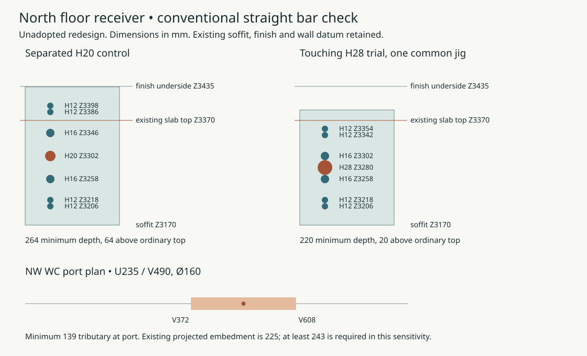

# Straight reinforcement for the north floor receiver

**Reject the straight reinforcement layout in the current 200 mm slab.** A local thicker slab could house a straight tension connection, but the northwest WC port would still need a developed force bypass. Keep the monolithic collar development open. This comparison does not change the reference floor, wall, roof or services. [Collar source](floor-portal-north-collar.md) · [Foundation splice and bar positions](studies/current-house-ground-ties.json)

## Split shear transfer from gravity

Give the slab-to-wall interface no concrete shear credit. In the original C30/37 and S500 comparison, use the same declared friction sensitivity of 0.6 and poor-bond stress of 2.1 MPa. From the **U190** receiving plane to the last admissible bar end at **U−35**, a straight H16 develops no more than **23.75 kN** normal to the plane. Angling the bars lengthens the bond path and reduces its normal component by the same ratio. Four bars therefore return just **57.00 kN** against the historical **95.16 kN** shear witness. They would require **375.62 mm** projected embedment.

Eight straight bars give **114.00 kN** under equal use of the available bond. Equal allocation of the historical action would require **187.81 mm** development from each side of the receiving plane, so the thickened deck would continue at least to **U378** before a developed mesh transition. This ignores local concentration. Preserve the actual exterior concrete face, 110 mm glass and 50 mm cavity. The interface must remain positive under reversal. A grade change, a lower measured bond or friction value, joint opening and the actual coupled force envelope require a new check. [Bond and spacing references](https://www.concretecentre.com/TCC/media/TCCMediaLibrary/Events/Online%20course/CCIP_EC2_Bridges.pdf) · [Placing guidance](https://www.concretecentre.com/TCC/media/TCCMediaLibrary/Products/Errata_How2_SecondEdition_Mar18.pdf)

Keep the ordinary upper and lower gravity mesh in both directions. On the old independent simple-span fields, NW-W and NE have **10.84 / 18.72 kNm/m** demand versus **48.31 kNm/m** in the retained H12 field. Their vertical reactions are **14.50 / 19.06 kN** over 860 mm. A true 100 mm-wide direct mineral seat would average only **0.169 / 0.222 MPa**. The bearing area comparison carries no vertical force through the straight shear ties. The seat, bottom-bar end development, crack and restraint conditions, fire boundary and construction order still require a coordinated detail. [Owning floor fields](studies/open-loggia-support.json)

## Fit the full deck stack

The existing wall-collector H12 tiers are 37 mm apart at the corner. At the level where a straight H16 crosses one set of longitudinal rails, the best independent passage within a 37 mm interval gives **4.5 mm** bare clearance to each rail and **−0.5 mm** after 5 mm combined setting. A coordinated new cage must also fit the floor chord and two directions of gravity mesh.

| Deck stack | Minimum height on Z3170 | Top Z | Result |
| --- | ---: | ---: | --- |
| Present H20 chord with separate H16 planes | 264 mm with 5 mm combined setting | 3434 | 1 mm below the finish underside before bedding or a real transition |
| Present H20 chord with independently set layers | 284 mm with 10 mm setting | 3454 | Above FFL Z3450 |
| Both H16 directions touching opposite sides of H20 | 212 mm | 3382 | Only 15 mm between the two H16 layers after 5 mm |
| Both H16 directions touching opposite sides of H28 | 220 mm with a common jig | 3390 | 23 mm between the H16 layers after 5 mm |
| Both H16 directions touching opposite sides of H32 | 234 mm with independent setting | 3404 | 22 mm between the H16 layers after 10 mm |

These heights allow **25 mm cover** and a **5 mm form allowance** at each soffit and top, with **21 mm** at unrelated interfaces. The ordinary orthogonal H12 face pairs have deliberate contacts within each pair. The H28 trial places the two H16 directions at **Z3258/3302** and the chord at **Z3280**, leaving 45 mm below the existing finish underside. At a true contact the shop jig and signed force path must provide the assumed relative setting. None of these ideal stacks includes closed link returns, the transition to the current collector steel or additional placement demands from existing inserts.

## Disposition at both northern corners

- **NE north wing.** Trial the eight straight bar stations at local V82/167/231/337/443/589/694/830. At the source-mapped H20 and comparison H12 uprights the nearest unrelated spacing after 10 mm is **22/25 mm**. Uniform tributary loading gives a **126 mm** worst tributary and only **0.51 kN** normal force reserve on its bar. This is a witness for the thicker receiver. It establishes no mesh, H10, enclosing link, end bearing or lateral stiffness result.
- **NW west wing.** The retained WC port is **Ø160 at U235/V490**. For 25 mm cover and a 5 mm setting, bar centres must lie outside **V372–608**. The two port-adjacent ties cannot both have tributaries below **139 mm** even with the minimum adjacent pitch. This takes at least **242.85 mm** projected bond, **17.85 mm** beyond the retained receiver, under the uniform comparison. Independent 10 mm setting raises the requirement to **255.95 mm**, a **30.95 mm** shortage. A three-H28 chord wrapped on the same inboard centroid at **U/V730** also crosses the retained port. Its nearest steel axis passes **13.61 mm** from the port centre. Do not move the WC or cut its opening to clear the reinforcement. Develop a positive collector around the port and into the actual wall, or retain the current route for further confinement work. [Live WC and floor port](../mat/whole-house-service-baseline.md)

The [independent west-wall gravity route](../mat/rear-wc-west-gravity.md) compares removing the northwest slab port while retaining the WC and shower. It leaves the receiver-depth and bearing requirements below in place.

The straight route can only reopen as a coordinated architectural rewind with a genuine thickened wall and floor receiver, positive port bypass, independent gravity bearing and developed end cage. A wider numerical cut through unchanged slab earns no additional anchorage into the supporting wall. Preserve the cabinet's wet and air boundary, the courtyard, loggia and roof independence. The signed 52-head and service-interface checks remain due on the adopted assembly.

Run `python3 -B project/str/studies/floor-portal-straight-receiver.py . --check` to reproduce the receipt and section.
