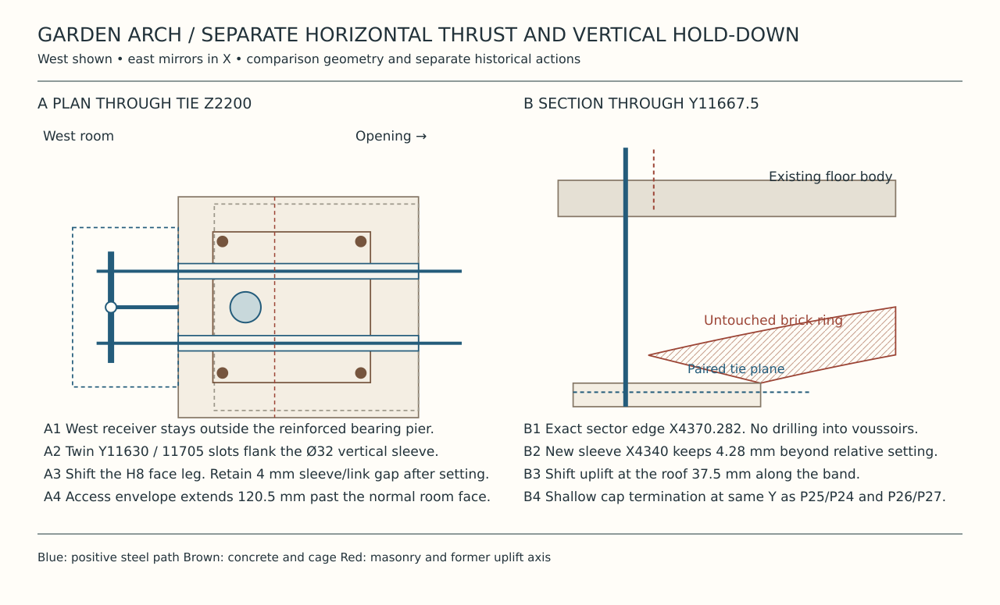

# Straight north hold-down with paired garden ties

**Develop the straight hold-down and paired garden ties as the preferred north detail.** This changes the lower pier cage and the existing centred arch tie. It removes the first-floor uplift dogleg, its lower access pocket and the foundation transfer back in Y. The 215 mm structural arch, skewback and occupied 50 mm transom depth stay at their existing levels. The new shoulder and access cover require coordinated owner review. [Existing collector and return](floor-portal-north-transfer.md) · [Captive pocket comparison](floor-portal-north-captive.md)



## Keep clear of the complete arch

The west extrados first enters the skewback at **X4370.282**. This is the minimum X over the full annular segment, derived from the outer-to-inner radius ratio at the spring line. A Ø32 sleeve with 10 mm relative setting must be **X4344.282** or farther west. The existing X4307.5 concrete face requires the centre to be **X4353.5** or farther east for 25 mm cover and 5 mm setting. The existing pier therefore misses by **9.218 mm** even before its links. The current centred vertical proposal crosses the voussoirs. Reject it in the unchanged pier.

Set the full-height vertical alignment at **X4340 / X7660, Y11667.5**. At the garden jamb widen the 212.5 × 215 mm west and east RC bodies locally to **250 × 230 mm** below the skewback, extending away from the opening and 7.5 mm to each axial face. The west side extends to **X4270**, with the west sleeve leaving **4.28 mm** beyond the relative setting to the annular ring. Mirror in X. Keep the 215 mm brick ring and its actual skewback. Widening uses 7.5 mm of each mineral shoulder if its finished faces stay fixed. If all 280 mm of the current wrapping section is needed, move those finished faces 7.5 mm each and reconcile the garden threshold, shelf, local ceiling and weather returns. The western concrete face is 10.5 mm into the room beyond the ordinary finished wall line. [Owning loggia geometry](../had/studies/open-north-loggia.json) · [Owning shoulder and soffit](../mat/loggia-soffit.md)

At the tie and nearest link levels, the west H8 legs run at **X4306/4470** and **Y11589/11746**. The principal trial H12s lie at **X4316/4460** and **Y11599/11736**. The inherited arch-side trial leg at X4485/Z2250 leaves only **16.1 mm** cover normal to the radial bevel after setting. Its highest valid level is **Z2237.25** while the upper hoop must be at least **Z2238** to clear the slot. Keep the upper hoop at Z2250 and shift that leg 15 mm roomward to X4470, with the enclosed H12 pair following to X4460. The new leg gives **26.9 mm** cover normal to the bevel. The remainder gives **27 mm** minimum face cover after 5 mm setting, and **4 mm** sleeve-to-nearest-link clearance after 10 mm relative setting. These are explicit geometric fit tests at the tie stations. Develop the shifted inside pair below the bevel and recheck the loaded cage and concrete. Set out and inspect the cage before casting.

Keep the existing gravity seat and floor load bearing. Take the uplift point 37.5 mm outboard in X along the raised north band, leaving the new local **1.25 kNm** eccentricity at the historical 33.207 kN action. The rejected first-floor dogleg needed **4.57 kNm** in Y. Connect the independent retaining shoe to the shifted line, keep the roof's sliding and normal restraints, and avoid intercepting the weather or air closure.

**Reject threading the straight sleeve through the current first-floor collector cage.** The canonical 140 × 750 mm section has a **30 mm** nominal lane between continuous longitudinal bars, shrinking to **20 mm** after 5 mm inward setting on each side. A Ø32 sleeve fails by **2/12 mm** before insertion clearance. Moving along X cannot escape these bars. Increase the local row spacing at least **22 mm** in total to retain a 42 mm lane after settings, giving **162 mm** minimum local core width if face cover is held. Treat this as a lower bound. Rebuild the local outer cage with the required bending bars and recast its transverse links, anchorage, shear transfer and finish around the sleeve. [Canonical floor collector](studies/current-house-floor-stops.json)

**Retain the 180 × 750 mm layout below as the placing failure control.** The [continuous north cage](floor-portal-north-cage.md) develops the larger local body, bend hoops and slab passage. Keep Z3170–3920 and the existing 200 mm floor around it, with zero additional downstand and at least 105 mm to the garden arch's highest bare extrados. Preserve eight H12 per face and locate the west sleeve in the straight bay X4278–4402. Use H12 axes Y11626.5/11708.5 with the existing row levels and trial closed H8 hoops at X4304/4376. The nearest new hoop leaves **6 mm** beyond 10 mm relative setting. Keep hoop pitch ≤100 through both returns. A 1:10 plan return to the ordinary row positions takes 200 mm per side, giving west **X4078–4602** and east **X7398–7922**. The nearest raw windows are **28 mm** away in plan on each side, with their raw sills **480 mm west / 280 mm east** above the unchanged collector top. The east trial crosses the solid rear-divider junction, whose continuity still needs development.

The 180 mm trial leaves **14 mm** to each H12 after the bar-side setting, below the **21 mm** aggregate/placing comparison. Keeping these assumptions requires at least **194 mm** of local width. Its same 1:10 transition reaches **42 mm** into each raw-window X range, so change the confined transition or concrete-placement detail before selecting a casting. Keep H12/150 floor steel clear in both directions. At the west, trial north–south lines X4265/4415 and east–west lines Y11568.5/11718.5 at the local support. The latter is just **10 mm** from the proposed outside collector row in plan. Do not stack those two bars in one level. Allocate a different layer or develop the collector bar as the floor boundary, with the altered floor edge and mid-height plan chords measured in that same three-dimensional cage. Nothing requires cutting the slab soffit. With both current finish lines held, 180 mm leaves only **7 mm** of the usual 27 mm inner finish and **90 mm** of the 110 mm outboard glass. Carry their existing depths by pricing the shifted room finish and the outer cavity/sill return. This is a layout reservation. Keep the routing adoption tied to load transfer and casting evidence. [Source panel and reinforcement](../mat/loggia-soffit.md)

The band still needs the altered uplift anchorage, verified bar development and operating travel. [Roof and wall-head control](floor-portal-fixed-wall-head.md)

## Divide the arch thrust without dividing its bearing line

Put two **10 × 40 mm** flat ties at **Y11630/11705, Z2200**. Each RC slot is **16 mm in Y × 48 mm in Z**, occupying Z2176–2224 inside the earlier 50 mm visible depth. The split produces **3.5 mm** spare to the vertical sleeve, **7 mm** to the nearest H12 and **12 mm** to the nearest H8 above or below, each after the 10 mm comparison. The inner running fit is separate. A nominal 1.5 mm liner leaves 1.5 mm on each side of the strap and 2.5 mm above and below. Use one fixture to control the two slots through both piers and confirm the straight shanks can run through those smaller true assembly gaps.

At the west, both ends pull on a crosshead free to rotate about a vertical central pin. Use equal **37.5 mm** arms and captive spherical seating at both tension tails. A centric fork fixed to a bearing plate transfers the sum to the west pier. At the east, a stiff fixed crosshead collects both tails to a centred pad. Keep separate live strap adjustment and thread locking. The free west pivot equalizes the forces through moment equilibrium. Both ends need a known friction and travel limit. The trial **±3.5°** pivot gives **4.58 mm** differential length adjustment to either side. With separately applied 40 K tie-to-tie differential expansion at 16 μm/m/K, the assumed effective length gives **2.32 mm** differential. The limiting friction moment for a 10% total-force imbalance is **0.112 kNm**. A strap slack or removed against its stop puts the whole thrust on the other strand and introduces **1.12 kNm** of transverse eccentricity at the historical thrust. Design the end stop for that condition and maintain an independent temporary thrust path during replacement.

| Separate historical arch-thrust comparison | Result |
| --- | ---: |
| Total thrust and each equal tie | 29.98 kN / 14.99 kN |
| Gross strap stress in the balanced case | 37.47 MPa |
| Pair axial stiffness and gross elastic extension at 3.63 m, E = 200 GPa | 44.08 kN/mm / 0.680 mm |
| 55 × 30 mm gross rocker strip bending | 68.13 MPa |
| Ø24 pin average double shear / distributed-bearing bending | 33.13 / 154.63 MPa |
| 150 × 150 mm pad average net contact pressure | 1.43 MPa |

Keep the fork lugs off the loaded rocker section. Use a separately machined tongue, cheek plates and retained pin. The gross checks omit threaded tails, clevis net sections, bearing contact, weld detail, preload, corrosion, actual fit and rotation under repeated differential movement. Use the selected material and its actual properties for those checks. The pads have their own local concrete stress, confinement and splitting checks. Reserve an **110 mm** outward hardware envelope from the widened pier face, projecting **120.5 mm** past the ordinary finished room face. Draw the demountable cover and prove withdrawal or reassembly in separately supported lengths. Keep the capillary, thermal, fire and air closures independent of the bearing faces. [Original arch action and tie source](open-loggia-support-study.md)

## Take the now-centred Y line to the cap

Both rods arrive at the same **Y11667.5** as the actual P25/P26 and P24/P27 beam heads. The nearest head is **160 mm** away in X. A centred bare Ø32 sleeve remains **24 mm** inside the bare Ø400 shaft outline, or **14 mm** after relative setting, before steel cover. The near cap instead carries a one-axis **5.31 kNm** eccentric demand at the old action. A signed lever comparison sends **29.88/3.33 kN** to P25/P24 and **30.26/2.95 kN** to P26/P27 under positive 33.21 kN, and reverses each under the negative test. Retain positive connections to both heads. That removes the prior need to close a second eccentric couple via P29/P31 for this isolated vertical force.

In the older west P25-region H22 cage translated 32.5 mm south to the current pile centre, the X4340 sleeve leaves **16.91 mm** beyond setting at Z−320 and **13.93 mm** at Z−340. At **Z−400** it fails by **7.21 mm** at starter P8. **Reject the deep straight continuation.** Use a shallow top-cap bearing termination above the bend and transfer into developed north-girder and pile-head bars. At the same X/Y, bound a **120 × 50 × 16 mm** bearing head at X4280–4400 / Y11642.5–11692.5 / **Z−316…−300**. The minimum exact segment-to-box check against all old starter lines leaves **10.03 mm** beyond H22 radius, 10 mm relative setting and 0.05 mm bend sampling allowance. Widening the same plate in Y to 60 or 72 mm leaves **5.44 or 0.16 mm**. Keep the narrower envelope rather than spend the alignment reserve. Lowering the 50 mm plate to **Z−356…−340** interferes by **8.63 mm** with P8 after setting. At the old 33.21 kN action a Ø36 central hole screen gives **6.67 MPa** mean net contact. It does not establish the actual compression stress field or steel connection. Develop a headed, integral or top-connected bearing assembly without a concealed bottom nut projection into the cage. Check the head, enclosure, local stress field, force development, coupled shear and return of the DPC and air barrier in that same Z section. The west historical screen supplies neither the current cage nor its east counterpart. [Grid, cap and starter evidence](studies/floor-portal-twin-garden-tie.json)

## Erect on independent support

Centre the brick arch until both straps, fixed receivers, centric rocker and controlled take-up are in effect. Retain the separate temporary supports until the measured load path is accepted. Provide restraint to the upper north wall before removing any construction braces. One trial reversible diagonal from each north head to the matching perpendicular wall/floor line at **Y10467.5** has 1200 mm run and 3170 mm rise. For the separate old façade witness it asks for **7.56 kN horizontally and 19.96 kN vertically**, **21.35 kN** along the brace. The floor still carries **1.38 kN** of horizontal reaction on that isolated free body. Design actual erection restraints, their reversible feet and on-site sequence against temporary actions. These numbers compare locations only.

The roof retaining shoe, continuous floor and jamb detailing, equalized tie hardware, shallow cap and physical test remain open. Then replay the complete signed roof, wall heads and collector with all 52 foundation heads. Keep STR-FLOOR-PORTAL open. [Operating north strip](floor-portal-north-transfer.md)

```sh
python3 -B project/str/studies/floor-portal-twin-garden-tie.py . | diff - project/str/studies/floor-portal-twin-garden-tie.json
python3 -B project/str/studies/floor-portal-twin-garden-tie.py . --svg | diff - project/str/studies/floor-portal-twin-garden-tie.svg
```
