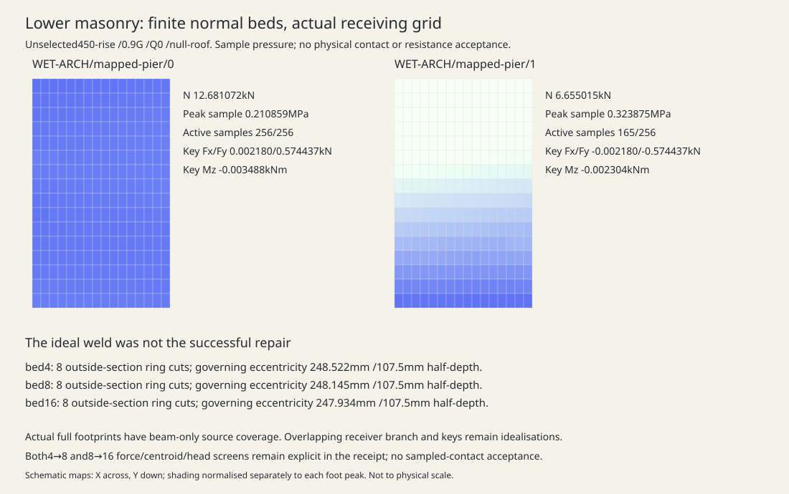

# Lower masonry normal-bed comparison

**The declared finite normal bed is not a successful repair of the fixed elastic lower-arch candidate.** All three actual450-rise reduced-gravity/null-roof comparisons retain eight ring cuts outside the215×140mm compression-only section bounds. Stop treating the ideal pier-foot weld as a sufficient explanation of the preceding failure. The tested bed is itself not numerically converged or physically qualified.

The actual current-source4/8/16-cell-per-axis runs keep RC200, the same floor/frame/roof laws, all52 foundation heads, actual source loads and physical mass. Their only physical-model change from the authenticated450-rise null-roof predecessor is the normal foot interface: independent footUZ/RX/RY carry compression-only finite-footprint springs into the actual contained grid members. The existing work-dual gridUX/UY/RZ traces remain explicitly **ideal positive keys**, not friction or qualified masonry/DPC hardware. Gauge coordinates carry no physical reaction. Exact beam-only source footprint partitions, sampled receiver identities, force/first-moment closure, arch/whole-house six-wrench balance, actual energy and unchanged inventory are retained in the [proof](studies/wet-masonry-arch-bed-proof.json).

| Bed cells per axis | Outside-section ring cuts | Governing ring eccentricity | North peak sampled pressure |
|---|---:|---:|---:|
|4|8|248.522mm|0.278375MPa|
|8|8|248.145mm|0.308836MPa|
|16|8|247.934mm|0.323875MPa|

The ring half-depth is107.5mm. The unmodified force/centroid/head criteria from the existing wet-bearing investigation fail both4→8 and8→16 monitoring screens. The actual lower finite-beam trace is generally non-affine; the old same-plane clipped-affine pad oracle is not applicable. No actual contact convergence, full-area contact, peak-pressure bound or masonry resistance follows from sampled states. Independent centred, eccentric, partial-contact triangular-pressure, uplift, missing-receiver/key and six-rigid-motion controls accompany the reusable method. Refining a numerical comparison that already fails its ring section bounds cannot be called a selected repair.



## Shared saved-document route

The optional `floorSection.lowerMasonryComparison` stores explicit execution, rise, masonry modulus, floor-bearing and normal-bed controls with stable object identity. The lower arch's complete source-bound geometry choices remain owned by `wet-masonry-arch-comparison-inputs.json`; the default is not an alternative house. The adapter consumes the **exact same saved native request** used by the ordinary floor stage. It never reads a retained request or response as a current fallback. Deferred execution returns that exact pending request; compute re-solves it through the existing additive adapter. Changed native loads, supports or laws change the assessed request identity; source/method changes invalidate evidence. Missing wet geometry, changed thickness outside the RC200 adapter and unavailable execution return explicit unsupported outcomes while preserving ordinary floor output.

The existing editor transaction, save/load and revision protocol admits an atomic complete lower-comparison edit with undo. This is a separately labelled candidate beside the ordinary beam/diaphragm response: no force, cage, mass or architectural result from one is silently combined with the other. The browser can submit the saved document through the existing engineering API; dedicated visual controls remain unimplemented. Physical masonry, tie/keys/beds, complete signed action families, force feedback into architectural/ground decisions and owner acceptance remain open. No whole slab, floor level, opening, crafted room or current house is selected.

The two earlier `slab-constitutive-compiled-control` bundles are immutable **historical shared-compiler execution snapshots**, already labelled with their executed-source identities. They are not current model inputs; no active solver consumes them. Their bytes and original method identities are preserved. The source account now classifies them as history rather than demanding that an old executed adapter hash equal a subsequently extended adapter. Current compilation continues to pin and execute current methods, and the actual shared-stage replay is checked against the authenticated native control. This is an authority correction, not a rebinding of historical execution to new code or retirement of an existing computation.

```sh
OPENBLAS_NUM_THREADS=1 OMP_NUM_THREADS=1 python3 -B project/str/studies/wet_masonry_arch_bed_proof.py --check
python3 -B project/str/studies/wet_masonry_arch_bed_test.py
node --import tsx --test compiler/reference-house/current-design-lower-masonry.test.ts
```

Replay authenticates actual captured requests/results, current source/methods and runtime, then regenerates the proof and figure. It executes no native solve. Explicit compute uses `wet_masonry_arch_bed.run` with the actual saved request, not this receipt. Failed global corner convergence remains independent of this local lower-wall comparison.
