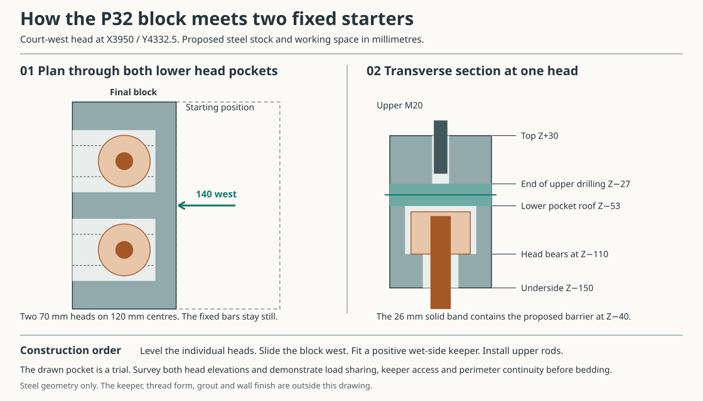
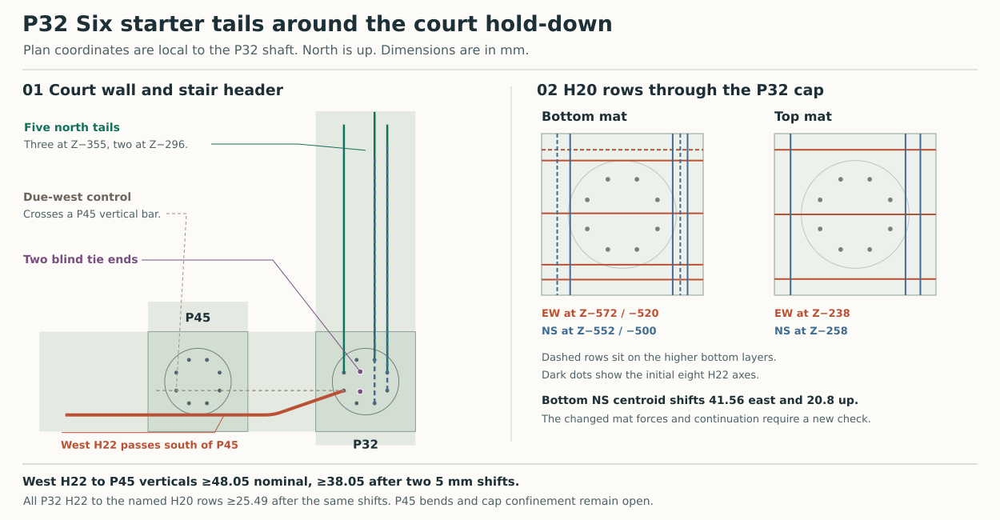

# Assembling the west court hold-down at P32

**Keep the two designated H22 pile bars. Change how the block engages them once the shaft reinforcement is fixed.** P32 has the largest uplift in the four-hold stripped comparison. Its 164.21 kN total puts 98.52 kN on one rod and 65.68 kN on the other at the trial 60/40 split. The 400 mm shaft is centred at X3950/Y4332.5. The two fixings lie 120 mm apart on the line X3917.5, 32.5 mm west of that axis. The other six H22 bars still have jobs in the shaft and cap. [Four-hold actions and original block](studies/current-house-ground-ties.json) · [Ground grid and adjoining beams](studies/current-house-grid.json)

The earlier 280 × 140 × 140 mm solid block had two upper and two lower blind sockets. A rigid block cannot screw onto two fixed parallel starters. Rotating about one bar by only 15° carries the other socket 31.33 mm away from its axis. The alternative is to assemble the original block with both formed bars free on a jig before placing the other six bars and closing the hoops. Turning the second bent bar with the six original bars already standing gives only 2.48 mm nominal clearance. Any prefabricated sequence must also work during cage lowering, casing withdrawal and pile-head preparation.

A straight non-rotating splice does not fit by substitution at the existing bend start. Leviat's international ET22 mechanical coupler is 248 mm long and 48 mm in diameter, with ten lockshear bolts. Only 15 mm of straight bar lies between the cap soffit and the start of the upper bend. Pushing the coupler down into the 400 mm shaft at the original bar radius leaves 35 mm cover to its bare body before bolts or the H8 hoop. The shaft comparison requires 40 mm cover. Changing the cap or bend is a separate design. The UK supplier distinguishes regional size availability. [Leviat MBT data and installation instructions](https://www.ancon.co.uk/downloads/83/Ancon_MBT_Couplers_International_Version.pdf.pdf) · [UK range](https://www.ancon.co.uk/products/reinforcing-bar-couplers/mbt-couplers)

## A side-entry block above the cap

Fit and level a separate 70 mm diameter × 50 mm deep round threaded head on each factory-prepared M24 lower end. Retain 45 mm of full engagement. The lower bearing faces are at Z−110. With the surrounding wall and bedding still open, carry the block 140 mm west from the court side. Its two undercut pockets engage the heads together, without rotating the block or the embedded bars. The complete trial sweep is X3847.5–4127.5/Y4192.5–4472.5. It stays at least 122.5 mm inside the 600 mm cap outline in plan, and the block's underside at Z−150 is 30 mm above the cap top. Provide temporary lifting and a surveyed seat. This plan envelope does not include a sling or worker.

The proposed 140 × 280 × 180 mm stock reaches Z+30 inside the wall. Each 84 mm head pocket ends at Z−53. A 42 mm slot below it clears the stem. The upper M20 blind bore ends at Z−27, retaining 26 mm of solid metal between the wet pocket and the upper drilling. At a 5 mm lateral setup error the head has 2 mm side clearance. Allowing for the terminal bend leaves at least 1.74 mm at the stem throat. The 7 mm of headroom is for assembly. The two load faces must be individually set to bear.

At a 5 mm transverse offset the circular head sits on unequal shoulders. Equilibrating the two contact patches gives 64.69 and 151.70 MPa under the most-loaded rod. For every offset through 5 mm, a conservative bound is 179.81 MPa. A 40 mm shoulder acting as a cantilever strip gives at most 148.68 MPa against the inherited steel comparison of 181.82 MPa. These are contact and strip models. Check the actual head, thread roots, three-dimensional block stresses, pocket corners, side restraint and material proof before fabrication. The original lower thread's tensile comparison transfers only if the new head supplies the full 45 mm thread, material, root area and engagement used there. No reduction in steel strength after processing has been priced. [Dimensions, loads and limiting contacts](studies/p32-court-hold.json)

Provide a positive wet-side closure at each pocket mouth and a positive lock on each adjusted round head. The keeper must prevent escape and rotation, remain accessible before bedding, and preserve the solid band. Its fastening and horizontal action still need design. The upper rods install while they are free to turn. If either lower head misses its seat, one upper M20 could see the full 164.21 kN against a 117.60 kN resistance comparison. For two equal axial stiffnesses *k*, limiting the higher force to 60% requires *k* times the initial seating mismatch to stay within **32.84 kN**. Verify levels, simultaneous contact and sharing under a controlled trial load before closing the work.

Return the upper damp-course sheet to the intact stock at Z−40, within the earlier Z−50 to −30 web band. Keep the pocket mouths, keeper and their fixings below the separating metal. Demonstrate the shop detail, perimeter joint, inspection and water continuity before adding the wall bedding, floor edge and finishes. Maintain separate bearing for the masonry and the rod load. The individual heads need no field-welded rings in the barrier plane. A successful local joint still leaves the common concrete grid and the three previously identified occupied-floor moisture routes. [Scope of the building's moisture break](../mat/envelope-disposition.md#trace-the-water-from-the-ground-to-the-room)

## Where the other six starters go

P32 has no east beam arm and only 382.5 mm to the south end. Retain the north court beam and west stair header as receivers. Five H22 bars turn north on two levels. Route the sixth, original bar 4, initially 19° south of west, allow 110 mm straight between the two 291 mm centreline-radius bends, then continue due west at Z−315 for the full 1,200 mm straight anchorage. Order it as a two-plane bar shape. The best single-angle straight trial retaining 50 mm side cover gives only 23.86 mm clear to P45's vertical-bar comparison. The two-bend route gives 38.05 mm after allowing adverse 5 mm displacement of each bar. Its 19° horizontal bend introduces a 54.56 kN change of force direction if this **separate H22** reaches its B500 design yield. Provide transfer and confinement in the stair header there. P32's hold rod force and its two H12 local ties cannot be reused at that bend.

| Named pair or group | Clear after two adverse 5 mm displacements |
|---|---:|
| All eight P32 H22 bars, including the two crank-shaped hold bars | ≥26.91 mm |
| Eight P32 H22 bars against the revised H20 mats | ≥25.49 mm |
| West H22 against the modelled P45 vertical bars | ≥38.05 mm |
| West H22 against named mats including the P45 crossing | ≥25.96 mm |
| Parallel H20 groups on P32 | ≥25.20 mm |

These distances bound continuous curves with straight segments and their maximum chord errors. The two orthogonal mat families have 23 deliberately tied contacts. The next nominal clear crossing is 12 mm. Check placing and consolidation through the actual three-dimensional cage. The P45 comparison uses vertical shaft-bar positions and the stated mat. Its real returns, closed cap hoops, side bars and fabrication sequence still need coordination. [Bar stations and closest pairs](studies/p32-court-hold.json) · [Source cage and bend comparison](open-loggia-support-study.md#further-nodehead-and-cage-correction-checkpoint)

The route changes the beam steel. The five bottom east–west H20s rise by 10.4 mm at their centroid and the five bottom north–south H20s rise by 20.8 mm. The three top north–south H20s drop by 20 mm. At the B500 design yield stress with a fixed compression resultant, those lever changes cost **7.10, 14.21 and 8.20 kNm** respectively. The relocated rows also shift across the beam. Recompute the affected members for their actual signed actions, transverse distribution and torsion before repeating the cage on another head. Shaft resistance, the six-bar residual bending duty, P45 detailing and geotechnical acceptance remain open. [Reproducer](studies/p32-court-hold.py)
