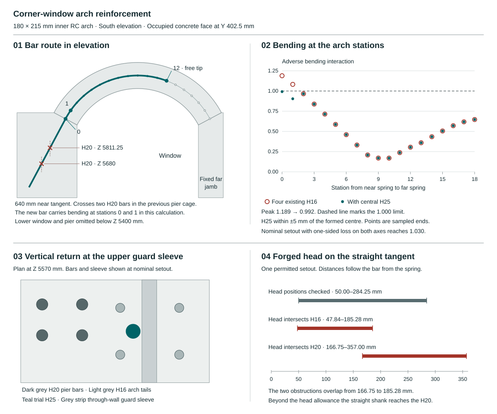

# A partial reinforcing bar for the corner-window arch

In the 180 × 215 mm inner concrete arch, the existing four H16 bars exceed the project’s bending limit at just two of the 19 sampled stations. Both are at the end supported by the corner pier. A single H25 bar at the section centre brings the highest adverse interaction from **1.189 to 0.992** when it can develop **98.2 kN** at that end. The bar can finish inside the arch. Its force transfer into the corner pier remains unresolved.

## Where the extra steel earns its place

For each of the eight windows, the calculation retains both bending magnitudes and the compression from the same signed load case and member end. The table gives the worst result over four stiffness and restraint comparisons, 96 roof wind programmes, both pressure signs and both locations and signs of the guard point. The model recovers 196,608 window responses across those controls. Its gross concrete stiffness, 25 kN/m³ reinforced-concrete gravity assumption, guards, crown, jamb foot and thermal section are those of the [180 mm width study](outward-arch-width-comparison.md).

| Station from corner pier | Existing four H16 | With partial H25 |
|---|---:|---:|
| 0, near spring | 1.189 | 0.992 |
| 1, first interior station | 1.082 | 0.904 |
| 2, next station | 0.966 | 0.966 |
| 18, opposite spring | 0.647 | 0.647 |

The four continuous corner bars retain their entire longitudinal torsion debit. The H25 receives up to 200 MPa in tension at stations 0 and 1, with ±5 mm setout relative to the centre of the adverse formed section in each bending plane. This requires setout from the measured section. If the bar stays on its nominal datum while one face takes the full 10 mm loss, the governing load case reaches **1.024** for radial loss or **1.030** for loss on both axes. Beyond station 1 the calculation gives the H25 zero flexural strength and deducts the concrete it displaces up to the free tip. The unchanged jamb reaches 0.712 bending interaction. Maximum adverse link demand across arch and jamb is 186.45 N/mm against the existing 191.29 N/mm comparison. Station checks do not bound intermediate extrema. The signed load path through the knee, pier and foundations still requires reconciliation. [Section solver and case recovery](studies/current-house-outward-arches.py) · [Station results](studies/current-house-outward-arches.json)

## Cutoff in the arch

The trial cuts the H25 at station 12, two-thirds of the way around the ring. The nominal curved length is 972 mm. A reduced radius and a 5 mm early cut leave **872.4 mm** from station 1 to the tip. At the study’s 2.1 MPa bond stress with its 5% reserve, developing 200 MPa in a 25 mm bar requires **626.6 mm**. The 245.8 mm difference exceeds one 215 mm ring depth. This is a length allowance. Curved bond, radial pressure (about 146 N/mm at the nominal radius and full bar force), transverse restraint and shear-induced tension shift need their own checks. No H25 enters the opposite jamb or its footing. The nominal steel inventory is **49.7 kg for all eight openings**. [Cutoff and bar quantities](studies/current-house-central-arch-detail.json)

## Anchorage at the corner pier

The H25 continues along the arch tangent for a nominal 640 mm. Inspection limits of 630–650 mm leave just **3.4 mm** of straight bond reserve at the shortest length. The unchanged near-pier H20 bars intersect the H25 at X1007.5/Z5680 and X1077.5/Z5811.25 in the representative elevation. Both crossings have a nominal steel overlap of 15.5 mm.

One trial shifts the outer H20 lane from 43 to 6 mm at the two affected stations on each arm of the L. Four bars move per corner pier. The shifted portion extends from Z5400 to Z5950, with 400 and 250 mm reserved for transitions within the widened pier band. On the stated centred form contraction and independent steel setout allowances, the calculated surface gaps are **6.5 mm** at the H20 crossings, **5.5 mm** to the existing arch H16s, and **3.3 mm** to the nearest H12 at the longest cut. These gaps only establish geometric separation for that setout. Assigning the full 10 mm form error to one side consumes another 5 mm. The H12 clearance bound then becomes −1.7 mm and separation is unproved. The proposed H10 hoop has 26 mm nominal cold-face cover, falling to **11 mm** with a one-sided 10 mm form loss and 5 mm link error.

Using the same 3,072 historical pier action cards and moment datum, the widened upper L gives 0.828 interaction before the four bars move and 0.813 in the proposed constant-lane section. That comparison excludes the cranks and new local H25 force. The next detail must place the cranks, transverse links and H25 restraint, show where aggregate can pass, retain the necessary cover and carry the 98.2 kN into the pier. House adoption remains open until that transfer is demonstrated. [Pier and anchorage calculation](studies/current-house-central-arch-detail.py) · [Basic anchorage relation, JRC workshop slide 7](https://eurocodes.jrc.ec.europa.eu/sites/default/files/2022-06/05_EC2WS_Arrieta_Detailing.pdf)

### Can the bar turn down before the pier reinforcement?

**Reject the vertical return with the existing cage and guard sleeves.** The H25 can turn towards the corner and fit on a nominal drawing. Its only possible vertical lane is **5.65 mm wide**. It disappears under the existing ±5 mm horizontal placement allowance, even with every wall-normal dimension exact.

The comparison keeps the H25 at local Y50 and credits bond only on the straight leg after the turn. The approach moves down and towards the pier from X1205.15/Z6050.59. A leg at least 626.57 mm long, wholly inside the widened band above Z5000, must begin at or above Z5626.57 and finish at or below Z5424.03. It therefore passes **both** through-wall guard sleeves at Z5430 and Z5570. The H16 and H20 uprights also cross these elevations. A route passing X1077.5 on its way into the pier intersects the original H20 at Y43. All remaining candidates have X between 1077.5 and 1205.15. [Bar, sleeve and anchorage coordinates](studies/current-house-central-arch-detail.json)

| Constraint on the vertical H25 centre | Nominal X, mm | X allowing independent ±5 mm horizontal setout |
|---|---|---|
| 25 mm clear of the parallel H20 at X1077.50, Y43 | ≥1124.48 | ≥1134.48 |
| 25 mm clear of the parallel H16 at X1144.12, Y9 or Y91 | ≤1124.39 or ≥1163.85 | ≤1114.39 or ≥1173.85 |
| Positive clearance to the Ø26 guard sleeve at X1195, approaching from the pier side | <1169.50 | <1159.50 |

For the parallel bars, the required horizontal centre spacing follows from the two bar radii, the 25 mm placing gap and the known separation in Y. Each pair can lose 10 mm of horizontal spacing through two opposed 5 mm setout errors. The through-sleeve needs only steel separation. Its other side lies beyond the spring. The left-hand nominal intervals already miss by 0.093 mm. The remaining interval, X1163.85 to 1169.50, would require independent horizontal errors below **±1.41 mm per item** before allowing for any other error. The figure is a necessary limit for this geometry. [Reproducible interval calculation](studies/current-house-central-arch-detail.py) · [Parallel-bar placing comparison](outward-arch-width-comparison.md)

A 300 mm centreline bend and 650 mm vertical tail put the H25 at X1166.67, midway in the nominal pocket. It clears the H16 by 26.29 mm and the sleeve by 2.83 mm. Under the stated setout, those clearances can separately fall to 22.38 mm and a 7.17 mm overlap. Changing the bend radius or the length of the incoming tangent cannot reopen the interval. At full bar tension the 28.07° turn would also impose an in-plane deviation force of 47.62 kN, with horizontal and vertical components of 46.20 and 11.55 kN. These describe a local change in force direction. Splitting resistance, confinement and the signed pier reactions require separate evidence.

### Can a forged head stop the bar ahead of the first crossing?

The Peikko PSB Single 25 has a 79 mm diameter forged head, 13 mm thick. Its B3 static assessment covers anchorage without bar bond in concrete of at least C30/37. The head-to-bar connection must be at least 50 mm from the start of a bend. The assessment leaves local crushing, bursting, spalling and transverse reinforcement to the individual design. At 98.2 kN the mean pressure on the gross head annulus is 22.26 MPa. [Peikko UK technical manual, March 2026, pp. 5–7](https://www.peikko.co.uk/products/product/psb-headed-anchor/) · [ETA 21/0463, version 3, Annex 1](https://media.peikko.com/file/dl/i/dmm3Bw/APPsD9JDzhrtdWsQePkoRQ/ETA_21_0463_PSB_Headed_Anchors.pdf)

**Reject this head on the retained tangent in the original cage.** The first H20 axis crosses the nominal tangent 271.25 mm from the spring. Even allowing the entire thickness of the head beyond that station gives a trial range of 50 to 284.25 mm for its full-diameter plane. Beyond that range the shank itself crosses the H20.

One permitted setout covers the whole range. Move the H25 by +5 mm radially and −5 mm through the wall. Move the cold-side H16 by −2 mm radially and +5 mm through the wall. Keep the H20 nominal. A chord across the head 27 mm from its centre meets the H16 for stations **47.84–185.28 mm**. A second chord, 2 mm from the centre, meets the H20 for stations **166.75–357.00 mm**. The witnesses lie within the actual heights of the vertical bars. The intervals overlap, so shortening the tangent cannot guarantee steel separation. This also rules out counting on a small placing gap around the head. [Head and cage calculation](studies/current-house-central-arch-detail.py) · [Dimensioned comparison](studies/current-house-central-arch-sheet.svg)

Further trials must change an interface. A smaller head needs its own connection and bond evidence. Changing the pier cage or the guard load path requires checking both arms of the corner, concrete access and signed reactions. The straight-tail trial above retains its separate cover and force-transfer duties.
