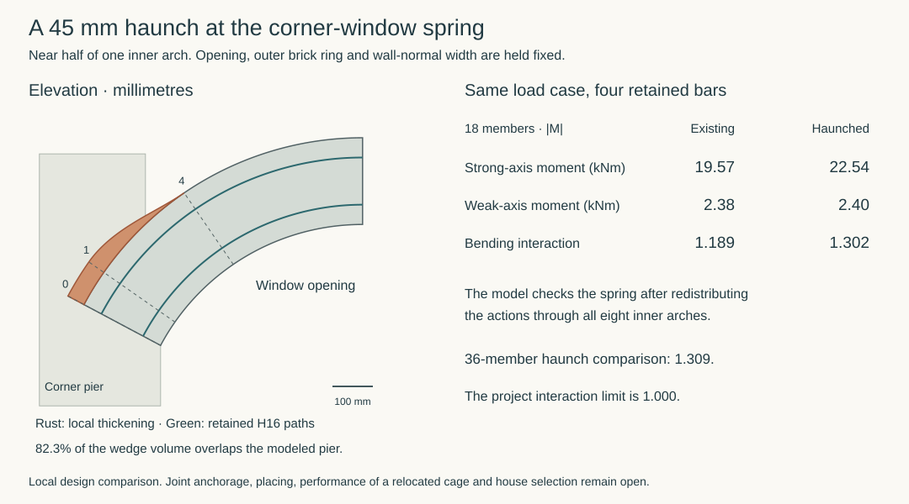
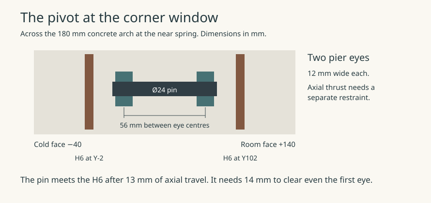

# A partial reinforcing bar for the corner-window arch

In the 180 × 215 mm inner concrete arch, the existing four H16 bars exceed the project’s bending limit at just two of the 19 sampled stations. Both are at the end supported by the corner pier. A single H25 bar at the section centre brings the highest adverse interaction from **1.189 to 0.992** when it can develop **98.2 kN** at that end. The bar can finish inside the arch. Its force transfer into the corner pier remains unresolved.

## Where the extra steel earns its place

For each of the eight windows, the calculation retains both bending magnitudes and the compression from the same signed load case and member end. The table gives the worst result over four stiffness and restraint comparisons, 96 roof wind programmes, both pressure signs and both locations and signs of the guard point. The model recovers 196,608 window responses across those controls. Its gross concrete stiffness, 25 kN/m³ reinforced-concrete gravity assumption, guards, crown, jamb foot and thermal section are those of the [180 mm width study](outward-arch-width-comparison.md).

| Station from corner pier | Existing four H16 | With partial H25 |
|---|---:|---:|
| 0, near spring | 1.189 | 0.992 |
| 1, first interior station | 1.082 | 0.904 |
| 2, next station | 0.966 | 0.966 |
| 18, opposite spring | 0.647 | 0.647 |

The four continuous corner bars retain their entire longitudinal torsion debit. The H25 receives up to 200 MPa in tension at stations 0 and 1, with ±5 mm setout relative to the centre of the adverse formed section in each bending plane. This requires setout from the measured section. If the bar stays on its nominal datum while one face takes the full 10 mm loss, the governing load case reaches **1.024** for radial loss or **1.030** for loss on both axes. Beyond station 1 the calculation gives the H25 zero flexural strength and deducts the concrete it displaces up to the free tip. The unchanged jamb reaches 0.712 bending interaction. Maximum adverse link demand across arch and jamb is 186.45 N/mm against the existing 191.29 N/mm comparison. Station checks do not bound intermediate extrema. The signed load path through the knee, pier and foundations still requires reconciliation. [Section solver and case recovery](studies/current-house-outward-arches.py) · [Station results](studies/current-house-outward-arches.json)

## Cutoff in the arch

The trial cuts the H25 at station 12, two-thirds of the way around the ring. The nominal curved length is 972 mm. A reduced radius and a 5 mm early cut leave **872.4 mm** from station 1 to the tip. At the study’s 2.1 MPa bond stress with its 5% reserve, developing 200 MPa in a 25 mm bar requires **626.6 mm**. The 245.8 mm difference exceeds one 215 mm ring depth. This is a length allowance. Curved bond, radial pressure (about 146 N/mm at the nominal radius and full bar force), transverse restraint and shear-induced tension shift need their own checks. No H25 enters the opposite jamb or its footing. The nominal steel inventory is **49.7 kg for all eight openings**. [Cutoff and bar quantities](studies/current-house-central-arch-detail.json)

## Anchorage at the corner pier

The H25 continues along the arch tangent for a nominal 640 mm. Inspection limits of 630–650 mm leave just **3.4 mm** of straight bond reserve at the shortest length. The unchanged near-pier H20 bars intersect the H25 at X1007.5/Z5680 and X1077.5/Z5811.25 in the representative elevation. Both crossings have a nominal steel overlap of 15.5 mm.

One trial shifts the outer H20 lane from 43 to 6 mm at the two affected stations on each arm of the L. Four bars move per corner pier. The shifted portion extends from Z5400 to Z5950, with 400 and 250 mm reserved for transitions within the widened pier band. On the stated centred form contraction and independent steel setout allowances, the calculated surface gaps are **6.5 mm** at the H20 crossings, **5.5 mm** to the existing arch H16s, and **3.3 mm** to the nearest H12 at the longest cut. These gaps only establish geometric separation for that setout. Assigning the full 10 mm form error to one side consumes another 5 mm. The H12 clearance bound then becomes −1.7 mm and separation is unproved. The proposed H10 hoop has 26 mm nominal cold-face cover, falling to **11 mm** with a one-sided 10 mm form loss and 5 mm link error.

Using the same 3,072 historical pier action cards and moment datum, the widened upper L gives 0.828 interaction before the four bars move and 0.813 in the proposed constant-lane section. That comparison excludes the cranks and new local H25 force. The next detail must place the cranks, transverse links and H25 restraint, show where aggregate can pass, retain the necessary cover and carry the 98.2 kN into the pier. House adoption remains open until that transfer is demonstrated. [Pier and anchorage calculation](studies/current-house-central-arch-detail.py) · [Basic anchorage relation, JRC workshop slide 7](https://eurocodes.jrc.ec.europa.eu/sites/default/files/2022-06/05_EC2WS_Arrieta_Detailing.pdf)

### Can the bar turn down before the pier reinforcement?

**Reject the vertical return with the existing cage and guard sleeves.** The H25 can turn towards the corner and fit on a nominal drawing. Its only possible vertical lane is **5.65 mm wide**. It disappears under the existing ±5 mm horizontal placement allowance, even with every wall-normal dimension exact.

The comparison keeps the H25 at local Y50 and credits bond only on the straight leg after the turn. The approach moves down and towards the pier from X1205.15/Z6050.59. A leg at least 626.57 mm long, wholly inside the widened band above Z5000, must begin at or above Z5626.57 and finish at or below Z5424.03. It therefore passes **both** through-wall guard sleeves at Z5430 and Z5570. The H16 and H20 uprights also cross these elevations. A route passing X1077.5 on its way into the pier intersects the original H20 at Y43. All remaining candidates have X between 1077.5 and 1205.15. [Bar, sleeve and anchorage coordinates](studies/current-house-central-arch-detail.json)

| Constraint on the vertical H25 centre | Nominal X, mm | X allowing independent ±5 mm horizontal setout |
|---|---|---|
| 25 mm clear of the parallel H20 at X1077.50, Y43 | ≥1124.48 | ≥1134.48 |
| 25 mm clear of the parallel H16 at X1144.12, Y9 or Y91 | ≤1124.39 or ≥1163.85 | ≤1114.39 or ≥1173.85 |
| Positive clearance to the Ø26 guard sleeve at X1195, approaching from the pier side | <1169.50 | <1159.50 |

For the parallel bars, the required horizontal centre spacing follows from the two bar radii, the 25 mm placing gap and the known separation in Y. Each pair can lose 10 mm of horizontal spacing through two opposed 5 mm setout errors. The through-sleeve needs only steel separation. Its other side lies beyond the spring. The left-hand nominal intervals already miss by 0.093 mm. The remaining interval, X1163.85 to 1169.50, would require independent horizontal errors below **±1.41 mm per item** before allowing for any other error. The figure is a necessary limit for this geometry. [Reproducible interval calculation](studies/current-house-central-arch-detail.py) · [Parallel-bar placing comparison](outward-arch-width-comparison.md)

A 300 mm centreline bend and 650 mm vertical tail put the H25 at X1166.67, midway in the nominal pocket. It clears the H16 by 26.29 mm and the sleeve by 2.83 mm. Under the stated setout, those clearances can separately fall to 22.38 mm and a 7.17 mm overlap. Changing the bend radius or the length of the incoming tangent cannot reopen the interval. At full bar tension the 28.07° turn would also impose an in-plane deviation force of 47.62 kN, with horizontal and vertical components of 46.20 and 11.55 kN. These describe a local change in force direction. Splitting resistance, confinement and the signed pier reactions require separate evidence.

### Can a forged head stop the bar ahead of the first crossing?

The Peikko PSB Single 25 has a 79 mm diameter forged head, 13 mm thick. Its B3 static assessment covers anchorage without bar bond in concrete of at least C30/37. The head-to-bar connection must be at least 50 mm from the start of a bend. The assessment leaves local crushing, bursting, spalling and transverse reinforcement to the individual design. At 98.2 kN the mean pressure on the gross head annulus is 22.26 MPa. [Peikko UK technical manual, March 2026, pp. 5–7](https://www.peikko.co.uk/products/product/psb-headed-anchor/) · [ETA 21/0463, version 3, Annex 1](https://media.peikko.com/file/dl/i/dmm3Bw/APPsD9JDzhrtdWsQePkoRQ/ETA_21_0463_PSB_Headed_Anchors.pdf)

**Reject this head on the retained tangent in the original cage.** The first H20 axis crosses the nominal tangent 271.25 mm from the spring. Even allowing the entire thickness of the head beyond that station gives a trial range of 50 to 284.25 mm for its full-diameter plane. Beyond that range the shank itself crosses the H20.

One permitted setout covers the whole range. Move the H25 by +5 mm radially and −5 mm through the wall. Move the cold-side H16 by −2 mm radially and +5 mm through the wall. Keep the H20 nominal. A chord across the head 27 mm from its centre meets the H16 for stations **47.84–185.28 mm**. A second chord, 2 mm from the centre, meets the H20 for stations **166.75–357.00 mm**. The witnesses lie within the actual heights of the vertical bars. The intervals overlap, so shortening the tangent cannot guarantee steel separation. This also rules out counting on a small placing gap around the head. [Head and cage calculation](studies/current-house-central-arch-detail.py) · [Dimensioned comparison](studies/current-house-central-arch-sheet.svg)

### Keeping the guard and moving the pier bars

Move both pairs of H20 end bars **50 mm along each arm towards the corner**. The wall-normal lanes stay at Y43 and Y97. This leaves the two guard sleeves, the room-side temporary barrier and the raw window opening in their original positions. The H25 can then return vertically on the **pier side** of the outer H16 tails. This is the preferred geometry for the next joint study. The placing route through the turn and the reinforcement that carries its local forces remain open. [Dimensioned plan and elevation, panels 5–6](studies/current-house-central-arch-sheet.svg)

| Check at one representative opening | Result |
|---|---|
| Upper pier cage | The end stations move from 745/815 to 695/765 mm along both arms. The lower 850/950 mm stations are retained. Two 400 mm centreline bends and a straight connect each lower bar to its new station between Z4450 and Z5050. |
| Temporary barrier and exterior guard | The cranks clear the 50 × 10 mm pin at the X980 room-side socket by at least 6.64 mm under the socket study's opposed 5 mm setouts, including the sloping bar within the pin's finite height. The H25 clears both permanent guard sleeves by at least 63.5 mm on the wider allowance below. |
| Vertical H25 | A 186.31 mm tangent and 225 mm centreline radius bring the bar to X1091, Y50 at Z5780.31. The 640 ±10 mm vertical tail gives at least 630 mm straight against 626.57 mm required. Its lowest tip stays 80.31 mm above the top of the H20 cranks. The eight H25 bars weigh 58.82 kg on nominal cut lengths. |
| Parallel-bar placing | Allow 10 mm relative steel error in each plan coordinate and another 5 mm for a differential formed datum. The resulting interval for the specified H25 centre is X1090.00–1091.78. At X1091 the guaranteed straight-leg gaps on these assumptions are 25.64 mm to the closest H16 and 26.00 mm to the closest H20. The interval is for choosing the nominal setout. The error allowances are already included. |
| Biaxial pier screen | On the same 3,072 historical action cards, the upper L interaction rises from 0.828 to 0.875. The governing card carries −125 kN with signed 394.38/−337.68 kNm at one corner. This assesses the constant upper cage only. |

The bend changes the placing decision. At 20° to vertical, one permitted pair of steel offsets leaves **22.33 mm** to the H16 upright, even with the form exact. Farther up, the incoming tangent crosses that upright in elevation. At X1144.12/Z5936.16 the H25 passes between the two H16s. Leave the H25 nominal and move each H16 5 mm towards it. **Both throats narrow to 15.5 mm at once**, even with the form exact. A 16 mm aggregate particle must go around the crossing on this allowed setout. The wider datum allowance permits a single throat to narrow to 5.5 mm. The drawn steel separation does not establish a connected placing and compaction route through the links. The unchanged H20 lanes also leave only 24 mm between an opposed pair after two adverse 5 mm normal offsets. [Calculation and finite steel geometry](studies/current-house-central-arch-detail.json)

At the 98.17 kN comparison tension, each H25 bend pushes the concrete **46.20 kN towards its window and 11.55 kN down**. Bond along its vertical tail pulls the concrete upwards. The perpendicular return delivers the same local components along the other arm if it reaches the same tension. These internal transfers need anchored transverse steel, a concrete compression path and the matching signed actions at the two openings. The existing H10 schedule supplies no demonstrated tie around the new H25. The H20 cranks introduce a further change of direction. At the historical 400 MPa steel cap the two profiles require up to 39.70 and 49.89 kN per bend per bar. Those maxima have no established simultaneous load case.

The 425 mm internal mandrel exceeds the 175 mm bar-bending comparison. The first-generation concrete bearing expression gives a required effective transverse distance of 18.66 mm at 98.17 kN and the study's 17 MPa concrete stress. The formed cage still has to supply that distance and the local confinement. The next joint detail must show those ties and their cover in **both arms**, trace a connected concrete and poker route, and retain access to the temporary and permanent guard fixings. Preserve the full-frame removal opening while making that comparison. [The Concrete Centre, *Detailing*, “Bearing stress inside bends”](https://www.concretecentre.com/TCC/media/TCCMediaLibrary/PDF%20attachments/Lecture-9-Detailing-PHG-A1-Rev-12-16-Nov-17.pdf) · [JRC workshop detailing comparison, slide 4](https://eurocodes.jrc.ec.europa.eu/sites/default/files/2022-06/05_EC2WS_Arrieta_Detailing.pdf)

### A transverse tie at the H25 turn

**Keep the current room face. Do not add a straight-legged horizontal U to this cage.** A two-legged H10 could carry the nominal horizontal resultant in steel, but there is no room for the room-side anchored leg to pass the H20 uprights and retain even a modest concrete cover. The wider comparison in panel 7 gives the reinforcement a price in occupied space and insulation.

The near-pier H10s lie at Z5754.5 and Z5903.0, on either side of the entire H25 turn. Place a trial tie halfway around the turn at **Z5834.88**, with the U opening back into the corner pier. In one arm, sharing 46.20 kN equally puts 294.1 MPa in each H10 leg. A single H10 or two H8 legs at the pier study’s 400 MPa cap give only 31.42 or 40.21 kN respectively. The same 2.1 MPa bond comparison and 5% reserve call for 368.57 mm straight development. A 375 mm leg would fail even the equal-share comparison if cut 10 mm short. A 55/45 split needs 405.43 mm on the heavier leg. Compare **425 ±10 mm** from X1135 towards X710, crossing both shifted H20 stations and leaving 9.57 mm at the shortest length for that split. The split is a sensitivity; force transfer through the intervening concrete and actual anchorage remain unverified. The separate 11.55 kN downward force, vertical tail bond and actions on the perpendicular arm still need their own paths. [Located bar and schedule calculation](studies/current-house-central-arch-detail.py)

| Trial in local wall-normal Y | Consequence |
|---|---|
| Straight room-side leg between H20 lanes Y43 and Y97 | Enclosing the Y50 H25 requires the H10 centre above Y82.5; passing inside the roomward H20 requires it below Y67. Both include the existing 15 mm relative allowance. |
| Pass the roomward H20 on its far side | The leg must exceed Y127. At the present face Y140 it leaves less than 8 mm nominal cover. Retaining the original H20’s **33 mm nominal room-side cover as a comparator** requires moving the face beyond Y165, more than 25 mm into the room. This is a geometric price, independent of a final exposure specification. |
| Symmetric widened U with legs Y−30/+130, centreline radius 80 | Faces Y−68/+168 give the same 33 mm nominal cover, consuming **28 mm of room and 28 mm of the remaining 70 mm glass** at this local section. The legs retain at least 3 mm steel separation from the H20s on the stated allowance. The semicircular nose retains at least 5.85 mm from both pairs of H16 uprights, including the intervals between samples. |

Widening the form buys steel separation at this section. It still allows the curved nose and one H16 to close to **12.53 mm** from opposed 5 mm steel offsets with the form exact. A 16 mm particle must go around that local throat. An insertion path for the poker, the other links, anchorage beyond both H20 rows and combined loads on the two arms have yet to be demonstrated. Prioritise the spring bearing or an integrated change to the main cage before spending these 56 mm of width on a stand-alone U. [Dimensioned tie plan, panel 7](studies/current-house-central-arch-sheet.svg)

### Can a dry bearing carry the present spring reaction?

**A compression-only seat on the existing cross-section cannot replace the continuous joint under its present actions.** Use the same near-spring member end that governs the H25 section at 0.992 interaction. This is wind programme 55, window 5 loaded and observed, point at X2240, positive point and pressure signs, 0.35 cracked EI, 0.25 L/upstand torsion factor, all lower bearings and the floor/roof yaw join. Compression is **18.36 kN** and the simultaneous strong/weak bending magnitudes are **19.57 / 2.38 kNm**. The source retains moment magnitudes for this signed case. Symmetric face limits apply to either moment sign. [Archived case recovery](studies/current-house-outward-arches.json)

Take a single plane perpendicular to the member axis, with the full **215 mm radial depth × 180 mm wall-normal width** available. Any nonnegative normal pressure has its resultant inside the face. Even at the extreme edge its strong-axis moment cannot exceed 18.362 × 0.1075 = **1.97 kNm**. The weak-axis bound is 18.362 × 0.090 = **1.65 kNm**. The demanded offsets are **1,066 mm radial and 130 mm normal**, against available half-dimensions of 107.5 and 90 mm. This generous bound allows concentrated edge loading before any concrete bearing limit. The same end also carries 1.90 kNm of torsion about the member axis; normal contact pressure on this plane supplies no such couple.

That failure belongs to the existing continuous model. The rotating-seat comparison below changes the support kinematics and recomputes the coupled reactions. The fixed-joint moments above cannot be assigned unchanged to the new interface. [Contact bounds and governing case](studies/current-house-central-arch-detail.json)

### Can a rotating bearing replace the reinforced joint?

**Keep a positively retained bearing as an alternative. Reject a plain compression seat at the existing spring centre.** Letting the inner arch rotate in elevation reduces its worst four-H16 bending interaction from **1.189 to 0.568**. The opposite jamb reaches 0.759. Neither member needs the partial H25 for the sampled bending checks in this idealisation. The reaction that the pier must supply, however, changes sign across the width of the bearing.

The trial keeps all eight 180 × 215 mm inner arches, their loadings, their opposite jambs and the existing window and guard positions. It releases only rotation about the through-wall axis at the near spring. Both other rotations and all three translations still transfer forces into the corner pier. The altered joints are included in the coupled house solve before recovering the member actions. Four stiffness and restraint comparisons each include 96 roof wind programmes, both aperture pressure signs and the guard load at either edge of each window. On this geometry the largest adverse arch and jamb link flows are 159.31 and 180.38 N/mm respectively against the existing 191.29 N/mm comparison. The knee, real pivot stiffness, opening movement and a finite fixing arrangement remain to be designed. [Released-joint model and signed reaction pairs](studies/current-house-arch-bearing.json)

| Stiffness and restraint comparison | Four-bar arch bending interaction | Lowest total seat compression (kN) | Lowest equivalent edge compression (kN) |
|---|---:|---:|---:|
| EI 0.20, pier torsion 0.15, all lower bearings, joined yaw | 0.338 | −0.04 | −12.24 |
| EI 0.35, pier torsion 0.25, all lower bearings, joined yaw | 0.513 | −0.77 | −12.51 |
| EI 0.20, pier torsion 0.08, two lower bearings, released yaw | 0.490 | +0.35 | −12.64 |
| EI 0.35, pier torsion 0.25, two lower bearings, joined yaw | 0.568 | −0.12 | −12.27 |

Each column is a separate extremum. For the actual joint comparison, take **one** simultaneous state from the third row. Wind programme 31 with negative aperture pressure and the negative guard-point load at X2240 on the east window of the north-east corner gives the following reactions. Each arm uses local X from the corner towards its opening, Y across the wall and Z upwards.

| Window on the same pier | Centre force X/Y/Z (kN) | Centre moment X/Y/Z (kNm) | Tangent-normal compression (kN) | Equivalent outermost edge forces (kN) |
|---|---|---|---:|---|
| East, centre Y10200 | +2.97 / +4.12 / −0.70 | −1.11 / 0 / +2.90 | +0.78 | −12.64 / +13.42 |
| North, centre X10200 | +2.82 / +3.29 / +1.42 | +0.01 / 0 / +3.01 | +2.58 | −6.54 / +9.12 |

Give a flat seat the full 180 mm wall width and allow its resultant to reach either edge. Across that width the two edge equivalents reproduce the normal force and its moment. Any non-negative contact pressure requires both equivalents to be non-negative. Even though the east arm has positive total compression, the required moment puts its resultant outside the seat. The perpendicular opening loads the same pier at that instant and also requires restraint.

Tilting this seat about its existing pin axis cannot cure the east-arm case. With width *b* in metres and forces and moments taken at the bearing centre, the deficient edge's components in elevation are `Fx/2 − Mz/b` = **−14.61 kN** and `Fz/2 + Mx/b` = **−6.53 kN**. Their projection is negative for every unit normal pointing towards the opening and upwards, including either limiting axis. This rules out changing the inclination of a single pressure-only face at that centre under the postulated kinematics. A rocking joint that releases another rotation, a moved pivot or a separate restraint changes the structural model.

The retained-bearing option therefore needs a physical couple across the wall, lateral and axial restraint, and anchored delivery into **both** arms of the pier. Its installed lever will be smaller than 180 mm. Keep the independent outer brick arch, window opening and guard replacement route when comparing that hardware with the continuous reinforced joint. The 12.64 kN edge demand and the monolithic option’s 98.17 kN bar tension arise from different load paths. Neither is an interchangeable anchor rating.

### Can a deeper arch keep the original four bars?

**Reject the 45 mm inner-concrete haunch with the four H16 bars left in their existing positions.** On the same signed wind and guard case that governed the original arch, the deeper spring attracts more bending. The 18-member comparison goes from 1.189 to **1.302** against the project interaction limit of 1.000. Refining the haunched arch to 36 and 72 members gives 1.309 and 1.307. One exceeded case is sufficient to retire this arrangement at the stated load and support assumptions. [Calculation and results](studies/corner-arch-haunch.json)

The 1000 mm opening, 300 mm rise, occupied face, 180 mm wall-normal width, far jamb and independent outer brick arch keep their present geometry. Deepen only the concrete outside the inner arch curve, from 215 to 260 mm between stations 0 and 1. A cubic taper returns to the existing depth with zero end slope at station 4, well before the crown. Keep the near joint continuous. The [rotating bearing](#can-a-rotating-bearing-replace-the-reinforced-joint) has different support conditions and its own restraint duty.

Recompute the centreline, axial and bending stiffnesses and torsional stiffness at all eight openings. Apply the existing dead, ceiling, pressure and guard actions at their original physical positions for each mesh. Moving the centroid changes the moment arm of those forces. The house, its piers and the opposite jambs respond to the resulting change in arch stiffness. The load case uses 0.35 cracked bending stiffness, 0.25 pier torsion stiffness, all lower bearings and joined yaw. It combines roof wind programme 55, positive 2.25 kPa aperture pressure and a positive 1.5 kN guard load at local X2240 on window 5. [Archived signed control](studies/current-house-outward-arches.json) · [Single-case recovery](studies/arch-haunch-card.py)

| Near-spring quantity, same load case | Existing, 18 members | Haunch, 18 | Haunch, 36 | Haunch, 72 |
|---|---:|---:|---:|---:|
| Strong-axis moment magnitude (kNm) | 19.57 | 22.54 | 22.53 | 22.53 |
| Torsion magnitude (kNm) | 1.90 | 2.04 | 2.11 | 2.14 |
| Interaction with the four bars retained, project resistance bins | 1.189 | 1.302 | 1.309 | 1.307 |

The four retained bars keep their existing lever arms from the opening, and the closed H6 loop keeps its original enclosed area. The increased torque therefore reserves more of the same longitudinal steel. Using the actual axial force instead of the conservative 2 kN resistance bins gives 1.301 on the 72-member haunch. The failure has substantial margin even at the actual axial force. [Section axes, torsion debit and signed resistances](studies/corner-arch-haunch.json)

The gross sector is **0.01558 m³ across eight windows**. By volume, 43.2% intersects the widened pier band below Z6200 and a further 39.1% intersects the narrower arm above it. The union with the nominal spandrel gravity territory accounts for 92.7% of the sector. The spandrel is represented by loads sampled at member midpoints. These geometric quantities cannot be charged as a net material addition or counted twice as stiffness. The comparison holds the existing pier compliance and external gravity field fixed while crediting the full haunch section to the member. A physical joint model must allocate the shared concrete once. [Geometry and overlap](studies/corner-arch-haunch-profile.py) · [Pier and spandrel control](studies/current-house-coupled-arches.py)

Moving the extrados H16 pair and enlarging its H6 loop is a separate proposal. At the constant-depth spring, the 72-member result for that section is **1.010** under the project bins, **1.006** using the actual axial force, and **0.997** if the remaining longitudinal-steel fraction is also left unrounded. Applying the same guard load to window 1 instead gives 1.013, 1.008 and 1.006 with the project resistance bins on the three haunched meshes. At 72 members, using the actual axial force and unrounded steel leaves 1.001. These small margins make the cage layout and numerical assumptions material. A favourable reading of either card cannot qualify the relaid bars. With an unchanged 80 mm return, the 45 mm radial move shifts the outer vertical H16 leg to X1104.41. Its surface clears the nearest shifted H20 by 43.91 mm under the earlier 15 mm relative-setout allowance, and 28.91 mm under a 30 mm challenge. A 75 mm radial move leaves only 17.44 mm even on the 15 mm allowance. Any relaid cage needs the actual curved H16s, closed links, bends, anchorages and placing gaps checked throughout the taper and both pier arms. [Setout comparison](studies/corner-arch-haunch.json) · [Shifted pier cage](#keeping-the-guard-and-moving-the-pier-bars)

### Can the pivot be fitted inside the end link?

**Reject a straight, side-withdrawn pin through the unchanged end cage.** Its through-wall axis is at local X1205.15/Z6050.59, on the centreline of the 180 × 215 mm arch. The first closed H6 lies at zero arch chainage. Its two radial sides cross the pin axis at Y−2 and Y102 and extend 69.5 mm either side of the axis. A full-width pin crosses both. The four existing H16s continue through this spring into 80 mm bends and 900 mm tails in the pier. Leaving those bars and the concrete continuous cannot realise the released rotation. A separated spring needs development on the arch side and new force paths into the pier. [Recorded cage geometry](studies/arch-width-geometry.py) · [End-link stations](studies/arch-link-schedule.py) · [Bar returns](studies/current-house-arch-detail.py)

Try a plain Ø24 mm pin from Y14 to 86. Two trial pier eyes occupy Y16–28 and Y72–84. The axle must couple to a separate arch-end shoe between them. The eye centres are 56 mm apart. At rest, the bare pin ends have 13 mm nominal clearance to the loop. Moving in either direction hits the link after 13 mm, before the 14 mm needed to disengage the first eye. The earlier 15 mm relative setout allowance also consumes the nominal static gap by 2 mm. These are pin-only bounds. Heads, bushes, thrust collars and tools require their own space. Casting the axle in before closing the cage does not give a renewal route.

Take the same two windows and signed wind 31 state as above. Treat each eye centre as a radial reaction line. From the two in-plane forces and two transferred moments about the spring centre, the X/Z reactions are fixed by equilibrium. The separate Y thrust still needs a reversible restraint. The last column moves the contact resultant across each finite 12 mm strip, covering any single contact line in each eye. Those numbers apply to this load card.

| Arm of north-east pier | Cold eye X/Z, kN | Warm eye X/Z, kN | Y thrust, kN | Largest radial resultant within strips, cold/warm, kN |
|---|---:|---:|---:|---:|
| East | +53.21 / +19.52 | −50.24 / −20.22 | +4.12 | 71.78 / 69.26 |
| North | +55.21 / +0.53 | −52.40 / +0.89 | +3.29 | 69.89 / 67.08 |

Both sides must be able to reverse. With 56 mm centre spacing, the north warm-side force normal to the spring face is −23.87 kN under wind 31. A second archived event, wind 10 with positive aperture pressure and the negative guard load at X1360 on window 1, puts the **cold** line of the same north opening at −23.26 kN and the warm line at +27.49 kN. That reversal also occurs in the east opening. A compression shoe on one side and one tension-only keeper opposite cannot reproduce both events. The eyes require a physical reversible restraint on both arms. [Reproducible signed force and contact calculation](studies/corner-pivot-pin.py) · [Two archived reaction states](studies/current-house-arch-bearing.json)

A separate recovery of all **196,608 signed window responses** gives peak cold/warm radial forces of **62.80/62.59 kN** at the eye centres, or **79.16/78.72 kN** when the single resultant in each eye can move across its 12 mm strip. The most tensile face-normal forces reach −52.00/−52.96 kN across the same choices. Each extremum has its own load case. The recovery matched the earlier 180 mm extrema and simultaneous neighbouring reactions for all four stiffness controls. It retains the released-joint kinematics and does not establish how a real bushing distributes pressure or transfers thrust. [Signed witnesses, method and reproducible audit](https://github.com/adamnoden/architecture/issues/1103#issuecomment-6730707191)

Moving the first H6 **30 mm along the arch** would clear the bare withdrawal cylinder locally. At the innermost link radius, the separation along the spring tangent leaves 1.90 mm after the 12 mm pin radius, 3 mm link radius and two adverse 5 mm offsets. The next existing link is at 53.98 mm. The shift takes confinement away from the end face. The nearby pier H10 has an elevation within 1 mm of the pin, but its exact return in plan still needs locating. Develop the arch-end shoe, ring reinforcement, concrete separation, pier anchors and reversible thrust path together before crediting the change. At Z6050.59 the actual window intrados is at X1330.47, so the pin axis lies 125.32 mm into the solid surround. Opening the window gives no straight withdrawal route on that axis. A removable room-side access pocket, or a different assembly sequence, must also preserve the cold-side insulation, cavity, window and guard. Pin and anchor resistance, installation and fatigue remain open.
