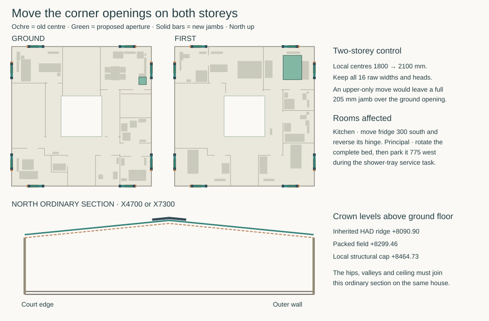

# A provisional structure for the pitched courtyard house

**SAP-C1's current coherent structural handoff is withdrawn.** The 10 November
[floor/portal review](floor-portal-interface-review.md) finds that the required
independent jamb movement crosses a continuous concrete floor collector with
no physical separation or bypass. The roof receiver also needs an actual
non-intersecting connection. The new
[STR-FLOOR-PORTAL correction](structural-architecture-programme.md#str-floor-portal--correct-the-floor-and-portal-load-path)
must resolve the joined load system before ROF-RWT-GATE or TRIAD-GATE can pass.
The original coherent-design exit is unchanged; a reproducible adverse model
does not satisfy it.

The following records the 9 November SAP-C1 candidate and its bounded evidence.
It moved all sixteen outer corner openings, carried both inner arches on
continuous jambs, retained the existing primary corner returns and raised the
roof collector's weather cap. The former corner spring and uninterrupted low
crown remain rejected. STR-RECONCILE retains its historical completion record,
not a claim that the present structural interface is resolved. The accepted
architectural source remains RH-LAYOUT-REVISION-02. Existing geometry and load
receipts may be reused only within their stated model, pending the correction.
[Exact input identities and sixteen occurrence changes](studies/reconciled-house-interface.json)
· [existing authority and change procedure](../triad-interface-contract.md#structural-direction-and-selection-compatibility)

## One house and two independent load systems

The candidate starts with HAD-WATER-REPLAN on main `d59be85e5aa06bfd3ec8abd26439ec1280025acf`. The machine-readable schedule binds fourteen local input blobs and the exact MAT slate prototype, including the RC200 floor, roof, room controls, window, G1 grid, P32 connection and the new structural calculation. Retain ground/first FFL 0/3450, finished ceilings 3100 above each floor and the 12 m square shell. The finish at the ordinary external wall is 429.5 from the weather face, including 27 plaster. The assumed intermediate slab spans Z3170–3370, with 80 above to first FFL and 70 below to ceiling. Those 80/70 mm zones include every finish and service layer at this candidate. The previous 20/22/238/55/15 timber-family section cannot be superimposed. [Occupied plan, furniture, opening schedule and section](whole-house-corner-rewind.md) · [RC floor, transfer and exception drawings](current-house-structural-reference.md)

The two pitched leaves deliver purlin and rafter loads to the continuous welded ridge, outer/court collectors and their 22 roof stations. The four outer RC L-returns, perforated floor diaphragm and its chords carry wind. The distributed upper stations connect to the floor edge, continuous perimeter girders and G1 shaft groups. Retain the real stair and court cuts, entrance header, north loggia transfers, trimmed rear wet well, four court hold-downs including the P32 block, accessible threshold and two independent court-water exits. Keep the SW elbow as a joined two-arm receiver. Do not count the 450 mm service bridges, partition linings, independent brick arches or the eight new portals as extra roof gravity supports. The g1 slate trial keeps the existing roof steel structure but loads its sector and corner supports separately from the regular roof fields. The eight portals **do** share lateral force with the building at the new normal ties. [Floor and upper ring](studies/current-house-floor-closure.json) · [existing roof members](studies/current-house-roof-route.json) · [P32 court restraint](studies/p32-court-hold.json)

Each new portal has two 205 × 180 RC jambs from Z−180 to the ring, two 215 × 180 curved heads and short integral knees. Their local stations are 1497.5/2702.5, mirrored at the far end. Carry direct gravity into the two real perimeter-girder spans. Each foot has a compression seat plus two-direction shear transfer into the girder. Its rotation is released for this comparison. Each jamb has a separate two-sided normal shear key into the RC200 edge at Z3370 and the steel ring at Z6600. With only two pinned feet the portal can rotate bodily about their common axis. A freestanding two-pin portal fails this stability test. Keep the independent L-to-jamb separation. The 132.5 plan distance can accommodate a 25 separation and 107.5 of intervening closure. Form its inner and weather seals for differential movement without a hidden hard mortar wedge.

For each lateral key use opposing positive bearing cheeks around a sliding plate. Set its moving blade on the jamb and connect the two-sided receiver to a cast floor-edge insert or welded ring web/diaphragm. The interface transmits both signs of normal force while allowing independent tangential and vertical movement. A 20-wide by 20-high blade with ±45 tangential and ±35 vertical reserved travel needs a 110 × 90 clear sliding field. It fits within the 205 jamb breadth and the 120-high interval about the ring centre. A rigid tongue across the corner, two-axis fixed bolt, friction grip or vertical bearing on the roof would change the model. Design the floor/roof connections for at least ±8/±3 kN and 2 kN/mm minimum working normal stiffness, including substrate and anchorage. The first-order elastic take-up at the peak is 3.84/1.38 mm. Keep the bearing plate, packing and captive hardware physically inside each formed receiver, with a removable room-side inspection cover. Work beyond this displacement field requires a different joint or a new calculation.

## What changes at the foundation and the window

The [two-storey spatial frame](studies/reconciled-corner-portals.py) uses all eight window orientations, measured sills and circular heads. The connected roof/floor model retains the perforated membrane, the original L-pier stiffness and the continuous ring’s bending between actual stations. It replaces wind on each entire 1410-wide bay, including glass, guard and solid wall, with the same force and first moment applied to the new returns. The remaining opaque sill and spandrel panels span horizontally between the solid jambs. The 200 kg closed window, 50 kg guard and 52.69 kg fittings envelope are separate masses. Gravity includes both storeys, actual floor field directions and ceiling tributaries. A single upper 1.5 kN crowd point acts at either true end of the guard, at local Z2790. The raised rectangular wind envelope to +8645.33 bounds the complete slate cap across each loaded face. It is 356.90 above the original structural wind projection +8288.42. The +8464.73 metal candidate is a separate predecessor.

| Simultaneous case family | Result across both cracked stiffnesses |
|---|---|
| 96 full/half-face and diagonal programmes × unloaded guard or one of 32 end/sign choices × two EI fractions | 6,336 coupled cases; 0.20 and 0.35 gross flexural/torsional stiffness |
| Gravity, wind and guard; each real portal foot | 14.77–29.99 kN compression; max 2.13 kN wall-normal shear; 0.31 kN along-wall |
| Normal reaction, floor / roof | −7.68 to +0.79 / −2.76 to +1.23 kN; signs use the inward local axis |
| Mounted face and opening | At monitored fixing/head stations, up to 1.43 mm departure from a three-point rigid frame and 1.30 mm tangential change; absolute normal travel at ties reaches 20.62 mm |
| Uniform roof suction, no favourable permanent weight, full wind and one optional guard | All 52 heads retain signed N, Cx, Cy, Vx and Vy. P06 reaches 523.11 kN tension and P12 reaches 530.22 kN compression, in different states |

The [signed foundation recovery](studies/reconciled-foundation-join.py) releases passive pads before redistribution and routes real roof reactions, pier couples, portal-foot forces and the 570 mm horizontal lever to the existing heads. Independent checks recover all three external forces and all three moments including the relocated guard point. Each head’s normal extrema identify its own wind, guard and direction. The portal-origin gravity record also conserves force and the two plan first moments. **Do not add its full gravity to the predecessor’s gross filled-wall, ceiling and floor budgets.** Before member/foundation sizing, replace those overlapping origins with measured quantities of the selected house. The stripped ledger is a complete named suction/wind case. The original aggregate gravity table, thermal movement, settlement, cracked stiffness and site resistance require their own combination and evidence. [Signed cards and local member envelopes](studies/reconciled-corner-portals.json) · [existing ground alternatives and rejection triggers](ground-interfaces-result.md)

### Build and renew the returns

Form the warm core at q222.5–402.5. Retain 70 glass insulation, the 50 drained cavity and 102.5 weather brick. Each brick head carries its own outer leaf and thrust into its masonry returns. Provide independent two-way lateral restraint and cavity tray, end dams and weeps. Keep weather pressure on the supported wall system and the guard on the inner RC. Keep four continuous H12 in the jamb at x±32 from centre and q260.5/364.5. Bring the four curved H16 head bars on separate q293.5/331.5 planes. The two radial centres are 49 from each arch face. At the spring, turn each existing tangent downward on an 80 centreline radius. On the near side the resulting vertical legs are x1547.35 and 1444.12, continuously within the real jamb. Mirror for the far side. Reserve 600 straight below the bend at each storey, including congested guard levels. The new bars remain at least 19 mm clear of a jamb longitudinal bar even at coincident x. The two H16 planes have 22 clear between bars. A wide outer knee link must enclose both returning legs, in addition to the normal jamb links. This locates real bars through the old spring failure. Anchorage length, bend/aggregate, closed-link torsion/confinement, tolerance and casting trials belong to the reinforcement designer before sizing or issue.

Turn the 50 × 10 barrier crosspin vertically in its central cast socket. The socket stem clears the H12 by 17.5 and the permanent 26 OD central guard bushing by 13 to the H12. Place H6 links 45 above/below those rows, including the full pin height. At the worst pin row 2 mm remains after two 5 mm allowances. Normal jamb hoop continuity and the upper tie inserts need a single all-steel drawing. Confirm the socket manufacturer's crosspin orientation and anchor force in this section before procurement. If a vertical pin is unavailable, form a captive embedded plate between the bar planes in the same work zone and reassess its force and cover. [Socket and collar geometry](studies/reconciled-house-interface.json) · [prior backed guard assembly and mass](studies/current-house-guard-bracket.json)

Use a positive 80 × 200 interior reaction plate and a central formed bushing at each of the two guard-receiver rows, Z5430/5570. A backed external arm must reach the guard’s actual bolt centres, 1675 and 2525 in the near case. The 177.5 mm lateral arm at each side introduces real local torsion, up to 1.43 kNm at the jamb in this model. Fit sleeves, insulation returns, outward drip and the permanent anchors as one cast set. Install the temporary barrier at Z950/1270 local before opening the window. Put it inside the shut sash, lower edge at least 730. At the rear-west opening the 150-deep boxing may occupy its existing area only below local Z170. That matches the IAS 150 × 170 boxing study and leaves 560 below the temporary panel and 780 below the low socket centre. The separate 110 stack in the full-height cabinet stays at X567.5/Y11177.5, 297.5 between the cabinet and the near socket. The 80-wide rear-north backing plate stops 63 from the wet partition at X2805.5. Form that 0.5 nominal finish meeting as one deliberately detailed T-junction. The front plate is reached from the room, without reaching through the partition. Support and test the wet branch in its own removable front; the box limit does not select a tray or drain. [Wet section](../ias/ias-03-bedroom4-wet-section.md) · [later drain and service access](../ias/ias-03-rear-drain-release.md)

Turn the principal bed and slide it 775 west for servicing, retaining 195 to the WC-pan export sweep. The occupied bed would overlap the parked pan by 65. Move the kitchen fridge 300 south and change its hinge as scheduled. Preserve the named Bed 2/3 south and Bed 4 north opening actions; retain the protected stair/front exit. The Study south window at 2100 has the checked rectangular sash, outward escape from its swing and 2080 under the crosshead after two tolerance allowances. An ordinary 200 kg renewal limit needs positive support during removal. Establish guarded exterior access before removing the frame or guard. Do not reintroduce tray export at the north-west window; the independent internal sectional strategy keeps that duty away from this bay. Equal raw areas preserve neither daylight distribution nor a statutory escape qualification. [Room and window actions](whole-house-corner-rewind.md) · [OAS north export result](../oas/north-export-occurrence-result.md) · [IAS stair route](../ias/ias-03-stair-renewal-reset.md)

### Close the roof shape and keep water independent

Carry the **Penrhyn Capital / supported Sarket prototype** as the governing section for this provisional handoff. Its proposed eave, field ridge and outer weather cap are **+7418.42 / +8409.33 / +8645.33**. The 25° pitched steel frame, original ridge tube and one-sided structural saddle stay at their existing datums. The continuous higher cap cannot be welded across that hinge. The earlier metal field +7308.55/+8299.46 and cap +8464.73 fit its thinner layers; adopting that silhouette for slate would lose 180.59 mm at the crown. The slate prototype is not an approved material specification. [MAT source and measured section at immutable review](https://github.com/adamnoden/architecture/blob/53c6ad32f3acddc43461b2b4309876ebef9038a0/project/mat/ring-roof-family.md) · [roof / support source receipt](studies/reconciled-slate-roof.py)

The roofing trial counts **5.215 t of severe-exposure Capital slate** on the actual courses. Its 9.50 kg/m² average allowance in the distributed field cannot pay a local ridge or valley reaction without a load path. The **1.706 t** of lead includes 1,039.94 kg of ridge cheeks plus 215.53 kg of crown roll, 157.65 kg of outer hips, 204.45 kg of lined valleys and 88.17 kg of saddle/terminal blanks. The full 31 m ridge therefore carries 40.50 kg/m; the valleys carry 14.30 kg/m. Each cheek is about 520 kg around the complete ring. The two cheeks plus roll are 1,255.47 kg, or 627.73 per flank under an equal roll split. Preserve the difference between that total, the load of one replacement piece and the pressure on an individual rail.

The [sector calculation](studies/reconciled-slate-roof.py) applies the ridge mass to all twelve actual ridge spans, distributes diagonal loads to the crown and heel with their real cantilevers, and reserves one blank at each of the four crowns, outer hip ends and inner valley ends. The 22 ring-support reactions for this **separate** origin total **16.7334 kN characteristic**, each +0.327 to +1.184. The whole 5.215 t field and the 1.706 t specials are already charged once within MAT’s complete field choice. Do not add them to the earlier uniform roof allowance. Price actual per-course/rail gravity, clipping, wind/snow uplift, the limited 406 mm cold posts, local plateau/valley and family-specific maintenance loads at detailed sizing. The 75 mm enlarged court overhang adds 0.9075 m². Its independent **−2.041875 kN** roof-suction increment acts at the true cantilever eave and enters the 52-head stripped cases, without favourable lead weight.

At the slate curb use the 250 wall, 360 board cut and 520 drip offsets. Use 160 gross court intake, 60 lower cross layer and 50 raised upper rails with the stated 10 drape. Carry the 200-wide wet valley pan on its continuous base, independent of the underlying watertight sheet and the dry ventilation channels. The 1250-wide transfer field has 55,000 mm² against 51,000; the former 1000 band has only 45,000. Cross-ventilate the cap independently at its opposed ports and return all four capped corners within the +8645.33 profile. Shelter and independently drain the dry intakes without penetrating the valley invert. The earlier metal control’s 40 gross screened side slots and 3.030 m diagonals remain a separate comparison. They do not qualify the slate valley or dry cap. The qualified cover, strong valley membrane, fixation, runoff destination, scaffold and materials remain ROF/MAT/RWT/DEL decisions. Normal inward roof runoff becomes 3.0816 L/s; the simultaneous roof-plus-open-court failure demand stays 3.60375 L/s.

Keep roof posts, warm-side hip closure and vapour returns distinct from weather-side ventilation. Retire the compact 0.637 mm near-touch sleeve/packing combination. Reserve a locally formed warm-side sealed inspection box around the complete hip foot and packing; no horizontal sheet runs in the gap between them. Its dry inspection face can use the eave structural zone. A final box reaching the occupied ceiling or insulation instead requires a new local section before adoption. [Earlier roof layers](../mat/ordinary-eave-joined.md) · [SW collar obstruction](../mat/sw-hip-collar-fit.md)

Keep both court exits, external staff landings and the fail-safe drainage duties. An architectural receiver that occupies the full 450-square roof-maintenance chamber cannot be granted clearance by this structural packet. The separate HAD-COURT-INTAKE gate must locate that chamber, vehicle/component exchange, ramp and dry staff route before shared house selection. The new court geometry can remove or move a local support, with new bridge spans, chamber sides, ground reactions and access. No court-frame foundation or P32 location is adopted by this structural pass. Retain the registered case only while its actual support geometry persists. The G1 deep grid remains conditional on actual site, roots, heave, shaft resistance, clear void and safe excavation. Do not lower the external grade or count a water receiver as dry access to make the section fit on paper. [RWT programme](../rwt/rainwater-systems-programme.md) · [ground/threshold limits](ground-interfaces-result.md)

## Receipts for the next decisions

| BCR obligations | Disposition and owner |
|---|---|
| 001, 027 | SAP-C1 names the source and owner at every changed interface. HAD selection or an explicit successor activates migration. DEL retains issue, product and procurement responsibility. |
| 002, 003 | The dated G1, paired-jamb, normal-key and 52-head model locates numerical force transfers; it does not resolve the physical floor/jamb join. STR-FLOOR-PORTAL must correct that load route and regenerate affected reactions and movements before selection. ER-STR-01 retains whole-design sizing and movement, subsoil, bearing and positive-tie acceptance. |
| 004, 005, 006 | Retain the protected stair, entrance void, RC edge and independent guards. Preserve the wall/ceiling boundaries around each formed sleeve. Fire resistance, acoustic flanking and vibration need assembly-specific evidence. |
| 007, 008, 009, 010 | The west low box fits below the temporary barrier, the north T-return preserves backing-plate access and the full stack stays in its cabinet. IAS must select and test the complete drain and protected wet floor/well, including failure discharge and reinstatement. |
| 011, 012, 013 | Permanent structural zones are marked at the court, plant and eaves. No new service bore, floor void, duct or electrical capacity is credited. MAT/IAS retain plant replacement, heat/vent performance and isolation. |
| 014, 015, 016 | Raised field/cap, independent hip and valley air paths and 450 bridge roles are explicit. ROF/RWT/HAD must join the actual wet roof, court intakes, accessible threshold, site discharge and first harm. A door crest alone does not establish those performances. |
| 017, 018, 019, 020 | Jambs, room-side sockets, permanent guarded mounts and 70 glass/50 cavity fit the reference bay. OAS/MAT provide movement/tolerance allocation, dry membranes and cavity drainage, verified thermal/moisture performance and construction drying. |
| 021, 022 | Four-bedroom occupancy, furniture and window actions retain separate ordinary and service states. OAS/HAD still select products, hardware, guard/security, light and escape operation under the applicable use. |
| 023, 024, 025 | The receiver rows, barrier, working faces and ordered frame renewal are located. Commission the actual anchors and complete rig with its independent landing, safe load transfer, reversible reinstatement and testing before use. |
| 026 | Keep the conventional lower-risk comparator: a conventionally headed, paired-jamb opening and independently maintained outer leaf. If the reinforced arch and guard renewal no longer justify their complexity at selection, change that head explicitly; do not preserve an unsupported spring for appearance. |

These are candidate receipts for the existing [BCR matrix](../bcr/construction-resolution-matrix.md). BCR-PREFLIGHT retains authority over integrated technical resolution. Replay **OAS-DETAIL** at the moved Study and rear occurrences, including the differing sill, actual mounts, exterior access and room return. Replay **BAY-FRONT-STUDY-01** at GROUND / outer-south / south-window-0 / centre 2100. Replace its 1800 axis, historical intermediate timber depth and old desk/handle references with this plan, RC200 section and operable sash. The rear tray-export rejection remains occurrence-specific. [OAS representative detail](../oas/representative-detail-completion.md) · [BCR construction bay](../bcr/bay-brief-result.md)

**ER-STR-01 / EPR-REFRESH** receive this identity, the negative old crown/spring, the paired-jamb load cards, the uncredited G budgets, actual support movement and the uplift demand. **PHY-APPLICABILITY** receives a new two-storey edge/portal and backed-guard specimen definition, load paths and limiting movements; a former timber-floor or unguarded bay specimen cannot validate it. **HRS** imports the chosen source only after HAD and the relevant roof/water decisions have reconciled the same plan and section. Record the slab/ceiling, aperture, bed, fridge, roof silhouette, drain, exterior access and source IDs together. No current study author can issue the house, certify the court intake or procure an assumed shaft. [EPR applicability and review questions](../epr/current-house-review-applicability.md) · [PHY release boundary](../phy/current-house-prototype-applicability.md)

For the manuscript, the [Repose structural-reading passage](../../docs/manuscript/principle-08-repose.md#structural-reading--bounded-hypothesis) already treats felt stability as a bounded hypothesis. The room can look structurally legible while its concealed spring is in tension; the owner’s response is testimony, not a load test. The [permanent opening pattern](../../docs/patterns/permanent-opening-replaceable-door.md) earns an illustration of the fixed jamb and independently removable barrier/guard/frame; it does not establish the service life of those components. The [G-01 plan/section/elevation grammar](../../docs/grammar/g01-plan-section-elevation-coupling.md#section-is-often-the-mediator) now has a specific modern example of why moving only an upper opening can put its entire structural jamb over a lower void. The equal-area changes also move a bed and refrigerator. These illustrations do not establish a general preference for compression, symmetry or a particular material.
