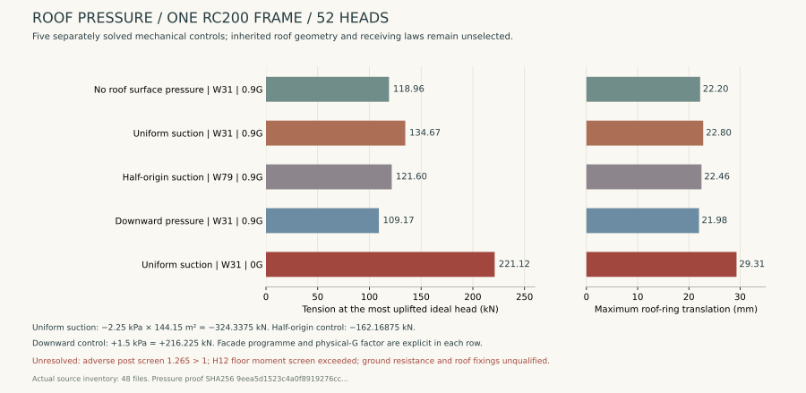

# Signed roof surface-pressure integration

The current straight-frame comparison can apply signed equivalent **plan** pressures to the actual tied-roof row origins and solve them with the same RC200 floor, receiving paths, grid and 52 heads. This adds a load capability; it does not select the inherited roof geometry or qualify a site wind/snow case.

The [five-case receipt](studies/roof-surface-pressure-proof.json) binds the corrected 48-file source inventory, including all 18 physically participating plate/beam traces. The native baseline and uniform-suction controls are reused only after exact source and complete authored-request equality; the [three additional controls](studies/roof-surface-pressure-extra-proof.json) were solved separately. Both input receipts are bound by portable repository paths and exact file hashes. Every case independently reconstructs all 52 head forces and moments. Earlier orphan-coordinate results are invalid for this coupled load path.

| Executed control | Roof pressure, down positive (kN) | Facade programme | Physical-G factor | Minimum head compression (kN) | Roof-ring translation (mm) |
| --- | ---: | ---: | ---: | ---: | ---: |
| No surface pressure | 0 | 31 | 0.9 | −118.96 | 22.20 |
| Uniform suction | −324.34 | 31 | 0.9 | −134.67 | 22.80 |
| Half-origin suction | −162.17 | 79 | 0.9 | −121.60 | 22.46 |
| Downward pressure | +216.23 | 31 | 0.9 | −109.17 | 21.98 |
| Uniform suction, no physical G | −324.34 | 31 | 0 | −221.12 | 29.31 |

The uniform suction and downward edits change the actual 52-head response by up to 24.4234 and 14.2565 kN/kNm respectively, while physical G remains 2476.872718 kN. Their added external force and three moments match the independent pressure-origin wrench within 5.5 × 10⁻¹² kN/kNm. These are numerical load-path results, not passing resistance checks.

**The adverse design is unresolved.** Uniform suction with zero physical G gives a necessary post section-screen ratio of **1.2652**, above one, at `court-north/west/A-post/22`. Its simultaneous compression is −37.3119 kN with moments 13.1677/18.3604 kNm. The three additional controls produce floor bending-plus-twisting inspection peaks of 70.920, 71.790 and 71.624 kNm/m, above the H12/100 trial's 49.672 kNm/m screen. The first two govern a 15 mm cell beside the corner-L strip; the adverse case governs a 25 mm cell near the east perimeter. Local stress convergence is unproved. Revise the real section/anchorage and validate the local plate recovery; neither a global slab rejection nor an automatically accepted denser cage follows from these screens.

The separate native occupied-floor Q2 control reaches 79.462 kNm/m and must also govern any subsequent reinforcement redesign. A 15 mm finite-element cell is not evidence of a 15 mm physical aperture ligament: this corner cell lies between the L-patch and perimeter-band mesh cuts, with solid slab continuing inward. Grid and cap local cut rows remain elastic `K·u` comparisons with distributed-load subtraction absent; they are not qualified physical G member actions. Global head equilibrium and the roof's recovered local load vectors are reported separately.

`roofCoupling.roofSurfacePressure` is nullable. An authored control contains `kind: "authored-equivalent-plan-pressure-control"`, signed `uniformKPa` (positive down, supported source comparison range −2.25 to +6.3), and all 108 source-derived `rowMultipliers` in the range 0–1. Row IDs are `ROOF-ROW/<frame index>/<row index>`. Multipliers describe executed row patterns, not independent extrema combined into a fictitious simultaneous case. The facade `windIndex` remains a separate authored input.

The [pressure method](studies/roof_surface_pressure.py) reads the existing 12-frame × 9-row source, including signed overhang positions. Its 144.15 m² plan area gives −324.3375 kN at uniform −2.25 kPa and +216.225 kN at +1.5 kPa. Those are mechanical controls, not qualified suction or snow values. No new geometry, stiffness, ground restraint, weather weight or favourable gravity is introduced.

Actual row forces use the existing finite-outer/released-inner member work maps before roof condensation. Origin forces and all three moments must equal the retained-ring wrench; independent physical-origin virtual work must also agree for all six rigid movements. The same condensed loads enter the existing house solve. Recovery combines actual steel body loads and signed row loads before subtracting equivalent member loads, so the 24 primary-half cuts are consistent with the solved state. Local released bending and free tails remain explicit.

The pressure, facade P2/crown and physical steel-G ledgers remain separate. Saved source identities include the new method; stale cases fail through the existing source binding. `siteWindQualified`, `siteSnowQualified`, `facadePressureCorrelationQualified`, `candidateAccepted` and whole-house acceptance remain false. Ordinary lower P0, actual weather layers and local positive/negative fixing resistance remain open.

Run the component checks with `node --test project/str/studies/roof-surface-pressure.test.mjs`. Run the five actual joined controls with `OPENBLAS_NUM_THREADS=1 OMP_NUM_THREADS=1 python3 -B project/str/studies/roof_surface_pressure_proof.py`. The latter executes default-null, uniform suction, a half-origin suction pattern with courtyard programme 79, positive plan pressure, and suction with zero physical G. It reconstructs the complete head wrench independently and writes only computed outputs.

The producer isolates each solve and preserves per-case checkpoints. To avoid repeating the two native controls, run its `--extra-only` mode, then `--join-native <fresh native proof> <fresh extra proof>` after the output path. The join rejects stale sources, producer hashes and any changed request field. Render the chart with `python3 -B project/str/studies/roof_surface_pressure_view.py`; its SVG metadata binds the complete pressure receipt, all 48 source identities and the view method. The canonical [integrated support drawing](studies/masonry-frame-a-roof.svg) remains the computed native baseline view.
