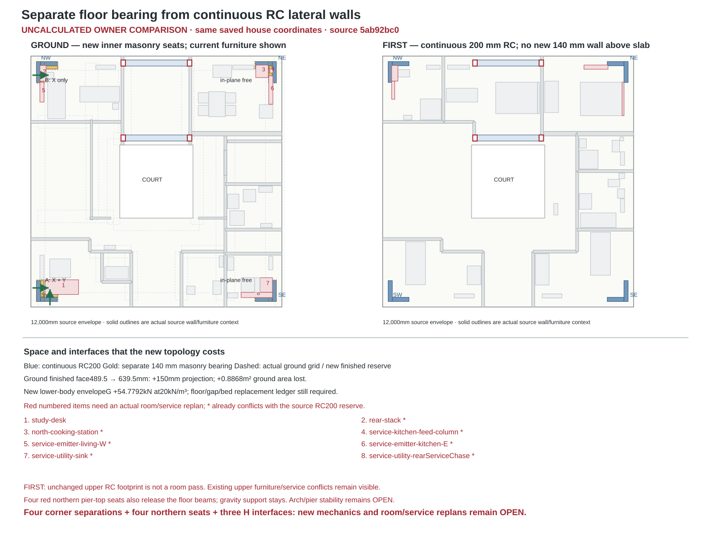
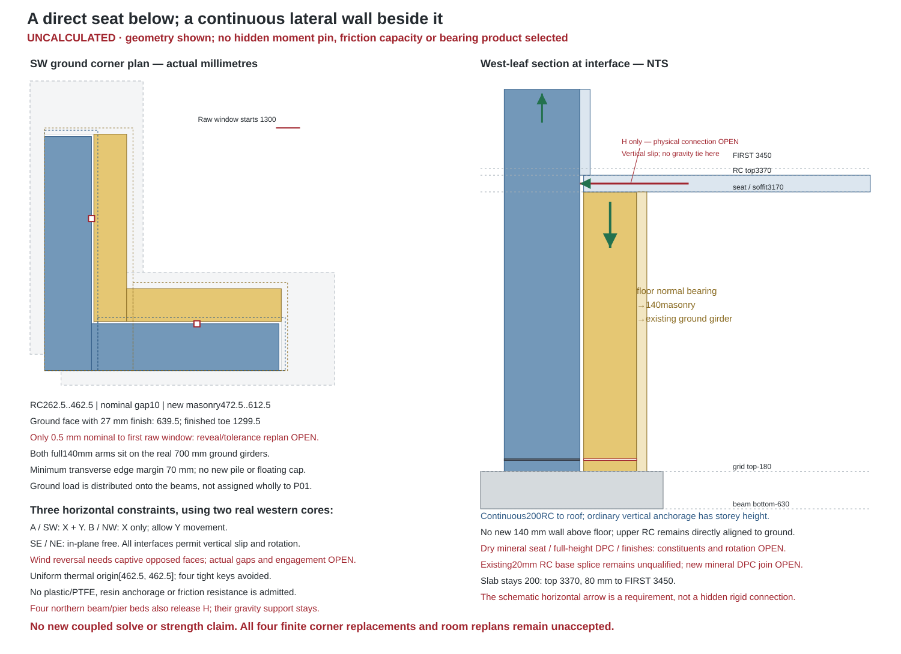

# Separate floor gravity bearing from continuous RC lateral walls

**Develop this complete-system comparison before spending more on dense RC200 tail packing.** Four inner masonry L seats can carry the floor directly while the existing outer RC200 walls continue through the storeys to their actual base splices and roof. The cost is real: 150 mm more ground-room projection at each corner, 0.8868 m² lost overall, and room/service replans. This is not an adopted house or an accepted three-restraint connection.

The figures derive from nine exact source blobs at saved-house commit 5ab92bc0cf8e88a0f5ea700ba065c2552348c4f3. They are not generated imagery. [The source-only producer](studies/separated_floor_bearing.py) reads [explicit comparison inputs](studies/separated-floor-bearing-inputs.json), including the actual portal geometry and pressure functions. Both Chromium renders were inspected. [Hosted proof45845397462](https://github.com/adamnoden/architecture/actions/runs/45845397462) passes nine geometry/statics/adverse controls and executes no house solve. [The observed receipt](studies/separated-floor-bearing-observed.json) records exact output and retention identities.

## Direct gravity support at all four corners

At SW retain the actual RC rectangles X262.5..462.5/Y262.5..1262.5 and X462.5..1262.5/Y262.5..462.5 mm. A prospective 10 mm isolation gap separates the floor/new bearing from that RC. Add disjoint masonry rectangles X472.5..612.5/Y472.5..1272.5 and X612.5..1272.5/Y472.5..612.5 mm: 140 mm width, 800 mm overall leaf, 0.2044 m² total. The leaf ends include 10 mm clearance around the RC toe. Mirror these relationships at the actual P04/P07/P10 origins.

| Corner | Actual ground girders | Full-arm transverse edge margins |
| --- | --- | --- |
| SW | outer-W / outer-S | 70 / 70 mm |
| SE | outer-E / outer-S | 170 / 70 mm |
| NW | outer-W / outer-NW | 70 / 70 mm |
| NE | outer-E / outer-NE | 170 / 70 mm |

Every full footprint lies on real continuous girders. Do not assign a whole wall to the nearest cap: its eccentric distributed load produces actual girder bending/torsion and new demands at all 52 heads. The new lower-body envelope extends from grid top −180 to slab soffit 3170 mm. At the explicit 20 kN/m³ comparison its G is 13.6948 kN each, 54.7792 kN total. This is **not net added house G**: floor/gap/RC/bed/plate unions and first moments must be replaced exactly once.

Slotting the existing RC L without these new seats would leave an unsupported corner wedge. The new full 140 mm normal seat supplies its support. Bearing pressure, rocking/contact, masonry slenderness/restraint and ordinary slab support anchorage remain to calculate; no friction or adhesion carries wind.

Only lower gravity seats are added. Upper RC200 remains aligned; no additional 140 mm wall is placed above the slab. The floor stays Z3170..3370, FIRST3450, with the original 80 mm upper allowance. New mineral DPC continuity must be designed. The existing 20 mm RC base plate splice remains physically unqualified.

## The complete system must also release the northern frames

The native floor also joins both northern RC upstands. Leaving those monolithic post-head connections would invalidate a claim that only three horizontal restraints remain. Keep the existing 650 mm court and 750 mm garden upstands **integral with the floor**, but seat their ends on four actual RC pier tops through prospective compression-only sliding beds. This retains gravity support over both open portals without raising the floor or adding a wall through an opening.

The actual top footprints are 212.5 mm east–west by 290 mm normal. Court beds occupy X4307.5..4520 and7480..7692.5, Y7937.5..8227.5; garden beds use the same X ranges and Y11522.5..11812.5. The native portal geometry function and P28/P30/P25/P26 caps supply them. Contact remains at3170; a selected bed thickness must come out of the post top.

These are four **new uncalculated interfaces**. Released heads may increase pier movement and arch thrust. Deep beam end returns have more space than the 200 mm slab, but reinforcement, bearing, post stability, masonry-arch compatibility and foundations still need calculation. Drawing a bed earns no ideal pin.

## Horizontal and thermal boundary

Use a conventional three-constraint control: SW restrains X and Y; NW restrains X while allowing Y movement; SE/NE are free in plan. All three interfaces must permit vertical slip and rotation. Their source-derived points are462.5/912.5,912.5/462.5 and462.5/11087.5 mm, with a10.175 m torsion lever.

The existing native pressure primitive supplies96 identified **pressure-only controls**, not96 new houses. Necessary rigid-diaphragm statics give94.581 kN maximum in each restraint and2.28e−13 in-plane equilibrium residual. This excludes the actual northern opening-pressure replacement, roof/body redistribution and floor flexibility. Source force acts at Z3370 versus key plane3270: up to9.4581 kNm out-of-plane moment must still close through vertical floor bearings. It is explicitly unclosed by the three-force calculation.

An illustrative strain1e−5/K×30 K gives3.3225 mm NE movement in each direction with no kinematic incompatibility. Gravity-seat/key friction, seizure, gradients, shrinkage, creep and finite travel can still impose restraint. No zero-friction material property is inferred.

The next physical family is three ordinary orthogonal all-metal pin/vertical-slot clevises. Opposed bearing carries reversal; a shouldered, unclamped pin permits vertical and along-wall clearance. Full-depth mechanical wall ties with front/back plates cast flush into the200RC could transfer pull as rear-face compression and reverse load as front-face compression, avoiding a fictitious short bonded embedment. Continuous insulation remains outside the flush rear plate. Floor-side reinforcement develops into the slab interior.

This is an unfinished family: no pin, plate, rod group, cage clearance, travel, friction coefficient or resistance is accepted. It must not reconnect floor rotations or vertical roof uplift. The [manufacturer DSD/ESD brochure](https://www.ancon.co.uk/downloads/74/DSD_ESD_Shear_Load_Connectors.pdf) lists polypropylene within its sleeve specification; stainless marketing alone does not establish an installed plastic-free BOM. Published product orientations, wall dimensions and local reinforcement cannot be transferred to an invented arrangement. No product/material exception is adopted.

## Actual inhabited cost

Ground finished corner faces move489.5→639.5 mm; each corner loses0.2217 m² locally. The new finished toe1299.5 is only0.5 mm before the nearest actual1300 mm raw opening edge. The reveal and construction tolerance require recomposition.

The current controlled Study desk is680/600..2280/1300 after its actual25 mm east move; the new south pier conflicts by39.5 mm. A further move requires renewed chair, socket and136-piece handling checks. SE sink/chase, NW rear-stack/emitter and NE cooker/feed-column/emitter require real replans. Several already intersect the current source200RC reserve; the figures expose that existing debt.

Do not bury or delete services. FIRST receives no new140 mm wall, but existing upper cabinet/emitter conflicts remain visible. Room, opening, finish, service and renewal acceptance remains open.

## Next decision and retained scope

[The executable implementation plan](separated-floor-bearing-implementation.md) names exact coupling terms and controls. The hoped-for benefit is that roof/core uplift no longer drags the gravity floor off its masonry seats. That is a hypothesis, not a result.

Earn physical horizontal details and the four northern bearing/post-stability boundaries, then compare fresh matched W0/W31 cases. If a genuine all-metal detail cannot fit200RC, reject it and price a concrete core/section revision rather than hide short embedment, polymer parts or local thickening. A300 mm lower RC/100 mm rebated seat remains secondary: clearance reduces its nominal seat and actual section, anchorage and G must be rebuilt. A250 mm slab carries the complete FIRST/services/roof-level cost.

All four original finite corners remain unresolved for this topology. Old monolithic96 witnesses supply no new strength acceptance.

Artifact [15130861918](https://github.com/adamnoden/architecture/actions/runs/45845397462/artifacts/15130861918),339,873 bytes, SHA256 bb1de2c3cec2341e6d56f965390f1ac5118bdf6cee639e4d473390989354256f, retains both SVGs/PNGs, complete geometry/pressure-only output and nine-test log until2027-02-24. Generated SVGs and compact observed output are protected in Git. No native physics, saved house, source account, old receipt or PR1629 head changes. The temporary source-specific workflow is deliberately retained on this private branch pending parent integration/cleanup.
