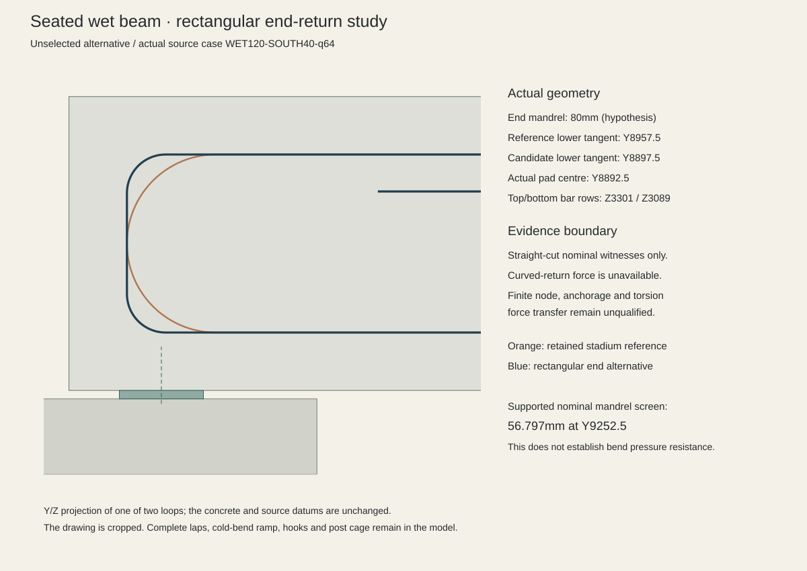

# Wet beam end — rectangular-return development

The rectangular return is worth carrying into the next finite end-region investigation. Its80mm inside mandrel is an explicit **development hypothesis**, with100mm retained as a comparison. Neither loop, relocated pad, reinforcement arrangement nor complete house is selected.

The ordinary200mm-mandrel stadium return ties its106mm centreline radius to the212mm separation of the actual Z3301/3089 strands. Its south lower tangent lies at Y8957.5, beyond the retained pad's loaded end. Two90-degree bends and a vertical return preserve those strand levels while bringing the80mm lower tangent to Y8897.5. The complete960mm laps,200mm-mandrel cold-bend ramp, both loop planes, concrete end, original posts, stair reservation and existing closed links remain unchanged. The case moves the south120×100mm pad40mm north within its actual450mm post; it does not invent new support material or extend the beam into the stair.



## Actual coupled case and geometric result

The versioned [inputs](studies/wet-beam-rectangular-return-inputs.json) identify the authored hypothesis, units, source datum, native family,32/64-point comparison and strut-angle sensitivities. The [full native archive](studies/wet-beam-end-native-captures.tar.xz) retains two genuinely executed current58-source wet27/1.35G/Q2 responses, their exact requests and complete capture manifests. All52 heads, source gravity/pressure/material wrenches and original full-response checksums pass the existing capture guard. The new bar paths do not alter that native model's bulk density or stiffness.

The actual32→64 contact comparison passes the unchanged force, centre and head criteria. Its largest52-head component change is0.0000057595kN/kNm. The actual plate cells are unchanged from the centred120mm comparison; one real beam node is added for the relocated pad. Matched64-point head components change by up to3.0931kN at P47/Fy. That consequence belongs to the receiving grid/foundation comparison and cannot be discarded because a local bar shape improves.

| Same actual64-point case |80mm end mandrel|100mm end mandrel|
|---|---:|---:|
|South lower straight tangent Y|8897.5mm|8907.5mm|
|Independent path-pair checks|28,203|28,203|
|Pair / internal closure / cover failures|0 /0 /0|0 /0 /0|
|Minimum reported adverse known-steel clearance|0.563994mm|0.563994mm|
|Minimum adverse source-solid cover|40mm|40mm|
|Complete beam-loop length|13.885177m|13.850841m|

These are geometric comparisons with the existing independent setting/fabrication and curve-interpolation bounds. They do not establish fabrication, installation or unknown existing grid-cage clearance. The80mm variant adds about0.183kg of explicit steel relative to the stadium reference. Its source24kN/m³ plain-concrete comparison gives25.006906kN of beam/post concrete plus all explicit steel, against the native wet27 bulk budget27.135608kN. Delivered concrete, wire/chairs, existing grid steel and actual coupled mass remain unqualified; the apparent reserve is not an installed-weight acceptance.

The same source case leaves the northern head near-unloaded: N0.08378kN and a gross full-compression ratio1.46509. Its southern head has N44.0733kN and ratio0.54615. Actual declared affine pressure peaks are3.844/0.329MPa south/north. Positive virtual post-fan domain reserves are[3,68]mm south and[3,108]mm north under the unchanged independent bounds. These do not supply finite post-head, pad-material or placement acceptance.

## What the force screen actually establishes

The [current proof producer](studies/wet_beam_end_development_proof.py) and [receipt](studies/wet-beam-end-development-proof.json) use each actual cut's simultaneous N, both shears, torsion and both moments. Four actual straight corner strands must exist at that physical station before the existing axial-equilibrium witness is available. Extra lap strands receive no credit. Five cuts through the return remain explicitly unsupported; their forces cannot be assigned to imaginary straight bars.

For supported straight cuts, the chosen four-corner equilibrium allocation leaves a self-equilibrating corner mode unresolved; its inherited `maximumNecessaryTieTensionKN` field is not an actual bar-force bound. A declared nominal witness adds both orthogonal per-tension-bar shear shifts and equal-corner thin-cell torsion contributions. Cotangent1 and2.5 are compared consistently. The governing nominal force comparison is15.2282kN at the actual Y9252.5 cut; its source bend-pressure comparison requires56.7973mm, alongside the48mm bar-damage comparison. The same declared strength-fraction convention gives209.078mm basic poor-bond development. These quantities do **not** determine compatible stresses or the force at the start of a curved bend. No bond reduction, node strength, local anchorage or full joint acceptance follows from them.

The first-generation comparison source is [The Concrete Centre, *Concise Eurocode2*](https://www.concretecentre.com/TCC/media/TCCMediaLibrary/Events/Online%20course/CCIP_Concise_EC2.pdf), sections7.3.4,9.2 and11.3–11.5, referring to BS EN1992-1-1:2004 and the2005 UK annex. It supplies the stated shear/torsion additions, bend-bearing relationship and basic bond comparison. The repository's17MPa concrete comparison and independent bounds remain explicit assumptions; this is not a current-code compliance claim. The maximum-moment cap on additional shear tension is deliberately uncredited.

## Exact next boundary

The unresolved task is the actual end body: recover all source floor/membrane/normal-pad/body origins on one end-region free body; develop finite compression nodes and both90-degree bend-pressure/splitting paths; establish the actual curved-bar force and available continuous anchorage; and carry both shears, torsion, reversal and pressure/roof families through that same arrangement. The present discrete cut catalogue is not a continuous envelope. Actual link/hook force transfer, placement-force perturbations and mass feedback remain absent. The current floor-corner convergence failure and whole-house ground/roof/finish coordination remain independent holds.

This result rejects neither an untested finite node nor the whole house. It shows a more compact ordinary return can fit and that the supported entry-cut comparisons do not immediately rule it out. Increasing the whole slab is not a response to the remaining local question.

Reproduce the complete geometric and nominal comparison from the retained actual bytes:

```sh
OPENBLAS_NUM_THREADS=1 OMP_NUM_THREADS=1 python3 -B project/str/studies/wet_beam_end_development_proof.py --check
python3 -B -m unittest discover -s project/str/studies -p wet_beam_rectangular_return_test.py
```

The versioned source and reusable pure method separate controls, geometry, same-case evidence and drawing. Native/source/method or authored-control changes invalidate the applicable receipt; neither a missing full capture nor a curved-return cut receives an old result or invented force. Shared saved-document admission and reversible browser mandrel edits use that same current method, with actual hosted replay required before publication.

The optional shared `floorSection.beamEndDevelopment` stage stores only `endReturnMandrelMm` and `strutCotangentComparisons`. The same native response and authored cage choices drive the Python batch method, Node compiler adapter and exact SVG; absent controls leave the existing cage unchanged. Browser-safe admission resides in `structural-wet-beam-end-settings.ts`. Changed controls recompute geometry and nominal comparisons, and stale native or method inputs yield explicit unsupported diagnostics. The adapter does not solve a second native case or feed cage mass back into the frame.
