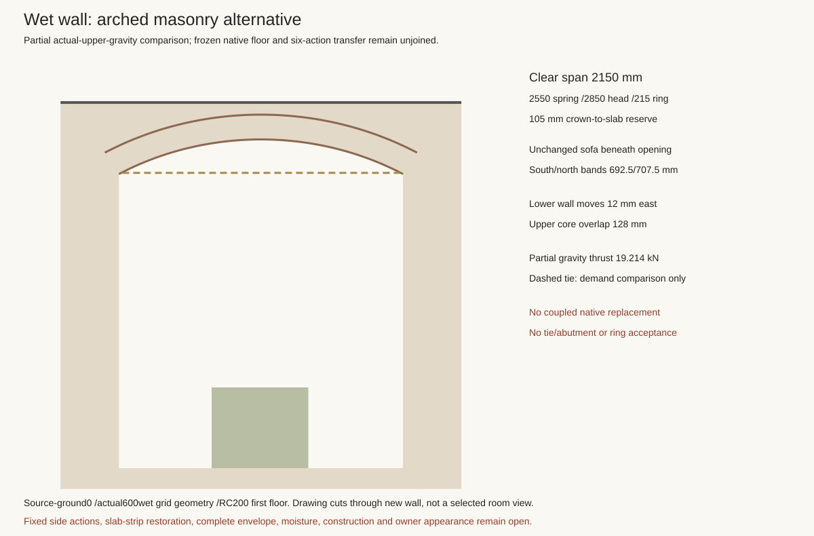

# Lower wet wall: arched masonry comparison

**Retain an arched-wall alternative as a partial mechanical hypothesis. Reject a solid wall in the present furnished living room. Do not select either replacement.** The subsequent [actual coupled elastic-frame comparison](wet-masonry-arch-native-development.md) has now run and fails necessary compression-only ring admission; the partial three-hinge result below does not override that failure. This is a partial local gravity investigation, rather than a fresh house solution or a replacement set of foundation demands.

The current upper wet wall occupies X2832.5–2972.5. A solid lower wall on that axis cuts the current family sofa over194×750mm. Its source-ground room is3851×2621mm; introducing a closed divider leaves only1281mm on its east side. That is not the same inhabited room with a harmless structural substitution.

## A specific opening and its architectural price

The new source-owned choices retain the actual internal arch controls: raw spring2550, raw crown2850, radial ring215 and27mm intrados finish. A2150mm finished opening centred atY10182.5 has2204mm raw span, jambsY9080.5/11284.5 and a3065mm ring crown,105mm below the actual RC3170 soffit. The outer ring at the spring projects toY8700.794/11664.206, inside the original combined receiver territories; this projection must be carried as masonry, rather than drawing only the visible hole.

The current sofa lies below that opening. The south/north passage bands are692.5/707.5mm, leaving92.5/107.5mm around a600mm body **before additional operating and setting allowances**. The retained west-radiator pulling body atY9450±300 has42.5mm longitudinal opening reserve. Those are limited plan checks; the whole connected room, body/hand operations, furniture renewal and appearance have not been accepted. The sofa straddles the wall plane beneath the opening: the actual inhabited comparison must show that consequence.

A strictly aligned140mm lower core plus the existing27mm finish intrudes12mm into the retained finished stair plane where the southern arch/abutment overlaps its north landing territory. The worked candidate moves only the lower core12mm east, toX2844.5–2984.5. Its west finish is then the actual stair boundaryX2817.5. The upper/lower cores overlap128mm and the upper gravity axis is12mm west of the lower centre. This is an explicit eccentric support hypothesis, **not an adopted wall shift or a complete stair-clearance pass**.

The actual600mm wet grid, stair-post, rear-W and outer-NW member-footprint union covers that complete lower core. This geometric result gives neither local grid/joint strength nor pile/soil resistance. The retained north opening, court, source stair and exterior window grid are not moved by this comparison; actual arch-junction and finished three-dimensional checks remain required.



## Actual retained load identity and partial mechanics

The [retained input](studies/wet-masonry-arch-native-input.json) is cropped from the genuinely executed `wet-aligned-concrete27-quadrature64` response, complete-file SHA256 `fd309e5901f561f56777695a7fca5e4e5fb302a3ba143f4d3ce7db35fee9b0ea`. Its full bytes remain in `evidence/convergence-native-controls-20261123`, `project/str/studies/captures/wet-pad-development-20261123.tar.xz` (archive SHA256 `2ed13dfb0b1d4ceda5e251567521e679cd72e9807641eabb22ec74a10c081691`), member `width220.full.json`. The original full response is source58; the retained input carries its exact request and all58 current native source hashes. It does not reconstruct omitted full native bytes.

Seven disjoint actual upper clear-body intersections with the existing250mm wet-beam reservation supply27.260415kN at their actual1.35G factor. Their normal first moment about the shifted lower axis is−0.327125kNm. These are the same actual material cards, not a new gross3.1m wall budget; upper-door/spandrel/sill and finish omissions remain inherited. Loads beyond the physical ring hinges go directly into the separate abutment account, rather than disappearing or being added to the arch twice.

The shared Python method reuses `masonry_frame_a._ring_witness` for the existing disjoint radial-course self-weight witnesses. The loaded215mm whole-ring comparison uses the same circular three-hinge crown-equilibrium and sampled no-tension section method as the existing north-arch investigation. It expressly assumes a full-width composite comparison section; constituent directional strength, inter-course load allocation, slip, finite nodes and physical composite action are unqualified.

Under ring, local spandrel and those actual upper clear-body cards, the partial loaded arch has about19.214kN horizontal thrust and13.213/7.455kN vertical ring-seat reactions. Sampled eccentricity reaches61.616mm, beyond the35.833mm middle-third kern but within the107.5mm half ring. The resulting2.069MPa peak is a **required** compression of that partial idealisation, not an accepted masonry resistance. Source ring-only controls and800→1600 load integration/400→800 section sampling retain measured sensitivity separately. No threshold is relaxed and no complete masonry or continuum-convergence pass is asserted.

## The tie matters

Untied abutments must transfer the actual horizontal thrust down to their bases. Even this partial gravity comparison produces in-plane base moments of approximately−51.818/+53.290kNm. The included gross below-spring pier weight and direct upper-body cards do not make those slender abutments compression-only. Unknown return-wall participation, extra self-weight and friction are not credited to rescue them.

The initialZ2500 tie comparison carries the same19.214kN horizontal demand,142.666mm below the physical mean-ring hinges. It reduces partial base moments to−0.324/+1.795kNm, but the north gross affine no-tension screen still exceeds one. A height sensitivity therefore retains2450/2500/2550/2560/2570/2600mm instead of stopping at that failed detail.

The worked **Z2560 tie hypothesis** puts its axis82.666mm below the physical mean-ring hinges. It also retains the12mm perpendicular upper-wall offset: a declared linear support-influence allocation conserves every actual upper-cardX moment, producing nominal normal moments−0.186968/−0.140157kNm at the two abutments. The allocation is an explicit statical witness; it is neither a compatible distribution nor a bound on opposing actual end couples. Combined gross biaxial no-tension ratios remain below one in both abutments at2560 and at the±10mm height probes. No physical setting/tolerance acceptance follows.

The positive tie path uses the existing north-portal component **requirements** as comparison geometry:30mm rod,40mm formed bore,150×150×15mm end plate,60×10mm washer and50×30mm nut. New bearing facesY8700/11650 give full55mm end stacks atY8645..11705, inside the actual receiver territories by17.5/32.5mm; the north stack stops32.5mm before the source weather boundary. Each150mm plate projects5mm beyond the140mm core but remains22mm inside the194mm finished wall edge. The full core cannot silently supply150mm bearing width: the reported required bearing pressure uses140×150mm **minus the40mm bore**, giving approximately0.973MPa. Nominal rod stress is27.183MPa; neither number is a resistance or product rating. The50mm exposed-envelope requirement gives an underside at2535mm.

The rod loads the two outer plates positively toward the intervening arch masonry; no friction, glue or embedded tension-development length is credited. Installation requires actual end pockets and retained east-side nut access before masonry closure, with no crossing of the north weather plane. Pocket material loss, plate bending, finite compression/splitting nodes, actual tools/grips, complete constituents, corrosion, restoration and strength remain unqualified. The gross wall quantity does not conceal these missing recess deductions. This is a complete **partial mechanical hypothesis**, not a ready-made tied arch or an accepted end detail.

The gross140mm wall from grid top−180 to soffit3170, less the actual circular opening, is0.609145m³ or12.182895kN at the authored20kN/m³. The current wet RC beam/post bodies weigh27.135608kN at their actual27kN/m³. These are **gross material comparisons**, not net house weight savings: retained-wall overlaps, restored slab strip, finish, tie hardware and changed load distribution still require exact replacement accounting.

## What must change in the actual native model

The receipt exposes an executable replacement recipe rather than calling this partial study a same-system comparison:

1. Remove the seated250×350 beam, both finite posts, normal-only pads and their material/load cards exactly once. Remove both beam boundary maps and the current RC200 strip omission.
2. Restore the actual200mm slab strip and its plate/membrane operators, G and Q; it must not inherit the350mm beam's stiffness or weight. Preserve the independent steel chord and real openings.
3. Insert the exact eccentric lower masonry geometry, actual arch/abutment constitutive and contact laws, and a declared tied or untied transfer at the existing finite600mm grid receivers. Reconcile the ordinary lower masonry previously removed in the post reservations.
4. Recover all six components of the actual floor/membrane/body/contact origins through that replacement and re-solve the52-head house. The present receipt retains the predecessor's complete beam-end action catalogue as **unreplayed evidence**: in-plane/out-of-plane forces and couples cannot be erased merely because this study examines gravity.
5. Re-prove actual stair/sofa/window operations, north weather/thermal and floor/moisture interfaces, masonry/floor support and full signed loads. The source-ground-zero result cannot silently qualify either raised-ground proposal.

## Reproduction and limits

```sh
OPENBLAS_NUM_THREADS=1 OMP_NUM_THREADS=1 python3 -B project/str/studies/wet_masonry_arch_comparison.py --check
OPENBLAS_NUM_THREADS=1 OMP_NUM_THREADS=1 python3 -B project/str/studies/wet_masonry_arch_comparison.py --check-capture /ABSOLUTE/width220.full.json --check
python3 -B -m unittest discover -s project/str/studies -p wet_masonry_arch_comparison_test.py
```

Authored dimensions and numerical controls live in the versioned choices file; the reusable `assess` method accepts explicit house, grid and retained evidence. A clear-span edit recomputes geometry, quantities and arch/abutment actions while preserving the same native evidence and unreplayed beam actions. The zero-offset adverse control exposes the stair intrusion; missing wall identities, unsupported geometry and approval injection reject. Crown-point statics and mirrored point loads supply independent analytical controls. Changed method, actual source or retained evidence invalidates the receipt. No second house source, selected material, final current-output route, construction release or owner approval is introduced. CLI/browser integration belongs with an actual coupled successor if this alternative survives its next test.
