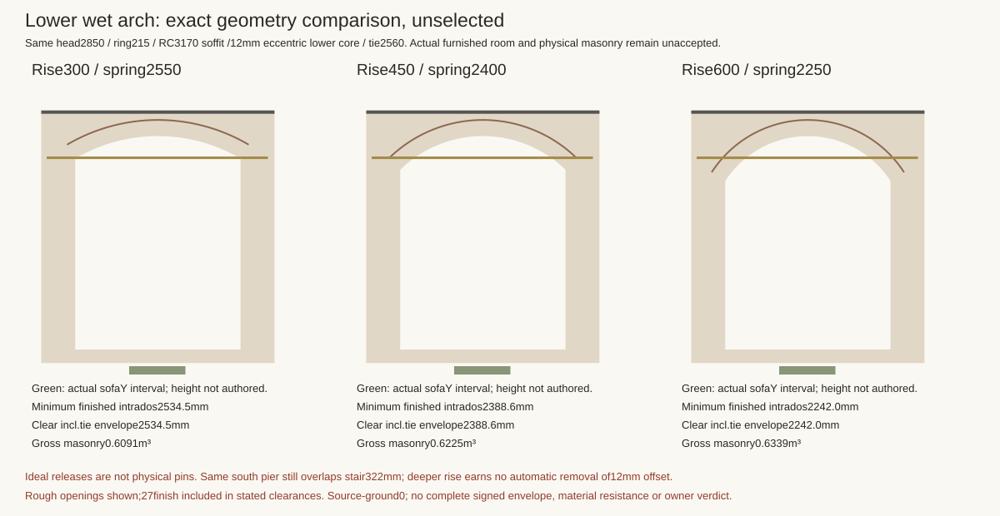

# Lower arch: actual rise and receiving-grid comparison

**Rise450 improves the1.35G/Q2 gravity response but does not earn a complete masonry candidate. Rise600 is worse in both tested load programmes and costs more headroom.** Stop increasing rise within this fixed tie/spandrel arrangement. Before more geometry, replace or justify the all-six welded pier-foot interface and trace its actual normal/contact/key demands.

Five complete native solves preserve the original v2/v3 RC200 plate/membrane laws, upper source,52 heads,140mm lower core with12mm east eccentricity, head2850,ring215,RC3170 soffit and tieZ2560. Only the new lower arch has rise450/600 and corresponding spring2400/2250. The source Plant/spine arch controls remain untouched. Full masonry, piers/spandrels, contact geometry and gross G regenerate from each actual rise; no old ring loads are superposed onto a new curve.

| Rise |1.35G/Q2 fixed ring actions: outside-section cuts | Governing eccentricity |0.9G/Q0/suction: outside-section cuts | Governing eccentricity | Gross new masonry |
|---|---:|---:|---:|---:|---:|
|300, prior released model|1|111.506mm|9|195.549mm|12.182895kN|
|450|0|82.670mm|7|245.479mm|12.449212kN|
|600|4|186.923mm|10|657.537mm|12.677425kN|

The ring half-depth is107.5mm. Every listed cut is an actual recovered action at a physical end section, not a point stress peak. All five new cases retain compressive ring axial resultants, yet several fail necessary compression confined to the215×140mm rectangle. The450 gravity affine kern ratio2.434 still requires partial contact/cracking and does not qualify a masonry stress field or material. Ideal spring/crown released moments remain negligible. None of these elastic responses supplies physical joints, directional masonry resistance, tie/bearing/splitting, grid/foundation strength or a complete signed envelope.

For every matched new-rise/control pair, the actual plate cells and holes remain identical. The joined physical G change equals the exact gross masonry change alone; the entire external source-wrench change equals that added G and its actualX/Y first moments. The source/method/runtime-bound full responses, normal contacts,52 heads, global energy/wrench and independent six-component arch free body are retained in the reproducible receipt. All applicability/current-house/acceptance boundaries remain false.



## The matched pressure test matters

The1.35G/Q2 baseline and0.9G/Q0/suction programme change three controls. Their difference cannot isolate roof pressure. A fifth **actual450-rise0.9G/Q0/null-roof solve** changes only roof pressure and case identity from its suction counterpart. Floor mesh and physical G stay identical; the actual external-wrench delta equals the separate roof-pressure source wrench to less than6e−12kN/kNm.

The null-roof case already has eight outside-section ring cuts and235.401mm controlling eccentricity, compared with seven and245.479mm under suction. The combined failure therefore originates before roof suction is applied; suction is not a sufficient explanation. The source native31 programme, reduced physicalG/Q0, elastic spandrel/ring compatibility and the all-six receiving-grid interface remain in that matched null case. No favorable null case replaces an adverse duty, and no causal attribution to a particular remaining interface is asserted without changing it and re-solving.

The proper0.9G/Q0/suction programme is inherited from `roof_surface_pressure_proof.uniform-suction` and re-solved with full gravity/contact. It is not linear superposition. The prior zeroG/Q0/suction response remains a separate diagnostic, not a preloaded design combination or rejection of gravity masonry. No new-rise zeroG capture or complete signed/code envelope is claimed.

## The bottom interface is still an ideal weld

The current mapped pier feet retain **all six** native receiving-grid displacement traces, with exact work-dual forces and couples. That makes the numerical load path real and auditable, but does not qualify a bilateral masonry/DPC/bearing weld. The southern centroid maps to`GRID/rear-W/1`; the northern maps to`GRID/wet/0`, both actual600mm wide source girders. The whole wall footprint remains covered by the original wet/stair/rear/outer receiving union.

In the450 null-roof case, the north trace has RX42.131µrad,RY−118.994µrad and vertical movement−0.006098mm. Its recovered foot Mx is1.110007kNm. The signed north boundary translation product is−2.1651e−5kNm and rotation product+4.8361e−5kNm. Under suction these become−1.9885e−5/+4.7999e−5kNm, with northRX41.327µrad/RY−130.585µrad and Mx1.113003kNm. Every component and both feet are retained. These wrench-times-displacement products are signed **boundary work diagnostics**, not causal shares or masonry strain energy.

All52 original foundation heads have ideal pinned translations and free rotations; no soil/pile stiffness or capacity is inferred. Individual head rotations were not retained in these responses. The reported foot rotations are the actual finite receiving-grid traces at the wall base, not invented head rotations and not clamps to zero.

A bounded next normal-bed comparison can separate footUZ/RX/RY from the receiving-grid trace and use finite compression-only fibres over the real140×453mm pier footprints. Tangential translation/yaw need an explicit positive key path: silently freeing them creates rigid modes, while silently retaining them as friction invents a material law. An ideal no-slip key comparison may report actual requiredFx/Fy/Mz with geometry/resistance still unsupported; it must not be promoted to an installed DPC/key detail. Source grid rotations, all material/source wrenches, finite receiver coverage and six rigid-motion work must survive the test. Any actual normal-bed opening/tension, key demand, contact/refinement or unclosed load path must remain visible.

## Architectural costs and ownership

Minimum actual finished intrados falls from2534.491 to2388.599/2241.991mm. The unchanged exposed tie envelope has underside2535mm and spans the opening. At2250mm hypothetical body height, the600rise's true finished width is2139.425mm rather than the nominal2150; neither figure is a carrying/installation pass. Body-height width probes, radiator pull band, sofa interval, actual quantities and geometry are explicit in the receipt.

The source2680 service packet applies to other Plant/spine arches. The protected-route2250 assembly duty does not automatically validate or reject this new living divider; its real operations and connected routes must be coordinated. The binding actual protected stair plane remains: the same south solid pier overlaps it over322mm, so neither deeper rise removes the12mm eccentricity. The sofa, room/headroom, finishing, actual renewal/tool paths, north weather and raised-ground alternatives still need owner-reviewable house integration. No source floor, opening, service, crafted study room or owner aesthetic acceptance is changed by this experimental study.

```sh
OPENBLAS_NUM_THREADS=1 OMP_NUM_THREADS=1 python3 -B project/str/studies/wet_masonry_arch_rise_proof.py --check
python3 -B -m unittest discover -s project/str/studies -p wet_masonry_arch_rise_test.py
```

The shared pure geometry helper and exact request producer drive the same native CLI path used for the captures. The proof authenticates all bytes/current inputs, changes and unchanged controls, then regenerates the technical receipt and comparison figure without executing a solve. Changed methods, source or requests invalidate the evidence. Browser/current-house admission remains unsupported; no separate selected house, accepted physical masonry joint or construction release is introduced.
