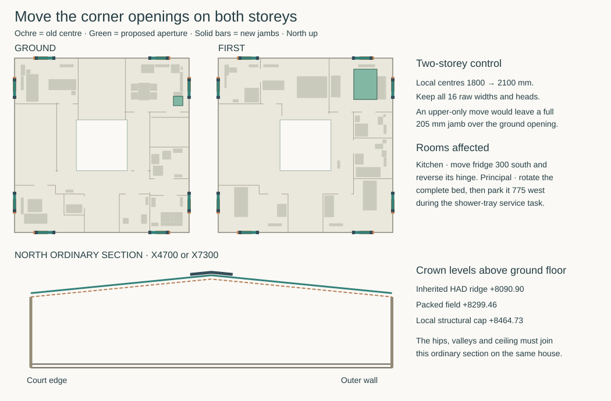

# Whole-house structural disposition

**The supplied pitched courtyard house requires architectural redesign. Close STR-HOUSE on that documented failure.** Its corner arches cannot be released or left unsupported in the inhabited envelope. Its ordinary north crown cannot keep the inherited roof outline and the proposed structural joint in the same space. The next house drawing should move both storeys’ corner apertures towards the centres of their elevations, give each inner arch two continuous jambs, and carry the packed roof field and local raised north cap. This is a design instruction for the shared rewind. The accepted house and the HAD water source have not been revised. [STR-HOUSE exit](structural-architecture-programme.md#str-house--test-the-structure-and-the-inhabited-plan-together) · [shared design authority](../triad-interface-contract.md) · [source-derived plan and calculations](studies/house-corner-rewind.py)

## Why the present combination fails

The roof reactions already bypass the eight corner arches. The arch still carries its own weight, spandrel, local ceiling and window/guard actions, and follows the movements of its supports. In the same signed NE house case, the existing east seat develops **12.64 kN tension** at one edge. Its full-width pin hits the end link, its short pin lacks a withdrawal path and the four continuous H16 bars prevent the assumed free rotation. At rear west the Ø24 pin projects 6.85 mm into the cabinet footprint in plan. The soil stack also crosses the spring elevation. Cabinet height alone cannot resolve the structural conflict. [Pivot, cage and rear-west access](corner-arch-separated-end.md)

Dropping the near restraint altogether does not work. The refined calculation closes the end face by 5.01–14.05 mm east and 15.45–23.49 mm north. Wall-normal excursions are 124.83 and 86.34 mm against a remaining insulation layer only 70 mm deep. A three-rotation seat with translations held retains tangential forces of 4.85 and 3.29 kN. Available normal compression would require friction ratios of 6.04 and 1.27. The east knee torsion rises from −0.73 to −3.60 kNm. An unlocated pin, friction seat or access hole through the cage cannot establish that load path.

The first-floor plate, stair opening, court entrance, void and roof can keep their current plan positions. The corner supports and roof section cannot. This is the permanent conflict that triggers the programme exit. The short east staff platform, individual bar diameters, the eventual plot and external engineering review are separate decisions. [House, roof, floor and ground load paths](current-house-structural-reference.md) · [HAD north/east water architecture](../had/studies/water-replan.json)

## Redraw the corners on both levels

On each of the four outside faces, move its 1000 mm corner openings from local station **1800 to 2100** and **10200 to 9900**, on both floors. Preserve existing sills, crowns, room-side wall faces and the genuine independent brick arches. All sixteen bays keep their raw areas. The eight moved openings total 15.410 m² on ground and 15.910 m² on the first floor. Shifting a window changes light distribution, oblique views and opening operation even at equal area. Keep the non-corner bedroom windows, including Bed 2 South3900, Bed 3 South8100 and Bed 4 North3700. Keep all four bedrooms, the three upstairs sanitary rooms, ground WC, protected stair/front exit, independent water paths and 450 mm bridges. The proposed room-side footprint changes by **0 m²** on this setout. The floor-area table for the historical B model is not a measured area of this redesign.

At each end the proposed near 205 mm jamb fills local **1395–1600**, the far jamb **2600–2805**. Its 180 mm wall-normal depth is allocated outward from the existing room-side core face, retaining the 27 mm inner finish. Relative to an ordinary 140 mm core that takes 40 mm of the external zone locally. MAT must carry the reduced insulation continuously around both storeys and the reveals. The old L toe ends at 1262.5, leaving 132.5 mm to the new inner jamb and 107.5 mm after reserving a 25 mm separation. Moving the upper opening alone would place the *entire* 205 mm jamb over the unchanged ground opening. The matching two-storey change restores a direct vertical path and leaves at least 477.79 mm to the nearest original roof station, before bearing/fixture widths. [Jamb and roof stations](studies/current-house-arch-jambs.json) · [existing corner toe](studies/current-house-arch-movement.json)

Carry the upper arch and spandrel into its two jambs and through the aligned ground jambs. Tie the horizontal reactions through the first-floor RC edge and the ground perimeter girder; retain diaphragm connection for out-of-plane stability and keep the original L-piers in the primary roof and stability system. Do not also apply the former arch reaction at the L spring. The new near jambs alone account for **40.30 kN gross** across both floors before deducting displaced masonry. The study distributes this illustrative weight through the actual pairs of existing girder heads with exact vertical-force and along-wall first-moment conservation. It does not transfer the old tension, shear, torsion or 96-programme wind register into a frame with different restraints. Construction needs a separated near jamb, a continuous load path while each outer masonry arch is centred, and a new room-side reaction/renewal detail before depropping. No new soil capacity or price is assumed. [Per-head trace and all sixteen stations](studies/house-corner-rewind.json)

### Two rooms which defeat a window-only edit

| Occupied change | Source-bound result |
|---|---|
| Principal bedroom | Translating the east high-hand grip 300 mm without reorienting the bed needs at least **210.4 mm** of southward bed movement to get any 600 mm body within 600 mm reach. The existing 664 mm passage has only **14 mm** to spare after the source’s 50 mm loss. Turn the entire 1600 × 2090 mm bed onto a north–south axis at X9315/Y9150 and keep the existing west wardrobe. The new east strip is 655.5 mm. The east grip is 327.8 mm from its operator. Both north windows have distinct reachable positions, including 588.0 mm to the moved North9900 low grip. The bedroom paths join the existing principal-shower approach at X10400/Y8825. During tray service move the bed 775 mm west. It clears the padded tray stage by 35 mm and the wardrobe by 130.5 mm. Window operation uses the ordinary bed position. |
| Ground kitchen | The new east opening at Y9400 would overlap the existing refrigerator’s plan projection by **275 mm**. Move the 650-square body 300 mm south to X10920.5/Y8725 and change to the north hinge at Y9375. That preserves the original 25 mm gap to the rough window. The continuous 90° movement retains at least 44.6 mm body and 54.4 mm forearm clearance from the fixed furniture. Against the moving leaf itself the respective lower bounds are 10 and 20 mm. The existing four dining places and plant separation remain. Kitchen North9900 has its own operating point. |

The same calculation checks the shifted ground study south/west handles and living north handle. The study drawing does not establish daylight factors, compliant escape openings, product forces, frame renewal or a clear site drop. The NW first-floor north opening formerly called North1800 becomes North2100 in this proposed successor. Retire its old *location* as a possible export datum. OAS already rejected using that frame, hardware and guard to export the rear tray. Keep ordinary glazing, purge and renewal duties at the new opening and carry IAS’s separate internal stair/sectional-tray comparison. [Principal shower entry](../ias/ias-03-principal-shower-entry.md) · [north export decision](../oas/north-export-occurrence-result.md) · [IAS renewal reset](../ias/ias-03-stair-renewal-reset.md)

### Structural and weather interfaces that require the rewind

Moving the old temporary barrier with the window puts its near M12 socket at local **1280**, beyond the existing RC toe at 1262.5 and 115 mm before the new jamb face. The assumed structural backing has disappeared. The successor should place both rows, local Z950 and 1270, on the new jamb centre lines **1497.5 and 2702.5**. Each then has 102.5 mm nominal centre-to-edge. At rear west the near receiver is 297.5 mm away from the full-height cabinet footprint. The low box still occupies this plan, so bind its top and working clearance, or revise the enclosure, before relying on the sockets. At rear north the far jamb reaches X2805, just 0.5 mm from the wet-room partition face at X2805.5. Develop that return in the joined wall section. The present crosspin/cage, guard shoes and window handling rig do not inherit a pass in these new jambs. [Existing barrier and frame draws](studies/current-house-window-renewal.json)

For the ordinary north frames at X4700 and 7300 retain the 25° pitched roof, the existing collector/pivot elevation and the RC200 floor. The HAD section's original eave/ridge is +7100/+8090.90. The packed structural field needs **+7308.55/+8299.46** and the raised local cap finishes at **+8464.73**, 373.83 mm above the former ridge. The lower uninterrupted alternative puts both opposed rafter force paths through the ridge tube webs. Raising the local cap protects the occupied upper ceiling and its separate service volume without lowering that member. Continue the cap’s ventilation and weather lines physically through the hips/valleys and around the court, and draw the resulting elevations. The ordinary north section cannot set unspecified corner weather details. [North ridge and working joint](current-house-structural-reference.md#can-the-lower-ridge-member-keep-the-existing-crown-joint) · [roof layers and air paths](../mat/ordinary-eave-joined.md)

**Handoff to STR-RECONCILE.** Carry the adverse selection result, not a construction release. HAD/STR must return the changed openings, furniture, elevations, first-floor edge and two-storey portal/old-L separation to one actual candidate source. Re-solve the simultaneous roof/floor/guard/foundation actions with those constraints, locate the new socket/cage and the rear wet low-box access, and check thermal, weather, frame, site and room renewal as their owners’ shared interfaces. If the coupled load or occupied return cannot be provided, change the room or support arrangement before adopting the candidate. The later BCR/OAS/BAY evidence review, EPR, site investigation and member schedules retain their own authority. [Programme reconciliation exit](structural-architecture-programme.md#str-reconcile--candidate-handoff-and-affected-evidence-review)
